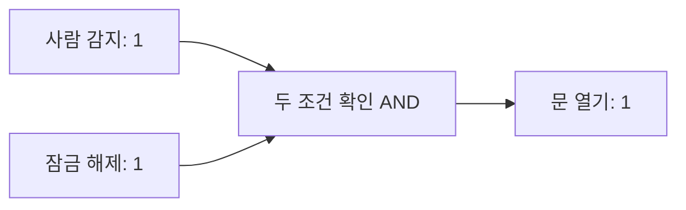

<!-- level:1 -->
# 트랜지스터와 논리회로 — 작은 스위치로 판단하기

> **한 문장으로:** 컴퓨터는 전기 신호를 조합해 ‘두 조건이 모두 맞는가?’ 같은 간단한 판단을 반복합니다.

## 왜 필요한가요?

계산기에서 2+3을 누르면 화면에 5가 나옵니다. 이 판단과 계산을 실제로 수행할 작은 전기 장치가 필요합니다. 그 출발점이 트랜지스터와 논리회로입니다.

## 일상에서 떠올려 보기

자동문이 ‘사람이 있음’과 ‘문이 잠기지 않음’을 함께 확인한다고 생각해 보세요. 두 조건이 모두 맞아야 문이 열립니다. 컴퓨터의 AND 규칙도 입력 두 개가 모두 1일 때만 결과를 1로 만듭니다. 트랜지스터는 이런 규칙을 구현하는 회로의 작은 부품입니다.

## 순서대로 따라가기

1. 전기 신호의 낮은 상태와 높은 상태를 0과 1로 구분합니다.
2. AND는 둘 다 1인지, OR는 하나라도 1인지, NOT은 반대 상태가 무엇인지 판단합니다.
3. 이런 규칙을 여러 개 연결하면 숫자를 더하고 결과를 저장하는 회로를 만들 수 있습니다.



## 작은 예로 확인하기

AND에 1과 1을 넣으면 1이 나옵니다. 1과 0을 넣으면 0이 나옵니다. OR에 1과 0을 넣으면 1이 나옵니다. NOT에 1을 넣으면 0이 나옵니다. 네 가지 입력 조합을 적어 두면 계산 규칙을 한눈에 확인할 수 있습니다.

## 처음 만나는 용어

| 용어 | 쉬운 뜻 |
|---|---|
| 트랜지스터 | 전기 신호로 전류 흐름을 제어하는 작은 부품입니다. |
| 비트 | 0 또는 1 중 하나를 나타내는 정보 단위입니다. |
| 논리 게이트 | 입력의 0과 1을 정해진 규칙으로 조합하는 회로입니다. |
| 진리표 | 입력 조합마다 어떤 결과가 나오는지 적은 표입니다. |

**비유의 한계:** 실제 부품은 기계식 문처럼 즉시 움직이지 않습니다. 전압에는 허용 범위가 있고 변화에는 시간이 걸립니다. 0과 1은 이 상태를 다루기 쉽게 붙인 이름입니다.

## 스스로 확인

두 조건 중 하나만 맞았는데 결과가 1입니다. AND와 OR 중 어느 규칙에 가까울까요?

**답과 이유:** OR입니다. OR는 하나라도 맞으면 1이고, AND는 두 조건이 모두 맞아야 1입니다.
<!-- level:2 -->
# CMOS에서 불리언 연산까지

<!-- beginner-guide:start -->
## 읽기 전 길잡이

먼저 입력이 바뀌면 출력도 바뀐다는 흐름을 보세요. 아래 코드는 전기 회로를 만드는 코드가 아니라 AND와 XOR의 계산 규칙을 확인하는 예제입니다. sum은 현재 자리의 결과, carry는 다음 자리로 넘기는 수입니다.

## 이 단계에서 만날 말

| 용어 | 쉬운 뜻 |
|---|---|
| CMOS | 서로 다른 성질의 트랜지스터를 짝지어 만든 회로 방식입니다. |
| pMOS·nMOS | CMOS에서 서로 보완하는 역할을 하는 트랜지스터 종류입니다. |
| NAND | AND 결과를 반대로 뒤집는 규칙입니다. |
| XOR | 두 입력이 서로 다를 때 1이 되는 규칙입니다. |
| 클록 | 값을 언제 저장하고 다음 일을 시작할지 맞추는 반복 신호입니다. |
| 플립플롭 | 비트 상태를 저장하는 회로입니다. |
| 전파 지연 | 입력 변화가 출력에 도달하는 데 걸리는 시간입니다. |
| 팬아웃 | 한 출력에 연결된 다음 입력의 수입니다. |

<!-- beginner-guide:end -->

현대 디지털 칩의 기본 회로인 CMOS 인버터에는 보통 pMOS와 nMOS가 한 쌍으로 들어갑니다. 입력이 낮을 때 pMOS 경로가 출력을 전원 쪽으로 끌어올리고, 입력이 높을 때 nMOS 경로가 접지 쪽으로 끌어내립니다. 따라서 출력은 입력의 반대가 됩니다. 실제 전압은 0/1이라는 숫자가 아니라 허용 범위가 있는 아날로그 값입니다.

NAND 게이트는 nMOS 두 개를 직렬로, pMOS 두 개를 병렬로 배치해 두 입력이 모두 높을 때만 출력을 낮춥니다. NAND만으로도 다른 불리언 연산을 구성할 수 있습니다. 여러 게이트를 조합하면 반가산기의 합(`A XOR B`)과 자리올림(`A AND B`)을 만들고, 이것을 이어 다비트 덧셈기를 구성합니다.

```typescript
// 회로를 재현하는 코드가 아니라 진리표를 검산하는 논리 모델입니다.
function halfAdder(a: 0 | 1, b: 0 | 1) {
  return { sum: (a ^ b) as 0 | 1, carry: (a & b) as 0 | 1 };
}
for (const a of [0, 1] as const) {
  for (const b of [0, 1] as const) console.log(a, b, halfAdder(a, b));
}
```

CPU가 명령을 실행할 때 레지스터의 비트가 조합회로 입력으로 전달되고, 게이트의 출력이 다음 단계로 전파됩니다. 각 게이트에는 **전파 지연**이 있어 가장 느린 경로가 클록 주기의 하한을 정합니다. 배선 길이, 팬아웃(하나의 출력이 구동하는 입력 수), 전압, 온도도 지연에 영향을 줍니다. 클록 경계의 플립플롭은 입력이 **셋업/홀드 시간**을 만족해야 안정적으로 값을 저장합니다.
<!-- level:3 -->
# 값은 맞는데 가끔 틀리는 회로를 찾는 법

<!-- beginner-guide:start -->
## 읽기 전 길잡이

여기서는 규칙은 맞지만 전기 신호가 제시간에 도착하지 않는 상황을 봅니다. 가상 보고서의 Required는 마감 시간, Arrival은 실제 도착 시간입니다. 도착이 늦으면 저장 시점을 놓칠 수 있습니다.

<!-- beginner-guide:end -->

조합회로에서 두 입력이 동시에 바뀌어도 각 경로의 지연은 같지 않습니다. 짧은 순간 예상하지 못한 출력이 나타나는 **글리치**가 생길 수 있습니다. 동기식 설계에서는 다음 플립플롭이 안정된 시점에 샘플링하도록 타이밍을 맞춥니다. 다른 클록 도메인의 신호를 그대로 읽으면 **메타안정성** 위험도 있습니다.

아래는 실제 제품 로그가 아닌, 정적 타이밍 분석 보고서의 **가상 예시**입니다.

```text
Startpoint: input_register/Q
Endpoint:   output_register/D
Required:   2.00 ns
Arrival:    2.18 ns
Slack:     -0.18 ns  (VIOLATED)
```

진단 순서는 다음과 같습니다.

1. 실패 경로의 시작·끝 레지스터와 클록 제약이 의도한 것인지 확인합니다. 잘못된 제약을 코드 버그로 오인하면 안 됩니다.
2. 경로를 게이트 지연과 배선 지연으로 나눕니다. 파형 시뮬레이션과 실제 타이밍 분석 결과를 비교하고, 전압·온도·공정의 최악 조건도 살핍니다.
3. 논리 단계가 길면 파이프라인 레지스터를 추가하거나 식을 재구성합니다. 팬아웃·배선이 원인이면 버퍼와 배치를 조정합니다. 변경 후 전체 경로와 기능 테스트를 다시 실행합니다.

비동기 외부 입력이라면 두 단계 동기화 플립플롭을 검토하되, 이것은 단일 비트의 메타안정성 전파 확률을 낮추는 기법입니다. 여러 비트의 일관된 전달에는 핸드셰이크나 비동기 FIFO 같은 별도 설계가 필요합니다. 임의로 클록을 낮춰 증상을 숨기기 전에 실패 조건과 재현 가능한 파형을 확보하세요.
<!-- level:4 -->
# 같은 판단을 어디에서 구현할까?

<!-- beginner-guide:start -->
## 읽기 전 길잡이

같은 계산도 일반 컴퓨터에서 실행하거나 전용 칩에 넣을 수 있습니다. ASIC은 고정한 기능에 맞춘 칩, FPGA는 회로 연결을 나중에 바꿀 수 있는 장치입니다. 속도뿐 아니라 변경 가능성과 제작 비용도 비교하세요.

<!-- beginner-guide:end -->

연산을 전용 회로에 넣을지, 재구성 가능한 하드웨어에 넣을지, 소프트웨어로 계산할지는 제품 규모와 변경 가능성에 따라 달라집니다.

| 선택 | 장점 | 비용과 제약 | 알맞은 상황 |
|---|---|---|---|
| ASIC 표준 셀 | 대량 생산 시 높은 성능·전력 효율과 집적도 | 설계·검증·마스크 초기 비용, 출시 후 수정 어려움 | 물량이 크고 알고리즘이 안정적일 때 |
| FPGA | 배포 후 논리 재구성 가능, 하드웨어 병렬성 | ASIC보다 일반적으로 면적·전력·단가 부담 | 프로토타입이나 변경이 잦은 저지연 처리 |
| CPU 소프트웨어 | 개발·배포·관찰이 쉽고 유연함 | 명령 실행·메모리 접근 오버헤드 | 처리량이 충분하고 요구가 자주 바뀔 때 |

‘회로가 빠르다’만으로 선택하지 않습니다. 목표 지연 시간, 처리량, 소비 전력, 생산 수량, 수정 비용, 검증 인력, 장애 시 복구 경로를 함께 계산합니다. 예를 들어 패킷 필터의 규칙이 매일 달라진다면 고정 ASIC보다 소프트웨어나 FPGA가 운영에 유리할 수 있습니다. 반대로 대량 생산 칩의 반복되는 핵심 연산은 전용 논리의 비용을 회수할 수 있습니다.

회로 수준의 결정도 트레이드오프입니다. 더 깊은 파이프라인은 클록 주파수를 높일 수 있지만 지연 단계와 제어 복잡도가 늘어납니다. 게이트를 복제해 팬아웃을 낮추면 속도는 나아질 수 있지만 면적과 전력은 증가합니다. 설계 결정은 대표 워크로드와 최악 조건의 타이밍·전력·면적 측정으로 검증해야 합니다.
