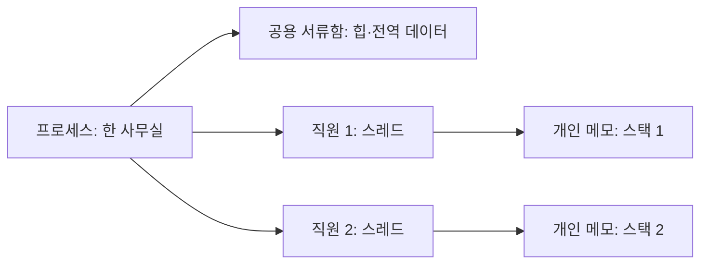

<!-- level:1 -->
# 프로세스와 스레드 — 작업 공간과 그 안의 작업자

> **한 문장으로:** 프로세스는 실행 중인 프로그램의 작업 공간이고, 스레드는 그 안에서 일을 진행하는 흐름입니다.

## 왜 필요한가요?

브라우저에서 화면을 그리는 동안 다운로드도 진행되길 원합니다. 여러 일을 진행하면서 데이터를 공유할지, 오류가 퍼지지 않도록 공간을 나눌지 정해야 합니다.

## 일상에서 떠올려 보기

한 회사의 사무실을 프로세스, 그 안의 직원들을 스레드로 생각해 보세요. 직원들은 공용 서류함을 함께 쓰지만 각자 개인 메모장을 갖습니다. 다른 회사의 사무실과는 서류를 주고받는 별도 방법이 필요합니다.

## 순서대로 따라가기

1. 프로그램을 실행하면 운영체제가 그 프로그램의 메모리와 자원을 마련합니다.
2. 그 안의 스레드가 명령을 따라 작업합니다. 여러 스레드는 같은 데이터 일부를 공유합니다.
3. 공유하는 데이터를 동시에 바꿀 때는 순서와 규칙을 정합니다. 프로세스를 나누면 데이터 교환 방법을 따로 준비합니다.



## 작은 예로 확인하기

한 직원이 재고 1개를 확인하고 다른 직원도 같은 재고 1개를 확인했습니다. 두 직원이 각각 판매하면 마지막 1개를 두 번 팔 수 있습니다. 함께 쓰는 데이터에는 ‘확인과 차감을 한 사람이 끝낼 때까지 기다리기’ 같은 규칙이 필요합니다.

## 처음 만나는 용어

| 용어 | 쉬운 뜻 |
|---|---|
| 운영체제(OS) | 프로그램 실행과 CPU·메모리·파일 사용을 관리하는 기본 소프트웨어입니다. |
| 프로세스 | 실행 중인 프로그램에 마련된 작업 공간과 자원의 단위입니다. |
| 스레드 | 프로세스 안에서 명령을 실행하는 작업 흐름입니다. |
| 힙·스택 | 힙은 여러 객체를 담는 공간이고, 스택은 함수 실행 중 필요한 기록을 담는 공간입니다. |

**비유의 한계:** 스레드의 개인 스택도 같은 프로세스의 메모리 안에 있습니다. 개인 메모라는 비유가 보안 장벽을 뜻하지는 않습니다. CPU가 하나면 여러 작업을 번갈아 진행할 수 있어도 동시에 계산하지는 못할 수 있습니다.

## 스스로 확인

같은 프로세스의 두 스레드가 함께 쓰는 서류함과 각자 갖는 메모장은 무엇에 해당할까요?

**답과 이유:** 공용 서류함은 힙과 전역 데이터, 개인 메모장은 스레드마다 마련된 스택에 해당합니다.
<!-- level:2 -->
# Level 2 — OS 내부 동작과 메모리 구조

<!-- beginner-guide:start -->
## 읽기 전 길잡이

먼저 프로그램 파일과 실행 중인 프로세스를 구분하세요. 아래 C 예제는 작업 스레드를 하나 만들고, 그 작업이 끝날 때까지 기다립니다. pthread_join이 기다려 주기 때문에 전달한 값이 사라지기 전에 작업이 끝난다는 점을 보세요.

## 이 단계에서 만날 말

| 용어 | 쉬운 뜻 |
|---|---|
| 커널 | 운영체제에서 하드웨어와 자원을 직접 관리하는 핵심 부분입니다. |
| 주소 공간 | 프로그램이 메모리 위치를 표현하고 접근하는 범위입니다. |
| 파일 기술자 | 열린 파일이나 연결을 가리키는 운영체제의 식별 번호입니다. |
| 동시성·병렬성 | 여러 작업의 진행이 겹치는 것과 실제 같은 순간 여러 작업을 실행하는 것입니다. |
| 뮤텍스 | 공유 데이터를 한 작업자씩 다루게 하는 잠금 도구입니다. |
| 원자 연산 | 다른 작업이 중간에 끼어들 수 없게 보장된 한 연산입니다. |
| IPC | 프로세스 사이에서 데이터를 주고받는 방법입니다. |
| 직렬화 | 데이터를 저장·전송할 수 있는 형식으로 바꾸는 것입니다. |

<!-- beginner-guide:end -->

프로그램 파일은 디스크의 정적인 명령·데이터다. 실행하면 커널이 프로세스 식별자, 가상 주소 공간, 열린 파일 기술자, 권한, 스케줄링 정보를 마련한다. 주소 공간에는 코드, 읽기 전용 데이터, 전역 데이터, 힙, 각 스레드의 스택과 메모리 매핑 영역이 포함된다. 스레드는 그 안에서 프로그램 카운터와 레지스터 집합, 스택, 스케줄링 상태를 가진 실행 흐름이다.

Linux에서는 스레드도 스케줄러가 다루는 태스크다. 같은 스레드 그룹의 태스크는 `clone` 계열 플래그에 따라 주소 공간과 파일 기술자 테이블 등을 공유한다. 공유와 독립은 항목별로 따져야 한다. 예를 들어 스택은 스레드마다 별도지만 같은 주소 공간에 놓여 있으므로 잘못된 포인터를 가진 다른 스레드가 그 스택을 손상시킬 수 있다. 프로세스 사이에서는 일반적으로 페이지 테이블이 분리되지만 공유 메모리 매핑을 명시적으로 만들 수도 있다.

CPU 코어가 스레드를 실행할 때 해당 스레드의 레지스터 상태를 적재한다. 실행 가능한 스레드가 코어보다 많으면 스케줄러가 번갈아 실행한다. **동시성**은 작업 진행 구간이 겹치는 성질이고, **병렬성**은 여러 코어에서 같은 순간 명령이 실행되는 성질이다. 스레드가 많다고 CPU 병렬 속도가 자동으로 증가하지 않는다.

```c
#include <pthread.h>
#include <stdio.h>

static void *worker(void *arg) {
    int *shared = arg;          // 같은 프로세스의 힙/전역 주소에 접근 가능
    printf("value=%d\n", *shared);
    return NULL;
}

int main(void) {
    int value = 42;
    pthread_t thread;
    if (pthread_create(&thread, NULL, worker, &value) != 0) return 1;
    if (pthread_join(thread, NULL) != 0) return 1;
    return 0;
}
```

이 예제에서 `value`는 메인 스레드의 스택에 있지만 `pthread_join`으로 메인 함수가 끝나기 전 작업 스레드를 기다리므로 주소의 수명이 유지된다. `join` 없이 함수를 반환하거나, 수명이 끝난 지역 변수의 주소를 넘기면 위험하다. 같은 프로세스에서 공유된다는 사실만으로 접근이 항상 안전해지는 것도 아니다.

**확인:** 각 스레드의 스택이 따로 있는데도 한 스레드가 다른 스레드의 스택을 손상시킬 수 있는 이유를 설명해 보자.
<!-- level:3 -->
# Level 3 — 동시성 버그와 디버깅

<!-- beginner-guide:start -->
## 읽기 전 길잡이

두 작업자가 같은 숫자를 읽고 각각 1을 더했는데 결과가 한 번만 증가하는 상황을 생각해 보세요. 읽기·더하기·쓰기가 서로 끼어들기 때문입니다. 먼저 어떤 데이터를 공유하는지 찾고 그 전체 작업을 보호하는 순서로 읽으세요.

<!-- beginner-guide:end -->

대표적인 실패는 **데이터 레이스**다. 두 스레드가 같은 메모리 위치에 동기화 없이 접근하고, 적어도 하나가 쓰면 실행 순서에 따라 결과가 달라진다. `counter++`는 읽기·더하기·쓰기의 여러 단계이므로 두 스레드가 같은 옛 값을 읽으면 증가분 하나가 사라진다. C/C++의 데이터 레이스는 단순한 값 누락을 넘어 정의되지 않은 동작이다.

```c
// 잘못된 예: 여러 스레드가 counter++를 실행
long counter = 0;

// 수정 예 1: C11 원자 연산
#include <stdatomic.h>
atomic_long safe_counter = 0;
atomic_fetch_add_explicit(&safe_counter, 1, memory_order_relaxed);
```

카운터처럼 다른 데이터와 불변식을 묶지 않아도 될 때는 원자 연산이 적합하다. 계좌 잔액과 거래 내역처럼 여러 값을 함께 바꿔야 하면 뮤텍스로 임계 구역을 보호한다. `volatile`은 스레드 동기화의 대체물이 아니다. 잠금이 항상 빠른 것도 아니다. 경합이 심하면 스레드가 잠들거나 계속 재시도하며 지연이 커진다.

실전 진단 순서:

1. **재현:** 입력, 스레드 수, 코어 수, 부하 조건을 기록하고 실패를 반복한다.
2. **계측:** C/C++은 ThreadSanitizer(`-fsanitize=thread`)로 경쟁 접근을 찾고, 프로덕션에서는 오류율·대기 시간·잠금 경합을 측정한다. 계측 자체가 타이밍을 바꿀 수 있다.
3. **상태 확인:** 스레드 덤프나 `gdb`의 `thread apply all bt`로 각 스레드가 실행 중인지, 잠금·I/O 대기 중인지 본다.
4. **원인 분류:** 데이터 레이스, 교착상태, 기아, 유실된 깨움, 이미 해제된 메모리 접근을 구분한다. 교착상태라면 잠금 획득 순서를 일관되게 만들고, 조건 변수라면 조건을 `while`로 다시 검사한다.
5. **수정 검증:** 불변식을 명시하고 재현 테스트, 스트레스 테스트, 성능 회귀를 함께 확인한다.

예를 들어 A 스레드는 `users_lock → orders_lock`, B 스레드는 `orders_lock → users_lock` 순서로 잡으면 서로 기다릴 수 있다. 모든 경로가 같은 순서로 잠금을 잡도록 고치거나, 데이터 소유권을 한 작업자에게 모아 공유를 줄인다. 락 순서 수정이 어려우면 제한 시간과 실패 복구도 설계하되, 타임아웃만으로 무결성 문제가 해결되지는 않는다.

**확인:** 원자 카운터로 충분한 상황과 여러 값에 대한 뮤텍스가 필요한 상황을 각각 하나씩 들어 보자.
<!-- level:4 -->
# Level 4 — 멀티프로세스와 멀티스레드의 설계 선택

<!-- beginner-guide:start -->
## 읽기 전 길잡이

작업 공간을 나누면 오류 전파를 줄이기 쉽고, 함께 쓰면 데이터 교환이 쉬울 수 있습니다. 어떤 데이터가 오가는지, 한 작업이 실패하면 다른 작업도 멈춰도 되는지를 먼저 정한 뒤 비교표를 보세요.

<!-- beginner-guide:end -->

| 기준 | 여러 프로세스 | 한 프로세스의 여러 스레드 |
|---|---|---|
| 장애 격리 | 주소 공간 분리로 메모리 손상의 전파를 제한 | 한 스레드의 잘못된 포인터가 전체 프로세스를 종료시킬 수 있음 |
| 데이터 교환 | IPC, 소켓, 공유 메모리 등 명시적 경계와 직렬화 비용 | 힙 공유가 쉬우나 동기화·소유권 설계 필요 |
| 자원 비용 | 프로세스별 페이지 테이블·파일 상태 등 관리 비용 | 주소 공간 공유로 상대적으로 가벼움. 스택·스케줄링 비용은 여전히 존재 |
| 보안 경계 | 별도 권한·샌드박스 구성에 유리 | 같은 권한과 주소 공간을 공유하므로 격리 수단으로 부적합 |
| 운영 | 독립 재시작·배포·자원 제한이 쉬움 | 프로세스 내부 작업 큐와 스레드 풀 조정이 중요 |

의사결정은 **작업 특성, 격리 요구, 통신량, 실패 복구** 순서로 한다. 서로 신뢰하지 않는 플러그인이나 사용자 코드는 별도 프로세스 또는 더 강한 샌드박스에 두는 편이 안전하다. 작은 공유 상태를 아주 자주 갱신하는 CPU 작업은 스레드와 분할된 데이터 구조가 유리할 수 있다. 독립 작업을 서비스 간에 분리하면 프로세스 경계가 복구와 운영 책임을 명확히 한다. 실제 비용은 워크로드로 측정해야 한다.

CPU 사용률이 높은 작업은 코어 수, 스레드 풀 크기, 작업 분할과 캐시 경합을 함께 본다. I/O 중심 작업은 스레드 수를 무한히 늘리기보다 비동기 I/O·백프레셔·연결 풀을 비교한다. 언어 런타임도 중요하다. 예를 들어 CPython의 일반적인 GIL 환경에서는 CPU 중심 Python 바이트코드에 스레드를 늘린다고 여러 코어를 모두 활용하지 못할 수 있지만, I/O 대기나 GIL을 해제하는 네이티브 코드는 별개다. 런타임과 버전을 확인한다.

**선택 예시:** 이미지 변환처럼 독립적이며 CPU 중심인 작업은 제한된 수의 워커 프로세스와 큐를 출발점으로 삼는다. 각 작업의 데이터가 크고 공유가 빈번하다면 직렬화 비용을 측정한 뒤 스레드 풀 또는 공유 메모리를 검토한다. 반면 한 프로세스의 웹 서버가 수천 연결을 처리한다면 요청당 스레드 하나보다 이벤트 기반 I/O와 제한된 워커 풀을 검토한다.

**아키텍처 질문:** 장애 격리를 강화하기 위해 프로세스를 분리했을 때 생기는 IPC 비용과 데이터 일관성 문제를 어떻게 관측하고 제한할 것인가?
