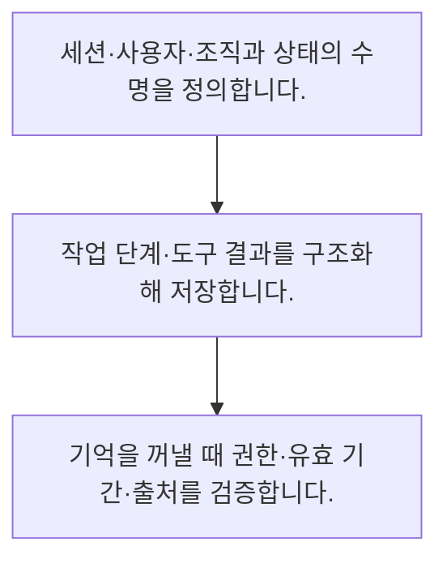

<!-- level:1 -->
# 에이전트 상태·메모리·세션 분리

> **한 문장으로:** 대화·작업 상태·장기 기억은 수명과 권한이 다르므로 범위·버전·삭제 규칙을 나누어 저장합니다.

## 왜 필요한가요?

조직과 사용자 ID를 함께 키로 쓰는 격리 예제입니다. 실제 저장소는 키 규칙만이 아니라 서버 권한 검사·수명·동시 갱신·삭제를 보장해야 합니다.

## 일상에서 떠올려 보기

회의 메모와 진행 중인 체크리스트, 회사의 공식 기록은 역할이 다릅니다. 한 사람의 메모를 다른 고객의 서류에 붙이면 안 됩니다.

## 순서대로 따라가기

1. 세션·사용자·조직과 상태의 수명을 정의합니다.
2. 작업 단계·도구 결과를 구조화해 저장합니다.
3. 기억을 꺼낼 때 권한·유효 기간·출처를 검증합니다.



## 처음 만나는 용어

| 용어 | 쉬운 뜻 |
|---|---|
| 세션 상태 | 현재 대화나 작업의 진행 정보 |
| 장기 기억 | 여러 세션에 재사용하도록 저장한 정보 |
| 네임스페이스 | 자료의 소속과 접근 범위를 구분하는 이름 공간 |

**비유의 한계:** 오래 기억한다고 더 정확한 것은 아닙니다. 모델이 요약한 기억에는 오류가 들어갈 수 있고 사용자 정정·만료·삭제가 필요합니다.

## 스스로 확인

장기 기억에서 필요한 정보는?

**답과 이유:** 범위·출처·유효 기간 — 저장 정보의 권한과 최신성·신뢰를 판단할 맥락이 필요합니다.
<!-- level:2 -->
# 에이전트 상태·메모리·세션 분리 — 실제 흐름 따라가기

## 읽기 전 길잡이

대화·작업 상태·장기 기억은 수명과 권한이 다르므로 범위·버전·삭제 규칙을 나누어 저장합니다. 아래 예제는 외부 시스템에 연결하지 않는 작은 학습용 사례입니다. 입력, 처리 조건, 결과를 순서대로 살펴보세요.

1. 세션·사용자·조직과 상태의 수명을 정의합니다.
2. 작업 단계·도구 결과를 구조화해 저장합니다.
3. 기억을 꺼낼 때 권한·유효 기간·출처를 검증합니다.

## 예제로 확인하기

```python
memory={("org-A","user-1"):"선호 언어: 한국어"}
assert memory.get(("org-B","user-1")) is None
print(memory[("org-A","user-1")])
```

## 결과를 해석하기

조직과 사용자 ID를 함께 키로 쓰는 격리 예제입니다. 실제 저장소는 키 규칙만이 아니라 서버 권한 검사·수명·동시 갱신·삭제를 보장해야 합니다.

## 실무에 옮기기 전

오래 기억한다고 더 정확한 것은 아닙니다. 모델이 요약한 기억에는 오류가 들어갈 수 있고 사용자 정정·만료·삭제가 필요합니다. 실제 업무에서는 기억할 업무 목적과 보관 수명을 먼저 정합니다. 사실과 추정·사용자 선호를 구분하고 출처·시각·정정 경로가 없는 기억을 중요한 결정의 근거로 사용하지 않습니다.

## 확인 질문

예제에서 org-B 조회 결과는?

**답과 이유:** 조직을 포함한 별도 키이므로 다른 조직의 값은 반환하지 않습니다.
<!-- level:3 -->
# 에이전트 상태·메모리·세션 분리 — 가상 사례로 문제 해결하기

실제 고객의 장애 기록이 아닌 학습용 재현 시나리오입니다. 결과만 바꾸기 전에 관측한 증거와 원인 가설을 구분합니다.

## 1. 어떤 문제가 생겼나요?

가상 에이전트가 다른 고객의 이전 답변을 기억으로 사용합니다.

## 2. 먼저 확인할 증거

메모리 키·검색 필터·인증 주체·공유 캐시를 추적합니다.

## 3. 원인 가설

사용자 ID나 조직 범위 없이 질의 텍스트만 키로 저장했습니다.

## 4. 수정 방법

세션·테넌트 범위를 강제하고 기존 잘못된 항목을 격리합니다.

## 5. 재검증

동일 질문을 서로 다른 조직에서 실행해 자료가 섞이지 않는지 검사합니다.

## 놓치기 쉬운 조건

오래 기억한다고 더 정확한 것은 아닙니다. 모델이 요약한 기억에는 오류가 들어갈 수 있고 사용자 정정·만료·삭제가 필요합니다.

## 확인 질문

고객 간 기억이 섞이면 먼저 볼 것은?

**답과 이유:** 격리 경계가 어느 저장·검색 단계에서 사라졌는지 추적해야 합니다.
<!-- level:4 -->
# 에이전트 상태·메모리·세션 분리 — 업무와 아키텍처의 선택

## 읽기 전 길잡이

같은 개념도 업무의 규모, 오류 비용, 운영 역량에 따라 적용 방식이 달라집니다. 아래 비교는 특정 제품의 성능 순위가 아닌 선택 기준입니다.

| 선택 | 얻는 점 | 감수할 점 |
|---|---|---|
| 세션 내 기억 | 범위·삭제가 단순 | 장기 개인화 제한 |
| 장기 기억 | 반복 문맥 비용 감소 | 오류 누적·민감정보·삭제 책임 |

## 선택 기준

기억할 업무 목적과 보관 수명을 먼저 정합니다. 사실과 추정·사용자 선호를 구분하고 출처·시각·정정 경로가 없는 기억을 중요한 결정의 근거로 사용하지 않습니다.

## 도입과 운영에서 확인할 것

세션·테넌트 범위를 강제하고 기존 잘못된 항목을 격리합니다. 동일 질문을 서로 다른 조직에서 실행해 자료가 섞이지 않는지 검사합니다.

## 판단 연습

장기 기억 도입의 비용은?

**판단의 근거:** 기억의 재사용에는 수명과 정정·삭제 책임이 따릅니다.

참고: [Anthropic 에이전트 설계](https://www.anthropic.com/engineering/building-effective-agents), [MCP 소개](https://modelcontextprotocol.io/docs/getting-started/intro), [OWASP 생성형 AI 보안](https://genai.owasp.org/llm-top-10/).
<!-- quizzes -->
[{"level":1,"question":"장기 기억에서 필요한 정보는?","choices":["문장 길이","범위·출처·유효 기간","요약문만","모델 자신감"],"answer_index":1,"explanation":"저장 정보의 권한과 최신성·신뢰를 판단할 맥락이 필요합니다."},{"level":2,"question":"예제에서 org-B 조회 결과는?","choices":["모든 메모리","항상 한국어","None","org-A의 선호"],"answer_index":2,"explanation":"조직을 포함한 별도 키이므로 다른 조직의 값은 반환하지 않습니다."},{"level":3,"question":"고객 간 기억이 섞이면 먼저 볼 것은?","choices":["응답 말투","요약 길이","모델 크기","키·권한·공유 캐시"],"answer_index":3,"explanation":"격리 경계가 어느 저장·검색 단계에서 사라졌는지 추적해야 합니다."},{"level":4,"question":"장기 기억 도입의 비용은?","choices":["오류·민감정보·삭제 관리","항상 정확도 향상","보관 책임 없음","권한 검사 제거"],"answer_index":0,"explanation":"기억의 재사용에는 수명과 정정·삭제 책임이 따릅니다."}]
