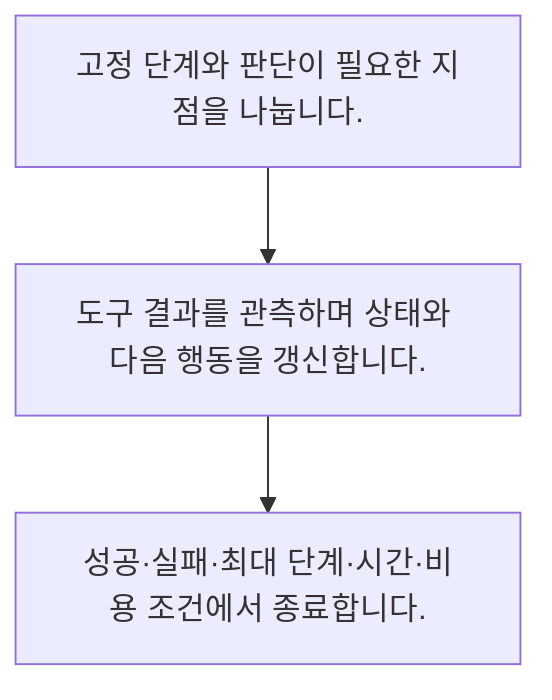

<!-- level:1 -->
# 워크플로·에이전트 루프·종료 조건

> **한 문장으로:** 정해진 흐름과 모델이 다음 행동을 고르는 루프를 구분하고 종료·실패·예산 조건을 코드로 제한합니다.

## 왜 필요한가요?

여러 단계를 수행하는 AI에게 모든 일을 한꺼번에 맡기면 실패 지점을 알기 어렵습니다. 정해진 흐름과 모델의 판단이 필요한 부분을 구분하면 비용과 위험을 관리하기 쉬워집니다.

## 일상에서 떠올려 보기

정해진 체크리스트대로 처리하는 업무와 상황을 보며 다음 일을 정하는 담당자는 다릅니다. 둘 다 멈출 조건과 책임 범위가 있어야 합니다.

## 순서대로 따라가기

1. 고정 단계와 판단이 필요한 지점을 나눕니다.
2. 도구 결과를 관측하며 상태와 다음 행동을 갱신합니다.
3. 성공·실패·최대 단계·시간·비용 조건에서 종료합니다.



## 처음 만나는 용어

| 용어 | 쉬운 뜻 |
|---|---|
| 워크플로 | 코드로 정한 경로에 따라 단계를 수행하는 구조 |
| 에이전트 루프 | 관측 결과에 따라 모델이 다음 행동을 고르는 반복 |
| 종료 조건 | 성공·실패·예산 초과 등 반복을 끝내는 규칙 |

**비유의 한계:** 더 자율적인 에이전트가 항상 좋은 것은 아닙니다. 여러 단계의 오류가 누적되고 비용·지연·외부 부작용이 커질 수 있습니다.

## 스스로 확인

에이전트 루프에 반드시 둘 것은?

**답과 이유:** 종료·예산 조건 — 자율 판단과 무제한 실행은 다르며 코드로 경계를 둬야 합니다.
<!-- level:2 -->
# 워크플로·에이전트 루프·종료 조건 — 실제 흐름 따라가기

## 읽기 전 길잡이

정해진 흐름과 모델이 다음 행동을 고르는 루프를 구분하고 종료·실패·예산 조건을 코드로 제한합니다. 아래 예제는 외부 시스템에 연결하지 않는 작은 학습용 사례입니다. 입력, 처리 조건, 결과를 순서대로 살펴보세요.

1. 고정 단계와 판단이 필요한 지점을 나눕니다.
2. 도구 결과를 관측하며 상태와 다음 행동을 갱신합니다.
3. 성공·실패·최대 단계·시간·비용 조건에서 종료합니다.

## 예제로 확인하기

```python
max_steps=3; observations=[]
for step in range(max_steps):
    observations.append(f"step-{step}")
    if step==1: break
assert len(observations)==2
print(observations)
```

## 결과를 해석하기

종료 경계를 보여 주는 모형이며 자율 추론 모델은 호출하지 않습니다. 실제 루프는 관측·도구 결과·상태 검증·단계별 예산을 포함하고 실패를 성공으로 표시하지 않아야 합니다.

## 실무에 옮기기 전

더 자율적인 에이전트가 항상 좋은 것은 아닙니다. 여러 단계의 오류가 누적되고 비용·지연·외부 부작용이 커질 수 있습니다. 실제 업무에서는 동적으로 선택할 단계가 실제 필요한지부터 평가합니다. 성공률 향상이 복잡성과 비용을 상쇄할 때 자율성을 늘리고 외부 행동의 권한은 별도 제한합니다.

## 확인 질문

예제에서 수행한 단계 수는?

**답과 이유:** step 0과 1을 수행한 뒤 종료합니다.
<!-- level:3 -->
# 워크플로·에이전트 루프·종료 조건 — 가상 사례로 문제 해결하기

실제 고객의 장애 기록이 아닌 학습용 재현 시나리오입니다. 결과만 바꾸기 전에 관측한 증거와 원인 가설을 구분합니다.

## 1. 어떤 문제가 생겼나요?

가상 조사 에이전트가 같은 검색을 끝없이 반복합니다.

## 2. 먼저 확인할 증거

행동·인자·관측의 반복 패턴과 누적 비용을 확인합니다.

## 3. 원인 가설

완료 기준과 진전 없음 탐지, 최대 단계 제한이 없었습니다.

## 4. 수정 방법

명시적 종료·중복 행동·예산 경계와 사람 인계를 추가합니다.

## 5. 재검증

답 없는 과제와 도구 실패에서 유한 시간 안에 종료하는지 확인합니다.

## 놓치기 쉬운 조건

더 자율적인 에이전트가 항상 좋은 것은 아닙니다. 여러 단계의 오류가 누적되고 비용·지연·외부 부작용이 커질 수 있습니다.

## 확인 질문

같은 검색을 반복하면 확인할 것은?

**답과 이유:** 루프가 새로운 근거를 얻는지와 멈출 조건을 검사해야 합니다.
<!-- level:4 -->
# 워크플로·에이전트 루프·종료 조건 — 업무와 아키텍처의 선택

## 읽기 전 길잡이

같은 개념도 업무의 규모, 오류 비용, 운영 역량에 따라 적용 방식이 달라집니다. 아래 비교는 특정 제품의 성능 순위가 아닌 선택 기준입니다.

| 선택 | 얻는 점 | 감수할 점 |
|---|---|---|
| 고정 워크플로 | 예측·테스트·통제 용이 | 새 상황 적응 제한 |
| 에이전트 루프 | 다음 단계의 유연한 선택 | 오류 누적·비용·검증 복잡성 |

## 선택 기준

동적으로 선택할 단계가 실제 필요한지부터 평가합니다. 성공률 향상이 복잡성과 비용을 상쇄할 때 자율성을 늘리고 외부 행동의 권한은 별도 제한합니다.

## 도입과 운영에서 확인할 것

명시적 종료·중복 행동·예산 경계와 사람 인계를 추가합니다. 답 없는 과제와 도구 실패에서 유한 시간 안에 종료하는지 확인합니다.

## 판단 연습

고정 흐름보다 에이전트를 고를 근거는?

**판단의 근거:** 성공률과 비용·통제 부담을 실제 과제로 비교해야 합니다.

참고: [Anthropic 에이전트 설계](https://www.anthropic.com/engineering/building-effective-agents), [MCP 소개](https://modelcontextprotocol.io/docs/getting-started/intro), [OWASP 생성형 AI 보안](https://genai.owasp.org/llm-top-10/).
<!-- quizzes -->
[{"level":1,"question":"에이전트 루프에 반드시 둘 것은?","choices":["종료·예산 조건","무한 반복","모델 자신감만","모든 도구 권한"],"answer_index":0,"explanation":"자율 판단과 무제한 실행은 다르며 코드로 경계를 둬야 합니다."},{"level":2,"question":"예제에서 수행한 단계 수는?","choices":["무한","2","3","0"],"answer_index":1,"explanation":"step 0과 1을 수행한 뒤 종료합니다."},{"level":3,"question":"같은 검색을 반복하면 확인할 것은?","choices":["상한 제거","항상 성공 처리","진전·중복·종료 기준","검색 결과 무시"],"answer_index":2,"explanation":"루프가 새로운 근거를 얻는지와 멈출 조건을 검사해야 합니다."},{"level":4,"question":"고정 흐름보다 에이전트를 고를 근거는?","choices":["자율성이라는 이름","항상 최신 구조","코드 감소만","유연성의 실제 품질 이득"],"answer_index":3,"explanation":"성공률과 비용·통제 부담을 실제 과제로 비교해야 합니다."}]
