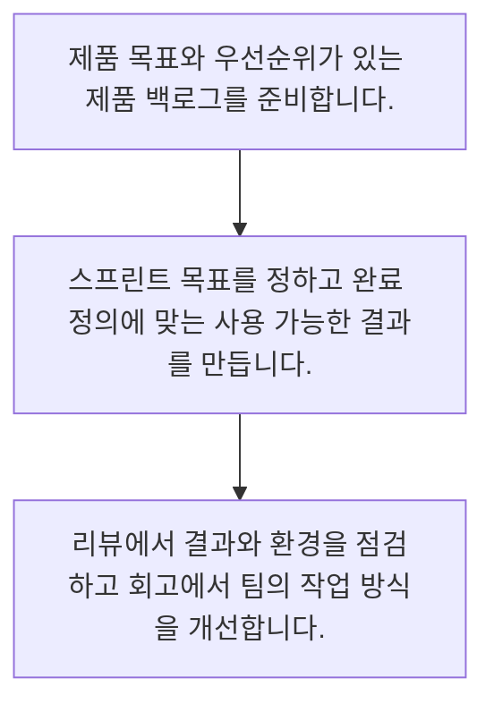

<!-- level:1 -->
# 애자일·스크럼·회고

> **한 문장으로:** 애자일은 작은 결과를 자주 확인하며 계획을 고치는 접근이고, 스크럼은 이를 돕는 구체적인 프레임워크입니다.

## 왜 필요한가요?

처음 계획을 완벽하게 맞히기 어려운 제품 개발에서는 실제 결과를 자주 확인해야 합니다. 애자일과 스크럼의 목적을 알면 회의 자체보다 검증과 개선에 집중할 수 있습니다.

## 일상에서 떠올려 보기

처음부터 거대한 정원을 완성하기보다 한 구역을 가꾸고 햇빛과 이용 반응을 본 뒤 다음 구역을 바꿉니다. 스크럼의 짧은 주기도 결과를 살피고 다음 결정을 조정하는 기회입니다. 매일 모이는 행사 자체가 목적은 아닙니다.

## 순서대로 따라가기

1. 제품 목표와 우선순위가 있는 제품 백로그를 준비합니다.
2. 스프린트 목표를 정하고 완료 정의에 맞는 사용 가능한 결과를 만듭니다.
3. 리뷰에서 결과와 환경을 점검하고 회고에서 팀의 작업 방식을 개선합니다.



## 처음 만나는 용어

| 용어 | 쉬운 뜻 |
|---|---|
| 스프린트 | 한 달 이하의 고정 길이로 검증하는 스크럼의 주기 |
| 완료 정의 | 결과물이 충족해야 할 공통 품질 상태 |
| 회고 | 팀의 일하는 방식과 품질을 개선하는 점검 |

**비유의 한계:** 정원 비유와 달리 스크럼에는 책임·이벤트·산출물과 약속이 정의돼 있습니다. 일부 회의만 따라 하는 것과 전체 프레임워크를 적용하는 것은 구분해야 합니다.

## 스스로 확인

애자일 접근의 중심은 무엇인가요?

**답과 이유:** 작은 결과의 피드백으로 계획을 조정한다 — 변화에 적응하려면 실제 결과를 확인하고 다음 선택을 바꾸는 피드백이 필요합니다.
<!-- level:2 -->
# 애자일·스크럼·회고 — 실제 흐름 따라가기

## 읽기 전 길잡이

애자일은 작은 결과를 자주 확인하며 계획을 고치는 접근이고, 스크럼은 이를 돕는 구체적인 프레임워크입니다. 아래 예제는 외부 시스템에 연결하지 않는 작은 학습용 사례입니다. 입력, 처리 조건, 결과를 순서대로 살펴보세요.

1. 제품 목표와 우선순위가 있는 제품 백로그를 준비합니다.
2. 스프린트 목표를 정하고 완료 정의에 맞는 사용 가능한 결과를 만듭니다.
3. 리뷰에서 결과와 환경을 점검하고 회고에서 팀의 작업 방식을 개선합니다.

## 예제로 확인하기

```markdown
# 스프린트 계획 예시
- 제품 목표: 상담원이 신뢰할 근거를 빠르게 찾는다.
- 스프린트 목표: 제한된 문서에서 출처를 확인하는 흐름 검증
- 선택한 일: 문서 검색, 근거 링크, 접근 거부 안내
- 완료 정의: 코드 검토·권한 테스트·운영 지표 확인

# 리뷰
- 시범 상담원의 근거 확인 성공 여부와 새로 배운 점
# 회고
- 병목: 검토가 마지막 날에 집중됨
- 개선 실험: 매일 작은 변경으로 검토하고 다음 회고에서 확인
```

## 결과를 해석하기

스크럼 가이드 2020의 책임은 Product Owner, Scrum Master, Developers입니다. 데일리 스크럼은 Developers가 스프린트 목표로 나아가는 계획을 점검하는 자리이며 상사에게 작업량을 보고하는 시간이 아닙니다. 스프린트 리뷰와 회고는 점검 대상이 다릅니다.

## 실무에 옮기기 전

정원 비유와 달리 스크럼에는 책임·이벤트·산출물과 약속이 정의돼 있습니다. 일부 회의만 따라 하는 것과 전체 프레임워크를 적용하는 것은 구분해야 합니다. 실제 업무에서는 스크럼을 적용하려면 제품 목표·팀 책임·완료 정의를 함께 이해합니다. 긴급 요청이 지속되는 운영 팀은 다른 흐름 관리 방식도 검토하며, 속도 점수나 티켓 수로 서로 다른 팀의 생산성을 비교하지 않습니다.

## 확인 질문

스프린트 리뷰와 회고의 차이는 무엇인가요?

**답과 이유:** 리뷰와 회고는 각각 제품과 작업 방식을 점검하는 서로 다른 목적을 가집니다.
<!-- level:3 -->
# 애자일·스크럼·회고 — 가상 사례로 문제 해결하기

실제 고객의 장애 기록이 아닌 학습용 재현 시나리오입니다. 결과만 바꾸기 전에 관측한 증거와 원인 가설을 구분합니다.

## 1. 어떤 문제가 생겼나요?

매일 회의와 2주 주기는 있지만 스프린트마다 미검토 코드만 쌓입니다.

## 2. 먼저 확인할 증거

백로그 항목은 닫혔으나 사용 가능한 결과와 공통 완료 정의가 없습니다.

## 3. 원인 가설

행사 준수와 티켓 수를 성과로 삼아 검증 가능한 결과를 놓친 것이 원인 가설입니다.

## 4. 수정 방법

완료 정의와 목표를 재합의하고 작은 범위에서 통합·검토된 결과를 만듭니다.

## 5. 재검증

리뷰에서 실제 결과와 학습을 확인하고 회고의 개선 조치가 다음 주기에 실천됐는지 살핍니다.

## 놓치기 쉬운 조건

정원 비유와 달리 스크럼에는 책임·이벤트·산출물과 약속이 정의돼 있습니다. 일부 회의만 따라 하는 것과 전체 프레임워크를 적용하는 것은 구분해야 합니다.

## 확인 질문

행사는 하지만 사용 가능한 결과가 없다면 무엇을 점검하나요?

**답과 이유:** 행사만 수행해도 품질과 학습이 자동으로 생기지는 않으므로 실제 결과를 확인해야 합니다.
<!-- level:4 -->
# 애자일·스크럼·회고 — 업무와 아키텍처의 선택

## 읽기 전 길잡이

같은 개념도 업무의 규모, 오류 비용, 운영 역량에 따라 적용 방식이 달라집니다. 아래 비교는 특정 제품의 성능 순위가 아닌 선택 기준입니다.

| 선택 | 얻는 점 | 감수할 점 |
|---|---|---|
| 스크럼 | 제품 목표와 정기 점검의 공통 틀 제공 | 책임과 이벤트를 제대로 유지할 노력이 필요 |
| 작은 실험 중심의 다른 애자일 방식 | 업무 특성에 맞게 점검 주기 조정 | 팀이 목표와 품질 기준을 직접 명료하게 설계해야 함 |

## 선택 기준

스크럼을 적용하려면 제품 목표·팀 책임·완료 정의를 함께 이해합니다. 긴급 요청이 지속되는 운영 팀은 다른 흐름 관리 방식도 검토하며, 속도 점수나 티켓 수로 서로 다른 팀의 생산성을 비교하지 않습니다.

## 도입과 운영에서 확인할 것

완료 정의와 목표를 재합의하고 작은 범위에서 통합·검토된 결과를 만듭니다. 리뷰에서 실제 결과와 학습을 확인하고 회고의 개선 조치가 다음 주기에 실천됐는지 살핍니다.

## 판단 연습

팀 간 성과 비교에서 주의할 것은 무엇인가요?

**판단의 근거:** 팀별 추정 기준과 맥락이 다르므로 점수는 조직 간 생산성 비교의 공통 단위가 아닙니다.

참고: [Scrum Guide](https://scrumguides.org/scrum-guide.html), [The Kanban Guide 2025](https://kanbanguides.org/the-kanban-guide/2025.5/), [GOV.UK Agile delivery](https://www.gov.uk/service-manual/agile-delivery).
<!-- quizzes -->
[{"level":1,"question":"애자일 접근의 중심은 무엇인가요?","choices":["매일 회의만 한다","작은 결과의 피드백으로 계획을 조정한다","문서를 전부 없앤다","일정을 절대 만들지 않는다"],"answer_index":1,"explanation":"변화에 적응하려면 실제 결과를 확인하고 다음 선택을 바꾸는 피드백이 필요합니다."},{"level":2,"question":"스프린트 리뷰와 회고의 차이는 무엇인가요?","choices":["리뷰는 코드 복사다","회고는 다음 기능 승인만 한다","리뷰는 결과와 환경을, 회고는 작업 방식 개선을 살핀다","둘 다 개인 성적 평가다"],"answer_index":2,"explanation":"리뷰와 회고는 각각 제품과 작업 방식을 점검하는 서로 다른 목적을 가집니다."},{"level":3,"question":"행사는 하지만 사용 가능한 결과가 없다면 무엇을 점검하나요?","choices":["회의 시간을 늘리기만 하기","티켓 수만 비교","검토를 다음 달로 미루기","스프린트 목표와 완료 정의·통합 상태"],"answer_index":3,"explanation":"행사만 수행해도 품질과 학습이 자동으로 생기지는 않으므로 실제 결과를 확인해야 합니다."},{"level":4,"question":"팀 간 성과 비교에서 주의할 것은 무엇인가요?","choices":["서로 다른 팀의 추정 점수를 생산성 순위로 쓰지 않는다","점수가 높으면 무조건 더 우수하다","목표보다 티켓 수를 우선한다","미완료 검토를 완료로 처리한다"],"answer_index":0,"explanation":"팀별 추정 기준과 맥락이 다르므로 점수는 조직 간 생산성 비교의 공통 단위가 아닙니다."}]
