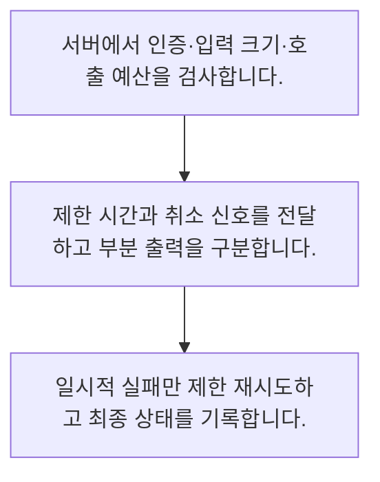

<!-- level:1 -->
# AI API·스트리밍·재시도·취소

> **한 문장으로:** AI 호출은 실패·지연·부분 응답을 가진 외부 의존성이므로 시간·비용·취소와 재시도를 함께 설계합니다.

## 왜 필요한가요?

AI를 웹 화면이나 회사 업무에 연결하려면 요청을 보내고 실패와 응답을 처리해야 합니다. API 연결의 흐름을 알면 화면 시연을 실제로 운영 가능한 기능으로 옮길 수 있습니다.

## 일상에서 떠올려 보기

전화를 걸어 긴 설명을 듣는 동안 끊기거나 상대가 늦게 답할 수 있습니다. 다시 전화할 때 같은 일을 두 번 처리하지 않도록 문맥을 남겨야 합니다.

## 순서대로 따라가기

1. 서버에서 인증·입력 크기·호출 예산을 검사합니다.
2. 제한 시간과 취소 신호를 전달하고 부분 출력을 구분합니다.
3. 일시적 실패만 제한 재시도하고 최종 상태를 기록합니다.



## 처음 만나는 용어

| 용어 | 쉬운 뜻 |
|---|---|
| 스트리밍 | 완성 전 출력 조각을 순차 전달하는 방식 |
| 타임아웃 | 응답을 기다릴 최대 시간 |
| 백오프 | 반복 실패 시 재시도 간격을 늘리는 방법 |

**비유의 한계:** 스트리밍 조각은 완성된 JSON이나 완결된 판단이 아닙니다. 클라이언트 취소가 공급자의 계산·과금을 즉시 멈춘다고 가정하지 않습니다.

## 스스로 확인

스트리밍 조각을 다룰 때 필요한 것은?

**답과 이유:** 부분·완성 상태 구분 — 출력 조각은 완결된 결과가 아닐 수 있어 상태와 검증이 필요합니다.
<!-- level:2 -->
# AI API·스트리밍·재시도·취소 — 실제 흐름 따라가기

## 읽기 전 길잡이

AI 호출은 실패·지연·부분 응답을 가진 외부 의존성이므로 시간·비용·취소와 재시도를 함께 설계합니다. 아래 예제는 외부 시스템에 연결하지 않는 작은 학습용 사례입니다. 입력, 처리 조건, 결과를 순서대로 살펴보세요.

1. 서버에서 인증·입력 크기·호출 예산을 검사합니다.
2. 제한 시간과 취소 신호를 전달하고 부분 출력을 구분합니다.
3. 일시적 실패만 제한 재시도하고 최종 상태를 기록합니다.

## 예제로 확인하기

```python
delays=[min(2**attempt,8) for attempt in range(4)]
assert delays==[1,2,4,8]
print("재시도 대기 예시:",delays)
```

## 결과를 해석하기

외부 API를 호출하지 않는 백오프 계산 예제입니다. 실제 구현에는 무작위 지연, 서버의 재시도 지시, 전체 제한 시간과 중복 효과 검사가 필요합니다.

## 실무에 옮기기 전

스트리밍 조각은 완성된 JSON이나 완결된 판단이 아닙니다. 클라이언트 취소가 공급자의 계산·과금을 즉시 멈춘다고 가정하지 않습니다. 실제 업무에서는 첫 출력 시간과 전체 완료 시간, 성공률·비용을 함께 평가합니다. 중요한 행동은 완성·검증된 결과 뒤에 실행하고 부분 응답을 성공으로 저장하지 않습니다.

## 확인 질문

예제 백오프 순서는?

**답과 이유:** 지수적으로 늘리되 상한을 둔 대기 계산입니다.
<!-- level:3 -->
# AI API·스트리밍·재시도·취소 — 가상 사례로 문제 해결하기

실제 고객의 장애 기록이 아닌 학습용 재현 시나리오입니다. 결과만 바꾸기 전에 관측한 증거와 원인 가설을 구분합니다.

## 1. 어떤 문제가 생겼나요?

가상 챗봇이 공급자 장애 때 요청을 무한 재시도합니다.

## 2. 먼저 확인할 증거

요청별 시도 수·지연·상태 코드·취소 전파를 확인합니다.

## 3. 원인 가설

일시 오류와 영구 오류를 구분하지 않고 횟수 제한도 없었습니다.

## 4. 수정 방법

재시도 가능한 오류와 총 시도·시간·비용 상한을 둡니다.

## 5. 재검증

429·일시 장애·중간 끊김·사용자 취소를 모의해 최종 상태를 확인합니다.

## 놓치기 쉬운 조건

스트리밍 조각은 완성된 JSON이나 완결된 판단이 아닙니다. 클라이언트 취소가 공급자의 계산·과금을 즉시 멈춘다고 가정하지 않습니다.

## 확인 질문

장애 때 호출이 폭증하면?

**답과 이유:** 제한 없는 재시도는 의존성 장애와 비용을 증폭할 수 있습니다.
<!-- level:4 -->
# AI API·스트리밍·재시도·취소 — 업무와 아키텍처의 선택

## 읽기 전 길잡이

같은 개념도 업무의 규모, 오류 비용, 운영 역량에 따라 적용 방식이 달라집니다. 아래 비교는 특정 제품의 성능 순위가 아닌 선택 기준입니다.

| 선택 | 얻는 점 | 감수할 점 |
|---|---|---|
| 동기 단일 응답 | 실패 처리·파싱 간단 | 긴 대기 경험 |
| 스트리밍 응답 | 초기 피드백이 빠름 | 부분 출력·취소·오류 상태 복잡 |

## 선택 기준

첫 출력 시간과 전체 완료 시간, 성공률·비용을 함께 평가합니다. 중요한 행동은 완성·검증된 결과 뒤에 실행하고 부분 응답을 성공으로 저장하지 않습니다.

## 도입과 운영에서 확인할 것

재시도 가능한 오류와 총 시도·시간·비용 상한을 둡니다. 429·일시 장애·중간 끊김·사용자 취소를 모의해 최종 상태를 확인합니다.

## 판단 연습

스트리밍 도입의 절충은?

**판단의 근거:** 사용자 경험이 좋아질 수 있지만 부분 실패를 명확히 처리해야 합니다.

참고: [Anthropic 에이전트 설계](https://www.anthropic.com/engineering/building-effective-agents), [MCP 소개](https://modelcontextprotocol.io/docs/getting-started/intro), [OWASP 생성형 AI 보안](https://genai.owasp.org/llm-top-10/).
<!-- quizzes -->
[{"level":1,"question":"스트리밍 조각을 다룰 때 필요한 것은?","choices":["부분·완성 상태 구분","모든 조각 즉시 실행","항상 완전 JSON 가정","취소 처리 제거"],"answer_index":0,"explanation":"출력 조각은 완결된 결과가 아닐 수 있어 상태와 검증이 필요합니다."},{"level":2,"question":"예제 백오프 순서는?","choices":["무한 0초","1·2·4·8","1·1·1·1","8·4·2·1"],"answer_index":1,"explanation":"지수적으로 늘리되 상한을 둔 대기 계산입니다."},{"level":3,"question":"장애 때 호출이 폭증하면?","choices":["영구 오류도 반복","취소 무시","재시도 조건과 전체 상한 확인","횟수 무제한"],"answer_index":2,"explanation":"제한 없는 재시도는 의존성 장애와 비용을 증폭할 수 있습니다."},{"level":4,"question":"스트리밍 도입의 절충은?","choices":["전체 시간이 항상 감소","비용 항상 0","검증 생략","초기 피드백과 상태 처리 복잡성"],"answer_index":3,"explanation":"사용자 경험이 좋아질 수 있지만 부분 실패를 명확히 처리해야 합니다."}]
