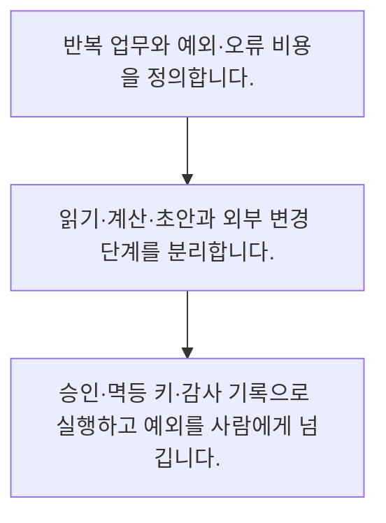

<!-- level:1 -->
# AI 업무 자동화·검토·중복 방지

> **한 문장으로:** AI 자동화는 입력·판단·초안·검토·실행을 나누고 실패와 중복 실행이 업무에 주는 영향을 통제합니다.

## 왜 필요한가요?

반복 업무라고 모두 AI로 바꾸는 것이 좋은 것은 아닙니다. 예외 처리와 승인·중복 방지까지 살펴야 자동화가 사람의 일을 줄이는지, 더 어려운 검토만 남기는지 확인할 수 있습니다.

## 일상에서 떠올려 보기

청구서를 분류하는 직원이 곧바로 대금을 지급하지는 않습니다. 추출·검토·승인·지급 단계의 책임이 나뉘어 있습니다.

## 순서대로 따라가기

1. 반복 업무와 예외·오류 비용을 정의합니다.
2. 읽기·계산·초안과 외부 변경 단계를 분리합니다.
3. 승인·멱등 키·감사 기록으로 실행하고 예외를 사람에게 넘깁니다.



## 처음 만나는 용어

| 용어 | 쉬운 뜻 |
|---|---|
| 업무 자동화 | 반복 업무의 일부 단계를 프로그램이 수행하는 구성 |
| 멱등 키 | 같은 업무 요청을 중복 실행하지 않도록 식별하는 키 |
| 예외 처리 | 규칙으로 안전하게 처리하기 어려운 입력을 별도 경로로 보내는 절차 |

**비유의 한계:** 자동화율이 높아도 잘못된 실행이나 검토 부담이 커지면 효과가 없을 수 있습니다. 고객 통지·기록 변경 등의 외부 행동에는 권한과 복구 계획이 필요합니다.

## 스스로 확인

외부 변경 전 나눠야 할 단계는?

**답과 이유:** 초안·검토·실행 — 제안과 실제 영향이 있는 실행을 구분해 통제합니다.
<!-- level:2 -->
# AI 업무 자동화·검토·중복 방지 — 실제 흐름 따라가기

## 읽기 전 길잡이

AI 자동화는 입력·판단·초안·검토·실행을 나누고 실패와 중복 실행이 업무에 주는 영향을 통제합니다. 아래 예제는 외부 시스템에 연결하지 않는 작은 학습용 사례입니다. 입력, 처리 조건, 결과를 순서대로 살펴보세요.

1. 반복 업무와 예외·오류 비용을 정의합니다.
2. 읽기·계산·초안과 외부 변경 단계를 분리합니다.
3. 승인·멱등 키·감사 기록으로 실행하고 예외를 사람에게 넘깁니다.

## 예제로 확인하기

```python
processed=set(); effects=[]
for invoice in ["INV-7","INV-7"]:
    if invoice not in processed:
        effects.append(invoice); processed.add(invoice)
assert len(effects)==1
print(effects)
```

## 결과를 해석하기

한 프로세스 안에서 중복 요청을 건너뛰는 예제입니다. 실제 외부 실행은 영속 저장·원자성·재시도와 공급자 멱등 계약을 함께 설계해야 하며 이 set만으로 분산 중복을 막을 수는 없습니다.

## 실무에 옮기기 전

자동화율이 높아도 잘못된 실행이나 검토 부담이 커지면 효과가 없을 수 있습니다. 고객 통지·기록 변경 등의 외부 행동에는 권한과 복구 계획이 필요합니다. 실제 업무에서는 절약한 시간에서 검토·수정·장애 비용을 빼고 실제 효과를 봅니다. 규칙이 명확하고 복구 가능한 구간부터 범위를 넓히며 불확실한 결과는 자동 승인하지 않습니다.

## 확인 질문

예제에서 효과가 기록된 수는?

**답과 이유:** 같은 청구 ID를 이미 처리한 집합으로 확인합니다.
<!-- level:3 -->
# AI 업무 자동화·검토·중복 방지 — 가상 사례로 문제 해결하기

실제 고객의 장애 기록이 아닌 학습용 재현 시나리오입니다. 결과만 바꾸기 전에 관측한 증거와 원인 가설을 구분합니다.

## 1. 어떤 문제가 생겼나요?

가상 자동화가 이메일 중복 수신으로 같은 청구 처리를 두 번 합니다.

## 2. 먼저 확인할 증거

원본 업무 ID·시도 기록·외부 실행 결과를 추적합니다.

## 3. 원인 가설

이메일 수신 건을 업무 자체의 유일 키로 잘못 사용했습니다.

## 4. 수정 방법

원본 청구 ID와 버전으로 중복을 통제하고 불확실 상태를 검토 큐로 보냅니다.

## 5. 재검증

중복 수신·부분 실패·재시작에서 중복 효과와 누락을 검사합니다.

## 놓치기 쉬운 조건

자동화율이 높아도 잘못된 실행이나 검토 부담이 커지면 효과가 없을 수 있습니다. 고객 통지·기록 변경 등의 외부 행동에는 권한과 복구 계획이 필요합니다.

## 확인 질문

중복 이메일로 업무가 두 번 실행되면?

**답과 이유:** 이벤트 수신과 실제 업무의 식별자를 구분해야 합니다.
<!-- level:4 -->
# AI 업무 자동화·검토·중복 방지 — 업무와 아키텍처의 선택

## 읽기 전 길잡이

같은 개념도 업무의 규모, 오류 비용, 운영 역량에 따라 적용 방식이 달라집니다. 아래 비교는 특정 제품의 성능 순위가 아닌 선택 기준입니다.

| 선택 | 얻는 점 | 감수할 점 |
|---|---|---|
| 초안까지만 자동화 | 피해 통제와 검토 용이 | 수동 실행 부담 |
| 검증 후 자동 실행 | 처리 시간 감소 | 권한·중복·복구 운영 비용 |

## 선택 기준

절약한 시간에서 검토·수정·장애 비용을 빼고 실제 효과를 봅니다. 규칙이 명확하고 복구 가능한 구간부터 범위를 넓히며 불확실한 결과는 자동 승인하지 않습니다.

## 도입과 운영에서 확인할 것

원본 청구 ID와 버전으로 중복을 통제하고 불확실 상태를 검토 큐로 보냅니다. 중복 수신·부분 실패·재시작에서 중복 효과와 누락을 검사합니다.

## 판단 연습

자동화 효과의 적절한 평가는?

**판단의 근거:** 자동화가 만든 추가 부담까지 포함해야 실질적 효익을 알 수 있습니다.

참고: [Anthropic 에이전트 설계](https://www.anthropic.com/engineering/building-effective-agents), [MCP 소개](https://modelcontextprotocol.io/docs/getting-started/intro), [OWASP 생성형 AI 보안](https://genai.owasp.org/llm-top-10/).
<!-- quizzes -->
[{"level":1,"question":"외부 변경 전 나눠야 할 단계는?","choices":["로그 삭제","초안·검토·실행","모든 단계 통합 실행","응답만 생성"],"answer_index":1,"explanation":"제안과 실제 영향이 있는 실행을 구분해 통제합니다."},{"level":2,"question":"예제에서 효과가 기록된 수는?","choices":["0","무한","1","2"],"answer_index":2,"explanation":"같은 청구 ID를 이미 처리한 집합으로 확인합니다."},{"level":3,"question":"중복 이메일로 업무가 두 번 실행되면?","choices":["제목만 바꾸기","시도 로그 삭제","무조건 전체 재실행","업무 유일 키와 실행 경계 확인"],"answer_index":3,"explanation":"이벤트 수신과 실제 업무의 식별자를 구분해야 합니다."},{"level":4,"question":"자동화 효과의 적절한 평가는?","choices":["절약 시간과 검토·오류 비용 함께","자동화 비율만","호출 수만","응답 문장 수"],"answer_index":0,"explanation":"자동화가 만든 추가 부담까지 포함해야 실질적 효익을 알 수 있습니다."}]
