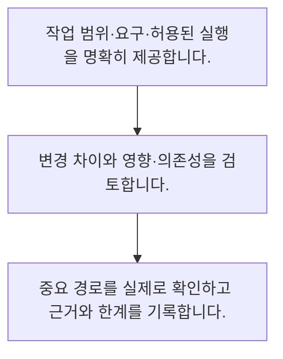

<!-- level:1 -->
# AI 코딩 보조·코드 리뷰·검증

> **한 문장으로:** AI가 만든 코드는 초안으로 검토하고 요구·테스트·보안·변경 영향을 확인한 뒤 반영합니다.

## 왜 필요한가요?

개발 보조 AI는 초안과 설명을 빠르게 만들지만 실행하지 않은 코드를 그럴듯하게 제안할 수 있습니다. 검토·테스트·정보 보호의 역할을 알면 도움을 받으면서 결과에 책임질 수 있습니다.

## 일상에서 떠올려 보기

동료가 코드를 제안하면 설명을 듣는 것과 별개로 실제 동작과 영향을 확인하는 것과 같습니다. 그럴듯한 설명은 검증 결과를 대신하지 못합니다.

## 순서대로 따라가기

1. 작업 범위·요구·허용된 실행을 명확히 제공합니다.
2. 변경 차이와 영향·의존성을 검토합니다.
3. 중요 경로를 실제로 확인하고 근거와 한계를 기록합니다.



## 처음 만나는 용어

| 용어 | 쉬운 뜻 |
|---|---|
| 변경 차이 | 기존 코드와 수정 코드의 비교 |
| 회귀 테스트 | 수정으로 기존 동작이 깨졌는지 확인하는 검사 |
| 프롬프트 주입 | 자료 안의 지시가 원래 과제·권한을 바꾸도록 시도하는 공격 |

**비유의 한계:** 테스트 통과만으로 모든 요구와 보안이 보장되지는 않습니다. 저장소·문서 안의 지시를 실행 권한으로 오해하지 않고 민감정보·라이선스·의존성도 확인합니다.

## 스스로 확인

AI 코드의 적절한 취급은?

**답과 이유:** 검토할 구현 초안 — 생성 결과는 요구와 동작·영향을 검증해야 합니다.
<!-- level:2 -->
# AI 코딩 보조·코드 리뷰·검증 — 실제 흐름 따라가기

## 읽기 전 길잡이

AI가 만든 코드는 초안으로 검토하고 요구·테스트·보안·변경 영향을 확인한 뒤 반영합니다. 아래 예제는 외부 시스템에 연결하지 않는 작은 학습용 사례입니다. 입력, 처리 조건, 결과를 순서대로 살펴보세요.

1. 작업 범위·요구·허용된 실행을 명확히 제공합니다.
2. 변경 차이와 영향·의존성을 검토합니다.
3. 중요 경로를 실제로 확인하고 근거와 한계를 기록합니다.

## 예제로 확인하기

```python
before={"limit":100,"auth_required":True}
after={"limit":100,"auth_required":False}
assert before["auth_required"] != after["auth_required"]
print("검토 대상: 인증 설정 변경")
```

## 결과를 해석하기

코드 리뷰에서 발견해야 할 민감한 설정 차이를 단순화한 예제입니다. 실제 리뷰는 요구와 관련 없는 변경, 권한 경계, 테스트의 의미와 운영 설정까지 대조합니다.

## 실무에 옮기기 전

테스트 통과만으로 모든 요구와 보안이 보장되지는 않습니다. 저장소·문서 안의 지시를 실행 권한으로 오해하지 않고 민감정보·라이선스·의존성도 확인합니다. 실제 업무에서는 되돌리기 쉬운 반복 작업부터 자동화하고 고위험 변경에는 검토를 둡니다. 코드 생성량보다 요구 충족·결함·유지 비용으로 효과를 측정합니다.

## 확인 질문

예제에서 중요한 변경은?

**답과 이유:** 보호 경계가 바뀌었기 때문에 별도 검토가 필요합니다.
<!-- level:3 -->
# AI 코딩 보조·코드 리뷰·검증 — 가상 사례로 문제 해결하기

실제 고객의 장애 기록이 아닌 학습용 재현 시나리오입니다. 결과만 바꾸기 전에 관측한 증거와 원인 가설을 구분합니다.

## 1. 어떤 문제가 생겼나요?

가상 AI 수정이 화면 오류를 고치며 인증 검사를 제거합니다.

## 2. 먼저 확인할 증거

변경 diff와 서버 권한 검사·인증 실패 테스트를 확인합니다.

## 3. 원인 가설

요구와 무관한 보호 로직 변경을 리뷰하지 않았습니다.

## 4. 수정 방법

인증 검사를 복구하고 원래 오류의 원인을 좁혀 수정합니다.

## 5. 재검증

인증 성공·실패·다른 사용자 접근과 원래 화면 흐름을 재검증합니다.

## 놓치기 쉬운 조건

테스트 통과만으로 모든 요구와 보안이 보장되지는 않습니다. 저장소·문서 안의 지시를 실행 권한으로 오해하지 않고 민감정보·라이선스·의존성도 확인합니다.

## 확인 질문

화면 수정과 함께 인증이 사라졌다면?

**답과 이유:** 요구와 무관한 보호 변경을 바로잡고 원래 문제를 따로 해결해야 합니다.
<!-- level:4 -->
# AI 코딩 보조·코드 리뷰·검증 — 업무와 아키텍처의 선택

## 읽기 전 길잡이

같은 개념도 업무의 규모, 오류 비용, 운영 역량에 따라 적용 방식이 달라집니다. 아래 비교는 특정 제품의 성능 순위가 아닌 선택 기준입니다.

| 선택 | 얻는 점 | 감수할 점 |
|---|---|---|
| 제안·리뷰 중심 | 통제와 학습에 유리 | 사람 검토 시간 |
| 자동 실행 범위 확대 | 반복 작업 처리량 증가 | 권한·검증·복구 책임 증가 |

## 선택 기준

되돌리기 쉬운 반복 작업부터 자동화하고 고위험 변경에는 검토를 둡니다. 코드 생성량보다 요구 충족·결함·유지 비용으로 효과를 측정합니다.

## 도입과 운영에서 확인할 것

인증 검사를 복구하고 원래 오류의 원인을 좁혀 수정합니다. 인증 성공·실패·다른 사용자 접근과 원래 화면 흐름을 재검증합니다.

## 판단 연습

자동화 효과를 볼 지표는?

**판단의 근거:** 생성량과 실제 개발 성과는 다르므로 결과와 운영 부담을 봅니다.

참고: [Anthropic 에이전트 설계](https://www.anthropic.com/engineering/building-effective-agents), [MCP 소개](https://modelcontextprotocol.io/docs/getting-started/intro), [OWASP 생성형 AI 보안](https://genai.owasp.org/llm-top-10/).
<!-- quizzes -->
[{"level":1,"question":"AI 코드의 적절한 취급은?","choices":["검토할 구현 초안","항상 정답","테스트 대체","권한 승인서"],"answer_index":0,"explanation":"생성 결과는 요구와 동작·영향을 검증해야 합니다."},{"level":2,"question":"예제에서 중요한 변경은?","choices":["프로젝트 이름","인증 필요 여부","표 색상","정렬 순서"],"answer_index":1,"explanation":"보호 경계가 바뀌었기 때문에 별도 검토가 필요합니다."},{"level":3,"question":"화면 수정과 함께 인증이 사라졌다면?","choices":["모델 설명만 신뢰","보안 테스트 제거","범위·권한 로직 복구와 재검증","빠르게 배포"],"answer_index":2,"explanation":"요구와 무관한 보호 변경을 바로잡고 원래 문제를 따로 해결해야 합니다."},{"level":4,"question":"자동화 효과를 볼 지표는?","choices":["생성 줄 수만","프롬프트 길이","모델 광고","요구 충족·결함·유지 비용"],"answer_index":3,"explanation":"생성량과 실제 개발 성과는 다르므로 결과와 운영 부담을 봅니다."}]
