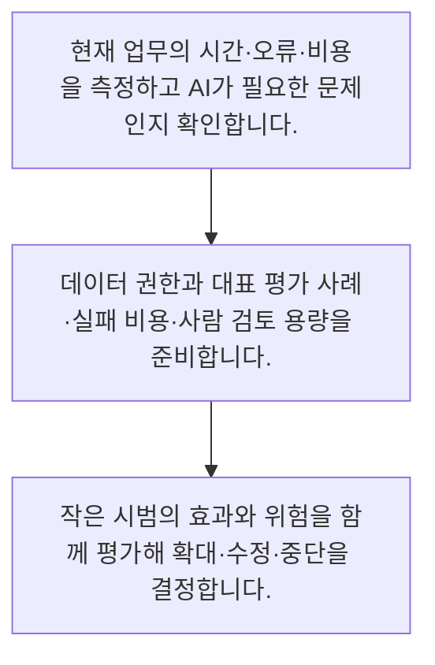

<!-- level:1 -->
# AI 프로젝트 기획·평가·사람 업무 설계

> **한 문장으로:** AI 프로젝트는 모델 선택보다 업무 문제·데이터 준비·평가·사람의 검토와 운영 비용을 함께 설계하는 일입니다.

## 왜 필요한가요?

AI 시연이 잘되는 것과 회사의 업무가 좋아지는 것은 다릅니다. 문제와 현재 성과·평가·사람의 검토를 같이 설계해야 도입의 효과와 남은 부담을 판단할 수 있습니다.

## 일상에서 떠올려 보기

새 직원을 채용할 때 도구 사용 능력만 보지 않고 맡길 일과 교육 자료, 검수 방법, 도움을 요청할 상황을 정합니다. AI도 비슷하게 업무 범위와 평가 사례, 사람이 개입하는 조건이 있어야 성과와 위험을 함께 확인할 수 있습니다.

## 순서대로 따라가기

1. 현재 업무의 시간·오류·비용을 측정하고 AI가 필요한 문제인지 확인합니다.
2. 데이터 권한과 대표 평가 사례·실패 비용·사람 검토 용량을 준비합니다.
3. 작은 시범의 효과와 위험을 함께 평가해 확대·수정·중단을 결정합니다.



## 처음 만나는 용어

| 용어 | 쉬운 뜻 |
|---|---|
| 기준선 | 새 방식과 비교하기 위해 측정한 현재 업무 결과 |
| 평가셋 | 품질과 위험을 반복 확인할 대표 사례 묶음 |
| 사람 검토 용량 | 정해진 시간에 실제로 확인할 수 있는 작업 수 |

**비유의 한계:** AI는 직원처럼 경험을 이해하거나 책임을 지는 주체가 아닙니다. 대화가 자연스러워도 사실 확인·권한·책임은 시스템과 사람이 설계해야 합니다.

## 스스로 확인

AI 프로젝트에서 모델 선택보다 먼저 정할 것은 무엇인가요?

**답과 이유:** 해결할 업무 문제와 현재 기준선 — 문제와 비교 기준이 있어야 AI 도입이 실제로 도움이 됐는지 판단할 수 있습니다.
<!-- level:2 -->
# AI 프로젝트 기획·평가·사람 업무 설계 — 실제 흐름 따라가기

## 읽기 전 길잡이

AI 프로젝트는 모델 선택보다 업무 문제·데이터 준비·평가·사람의 검토와 운영 비용을 함께 설계하는 일입니다. 아래 예제는 외부 시스템에 연결하지 않는 작은 학습용 사례입니다. 입력, 처리 조건, 결과를 순서대로 살펴보세요.

1. 현재 업무의 시간·오류·비용을 측정하고 AI가 필요한 문제인지 확인합니다.
2. 데이터 권한과 대표 평가 사례·실패 비용·사람 검토 용량을 준비합니다.
3. 작은 시범의 효과와 위험을 함께 평가해 확대·수정·중단을 결정합니다.

## 예제로 확인하기

```markdown
# AI 문의 분류 시범 계획
- 기준선: 현재 처리 시간·오분류·재작업 비율 측정
- 대상: 반복되는 저위험 문의, 예외는 기존 경로 유지
- 데이터: 사용 권한·최신성·개인정보 처리 조건 확인
- 평가: 정상·모호·공격·권한 제한 사례를 분리
- 사람 업무: 불확실 결과 검토, 하루 처리 가능량 확인
- 효과: 절약 시간에서 검토·재작업 시간을 뺀 순효과
- 중단: 민감정보 노출 또는 검토 대기 초과 시 신규 처리 중단
- 결정: 확대·수정·중단과 근거 기록
```

## 결과를 해석하기

자동 처리 비율이 높아도 검토와 수정에 더 많은 시간이 들면 목표를 달성하지 못합니다. 초기에는 현재 방식과 비교 가능한 대표 사례를 만들고 사람이 실제로 감당할 수 있는 검토량까지 측정해야 합니다. 모델 성능과 업무 성과는 연결해 보되 같은 지표로 보지 않습니다.

## 실무에 옮기기 전

AI는 직원처럼 경험을 이해하거나 책임을 지는 주체가 아닙니다. 대화가 자연스러워도 사실 확인·권한·책임은 시스템과 사람이 설계해야 합니다. 실제 업무에서는 현재 업무 기준선과 데이터 권한이 없으면 모델 구매보다 그것부터 정리합니다. 낮은 위험의 반복 업무로 검증하고 성공 시에도 검토 인력·운영 비용·모델 변경 대응을 포함한 확장 계획을 별도로 승인합니다.

## 확인 질문

AI 시범 계획의 평가 사례에 포함할 것은 무엇인가요?

**답과 이유:** 대표성과 위험을 함께 다뤄야 실제 업무에서의 성능과 실패 경로를 확인할 수 있습니다.
<!-- level:3 -->
# AI 프로젝트 기획·평가·사람 업무 설계 — 가상 사례로 문제 해결하기

실제 고객의 장애 기록이 아닌 학습용 재현 시나리오입니다. 결과만 바꾸기 전에 관측한 증거와 원인 가설을 구분합니다.

## 1. 어떤 문제가 생겼나요?

AI 시범의 자동 처리율은 높지만 상담원의 야근과 불만이 늘어납니다.

## 2. 먼저 확인할 증거

검토 대기와 수정 시간을 제외한 지표만 보고됐고 어려운 문의가 검토자에게 몰렸습니다.

## 3. 원인 가설

평균 자동화 비율을 업무 성과로 사용하며 남은 사람 업무의 난이도를 무시한 것이 원인 가설입니다.

## 4. 수정 방법

처리 유형별 순시간·오류 비용·검토 용량을 측정하고 범위를 줄이거나 승인 흐름을 재설계합니다.

## 5. 재검증

대표 기간의 품질·순효과·대기와 업무 부담을 확인한 뒤 확대 여부를 결정합니다.

## 놓치기 쉬운 조건

AI는 직원처럼 경험을 이해하거나 책임을 지는 주체가 아닙니다. 대화가 자연스러워도 사실 확인·권한·책임은 시스템과 사람이 설계해야 합니다.

## 확인 질문

자동 처리율이 높아도 효과가 없을 수 있는 이유는 무엇인가요?

**답과 이유:** 업무 순효과는 자동 처리 비율뿐 아니라 남은 사람 업무와 오류 비용을 포함합니다.
<!-- level:4 -->
# AI 프로젝트 기획·평가·사람 업무 설계 — 업무와 아키텍처의 선택

## 읽기 전 길잡이

같은 개념도 업무의 규모, 오류 비용, 운영 역량에 따라 적용 방식이 달라집니다. 아래 비교는 특정 제품의 성능 순위가 아닌 선택 기준입니다.

| 선택 | 얻는 점 | 감수할 점 |
|---|---|---|
| 제한된 업무 시범 | 실패 비용을 줄이며 데이터와 효과 확인 | 전사 효과를 바로 입증하지는 못함 |
| 넓은 범위의 동시 자동화 | 여러 업무의 연결 효과를 노릴 수 있음 | 평가·권한·검토 병목과 원인 구분이 어려움 |

## 선택 기준

현재 업무 기준선과 데이터 권한이 없으면 모델 구매보다 그것부터 정리합니다. 낮은 위험의 반복 업무로 검증하고 성공 시에도 검토 인력·운영 비용·모델 변경 대응을 포함한 확장 계획을 별도로 승인합니다.

## 도입과 운영에서 확인할 것

처리 유형별 순시간·오류 비용·검토 용량을 측정하고 범위를 줄이거나 승인 흐름을 재설계합니다. 대표 기간의 품질·순효과·대기와 업무 부담을 확인한 뒤 확대 여부를 결정합니다.

## 판단 연습

시범 성공 후 확대할 때 무엇을 다시 검토하나요?

**판단의 근거:** 규모가 커지면 오류 총량과 운영 병목도 달라지므로 확장 조건을 별도로 검토해야 합니다.

참고: [Scrum Guide](https://scrumguides.org/scrum-guide.html), [The Kanban Guide 2025](https://kanbanguides.org/the-kanban-guide/2025.5/), [GOV.UK Agile delivery](https://www.gov.uk/service-manual/agile-delivery).
<!-- quizzes -->
[{"level":1,"question":"AI 프로젝트에서 모델 선택보다 먼저 정할 것은 무엇인가요?","choices":["GPU 수만","해결할 업무 문제와 현재 기준선","유행하는 모델 이름","챗봇 말투만"],"answer_index":1,"explanation":"문제와 비교 기준이 있어야 AI 도입이 실제로 도움이 됐는지 판단할 수 있습니다."},{"level":2,"question":"AI 시범 계획의 평가 사례에 포함할 것은 무엇인가요?","choices":["성공한 화면만","개발자가 외운 질문만","정상·모호·실패·권한 제한 사례","쉬운 질문만"],"answer_index":2,"explanation":"대표성과 위험을 함께 다뤄야 실제 업무에서의 성능과 실패 경로를 확인할 수 있습니다."},{"level":3,"question":"자동 처리율이 높아도 효과가 없을 수 있는 이유는 무엇인가요?","choices":["답변이 짧아서 반드시","모델 이름이 길어서","자동화는 원래 측정 불가능해서","검토·수정·재작업 비용이 절약을 넘어서서"],"answer_index":3,"explanation":"업무 순효과는 자동 처리 비율뿐 아니라 남은 사람 업무와 오류 비용을 포함합니다."},{"level":4,"question":"시범 성공 후 확대할 때 무엇을 다시 검토하나요?","choices":["검토 용량·운영 비용·권한·변경 대응","자동화 비율만","홍보 문구만","평가셋 삭제 여부"],"answer_index":0,"explanation":"규모가 커지면 오류 총량과 운영 병목도 달라지므로 확장 조건을 별도로 검토해야 합니다."}]
