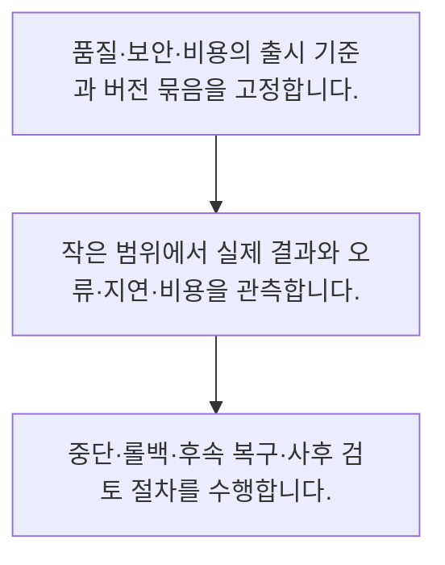

<!-- level:1 -->
# AI 출시·카나리·장애 대응·롤백

> **한 문장으로:** AI 변경은 모델·프롬프트·검색·도구를 묶어 평가하고 일부 트래픽에서 확인한 뒤 확대하며 복구를 준비합니다.

## 왜 필요한가요?

AI의 결과는 앱 코드 외에도 모델·프롬프트·문서 변경에 영향을 받습니다. 출시와 중단 조건·담당자를 묶어 관리하면 문제가 커지기 전에 발견하고 대응할 수 있습니다.

## 일상에서 떠올려 보기

새 메뉴를 모든 매장에서 동시에 판매하기 전에 일부 매장에서 품질과 주문 흐름을 확인하는 것과 비슷합니다. 문제가 생겼을 때 이전 방식으로 돌아갈 준비도 필요합니다.

## 순서대로 따라가기

1. 품질·보안·비용의 출시 기준과 버전 묶음을 고정합니다.
2. 작은 범위에서 실제 결과와 오류·지연·비용을 관측합니다.
3. 중단·롤백·후속 복구·사후 검토 절차를 수행합니다.



## 처음 만나는 용어

| 용어 | 쉬운 뜻 |
|---|---|
| 카나리 배포 | 일부 트래픽에 먼저 새 버전을 적용하는 방식 |
| 롤백 | 서비스를 이전에 검증한 구성으로 되돌리는 작업 |
| 런북 | 장애 진단·완화·복구의 운영 절차 문서 |

**비유의 한계:** 모델을 되돌린다고 이미 보낸 메시지나 변경한 외부 기록이 자동 복구되지는 않습니다. 자료와 도구 계약의 호환성도 따로 확인해야 합니다.

## 스스로 확인

AI 변경의 배포 단위에 포함할 것은?

**답과 이유:** 모델·프롬프트·검색·도구 계약 — 결과를 바꾸는 구성 전체를 추적하고 호환성을 확인해야 합니다.
<!-- level:2 -->
# AI 출시·카나리·장애 대응·롤백 — 실제 흐름 따라가기

## 읽기 전 길잡이

AI 변경은 모델·프롬프트·검색·도구를 묶어 평가하고 일부 트래픽에서 확인한 뒤 확대하며 복구를 준비합니다. 아래 예제는 외부 시스템에 연결하지 않는 작은 학습용 사례입니다. 입력, 처리 조건, 결과를 순서대로 살펴보세요.

1. 품질·보안·비용의 출시 기준과 버전 묶음을 고정합니다.
2. 작은 범위에서 실제 결과와 오류·지연·비용을 관측합니다.
3. 중단·롤백·후속 복구·사후 검토 절차를 수행합니다.

## 예제로 확인하기

```python
requests=1000; canary_fraction=0.05
canary_requests=int(requests*canary_fraction)
assert canary_requests==50
print("가상 카나리 요청 수:",canary_requests)
```

## 결과를 해석하기

1000건의 5%는 50건이라는 배포 비율 계산 예제입니다. 실제 배포는 사용자·세션의 일관된 배정과 표본 수, 희귀한 고위험 실패를 고려해야 합니다.

## 실무에 옮기기 전

모델을 되돌린다고 이미 보낸 메시지나 변경한 외부 기록이 자동 복구되지는 않습니다. 자료와 도구 계약의 호환성도 따로 확인해야 합니다. 실제 업무에서는 출시 전 복구 가능한 구성과 외부 부작용 대응을 연습합니다. 성공률뿐 아니라 금지 행동·꼬리 지연·비용의 중단 기준을 정하고 사후 학습을 회귀 평가에 반영합니다.

## 확인 질문

예제 카나리 요청 수는?

**답과 이유:** 1000건에 0.05를 곱하면 50건입니다.
<!-- level:3 -->
# AI 출시·카나리·장애 대응·롤백 — 가상 사례로 문제 해결하기

실제 고객의 장애 기록이 아닌 학습용 재현 시나리오입니다. 결과만 바꾸기 전에 관측한 증거와 원인 가설을 구분합니다.

## 1. 어떤 문제가 생겼나요?

가상 프롬프트 변경 뒤 잘못된 도구 호출이 늘어납니다.

## 2. 먼저 확인할 증거

릴리스 버전과 도구 실행·거부·외부 결과를 확인합니다.

## 3. 원인 가설

문장 품질만 평가하고 실행 경로의 회귀를 놓쳤습니다.

## 4. 수정 방법

위험 도구를 차단하고 검증된 구성으로 되돌린 뒤 외부 효과를 조사합니다.

## 5. 재검증

공격·권한·부분 실패 시나리오와 영향받은 업무 복구를 확인합니다.

## 놓치기 쉬운 조건

모델을 되돌린다고 이미 보낸 메시지나 변경한 외부 기록이 자동 복구되지는 않습니다. 자료와 도구 계약의 호환성도 따로 확인해야 합니다.

## 확인 질문

위험 도구 호출 증가 시 우선 대응은?

**답과 이유:** 모델을 되돌리는 것과 이미 생긴 외부 효과 복구는 구분해야 합니다.
<!-- level:4 -->
# AI 출시·카나리·장애 대응·롤백 — 업무와 아키텍처의 선택

## 읽기 전 길잡이

같은 개념도 업무의 규모, 오류 비용, 운영 역량에 따라 적용 방식이 달라집니다. 아래 비교는 특정 제품의 성능 순위가 아닌 선택 기준입니다.

| 선택 | 얻는 점 | 감수할 점 |
|---|---|---|
| 즉시 전면 배포 | 절차가 단순 | 실패 영향 범위 큼 |
| 단계적 배포·중단 장치 | 영향 범위와 복구 시간을 제한 | 버전 병행·관측·운영 비용 |

## 선택 기준

출시 전 복구 가능한 구성과 외부 부작용 대응을 연습합니다. 성공률뿐 아니라 금지 행동·꼬리 지연·비용의 중단 기준을 정하고 사후 학습을 회귀 평가에 반영합니다.

## 도입과 운영에서 확인할 것

위험 도구를 차단하고 검증된 구성으로 되돌린 뒤 외부 효과를 조사합니다. 공격·권한·부분 실패 시나리오와 영향받은 업무 복구를 확인합니다.

## 판단 연습

롤백이 자동 해결하지 않는 것은?

**판단의 근거:** 발송·기록 변경 등 외부 부작용은 별도 조사와 복구가 필요합니다.

참고: [Google Cloud MLOps](https://docs.cloud.google.com/architecture/mlops-continuous-delivery-and-automation-pipelines-in-machine-learning), [NIST AI RMF](https://www.nist.gov/itl/ai-risk-management-framework), [OWASP 생성형 AI 보안](https://genai.owasp.org/llm-top-10/), [Google SRE Workbook](https://sre.google/workbook/table-of-contents/).
<!-- quizzes -->
[{"level":1,"question":"AI 변경의 배포 단위에 포함할 것은?","choices":["서버 위치만","모델·프롬프트·검색·도구 계약","모델 이름만","화면 문구만"],"answer_index":1,"explanation":"결과를 바꾸는 구성 전체를 추적하고 호환성을 확인해야 합니다."},{"level":2,"question":"예제 카나리 요청 수는?","choices":["500","1000","50","5"],"answer_index":2,"explanation":"1000건에 0.05를 곱하면 50건입니다."},{"level":3,"question":"위험 도구 호출 증가 시 우선 대응은?","choices":["전면 확대","로그 삭제","설명만 변경","영향 차단·구성 복구·외부 효과 조사"],"answer_index":3,"explanation":"모델을 되돌리는 것과 이미 생긴 외부 효과 복구는 구분해야 합니다."},{"level":4,"question":"롤백이 자동 해결하지 않는 것은?","choices":["이미 실행된 외부 변경","이전 모델 선택","프롬프트 버전 복귀","서비스 구성 변경"],"answer_index":0,"explanation":"발송·기록 변경 등 외부 부작용은 별도 조사와 복구가 필요합니다."}]
