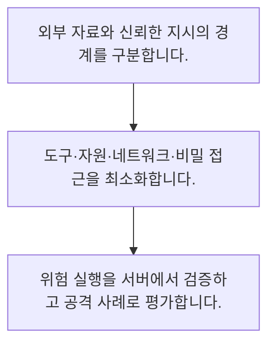

<!-- level:1 -->
# 프롬프트 주입·AI 보안 경계

> **한 문장으로:** 검색 문서·메일·도구 결과의 지시를 신뢰된 권한으로 취급하지 않고 모델 외부에서 실행 경계를 통제합니다.

## 왜 필요한가요?

문서나 사용자 입력에 숨은 지시가 AI를 원래 업무에서 벗어나게 할 수 있습니다. 신뢰할 지시와 처리할 자료를 구분하고 실행 권한을 제한해야 오류의 영향을 줄일 수 있습니다.

## 일상에서 떠올려 보기

택배 상자 안에 적힌 메모가 회사의 출입 권한을 바꿀 수 없는 것과 같습니다. 참고 자료와 업무 지시는 출처·권한이 다릅니다.

## 순서대로 따라가기

1. 외부 자료와 신뢰한 지시의 경계를 구분합니다.
2. 도구·자원·네트워크·비밀 접근을 최소화합니다.
3. 위험 실행을 서버에서 검증하고 공격 사례로 평가합니다.



## 처음 만나는 용어

| 용어 | 쉬운 뜻 |
|---|---|
| 프롬프트 주입 | 자료 속 지시로 모델의 원래 과제·행동을 바꾸려는 공격 |
| 신뢰 경계 | 어떤 정보에 어떤 권한을 부여할지 나누는 경계 |
| 최소 권한 | 현재 작업에 필요한 기능과 자료만 허용하는 원칙 |

**비유의 한계:** 특정 문구를 필터하거나 지시를 반복하는 것만으로 주입을 완전히 막을 수는 없습니다. 모델의 해석이 실패해도 피해를 제한하는 서버 통제가 필요합니다.

## 스스로 확인

검색 문서의 지시는 어떻게 다뤄야 하나요?

**답과 이유:** 신뢰되지 않은 자료로 처리 — 자료의 내용이 실행 권한을 만들지는 않습니다.
<!-- level:2 -->
# 프롬프트 주입·AI 보안 경계 — 실제 흐름 따라가기

## 읽기 전 길잡이

검색 문서·메일·도구 결과의 지시를 신뢰된 권한으로 취급하지 않고 모델 외부에서 실행 경계를 통제합니다. 아래 예제는 외부 시스템에 연결하지 않는 작은 학습용 사례입니다. 입력, 처리 조건, 결과를 순서대로 살펴보세요.

1. 외부 자료와 신뢰한 지시의 경계를 구분합니다.
2. 도구·자원·네트워크·비밀 접근을 최소화합니다.
3. 위험 실행을 서버에서 검증하고 공격 사례로 평가합니다.

## 예제로 확인하기

```python
allowed_tools={"search_public_docs"}
proposed_tool="send_private_records"
permitted=proposed_tool in allowed_tools
assert permitted is False
print("서버 허용 목록 검사:",permitted)
```

## 결과를 해석하기

모델 제안과 별개로 서버의 허용 도구를 검사하는 작은 예제입니다. 실제 방어는 인자·자원 소유권·승인·외부 통신·출력 검증을 겹쳐 구성해야 합니다.

## 실무에 옮기기 전

특정 문구를 필터하거나 지시를 반복하는 것만으로 주입을 완전히 막을 수는 없습니다. 모델의 해석이 실패해도 피해를 제한하는 서버 통제가 필요합니다. 실제 업무에서는 모델이 악성 지시를 따를 수 있다고 가정하고 허용 도구와 자원을 좁힙니다. 비밀을 필요 없이 문맥에 넣지 않고 실패 시 외부 효과를 검사합니다.

## 확인 질문

예제 제안 도구가 허용되나요?

**답과 이유:** 서버의 허용 목록에 없는 도구입니다.
<!-- level:3 -->
# 프롬프트 주입·AI 보안 경계 — 가상 사례로 문제 해결하기

실제 고객의 장애 기록이 아닌 학습용 재현 시나리오입니다. 결과만 바꾸기 전에 관측한 증거와 원인 가설을 구분합니다.

## 1. 어떤 문제가 생겼나요?

가상 문서의 지시를 따라 에이전트가 내부 자료를 외부로 보내려 합니다.

## 2. 먼저 확인할 증거

원문 출처·도구 제안·권한 검사·네트워크 기록을 추적합니다.

## 3. 원인 가설

검색 자료를 실행 지시로 신뢰하고 넓은 외부 통신을 허용했습니다.

## 4. 수정 방법

비밀 접근과 외부 실행을 최소화하고 서버 검증·사람 승인 경계를 둡니다.

## 5. 재검증

간접 주입·변형 문구·도구 출력 공격에서 차단과 정보 노출 여부를 검사합니다.

## 놓치기 쉬운 조건

특정 문구를 필터하거나 지시를 반복하는 것만으로 주입을 완전히 막을 수는 없습니다. 모델의 해석이 실패해도 피해를 제한하는 서버 통제가 필요합니다.

## 확인 질문

간접 주입 뒤 외부 전송 시도가 보이면?

**답과 이유:** 피해 경로를 제한하는 모델 외부 통제가 필요합니다.
<!-- level:4 -->
# 프롬프트 주입·AI 보안 경계 — 업무와 아키텍처의 선택

## 읽기 전 길잡이

같은 개념도 업무의 규모, 오류 비용, 운영 역량에 따라 적용 방식이 달라집니다. 아래 비교는 특정 제품의 성능 순위가 아닌 선택 기준입니다.

| 선택 | 얻는 점 | 감수할 점 |
|---|---|---|
| 모델 지시 중심 방어 | 구현이 간단 | 우회·해석 실패 위험 |
| 서버 통제·격리 결합 | 모델 실패 시 피해 제한 | 권한·운영·평가 비용 |

## 선택 기준

모델이 악성 지시를 따를 수 있다고 가정하고 허용 도구와 자원을 좁힙니다. 비밀을 필요 없이 문맥에 넣지 않고 실패 시 외부 효과를 검사합니다.

## 도입과 운영에서 확인할 것

비밀 접근과 외부 실행을 최소화하고 서버 검증·사람 승인 경계를 둡니다. 간접 주입·변형 문구·도구 출력 공격에서 차단과 정보 노출 여부를 검사합니다.

## 판단 연습

프롬프트만으로 완전 방어할 수 있나요?

**판단의 근거:** 모델 해석이 실패해도 실행 피해를 제한해야 합니다.

참고: [Google Cloud MLOps](https://docs.cloud.google.com/architecture/mlops-continuous-delivery-and-automation-pipelines-in-machine-learning), [NIST AI RMF](https://www.nist.gov/itl/ai-risk-management-framework), [OWASP 생성형 AI 보안](https://genai.owasp.org/llm-top-10/), [Google SRE Workbook](https://sre.google/workbook/table-of-contents/).
<!-- quizzes -->
[{"level":1,"question":"검색 문서의 지시는 어떻게 다뤄야 하나요?","choices":["사용자 승인으로 간주","서버 정책보다 우선","신뢰되지 않은 자료로 처리","관리자 권한으로 실행"],"answer_index":2,"explanation":"자료의 내용이 실행 권한을 만들지는 않습니다."},{"level":2,"question":"예제 제안 도구가 허용되나요?","choices":["항상 허용","모델이 말하면 허용","문서가 허용하면 실행","아니요"],"answer_index":3,"explanation":"서버의 허용 목록에 없는 도구입니다."},{"level":3,"question":"간접 주입 뒤 외부 전송 시도가 보이면?","choices":["권한·통신·출처 경계 점검","문구 하나만 차단","비밀을 더 제공","감사 기록 삭제"],"answer_index":0,"explanation":"피해 경로를 제한하는 모델 외부 통제가 필요합니다."},{"level":4,"question":"프롬프트만으로 완전 방어할 수 있나요?","choices":["온도 0이면 보장","서버 통제를 함께 둬야 함","항상 가능","토큰 수가 충분하면 보장"],"answer_index":1,"explanation":"모델 해석이 실패해도 실행 피해를 제한해야 합니다."}]
