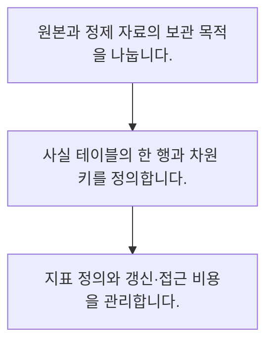

<!-- level:1 -->
# 웨어하우스·레이크와 분석 모델

> **한 문장으로:** 원본 자료 보관과 일관된 지표 제공은 서로 다른 목적이며 저장·변환 계층을 나누어 설계합니다.

## 왜 필요한가요?

실제 주문을 처리하는 곳에 무거운 분석을 함께 돌리면 서비스가 느려질 수 있습니다. 분석용 저장소를 따로 이해하면 어떤 자료가 얼마나 최신인지도 알고 사용할 수 있습니다.

## 일상에서 떠올려 보기

창고의 원재료와 진열대의 완제품을 떠올려 보세요. 원본을 보관하는 것만으로 누구나 같은 기준의 상품을 바로 고를 수 있는 것은 아닙니다.

## 순서대로 따라가기

1. 원본과 정제 자료의 보관 목적을 나눕니다.
2. 사실 테이블의 한 행과 차원 키를 정의합니다.
3. 지표 정의와 갱신·접근 비용을 관리합니다.



## 처음 만나는 용어

| 용어 | 쉬운 뜻 |
|---|---|
| 웨어하우스 | 분석 조회와 관리된 데이터 모델을 위한 저장·계산 환경 |
| 레이크 | 다양한 형식의 원본을 보관하고 처리하는 환경 |
| 그레인 | 사실 테이블 한 행이 표현하는 업무 단위 |

**비유의 한계:** 레이크·웨어하우스의 경계는 제품마다 겹칩니다. 이름만으로 품질·비용·일관성이 보장되지 않으며 실제 테이블 형식과 실행 엔진의 성질을 확인해야 합니다.

## 스스로 확인

분석 모델에서 그레인이란 무엇인가요?

**답과 이유:** 한 행이 나타내는 업무 단위 — 그레인이 달라지면 합계와 조인의 의미도 바뀝니다. 저장 기술의 이름과는 별개입니다.
<!-- level:2 -->
# 웨어하우스·레이크와 분석 모델 — 실제 흐름 따라가기

## 읽기 전 길잡이

원본 자료 보관과 일관된 지표 제공은 서로 다른 목적이며 저장·변환 계층을 나누어 설계합니다. 아래 예제는 외부 시스템에 연결하지 않는 작은 학습용 사례입니다. 입력, 처리 조건, 결과를 순서대로 살펴보세요.

1. 원본과 정제 자료의 보관 목적을 나눕니다.
2. 사실 테이블의 한 행과 차원 키를 정의합니다.
3. 지표 정의와 갱신·접근 비용을 관리합니다.

## 예제로 확인하기

```python
facts=[("A","web",100),("A","app",50),("B","web",20)]
revenue={}
for customer,channel,amount in facts:
    revenue[customer]=revenue.get(customer,0)+amount
assert revenue["A"]==150
print(revenue)
```

## 결과를 해석하기

예제 사실 행은 고객·채널별 금액입니다. 실제 주문 한 건과 주문 상품 한 건을 섞으면 모델이 달라집니다. 차원 조인 전후에도 그레인을 유지해야 같은 지표를 계산할 수 있습니다.

## 실무에 옮기기 전

레이크·웨어하우스의 경계는 제품마다 겹칩니다. 이름만으로 품질·비용·일관성이 보장되지 않으며 실제 테이블 형식과 실행 엔진의 성질을 확인해야 합니다. 실제 업무에서는 탐색용 원본과 의사결정용 지표를 구분합니다. 저장 비용뿐 아니라 스캔량, 재처리 시간, 접근 권한과 모델 변경 영향을 평가합니다.

## 확인 질문

예제에서 A의 합산 금액은?

**답과 이유:** A의 web 100과 app 50을 합칩니다. B의 금액은 별도입니다.
<!-- level:3 -->
# 웨어하우스·레이크와 분석 모델 — 가상 사례로 문제 해결하기

실제 고객의 장애 기록이 아닌 학습용 재현 시나리오입니다. 결과만 바꾸기 전에 관측한 증거와 원인 가설을 구분합니다.

## 1. 어떤 문제가 생겼나요?

가상 두 팀의 월 매출 보고서가 서로 다릅니다.

## 2. 먼저 확인할 증거

환불 반영 시각, 매출 인식 규칙, 테이블 그레인과 갱신 시간을 확인합니다.

## 3. 원인 가설

하나는 주문일, 다른 하나는 정산일을 사용해 서로 다른 정의를 비교했습니다.

## 4. 수정 방법

지표별 정의와 모델 계층을 정리하고 담당자·데이터 신선도를 공개합니다.

## 5. 재검증

같은 기간의 주문·환불 사례를 대조하고 여러 보고서의 정의 일치를 검사합니다.

## 놓치기 쉬운 조건

레이크·웨어하우스의 경계는 제품마다 겹칩니다. 이름만으로 품질·비용·일관성이 보장되지 않으며 실제 테이블 형식과 실행 엔진의 성질을 확인해야 합니다.

## 확인 질문

팀별 매출이 다르면 먼저 대조할 것은?

**답과 이유:** 같은 이름의 지표가 다른 업무 기준으로 계산되었을 수 있습니다.
<!-- level:4 -->
# 웨어하우스·레이크와 분석 모델 — 업무와 아키텍처의 선택

## 읽기 전 길잡이

같은 개념도 업무의 규모, 오류 비용, 운영 역량에 따라 적용 방식이 달라집니다. 아래 비교는 특정 제품의 성능 순위가 아닌 선택 기준입니다.

| 선택 | 얻는 점 | 감수할 점 |
|---|---|---|
| 조회마다 원본 변환 | 자유로운 탐색 | 비용·정의 불일치 |
| 관리된 분석 모델 | 반복 지표 일관성 | 변경·갱신 책임 필요 |

## 선택 기준

탐색용 원본과 의사결정용 지표를 구분합니다. 저장 비용뿐 아니라 스캔량, 재처리 시간, 접근 권한과 모델 변경 영향을 평가합니다.

## 도입과 운영에서 확인할 것

지표별 정의와 모델 계층을 정리하고 담당자·데이터 신선도를 공개합니다. 같은 기간의 주문·환불 사례를 대조하고 여러 보고서의 정의 일치를 검사합니다.

## 판단 연습

관리된 분석 모델의 주요 비용은?

**판단의 근거:** 일관된 모델은 유지와 갱신이 있어야 쓸 수 있습니다. 저장만으로 보장되지 않습니다.

참고: [NIST 통계 핸드북](https://www.itl.nist.gov/div898/handbook/), [PostgreSQL 쿼리](https://www.postgresql.org/docs/current/queries.html).
<!-- quizzes -->
[{"level":1,"question":"분석 모델에서 그레인이란 무엇인가요?","choices":["한 행이 나타내는 업무 단위","파일 이름","디스크 크기","사용자 수"],"answer_index":0,"explanation":"그레인이 달라지면 합계와 조인의 의미도 바뀝니다. 저장 기술의 이름과는 별개입니다."},{"level":2,"question":"예제에서 A의 합산 금액은?","choices":["50","150","100","170"],"answer_index":1,"explanation":"A의 web 100과 app 50을 합칩니다. B의 금액은 별도입니다."},{"level":3,"question":"팀별 매출이 다르면 먼저 대조할 것은?","choices":["표의 너비","도구 구독료만","지표 정의·기간·환불 기준","색상 테마"],"answer_index":2,"explanation":"같은 이름의 지표가 다른 업무 기준으로 계산되었을 수 있습니다."},{"level":4,"question":"관리된 분석 모델의 주요 비용은?","choices":["원본 자동 소멸","항상 0인 쿼리 비용","권한 관리 불필요","모델 변경과 갱신 책임"],"answer_index":3,"explanation":"일관된 모델은 유지와 갱신이 있어야 쓸 수 있습니다. 저장만으로 보장되지 않습니다."}]
