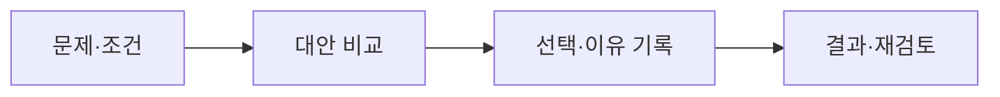

<!-- level:1 -->
# 아키텍처 결정 기록 — 왜 이 방법을 골랐는지 남기기

> **한 문장으로:** 문제·대안·선택 이유·결과를 기록하면 나중에 설계를 다시 판단할 수 있습니다.

## 왜 필요한가요?

몇 달 뒤 ‘왜 큐를 넣었지?’라는 질문에 아무도 답하지 못하면 설계를 바꾸기 어렵습니다. 당시의 조건과 감수한 비용을 남겨야 합니다.

## 일상에서 떠올려 보기

가족이 이사할 집을 고를 때 교통·예산·방 수와 포기한 조건을 메모한다고 생각해 보세요. 직장이 바뀌면 과거 결정이 잘못됐다고 단정하기보다 판단 조건이 달라졌는지 살필 수 있습니다.

## 순서대로 따라가기

1. 지금 해결할 문제와 반드시 지켜야 할 조건을 적습니다.
2. 후보 대안과 각각의 이득·부담을 비교합니다.
3. 선택과 이유, 예상 결과, 언제 다시 검토할지를 짧게 기록합니다.



## 작은 예로 확인하기

알림 전송이 주문 응답을 늦춰 큐를 쓰기로 했다고 해 보세요. 기록에는 응답을 빨리할 수 있다는 이득과, 알림이 늦거나 중복될 수 있어 재처리가 필요하다는 부담도 들어갑니다. 제품 이름만 적으면 판단을 다시 검토하기 어렵습니다.

## 처음 만나는 용어

| 용어 | 쉬운 뜻 |
|---|---|
| 아키텍처 | 시스템의 주요 역할과 연결·운영 방식의 구조입니다. |
| ADR | 주요 설계 결정을 짧게 기록한 문서입니다. |
| 제약 | 예산·시간·보안 등 선택에서 지켜야 하는 조건입니다. |
| 트레이드오프 | 어떤 이득을 얻으면서 다른 비용이나 제약을 감수하는 관계입니다. |

**비유의 한계:** 기록을 남겼다고 결정이 자동으로 옳아지지는 않습니다. 실제 결과를 관찰하고 조건이 달라지면 새 결정을 연결해 남겨야 합니다.

## 스스로 확인

ADR에 ‘Redis 사용’이라고만 적으면 무엇이 부족할까요?

**답과 이유:** 해결할 문제, 다른 대안, 선택 이유, 감수할 비용과 결과가 빠져 있습니다. 판단을 다시 검토할 수 있도록 이 맥락을 남겨야 합니다.
<!-- level:2 -->
# 검토 가능한 결정 만들기

<!-- beginner-guide:start -->
## 읽기 전 길잡이

가상 알림 시스템의 문서를 ‘문제 → 대안 → 결정 → 결과’ 순서로 읽으세요. 숫자는 요구 조건의 예시이며 실제 측정값으로 제시된 것은 아닙니다.

## 이 단계에서 만날 말

| 용어 | 쉬운 뜻 |
|---|---|
| 맥락 | 결정 당시의 문제와 환경입니다. |
| 가설 | 검증해야 할 예상이나 설명입니다. |
| 워크로드 | 시스템이 실제로 받는 작업의 종류와 양입니다. |
| SLO | 서비스가 달성하려고 정한 품질 목표입니다. |
| rollback | 문제가 있을 때 이전 상태로 되돌리는 절차입니다. |
| 재검토 조건 | 어떤 변화가 생기면 결정을 다시 평가할지 정한 기준입니다. |

<!-- beginner-guide:end -->

다음은 가상 알림 시스템의 ADR 최소 예시다. 수치는 요구 조건 예이며 실측 결과가 아니다.

```markdown
# ADR-001: 알림 전송을 비동기 큐로 분리
상태: accepted
맥락: 외부 메일 API 지연으로 주문 응답이 느림.
요구: 주문 저장은 동기 확인, 알림은 지연 허용.
대안: 동기 호출 / DB outbox + 워커 / 외부 워크플로.
결정: DB outbox와 제한된 워커를 사용.
결과: 중복 처리 멱등성, backlog 관측, 재처리 운영 필요.
검증: 주문 p95, outbox 지연, 누락·중복율.
재검토: backlog가 복구 시간 목표를 반복 초과할 때.
```

대안을 비교할 축은 요구와 연결한다. “유명해서” 대신 데이터 무결성, 지연, 비용, 팀 운영 역량, 이행 가능성을 제시한다. 가정과 근거를 구분하고 벤치마크의 환경·입력·한계를 남긴다. 이행 단계와 rollback이 불가능한 지점도 포함한다.
<!-- level:3 -->
# 가상 장애 — 결정 근거가 사라져 팀마다 다르게 구현한다

<!-- beginner-guide:start -->
## 읽기 전 길잡이

현재 설계가 요구를 못 맞출 때 당시 가설과 실제 관측을 비교합니다. 도구가 나쁘다는 결론보다 부하·제약·운영 조건이 무엇이 달라졌는지 확인하세요.

<!-- beginner-guide:end -->

가상 팀이 “큐 사용”만 기록하고 전달 보장을 적지 않았다. 한 팀은 중복을 허용하고 다른 팀은 중복이 없다고 가정해 알림이 두 번 발송된다. ADR에는 결과 구조뿐 아니라 실패 계약이 필요했다.

**진단:** 실제 구현과 문서의 가정·계약을 대조한다. 업무 이벤트의 멱등 키, 저장과 발행 경계, 재시도·재처리 정책을 확인한다. 개인의 의도를 추측하기보다 관측 가능한 근거를 모은다.

**수정:** 누락된 계약을 기록하고 검토자를 지정한다. 이전 기록을 조용히 지우기보다 새로운 ADR로 대체와 이유를 남긴다. 운영 runbook과 API 스키마 링크를 연결한다.

**재검증:** 장애 재현과 복구 훈련으로 문서의 선택이 실제 동작과 일치하는지 확인한다. 문서량 대신 결정 이해·이행·복구에 도움이 되는지 평가한다.
<!-- level:4 -->
# 결정의 수명과 조직의 비용

<!-- beginner-guide:start -->
## 읽기 전 길잡이

중요한 결정은 바꾸는 비용과 되돌리는 방법까지 포함합니다. 합의한 조건과 측정 근거를 남겨 다른 사람이 같은 판단을 따라갈 수 있게 해 보세요.

<!-- beginner-guide:end -->

| 기록 방식 | 강점 | 부담 |
|---|---|---|
| 저장소 ADR | 코드 변경과 함께 리뷰 | 여러 저장소의 발견성 |
| 중앙 문서 | 여러 팀 접근 | 코드와 불일치 위험 |
| 문서 + 검증 자동화 | 계약 drift 탐지 | 유지·검증 비용 |

아키텍처는 영구 정답이 아니라 당시 제약의 선택이다. 조직·트래픽·비용이 바뀌면 같은 대안의 평가가 달라진다. 재검토를 감정이나 유행에만 맡기지 않고 지표·요구 변화·기술 지원 종료 같은 조건을 정한다.

**판단 연습:** 모놀리스를 MSA로 나눌 결정에 어떤 가설·측정·이행·rollback·운영 비용이 필요한가? 다른 사람이 동일 근거로 반론을 제기할 수 있는 기록을 만들어 보자.

참고: [Michael Nygard — Documenting Architecture Decisions](https://cognitect.com/blog/2011/11/15/documenting-architecture-decisions), [MADR](https://adr.github.io/madr/).
<!-- quizzes -->
[{"level":1,"question":"ADR의 핵심 역할은?","choices":["도구 이름만 나열","모든 커밋을 긴 보고서로 변환","결정은 영원히 고정","맥락·대안·선택·결과를 남김"],"answer_index":3,"explanation":"결정 결과와 이유를 함께 남겨 후속 팀이 제약과 비용을 이해하게 합니다. 가정이 바뀌면 재검토할 수 있습니다."},{"level":2,"question":"결정을 검토 가능하게 만드는 근거는?","choices":["요구와 연결한 비교축·가정·검증 지표","유행 순위만","도구 로고","가장 긴 문서"],"answer_index":0,"explanation":"대안의 평가와 검증 지표가 실제 요구에 연결돼야 합니다. 가정과 실측도 구분해야 반론·재검토가 가능합니다."},{"level":3,"question":"새 ADR이 기존 결정을 바꿀 때 적절한 기록 방법은?","choices":["옛 문서를 조용히 삭제","대체 관계와 이유를 남김","변경된 계약을 숨김","로그만 저장"],"answer_index":1,"explanation":"결정의 수명과 대체 관계를 남겨 이전 맥락과 이행을 이해하도록 합니다. 구현 계약과 운영 문서도 연결합니다."},{"level":4,"question":"아키텍처 결정을 재검토할 합리적 계기는?","choices":["문서 제목이 오래됨","매일 무조건 전면 변경","요구·지표·운영 제약이 기존 가정을 바꿈","새 제품이 출시됐다는 이유만"],"answer_index":2,"explanation":"제약과 관측 결과가 달라지면 선택의 이득·비용도 변합니다. 근거 기반 재검토 조건을 정하는 것이 중요합니다."}]
