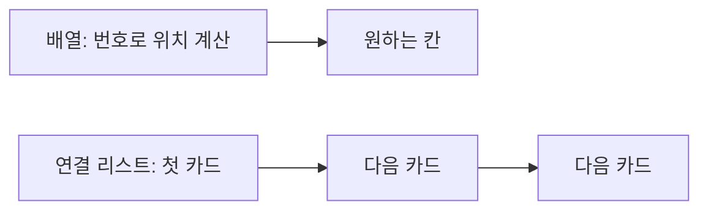

<!-- level:1 -->
# 배열과 연결 리스트 — 번호 붙은 칸과 연결된 카드

> **한 문장으로:** 자료를 나란히 놓을지, 다음 자료의 위치를 연결해 둘지에 따라 찾고 바꾸는 비용이 달라집니다.

## 왜 필요한가요?

자료를 많이 저장한 뒤 몇 번째 값을 찾거나 중간에 값을 넣는 일을 반복합니다. 자주 하는 작업에 맞는 배치 방식이 필요합니다.

## 일상에서 떠올려 보기

배열은 번호가 붙은 보관함과 같습니다. 7번 칸을 바로 찾을 수 있습니다. 연결 리스트는 각 카드에 다음 카드의 위치를 적어 둔 방식입니다. 첫 카드에서 출발해 다음 위치를 따라가야 7번째 카드에 도착합니다.

## 순서대로 따라가기

1. 배열은 원소의 위치를 번호로 계산해 접근합니다.
2. 연결 리스트는 다음 위치 정보를 따라가며 원소를 찾습니다.
3. 중간에 넣거나 지울 때 배열은 뒤 원소를 옮길 수 있고, 연결 리스트는 필요한 연결을 바꿉니다. 먼저 위치를 찾는 비용도 계산합니다.



## 작은 예로 확인하기

카드 A 뒤에 X를 넣을 때 A와 다음 카드의 위치를 이미 알면 연결 몇 개를 바꾸면 됩니다. 이를 일정한 작업량인 O(1)이라고 설명할 수 있습니다. 하지만 ‘목록의 100번째 뒤’가 어디인지부터 찾아야 한다면 그 탐색 비용이 추가됩니다.

## 처음 만나는 용어

| 용어 | 쉬운 뜻 |
|---|---|
| 배열 | 인덱스로 원소를 구분하는 나란한 저장 구조입니다. |
| 인덱스 | 몇 번째 원소인지 나타내는 번호입니다. |
| 연결 리스트 | 각 원소가 다음 원소의 위치를 가리키는 구조입니다. |
| 포인터 | 다른 데이터의 위치를 가리키는 값입니다. |

**비유의 한계:** 보관함은 실제 배열의 용량 변경이나 메모리 비용을 모두 설명하지 못합니다. ‘연결 리스트 삽입은 빠르다’는 말에는 삽입할 위치와 필요한 이웃을 이미 알고 있다는 전제가 필요합니다.

## 스스로 확인

연결 리스트의 중간 삽입이 일정한 작업량이라는 말에서 빠뜨리기 쉬운 조건은 무엇일까요?

**답과 이유:** 삽입 위치와 필요한 인접 노드를 이미 알고 있어야 합니다. 위치를 찾는 과정까지 포함하면 전체 비용이 커질 수 있습니다.
<!-- level:2 -->
# 연산 비용의 전제조건

<!-- beginner-guide:start -->
## 읽기 전 길잡이

예제에서 값 자체와 다음 원소의 위치 정보를 구분해 보세요. ‘어디에 넣을지 찾는 일’과 ‘찾은 곳의 연결을 바꾸는 일’을 따로 보면 비용 설명이 명확해집니다.

## 이 단계에서 만날 말

| 용어 | 쉬운 뜻 |
|---|---|
| 동적 배열 | 필요할 때 더 큰 저장 공간으로 옮겨 용량을 늘리는 배열입니다. |
| 노드 | 자료와 연결 정보를 담는 원소입니다. |
| 이중 연결 리스트 | 이전 원소와 다음 원소 위치를 함께 저장하는 구조입니다. |
| O(1)·O(n) | 일정한 작업량과 원소 수에 비례하는 작업량의 표현입니다. |
| 지역성 | 가까이 저장된 데이터를 이어 읽는 접근 특성입니다. |
| 재할당 | 더 큰 공간을 마련하고 기존 데이터를 옮기는 과정입니다. |

<!-- beginner-guide:end -->

배열 인덱스 접근은 시작 주소와 원소 크기로 위치를 계산한다. 연결 리스트의 k번째 원소는 일반적으로 k개의 연결을 따라간다. 단일 연결 리스트에서 특정 노드 삭제에는 이전 노드를 알아야 하는 경우가 있다. 이중 연결 리스트는 이전·다음 포인터를 둘 다 저장해 연산을 쉽게 하는 대신 공간과 갱신 책임이 늘어난다.

Python 3 예제는 직접 만든 단일 연결 구조와 내장 동적 배열을 비교한다.

```python
from dataclasses import dataclass
@dataclass
class Node:
    value: int
    next: "Node | None" = None
head = Node(1, Node(3))
head.next = Node(2, head.next)  # 위치를 알고 삽입
values = []
node = head
while node:
    values.append(node.value)
    node = node.next
assert values == [1, 2, 3]
```

동적 배열의 append는 용량이 충분하면 상수 비용이지만 확장 때 복사 비용이 발생한다. 적절한 성장 정책에서는 분할 상환 O(1)로 설명할 수 있다. 이것이 모든 append의 최악 비용이 O(1)이라는 뜻은 아니다. 순차 접근에서 연속 배치는 캐시 지역성에 유리할 수 있다.
<!-- level:3 -->
# 재현 사례 — 큐 앞에서 반복 삭제하니 느려진다

<!-- beginner-guide:start -->
## 읽기 전 길잡이

메모리 사용이 크거나 순회가 느린 상황을 봅니다. 각 원소의 연결 정보가 추가 공간을 쓰고, 멀리 떨어진 위치를 따라가면 데이터를 가져오는 비용이 달라질 수 있습니다.

<!-- beginner-guide:end -->

가상 Python 작업 큐가 `items.pop(0)`을 수만 번 호출한다. 각 삭제가 남은 참조를 이동시키므로 전체 처리 비용이 커진다. 프로파일에서 앞 삭제 함수에 시간이 집중되는지 확인한다.

**수정:** 양쪽 끝 연산이 필요한 큐에는 `collections.deque`를 검토한다. 리스트를 유지할 필요가 있다면 읽기 인덱스를 이동시키고 적절한 시점에 정리하는 설계도 가능하다. 임의 인덱스 접근이 많이 필요한 경우 deque로 무조건 바꾸는 것도 정답은 아니다.

```python
from collections import deque
queue = deque([1, 2, 3])
queue.append(4)
assert queue.popleft() == 1
```

**재검증:** 같은 입력과 결과로 전체 소모 시간·최대 메모리·지연 분포를 확인한다. 연결 노드가 끊어지지 않아 참조가 남는 누수와 자료구조의 정당한 저장 공간 증가를 구분한다.
<!-- level:4 -->
# 필요한 연산의 분포로 자료구조 선택하기

<!-- beginner-guide:start -->
## 읽기 전 길잡이

번호로 읽는 작업이 많은지, 이미 위치를 아는 곳에서 자주 바꾸는지를 먼저 정합니다. 이론적 연산 수와 실제 메모리 접근, 관리 복잡도를 함께 비교하세요.

<!-- beginner-guide:end -->

| 요구 | 출발점 | 주의 |
|---|---|---|
| 인덱스 접근·순차 집계 | 배열·동적 배열 | 중간 변경·확장 비용 |
| 양쪽 끝 큐 | deque·링 버퍼 | 임의 접근 특성 확인 |
| 노드 위치가 알려진 연결 변경 | 연결 리스트 | 탐색·포인터·캐시 비용 |

메모리 복잡도가 둘 다 O(n)이라도 노드별 포인터·할당·정렬 낭비 때문에 실제 바이트는 다르다. 대형 시스템에서는 allocator 부담과 캐시 미스가 중요하다. 동시에 수정하는 구조에는 자료구조 선택 외에 소유권·동기화가 필요하다.

**판단 연습:** 로그 100만 건 순차 처리와 이미 위치를 아는 편집 명령에 각각 어떤 구조를 비교할까? 작업 분포와 최대 크기, 참조 안정성, 구현 난도를 근거로 정하자.

참고: [Python collections.deque](https://docs.python.org/3/library/collections.html#collections.deque), [Princeton Bags, Queues, Stacks](https://algs4.cs.princeton.edu/13stacks/).
<!-- quizzes -->
[{"level":1,"question":"연결 리스트 삽입이 O(1)이라는 설명에 필요한 전제는?","choices":["삽입 위치와 필요한 인접 노드를 이미 알고 있음","전체 리스트를 매번 정렬","모든 원소가 배열에 있음","탐색 비용은 항상 0"],"answer_index":0,"explanation":"포인터 갱신은 상수 비용일 수 있지만 위치 탐색은 선형 비용일 수 있습니다. 연산 범위를 명확히 해야 합니다."},{"level":2,"question":"동적 배열 append의 분할 상환 O(1)은 무엇을 뜻하나요?","choices":["모든 개별 연산이 최악 O(1)","전체 연산열에서 평균 부담이 상수 규모","확장이 절대 없음","메모리가 무제한"],"answer_index":1,"explanation":"일부 append는 확장 복사 비용을 냅니다. 적절한 성장 정책 아래 연산열 전체 비용을 나누면 상수 수준으로 설명됩니다."},{"level":3,"question":"Python list의 앞 원소 삭제가 반복되어 병목이면 비교할 구조는?","choices":["더 큰 JWT","DNS 캐시","양끝 연산용 deque","모든 값 문자열 변환"],"answer_index":2,"explanation":"pop(0)는 남은 참조 이동이 필요합니다. deque는 양끝 큐 연산에 적합하지만 임의 접근 요구도 함께 확인해야 합니다."},{"level":4,"question":"두 구조가 모두 O(n) 메모리라면 실제 저장 비용도 같나요?","choices":["항상 같음","원소 수만 같으면 같음","포인터 비용은 사라짐","노드 포인터·할당·캐시 배치에 따라 다름"],"answer_index":3,"explanation":"점근 공간 복잡도는 실제 바이트와 지역성을 모두 설명하지 않습니다. 메모리 레이아웃과 작업 분포를 측정해야 합니다."}]
