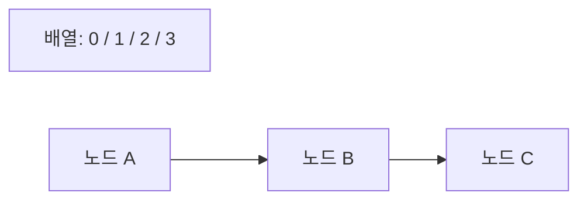

<!-- level:1 -->
# 배열과 연결 리스트 — 좌석 번호와 다음 사람의 주소

배열은 연속된 위치에 원소를 놓는다. 좌석 번호로 바로 찾듯 인덱스로 접근한다. 연결 리스트는 각 노드가 다음 노드의 위치를 들고 있어 앞에서 연결을 따라간다. 둘 다 순서를 표현하지만 접근·삽입·메모리 배치 비용이 다르다.



배열의 중간 삽입은 뒤 원소를 이동시킬 수 있다. 연결 리스트는 **삽입 위치의 노드가 이미 알려져 있다면** 포인터를 바꾸는 작업이 상수 비용일 수 있다. 그러나 위치를 먼저 찾는 비용까지 무조건 O(1)이라고 할 수는 없다.

**비유의 한계:** 동적 배열은 용량을 확장할 때 새 저장 공간으로 복사할 수 있다. 리스트의 포인터 자체도 메모리와 캐시 비용을 쓴다. 언어에서 이름이 List인 타입이 실제 연결 리스트라고 단정하지 않는다.

**확인:** Python list의 이름만 보고 연결 리스트라고 설명하면 왜 잘못인가?
<!-- level:2 -->
# 연산 비용의 전제조건

배열 인덱스 접근은 시작 주소와 원소 크기로 위치를 계산한다. 연결 리스트의 k번째 원소는 일반적으로 k개의 연결을 따라간다. 단일 연결 리스트에서 특정 노드 삭제에는 이전 노드를 알아야 하는 경우가 있다. 이중 연결 리스트는 이전·다음 포인터를 둘 다 저장해 연산을 쉽게 하는 대신 공간과 갱신 책임이 늘어난다.

Python 3 예제는 직접 만든 단일 연결 구조와 내장 동적 배열을 비교한다.

```python
from dataclasses import dataclass
@dataclass
class Node:
    value: int
    next: "Node | None" = None
head = Node(1, Node(3))
head.next = Node(2, head.next)  # 위치를 알고 삽입
values = []
node = head
while node:
    values.append(node.value)
    node = node.next
assert values == [1, 2, 3]
```

동적 배열의 append는 용량이 충분하면 상수 비용이지만 확장 때 복사 비용이 발생한다. 적절한 성장 정책에서는 분할 상환 O(1)로 설명할 수 있다. 이것이 모든 append의 최악 비용이 O(1)이라는 뜻은 아니다. 순차 접근에서 연속 배치는 캐시 지역성에 유리할 수 있다.
<!-- level:3 -->
# 재현 사례 — 큐 앞에서 반복 삭제하니 느려진다

가상 Python 작업 큐가 `items.pop(0)`을 수만 번 호출한다. 각 삭제가 남은 참조를 이동시키므로 전체 처리 비용이 커진다. 프로파일에서 앞 삭제 함수에 시간이 집중되는지 확인한다.

**수정:** 양쪽 끝 연산이 필요한 큐에는 `collections.deque`를 검토한다. 리스트를 유지할 필요가 있다면 읽기 인덱스를 이동시키고 적절한 시점에 정리하는 설계도 가능하다. 임의 인덱스 접근이 많이 필요한 경우 deque로 무조건 바꾸는 것도 정답은 아니다.

```python
from collections import deque
queue = deque([1, 2, 3])
queue.append(4)
assert queue.popleft() == 1
```

**재검증:** 같은 입력과 결과로 전체 소모 시간·최대 메모리·지연 분포를 확인한다. 연결 노드가 끊어지지 않아 참조가 남는 누수와 자료구조의 정당한 저장 공간 증가를 구분한다.
<!-- level:4 -->
# 필요한 연산의 분포로 자료구조 선택하기

| 요구 | 출발점 | 주의 |
|---|---|---|
| 인덱스 접근·순차 집계 | 배열·동적 배열 | 중간 변경·확장 비용 |
| 양쪽 끝 큐 | deque·링 버퍼 | 임의 접근 특성 확인 |
| 노드 위치가 알려진 연결 변경 | 연결 리스트 | 탐색·포인터·캐시 비용 |

메모리 복잡도가 둘 다 O(n)이라도 노드별 포인터·할당·정렬 낭비 때문에 실제 바이트는 다르다. 대형 시스템에서는 allocator 부담과 캐시 미스가 중요하다. 동시에 수정하는 구조에는 자료구조 선택 외에 소유권·동기화가 필요하다.

**판단 연습:** 로그 100만 건 순차 처리와 이미 위치를 아는 편집 명령에 각각 어떤 구조를 비교할까? 작업 분포와 최대 크기, 참조 안정성, 구현 난도를 근거로 정하자.

참고: [Python collections.deque](https://docs.python.org/3/library/collections.html#collections.deque), [Princeton Bags, Queues, Stacks](https://algs4.cs.princeton.edu/13stacks/).
<!-- quizzes -->
[{"level":1,"question":"연결 리스트 삽입이 O(1)이라는 설명에 필요한 전제는?","choices":["삽입 위치와 필요한 인접 노드를 이미 알고 있음","전체 리스트를 매번 정렬","모든 원소가 배열에 있음","탐색 비용은 항상 0"],"answer_index":0,"explanation":"포인터 갱신은 상수 비용일 수 있지만 위치 탐색은 선형 비용일 수 있습니다. 연산 범위를 명확히 해야 합니다."},{"level":2,"question":"동적 배열 append의 분할 상환 O(1)은 무엇을 뜻하나요?","choices":["모든 개별 연산이 최악 O(1)","전체 연산열에서 평균 부담이 상수 규모","확장이 절대 없음","메모리가 무제한"],"answer_index":1,"explanation":"일부 append는 확장 복사 비용을 냅니다. 적절한 성장 정책 아래 연산열 전체 비용을 나누면 상수 수준으로 설명됩니다."},{"level":3,"question":"Python list의 앞 원소 삭제가 반복되어 병목이면 비교할 구조는?","choices":["더 큰 JWT","DNS 캐시","양끝 연산용 deque","모든 값 문자열 변환"],"answer_index":2,"explanation":"pop(0)는 남은 참조 이동이 필요합니다. deque는 양끝 큐 연산에 적합하지만 임의 접근 요구도 함께 확인해야 합니다."},{"level":4,"question":"두 구조가 모두 O(n) 메모리라면 실제 저장 비용도 같나요?","choices":["항상 같음","원소 수만 같으면 같음","포인터 비용은 사라짐","노드 포인터·할당·캐시 배치에 따라 다름"],"answer_index":3,"explanation":"점근 공간 복잡도는 실제 바이트와 지역성을 모두 설명하지 않습니다. 메모리 레이아웃과 작업 분포를 측정해야 합니다."}]
