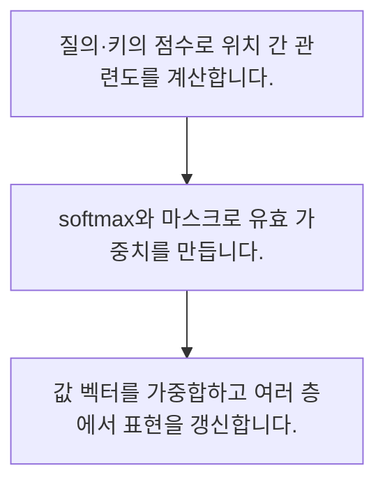

<!-- level:1 -->
# 어텐션·Transformer와 위치 정보

> **한 문장으로:** 어텐션은 입력 위치 사이의 관련도를 가중치로 바꿔 필요한 정보를 섞고 Transformer는 이 연산을 층으로 조합합니다.

## 왜 필요한가요?

문장을 이해하려면 지금 보는 단어와 멀리 떨어진 단어의 관계도 살펴야 합니다. Attention과 Transformer의 큰 흐름을 알면 현대 언어 모델의 연결 방식과 비용을 이해하기 쉬워집니다.

## 일상에서 떠올려 보기

회의 기록을 읽으며 현재 질문과 관련된 발언에 더 큰 비중을 두는 모습과 비슷합니다. 어떤 발언을 참고할지와 그 발언의 내용은 구분됩니다.

## 순서대로 따라가기

1. 질의·키의 점수로 위치 간 관련도를 계산합니다.
2. softmax와 마스크로 유효 가중치를 만듭니다.
3. 값 벡터를 가중합하고 여러 층에서 표현을 갱신합니다.



## 처음 만나는 용어

| 용어 | 쉬운 뜻 |
|---|---|
| 질의·키·값 | 관련도 계산과 정보 집계에 쓰는 세 표현 |
| softmax | 점수를 합이 1인 양수 가중치로 바꾸는 함수 |
| 인과 마스크 | 생성 과정에서 미래 위치를 보지 못하게 하는 제약 |

**비유의 한계:** 어텐션 가중치가 곧 사람의 사고 과정이나 신뢰할 수 있는 설명은 아닙니다. 전체 구조에는 위치 정보·정규화·다른 층과 마스크도 필요합니다.

## 스스로 확인

어텐션은 주로 무엇을 계산하나요?

**답과 이유:** 위치별 정보의 가중 집계 — 관련도와 값 표현을 이용해 정보를 섞는 연산입니다.
<!-- level:2 -->
# 어텐션·Transformer와 위치 정보 — 실제 흐름 따라가기

## 읽기 전 길잡이

어텐션은 입력 위치 사이의 관련도를 가중치로 바꿔 필요한 정보를 섞고 Transformer는 이 연산을 층으로 조합합니다. 아래 예제는 외부 시스템에 연결하지 않는 작은 학습용 사례입니다. 입력, 처리 조건, 결과를 순서대로 살펴보세요.

1. 질의·키의 점수로 위치 간 관련도를 계산합니다.
2. softmax와 마스크로 유효 가중치를 만듭니다.
3. 값 벡터를 가중합하고 여러 층에서 표현을 갱신합니다.

## 예제로 확인하기

```python
import math
scores=[0,math.log(3)]; values=[2,6]
exp=[math.exp(s) for s in scores]
weights=[e/sum(exp) for e in exp]
out=sum(w*v for w,v in zip(weights,values))
assert math.isclose(out,5)
print(weights,out)
```

## 결과를 해석하기

점수 0과 log(3)을 softmax하면 가중치 0.25와 0.75가 됩니다. 값 2와 6의 가중합은 5입니다. 실제 Q·K 행렬 곱과 스케일링·여러 헤드는 생략한 학습 예제입니다.

## 실무에 옮기기 전

어텐션 가중치가 곧 사람의 사고 과정이나 신뢰할 수 있는 설명은 아닙니다. 전체 구조에는 위치 정보·정규화·다른 층과 마스크도 필요합니다. 실제 업무에서는 문맥 길이와 필요한 관계, 품질·지연·메모리를 비교합니다. 어텐션 구조의 최적화는 데이터와 평가를 통해 의미 손실 여부를 확인합니다.

## 확인 질문

예제 가중합은 얼마인가요?

**답과 이유:** 0.25 곱하기 2와 0.75 곱하기 6을 더합니다.
<!-- level:3 -->
# 어텐션·Transformer와 위치 정보 — 가상 사례로 문제 해결하기

실제 고객의 장애 기록이 아닌 학습용 재현 시나리오입니다. 결과만 바꾸기 전에 관측한 증거와 원인 가설을 구분합니다.

## 1. 어떤 문제가 생겼나요?

가상 생성 모델이 학습 때만 비정상적으로 낮은 손실을 냅니다.

## 2. 먼저 확인할 증거

각 위치가 볼 수 있는 키 범위와 마스크 모양을 확인합니다.

## 3. 원인 가설

정답의 미래 위치를 어텐션으로 참고했습니다.

## 4. 수정 방법

인과 마스크와 이동된 입력·정답 정렬을 수정합니다.

## 5. 재검증

미래 토큰을 바꿔도 과거 위치 출력이 달라지지 않는지 검사합니다.

## 놓치기 쉬운 조건

어텐션 가중치가 곧 사람의 사고 과정이나 신뢰할 수 있는 설명은 아닙니다. 전체 구조에는 위치 정보·정규화·다른 층과 마스크도 필요합니다.

## 확인 질문

학습 중 미래 정보 누출의 검사 방법은?

**답과 이유:** 인과 모델의 과거 위치는 미래 내용에 의존하면 안 됩니다.
<!-- level:4 -->
# 어텐션·Transformer와 위치 정보 — 업무와 아키텍처의 선택

## 읽기 전 길잡이

같은 개념도 업무의 규모, 오류 비용, 운영 역량에 따라 적용 방식이 달라집니다. 아래 비교는 특정 제품의 성능 순위가 아닌 선택 기준입니다.

| 선택 | 얻는 점 | 감수할 점 |
|---|---|---|
| 전체 어텐션 | 넓은 위치 관계를 직접 계산 | 긴 입력에서 계산·메모리 비용 |
| 국소·희소 어텐션 | 긴 입력 비용 완화 가능 | 접근 가능한 관계 제한 |

## 선택 기준

문맥 길이와 필요한 관계, 품질·지연·메모리를 비교합니다. 어텐션 구조의 최적화는 데이터와 평가를 통해 의미 손실 여부를 확인합니다.

## 도입과 운영에서 확인할 것

인과 마스크와 이동된 입력·정답 정렬을 수정합니다. 미래 토큰을 바꿔도 과거 위치 출력이 달라지지 않는지 검사합니다.

## 판단 연습

국소 어텐션의 주된 절충은?

**판단의 근거:** 모든 위치 관계를 계산하지 않는 대신 일부 정보 접근을 제한합니다.

참고: [PyTorch 기초](https://docs.pytorch.org/tutorials/beginner/basics/intro.html), [Attention Is All You Need](https://arxiv.org/abs/1706.03762), [DDPM 논문](https://arxiv.org/abs/2006.11239).
<!-- quizzes -->
[{"level":1,"question":"어텐션은 주로 무엇을 계산하나요?","choices":["정답의 진실성 보증","데이터 소유권","위치별 정보의 가중 집계","모든 값의 삭제"],"answer_index":2,"explanation":"관련도와 값 표현을 이용해 정보를 섞는 연산입니다."},{"level":2,"question":"예제 가중합은 얼마인가요?","choices":["8","4","2","5"],"answer_index":3,"explanation":"0.25 곱하기 2와 0.75 곱하기 6을 더합니다."},{"level":3,"question":"학습 중 미래 정보 누출의 검사 방법은?","choices":["미래 변경에 과거 출력 불변 확인","학습 손실만 보기","마스크 삭제","정답 전체 입력"],"answer_index":0,"explanation":"인과 모델의 과거 위치는 미래 내용에 의존하면 안 됩니다."},{"level":4,"question":"국소 어텐션의 주된 절충은?","choices":["문맥 무한대","비용 감소와 관계 접근 제한","항상 더 높은 정확도","위치 정보 불필요"],"answer_index":1,"explanation":"모든 위치 관계를 계산하지 않는 대신 일부 정보 접근을 제한합니다."}]
