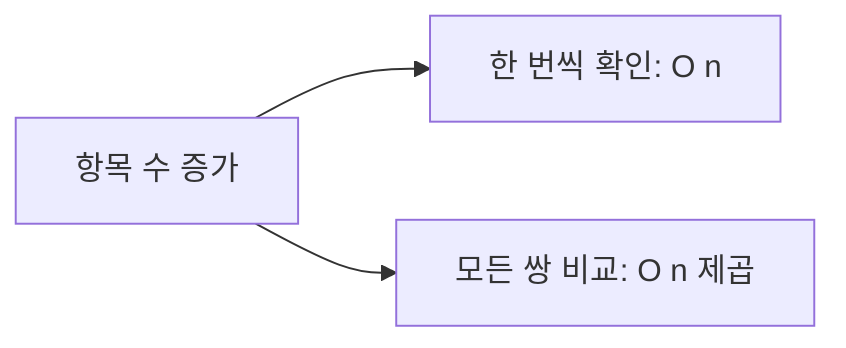

<!-- level:1 -->
# Big-O — 데이터가 늘면 일이 얼마나 늘어날까?

> **한 문장으로:** Big-O는 데이터가 커질 때 작업량이나 필요한 저장 공간이 어떤 모양으로 늘어나는지 설명합니다.

## 왜 필요한가요?

작은 목록에서는 빨랐던 기능이 사용자 수가 늘면 매우 느려질 수 있습니다. 지금 몇 초 걸리는지만 보지 않고 입력이 커질 때의 변화도 예상해야 합니다.

## 일상에서 떠올려 보기

학생 출석을 한 명씩 확인하면 학생 수만큼 확인합니다. 모든 학생을 다른 모든 학생과 한 번씩 비교하면 비교할 짝이 훨씬 많아집니다. 인원이 두 배가 될 때 일이 두 배인지, 네 배에 가까운지 생각하는 관점입니다.

## 순서대로 따라가기

1. 입력 크기를 정합니다. 목록의 항목 수를 n이라고 부를 수 있습니다.
2. 입력이 커질 때 반복되는 핵심 작업의 수를 셉니다.
3. 작업량을 주로 결정하는 증가 형태로 나타냅니다. 실제 실행 시간은 장비와 구현으로 따로 측정합니다.



## 작은 예로 확인하기

10명을 한 번씩 보면 10번, 20명을 보면 20번 확인합니다. 각 사람마다 전체 명단을 다시 훑는 단순한 방법은 10명에서 100번, 20명에서 400번 확인합니다. 뒤 방식의 대표적인 증가 형태가 O(n²)입니다.

## 처음 만나는 용어

| 용어 | 쉬운 뜻 |
|---|---|
| 입력 크기 n | 처리할 항목 수처럼 문제의 크기를 나타내는 값입니다. |
| 시간 복잡도 | 입력이 늘 때 계산 작업량이 늘어나는 형태입니다. |
| 공간 복잡도 | 입력이 늘 때 필요한 저장 공간이 늘어나는 형태입니다. |
| Big-O | 증가하는 비용의 상한을 핵심 형태로 표현하는 표기입니다. |

**비유의 한계:** O(n)이 무조건 O(n²)보다 작은 입력에서 빠르다는 뜻은 아닙니다. Big-O는 초 단위 시간표가 아니고, 입력 분포와 실제 실행 비용을 따로 확인해야 합니다.

## 스스로 확인

O(n²)이라는 표기는 ‘반드시 2초 걸린다’는 뜻일까요?

**답과 이유:** 아닙니다. 입력 크기에 따라 비용이 늘어나는 형태를 말합니다. 실제 시간은 입력값·구현·장비에 따라 측정해야 합니다.
<!-- level:2 -->
# 반복문과 측정의 입력 단위를 명확히 하기

<!-- beginner-guide:start -->
## 읽기 전 길잡이

두 중복 검사 예제에서 한 항목을 볼 때 또 얼마나 많은 항목을 보는지 세어 보세요. 두 반복문이 따로 있는지, 하나 안에 다른 하나가 있는지를 구분하면 작업량을 이해할 수 있습니다.

## 이 단계에서 만날 말

| 용어 | 쉬운 뜻 |
|---|---|
| O(1) | 입력 크기가 늘어도 해당 작업의 수가 일정한 형태입니다. |
| O(n) | 입력 크기에 비례해 작업량이 늘어나는 형태입니다. |
| O(n²) | 입력 크기의 제곱에 비례하는 대표적인 증가 형태입니다. |
| O(log n) | 범위를 반복해서 줄이며 탐색하는 경우 등에 나타나는 증가 형태입니다. |
| 최악·평균 | 가장 불리한 입력과 어떤 입력 분포를 가정한 평균 비용입니다. |
| 상수 비용 | 증가 형태는 같아도 구현마다 달라지는 실제 작업 비용입니다. |

<!-- beginner-guide:end -->

독립된 두 n길이 반복문은 O(n)이고, 각 원소마다 n개를 확인하는 중첩 반복문은 O(n²)이다. 입력이 줄어드는 이진 탐색은 정렬된 랜덤 접근 구조에서 O(log n) 비교를 한다. 중첩처럼 보여도 안쪽 포인터가 전체 실행에서 n번만 움직이면 O(n)일 수 있다.

Python 3에서 중복 검사 방법을 비교한다.

```python
def quadratic(values):
    return any(values[i] == values[j]
               for i in range(len(values))
               for j in range(i + 1, len(values)))
def with_set(values):
    seen = set()
    for value in values:
        if value in seen: return True
        seen.add(value)
    return False
assert quadratic([1, 2, 1]) == with_set([1, 2, 1]) == True
assert with_set([1, 2, 3]) == False
```

첫 방법의 최악 비교 수는 n(n-1)/2다. 두 번째는 해시 연산의 일반적인 평균 비용을 전제로 평균 O(n), 추가 공간 O(n)이다. 나쁜 해시 분포·비싼 키 비교가 있으면 이 전제가 달라진다. 조기 종료 입력만으로 최악 성장률을 측정하지 않는다.

**실습:** 중복 없는 n, 2n, 4n 입력으로 연산 수와 시간을 나눠 기록하고 메모리 비용을 함께 설명하자.
<!-- level:3 -->
# 재현 사례 — 작은 샘플에서는 빨랐던 코드가 멈춘다

<!-- beginner-guide:start -->
## 읽기 전 길잡이

데이터가 늘면서 느려질 때는 실제 입력 수와 반복 작업 수를 연결해 봅니다. 평균 시간 하나보다 크기별 실행 시간을 비교하면 증가 형태와 다른 병목을 구분하기 쉽습니다.

<!-- beginner-guide:end -->

가상 API가 100개 레코드로 테스트를 통과했지만 10만 개에서 중첩 중복 검사가 병목이 됐다. 입력 분포·최대 크기·중복 위치를 확인하고 실제 코드의 비교 횟수와 프로파일을 연결한다. 반환 결과가 작은 것과 검사 비용이 작은 것은 다르다.

**수정:** 요구가 순서 보존인지, 모든 중복 쌍을 출력해야 하는지 먼저 확인한다. 단순 존재 검사라면 set을 활용할 수 있지만 모든 쌍 출력은 결과 자체가 O(n²)일 수 있다. 메모리 제한이 강하면 정렬 후 인접 비교 등 대안도 있다.

**재검증:** 최대 입력·중복 없는 입력·맨 끝 중복·비싼 키를 비교한다. 입력 n과 처리 시간·최대 메모리를 같이 기록한다. 단일 실행의 노이즈를 줄이기 위해 동일 환경에서 반복하고 평균뿐 아니라 분포도 본다.
<!-- level:4 -->
# 복잡도와 자원 예산을 함께 선택하기

<!-- beginner-guide:start -->
## 읽기 전 길잡이

더 빠른 탐색을 위해 추가 저장 공간을 쓰는 선택이 자주 등장합니다. 처리할 데이터 크기, 자주 하는 작업, 메모리 한도에 따라 계산과 저장 비용을 비교하세요.

<!-- beginner-guide:end -->

| 선택 | 시간 특성 | 공간·운영 비용 |
|---|---|---|
| 중첩 비교 | 최악 O(n²) | 작은 추가 공간 |
| 해시 집합 | 보통 평균 O(n) | O(n) 메모리·해시 전제 |
| 정렬 후 비교 | 보통 O(n log n) | 순서 변경·정렬 구현 비용 |

입력 상한이 작은 관리 도구와 무제한 공개 API는 다른 판단을 요구한다. 더 좋은 점근 복잡도라도 구현의 상수·정확성·메모리 비용이 요구에 맞아야 한다. 공개 API에는 크기 상한·기한·큐 제한을 함께 둔다.

**판단 연습:** 중복 확인이 하루 한 번 1천 건과 매초 10만 건에서 실행된다면 같은 구현을 선택할까? 입력 단위·분포·성장·성능 예산을 ADR로 남기자.

참고: [MIT 6.006 강의 자료](https://ocw.mit.edu/courses/6-006-introduction-to-algorithms-fall-2011/pages/lecture-notes/), [Princeton Algorithms 분석](https://algs4.cs.princeton.edu/14analysis/).
<!-- quizzes -->
[{"level":1,"question":"O(n²)이 직접 설명하는 것은?","choices":["항상 실행 시간이 2초","입력 증가에 따른 지배적 비용의 성장","모든 입력의 정확한 명령 수","메모리 누수 여부"],"answer_index":1,"explanation":"점근 표기는 성장 특성을 설명합니다. 실제 시간은 상수·입력 분포·하드웨어·구현에도 영향을 받습니다."},{"level":2,"question":"두 개의 독립적인 n길이 루프를 연속 실행한 복잡도는?","choices":["O(n)","O(n²)","O(2ⁿ)","항상 O(1)"],"answer_index":0,"explanation":"비용은 n+n=2n이며 상수 배수를 제외하면 O(n)입니다. 서로 중첩되어 n번씩 반복하는 경우와 다릅니다."},{"level":3,"question":"중복 존재 검사의 성장률을 재검증할 입력으로 적절한 것은?","choices":["항상 첫 두 값만 중복","입력 크기를 고정하고 제목만 변경","중복 없는 n·2n·4n 입력과 최대 메모리","출력 길이만 측정"],"answer_index":2,"explanation":"조기 종료를 피한 입력과 크기 증가를 비교해야 최악 성장 패턴을 확인할 수 있습니다. 시간과 공간을 함께 봅니다."},{"level":4,"question":"해시 기반 개선을 선택할 때 같이 확인할 것은?","choices":["메모리는 무조건 0","모든 키 비용 동일","최악 비용은 절대 없음","추가 메모리·해시 비용·요구된 결과의 의미"],"answer_index":3,"explanation":"평균 시간 개선에는 추가 저장과 해시 전제가 필요합니다. 결과 의미와 입력 상한까지 함께 판단해야 합니다."}]
