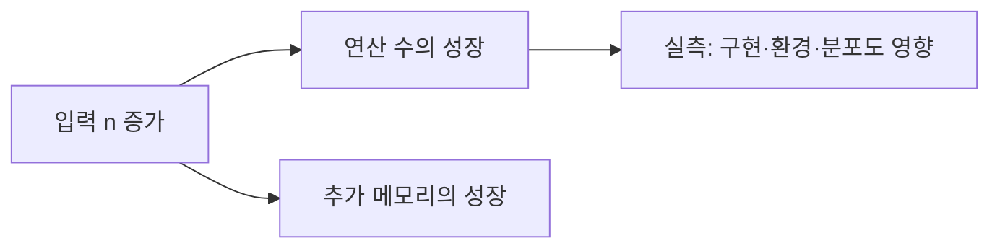

<!-- level:1 -->
# Big-O — 데이터가 커질 때 일이 얼마나 늘어나는가

책 한 권에서 특정 페이지로 바로 가는 것과 모든 페이지를 훑는 것은 책이 커질 때 비용이 다르게 늘어난다. 시간·공간 복잡도는 입력 크기 n에 따라 필요한 연산과 저장 공간이 어떻게 증가하는지 설명한다. O(1), O(log n), O(n), O(n log n), O(n²)는 초 단위의 실행 시간을 직접 뜻하지 않는다.



Big-O는 점근적인 상한 표기다. 보통 알고리즘 비교에서 사용하는 “최악 O(n)” 같은 말에는 어떤 경우를 분석하는지도 들어간다. 평균·최악·분할 상환 비용은 구분해야 한다. 작은 n에서는 상수·캐시·런타임 비용이 더 중요할 수 있다.

**비유의 한계:** 페이지 비유는 디스크·네트워크 같은 외부 자원 비용을 생략한다. 실제 병목은 CPU 연산 수뿐 아니라 I/O, 할당, 락일 수 있다.

**확인:** 입력이 두 배가 되면 O(n²) 알고리즘의 지배적인 연산 수는 대략 몇 배가 되는가? 이것이 응답 시간이 정확히 그 배라는 보장인가?
<!-- level:2 -->
# 반복문과 측정의 입력 단위를 명확히 하기

독립된 두 n길이 반복문은 O(n)이고, 각 원소마다 n개를 확인하는 중첩 반복문은 O(n²)이다. 입력이 줄어드는 이진 탐색은 정렬된 랜덤 접근 구조에서 O(log n) 비교를 한다. 중첩처럼 보여도 안쪽 포인터가 전체 실행에서 n번만 움직이면 O(n)일 수 있다.

Python 3에서 중복 검사 방법을 비교한다.

```python
def quadratic(values):
    return any(values[i] == values[j]
               for i in range(len(values))
               for j in range(i + 1, len(values)))
def with_set(values):
    seen = set()
    for value in values:
        if value in seen: return True
        seen.add(value)
    return False
assert quadratic([1, 2, 1]) == with_set([1, 2, 1]) == True
assert with_set([1, 2, 3]) == False
```

첫 방법의 최악 비교 수는 n(n-1)/2다. 두 번째는 해시 연산의 일반적인 평균 비용을 전제로 평균 O(n), 추가 공간 O(n)이다. 나쁜 해시 분포·비싼 키 비교가 있으면 이 전제가 달라진다. 조기 종료 입력만으로 최악 성장률을 측정하지 않는다.

**실습:** 중복 없는 n, 2n, 4n 입력으로 연산 수와 시간을 나눠 기록하고 메모리 비용을 함께 설명하자.
<!-- level:3 -->
# 재현 사례 — 작은 샘플에서는 빨랐던 코드가 멈춘다

가상 API가 100개 레코드로 테스트를 통과했지만 10만 개에서 중첩 중복 검사가 병목이 됐다. 입력 분포·최대 크기·중복 위치를 확인하고 실제 코드의 비교 횟수와 프로파일을 연결한다. 반환 결과가 작은 것과 검사 비용이 작은 것은 다르다.

**수정:** 요구가 순서 보존인지, 모든 중복 쌍을 출력해야 하는지 먼저 확인한다. 단순 존재 검사라면 set을 활용할 수 있지만 모든 쌍 출력은 결과 자체가 O(n²)일 수 있다. 메모리 제한이 강하면 정렬 후 인접 비교 등 대안도 있다.

**재검증:** 최대 입력·중복 없는 입력·맨 끝 중복·비싼 키를 비교한다. 입력 n과 처리 시간·최대 메모리를 같이 기록한다. 단일 실행의 노이즈를 줄이기 위해 동일 환경에서 반복하고 평균뿐 아니라 분포도 본다.
<!-- level:4 -->
# 복잡도와 자원 예산을 함께 선택하기

| 선택 | 시간 특성 | 공간·운영 비용 |
|---|---|---|
| 중첩 비교 | 최악 O(n²) | 작은 추가 공간 |
| 해시 집합 | 보통 평균 O(n) | O(n) 메모리·해시 전제 |
| 정렬 후 비교 | 보통 O(n log n) | 순서 변경·정렬 구현 비용 |

입력 상한이 작은 관리 도구와 무제한 공개 API는 다른 판단을 요구한다. 더 좋은 점근 복잡도라도 구현의 상수·정확성·메모리 비용이 요구에 맞아야 한다. 공개 API에는 크기 상한·기한·큐 제한을 함께 둔다.

**판단 연습:** 중복 확인이 하루 한 번 1천 건과 매초 10만 건에서 실행된다면 같은 구현을 선택할까? 입력 단위·분포·성장·성능 예산을 ADR로 남기자.

참고: [MIT 6.006 강의 자료](https://ocw.mit.edu/courses/6-006-introduction-to-algorithms-fall-2011/pages/lecture-notes/), [Princeton Algorithms 분석](https://algs4.cs.princeton.edu/14analysis/).
<!-- quizzes -->
[{"level":1,"question":"O(n²)이 직접 설명하는 것은?","choices":["항상 실행 시간이 2초","입력 증가에 따른 지배적 비용의 성장","모든 입력의 정확한 명령 수","메모리 누수 여부"],"answer_index":1,"explanation":"점근 표기는 성장 특성을 설명합니다. 실제 시간은 상수·입력 분포·하드웨어·구현에도 영향을 받습니다."},{"level":2,"question":"두 개의 독립적인 n길이 루프를 연속 실행한 복잡도는?","choices":["O(n)","O(n²)","O(2ⁿ)","항상 O(1)"],"answer_index":0,"explanation":"비용은 n+n=2n이며 상수 배수를 제외하면 O(n)입니다. 서로 중첩되어 n번씩 반복하는 경우와 다릅니다."},{"level":3,"question":"중복 존재 검사의 성장률을 재검증할 입력으로 적절한 것은?","choices":["항상 첫 두 값만 중복","입력 크기를 고정하고 제목만 변경","중복 없는 n·2n·4n 입력과 최대 메모리","출력 길이만 측정"],"answer_index":2,"explanation":"조기 종료를 피한 입력과 크기 증가를 비교해야 최악 성장 패턴을 확인할 수 있습니다. 시간과 공간을 함께 봅니다."},{"level":4,"question":"해시 기반 개선을 선택할 때 같이 확인할 것은?","choices":["메모리는 무조건 0","모든 키 비용 동일","최악 비용은 절대 없음","추가 메모리·해시 비용·요구된 결과의 의미"],"answer_index":3,"explanation":"평균 시간 개선에는 추가 저장과 해시 전제가 필요합니다. 결과 의미와 입력 상한까지 함께 판단해야 합니다."}]
