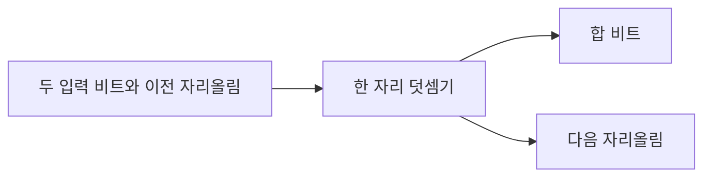

<!-- level:1 -->
# 이진 산술과 오버플로 — 자릿수가 정해진 계기판

네 자리 계기판에서 9999 다음 수를 표시할 공간이 없다면 어떤 정책이 필요할까? 비트 수가 정해진 정수도 같은 문제를 가진다. 이진 덧셈은 0+0=0, 0+1=1, 1+1=10이다. 오른쪽 자리부터 합을 쓰고 넘친 1을 다음 자리로 보내는 **자리올림**을 반복한다.



4비트 unsigned에서 15+1은 표현 범위 0~15를 넘는다. 4비트로 잘라 표시하면 0이 된다. 반면 signed 2의 보수 4비트에서 7+1은 `1000`이 되어 -8처럼 읽힌다. 최상위 자리 밖으로 나간 비트인 **carry**와, 의도한 signed 결과를 표현할 수 없다는 **overflow**는 서로 다른 조건이다.

**비유의 한계:** 모든 언어가 계기판처럼 자동으로 돌아가는 것은 아니다. Python은 더 큰 정수를 만들고, C의 signed overflow는 정의되지 않은 동작이며, 다른 언어는 예외·검사·래핑 API를 제공하기도 한다. 하드웨어 비트 결과와 언어 계약을 분리하자.

**확인:** 4비트 unsigned 15+1과 signed 7+1을 비교해 보자. 두 양수를 더했는데 음수처럼 보이면 어떤 조건을 의심해야 할까?
<!-- level:2 -->
# 덧셈기의 결과와 언어의 보장

한 비트 전가산기는 입력 a, b, carry-in을 받아 합 `a XOR b XOR c`와 carry-out을 계산한다. 여러 단계를 연결한 ripple-carry는 이해하기 쉽지만 이전 자리올림을 기다려야 한다. 실제 CPU는 더 빠른 자리올림 계산과 파이프라이닝 등 다양한 회로 기법을 쓴다.

다음 Python 3 예제는 정확한 수학적 합을 먼저 계산해 범위를 검사한 뒤 n비트 비트 패턴도 보여 준다.

```python
def add_signed(a, b, bits):
    low, high = -(1 << (bits - 1)), (1 << (bits - 1)) - 1
    if not low <= a <= high or not low <= b <= high:
        raise ValueError("input outside signed range")
    exact = a + b
    raw = exact & ((1 << bits) - 1)
    overflow = not low <= exact <= high
    return exact, f"{raw:0{bits}b}", overflow

print(add_signed(7, 1, 4))   # (8, '1000', True)
print(add_signed(-3, 2, 4))  # (-1, '1111', False)
```

signed 덧셈의 오버플로는 같은 부호 입력들의 결과 부호가 바뀌는 경우와 연결된다. 그러나 이 설명을 모든 곱셈·변환·언어 최적화에 그대로 적용해서는 안 된다. C에서 이미 signed overflow가 일어난 뒤 결과를 검사하는 코드는 안전하지 않을 수 있다. 더 넓은 타입으로 선검사하거나 컴파일러의 checked-arithmetic 기능을 쓴다.

**실습:** -8+-1, -8+7, 7+0을 넣어 경계값을 검증하자. 표시용 비트 패턴과 수학적 합을 따로 기록하면 무엇이 잘렸는지 보인다.
<!-- level:3 -->
# 가상 장애 — 요청 길이 계산이 작은 버퍼로 돌아온다

헤더 길이와 사용자가 보낸 본문 길이를 고정 폭 타입으로 더해 메모리를 할당하는 서버를 생각하자. 합이 래핑되면 작은 버퍼를 만들고 원래 길이만큼 복사하는 오류로 이어질 수 있다. 공격 사례를 재현할 때도 운영 시스템에 보내지 말고 격리된 입력 검증 함수를 테스트한다.

```text
input_length=4294967280 header_length=32
uint32_sum=16 allocation_size=16
```

이 로그는 가상 32비트 unsigned 산술의 예다. 먼저 길이 필드의 타입, 곱셈과 덧셈 순서, 더 넓은 타입으로 바뀌는 시점을 추적한다. unsigned에서 `a > MAX - b`면 덧셈 전에 거절할 수 있다. 배열 크기 계산은 `count > MAX / element_size`처럼 곱셈도 선검사해야 한다.

**수정:** 입력 상한을 API 계약에 명시하고 checked arithmetic으로 합·곱·캐스트를 검증한다. 메모리 할당 성공만으로 안전성을 판단하지 않는다. C/C++ 학습 환경에서는 UBSan과 AddressSanitizer를 보조 도구로 쓰되 탐지 결과가 안전 증명은 아니다.

**재검증:** 최대 허용값, 한 값 초과, 0, 음수 변환, 경계 주변 랜덤 입력을 검사한다. 정수 타입을 넓힌 뒤에도 외부 포맷의 범위와 최종 할당 타입을 다시 확인한다.
<!-- level:4 -->
# 넘친 값을 어떻게 처리할 것인가

| 정책 | 적합한 예 | 위험과 비용 |
|---|---|---|
| 실패·예외 | 크기·금액·재고 계산 | 호출자가 오류를 처리해야 함 |
| 포화 산술 | 음량·영상 픽셀 제한 | 실제 초과량이 사라짐 |
| 모듈러 래핑 | 명시적 해시·순환 카운터 | 일반 수량에 쓰면 조용한 오류 |
| 임의 정밀도 | 정확한 큰 정수 계산 | 입력 크기 제한과 자원 제어 필요 |

어떤 값이 “넘침”인지 먼저 도메인에서 정한다. 금융 금액은 보통 정해진 소수점 단위의 정수 또는 정확한 decimal로 다루고, 합계 범위도 별도로 검토한다. 보안 입력 길이는 조용히 줄이지 않는다. 네트워크 시퀀스 번호의 순환 비교는 일반적인 `>` 연산과 다른 규칙을 요구할 수 있다.

대규모 서비스에서 큰 정수 타입만 선택하면 끝난다고 생각하지 않는다. 집계가 몇 년 쌓이는지, 곱셈 중간값이 어디까지 커지는지, 다른 언어와 DB에 저장할 때 좁아지는지 확인한다. 비용 상한이 없는 임의 정밀도 계산도 입력에 따라 CPU와 메모리를 소모할 수 있다.

**설계 연습:** 일별 이벤트 수의 누적 집계와 사용자 업로드 크기 계산에 각각 래핑·포화·실패 중 어떤 정책을 적용할까? 관측 지표에는 범위 초과 횟수와 거절된 입력을 포함하되 민감한 원문은 남기지 않는다.

참고: [SEI CERT — signed overflow](https://wiki.sei.cmu.edu/confluence/display/c/INT32-C.+Ensure+that+operations+on+signed+integers+do+not+result+in+overflow), [Clang UBSan](https://clang.llvm.org/docs/UndefinedBehaviorSanitizer.html).
<!-- quizzes -->
[{"level":1,"question":"자리올림과 signed 오버플로의 관계로 정확한 설명은?","choices":["언제나 같은 조건이다","오버플로는 네트워크에서만 발생한다","자리 밖 비트와 signed 표현 범위 초과는 다른 조건이다","자리올림이 없으면 모든 산술이 안전하다"],"answer_index":2,"explanation":"Carry는 자릿수 밖으로 전달되는 비트이고 signed overflow는 결과를 해당 부호 있는 범위로 표현할 수 없는 상황입니다. 두 조건을 혼동하면 검사가 잘못됩니다."},{"level":2,"question":"C signed 정수의 범위 초과를 안전하게 처리하는 출발점은?","choices":["더 넓은 타입이나 checked arithmetic으로 연산 전에 검사","범위를 넘긴 뒤 항상 결과만 비교","컴파일러 최적화가 오류를 고칠 것이라 기대","signed overflow가 항상 래핑한다고 가정"],"answer_index":0,"explanation":"C signed overflow는 정의되지 않은 동작입니다. 이미 넘친 결과를 사용한 검사는 최적화로 예상과 달라질 수 있으므로 선검사나 검증된 checked 연산을 사용합니다."},{"level":3,"question":"사용자 길이 a와 헤더 길이 b를 unsigned 최대값 MAX 안에서 더하려면 어떤 검사인가요?","choices":["a와 b의 문자열 길이만 비교","a가 홀수인지 검사","더한 결과가 작은지 뒤늦게 검사","a > MAX - b인 경우 연산 전에 거절"],"answer_index":3,"explanation":"입력들이 유효한 unsigned 범위라면 a > MAX-b는 덧셈 범위 초과 조건입니다. 실제 복사와 할당에 쓰이는 모든 타입·변환도 함께 확인해야 합니다."},{"level":4,"question":"정확한 금액 합계가 범위를 넘었을 때 기본 정책으로 가장 적절한 것은?","choices":["0으로 래핑하고 성공 처리","오류를 반환하고 거래 규칙에 따라 처리","오류를 숨기고 최고값으로 무조건 포화","최상위 비트만 제거"],"answer_index":1,"explanation":"금액의 조용한 래핑이나 임의 포화는 거래 의미를 바꿉니다. 범위 계약과 정확한 타입을 정하고 초과를 명시적으로 처리해야 합니다."}]
