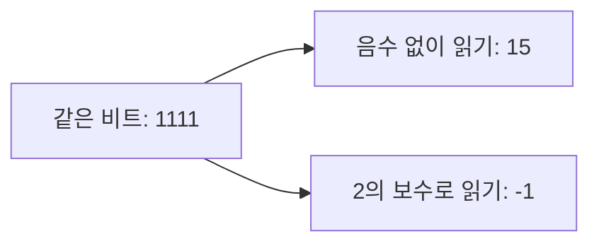

<!-- level:1 -->
# 2진수와 보수 — 0과 1로 숫자 읽기

> **한 문장으로:** 0과 1의 배열도 ‘자리의 값’과 ‘음수를 읽는 규칙’을 정하면 여러 숫자를 표현할 수 있습니다.

## 왜 필요한가요?

컴퓨터는 많은 전압을 세밀하게 구분하기보다 두 상태를 안정적으로 구분하는 방식을 널리 씁니다. 이 두 상태로 우리가 쓰는 숫자를 나타내는 규칙이 필요합니다.

## 일상에서 떠올려 보기

전등 네 개에 오른쪽부터 1점, 2점, 4점, 8점이라는 점수를 붙여 보세요. 켜진 전등의 점수를 더하면 숫자가 됩니다. 같은 전등 배열도 어떤 규칙으로 읽는지에 따라 양수나 음수를 나타낼 수 있습니다.

## 순서대로 따라가기

1. 오른쪽 자리부터 1, 2, 4, 8처럼 자리 값을 두 배씩 늘립니다.
2. 1인 자리의 값만 더합니다. 1010은 8과 2를 더해 십진수 10이 됩니다.
3. 음수까지 필요하면 별도의 읽기 규칙을 정합니다. 흔히 쓰는 ‘2의 보수’에서는 4비트 1111을 -1로 읽습니다.



## 작은 예로 확인하기

네 자리에서 0001은 1, 0010은 2, 0101은 4+1=5입니다. 1111은 음수 없는 규칙에서 8+4+2+1=15입니다. 2의 보수 규칙에서는 다른 계산법으로 -1이 됩니다. 그래서 비트 모양과 읽기 규칙을 함께 말해야 합니다.

## 처음 만나는 용어

| 용어 | 쉬운 뜻 |
|---|---|
| 2진수 | 각 자리에 0과 1만 쓰는 숫자 표기입니다. |
| 비트 | 0 또는 1 한 자리입니다. |
| 부호 | 숫자가 양수인지 음수인지 나타내는 성질입니다. |
| 2의 보수 | 정해진 비트 수 안에서 음수를 나타내는 대표적인 규칙입니다. |

**비유의 한계:** 비트에 양수·음수라는 뜻이 저절로 붙지는 않습니다. ‘1111은 -1’이라는 설명에는 비트 수와 2의 보수라는 읽기 규칙이 함께 필요합니다.

## 스스로 확인

1010을 음수 없는 네 자리 숫자로 읽으면 얼마일까요?

**답과 이유:** 10입니다. 왼쪽부터 자리 값은 8, 4, 2, 1이고, 1이 있는 8과 2만 더합니다.
<!-- level:2 -->
# 비트 폭, 해석, 바이트 순서를 분리하기

<!-- beginner-guide:start -->
## 읽기 전 길잡이

아래 예제에서는 -3을 비트로 바꿨다가 다시 숫자로 읽습니다. encode는 저장할 모양을 만들고 decode는 그 모양의 뜻을 읽습니다. 먼저 두 함수의 입력과 출력이 같은 숫자로 돌아오는지 보세요.

## 이 단계에서 만날 말

| 용어 | 쉬운 뜻 |
|---|---|
| 비트 폭 | 숫자 하나에 사용하는 비트의 개수입니다. |
| signed·unsigned | 음수를 포함하는 해석과 음수를 포함하지 않는 해석입니다. |
| 부호 확장 | 음수의 의미를 유지하면서 비트 수를 늘리는 방법입니다. |
| 바이트 | 8비트를 묶은 단위입니다. |
| 엔디언 | 여러 바이트를 어떤 순서로 저장하거나 보내는지 정한 규칙입니다. |
| 마스크 | 필요한 비트만 남기기 위해 사용하는 비트 패턴입니다. |

<!-- beginner-guide:end -->

n비트의 unsigned 값 u를 signed 2의 보수로 해석할 때, u가 2ⁿ⁻¹ 이상이면 u-2ⁿ이고 아니면 그대로 u다. 음수의 비트 폭을 늘릴 때는 부호 비트를 반복하는 **부호 확장**이 필요하다. 예를 들어 4비트 `1101`을 8비트 `11111101`로 확장해야 -3이 유지된다. `00001101`은 +13이다.

다음은 Python 3에서 고정 폭 표현을 직접 확인하는 실행 가능한 예제다. Python 정수 자체는 임의 정밀도이므로 마스크가 하드웨어의 n비트 제한을 모사한다.

```python
def encode(value, bits):
    if not -(1 << (bits - 1)) <= value < (1 << (bits - 1)):
        raise ValueError("signed range exceeded")
    return value & ((1 << bits) - 1)

def decode(raw, bits):
    return raw - (1 << bits) if raw & (1 << (bits - 1)) else raw

raw = encode(-3, 8)
print(f"{raw:08b}", decode(raw, 8))  # 11111101 -3
print((0x1234).to_bytes(2, "big").hex())     # 1234
print((0x1234).to_bytes(2, "little").hex())  # 3412
```

**엔디언**은 여러 바이트를 메모리나 전송에 놓는 순서다. 한 바이트 내부의 진법 변환과 구분해야 한다. 송신 측과 수신 측이 16비트 값의 바이트 순서를 합의하지 않으면 같은 바이트열을 서로 다르게 해석한다. 네트워크 프로토콜의 필드 정의를 우선하고 언어별 기본값에 기대지 않는다.

**실습:** 8비트 -128, -1, 0, 127을 왕복 변환하고 128을 넣었을 때 예외가 나는지 확인하자. 문자열 `"10"`, 정수 10, 바이트 `0x0a`는 같은 저장 형식이 아니다.
<!-- level:3 -->
# 재현 사례 — 센서의 -3도가 253도로 보인다

<!-- beginner-guide:start -->
## 읽기 전 길잡이

센서가 보낸 바이트는 맞는데 온도가 엉뚱하게 보이는 사례입니다. 같은 값을 음수 없는 숫자로 읽었는지, 음수를 포함해 읽었는지 비교하면 원인에 접근할 수 있습니다.

<!-- beginner-guide:end -->

가상 센서가 signed 8비트 온도를 보내는데 수신 코드가 unsigned로 읽었다고 하자.

```text
wire=fd  parsed_unsigned=253  expected_temperature=-3
```

첫 가설은 “센서가 고장났다”보다 **필드의 폭과 부호 해석이 어긋났다**다. 프로토콜 명세의 단위, signed 여부, 바이트 수, 엔디언을 확인하고 원본 바이트와 파싱 후 값을 함께 기록한다. `0xfd`는 253이지만 8비트 2의 보수로는 253-256=-3이다.

Python에서는 `int.from_bytes(bytes.fromhex("fd"), "big", signed=True)`로 -3을 얻는다. 여러 바이트라면 송수신 양쪽의 순서를 확인한다. 문자열 로그에서 `fd`를 십진수 문자열처럼 처리하는 오류도 구분한다. JavaScript 비트 연산은 대부분 32비트 정수 변환을 수반하므로 64비트 ID를 다룰 때는 BigInt 또는 검증된 바이너리 파서를 쓴다.

**수정 후 확인:** 최소·최대 값과 0, -1, 경계 바깥 입력을 테스트하고 송신→수신 왕복 결과를 비교한다. 유효하지 않은 범위를 조용히 잘라내지 말고 프로토콜 정책에 맞춰 거절하거나 별도 오류로 처리한다. 원본 패킷을 기록할 때 개인 정보나 토큰 필드는 제거한다.
<!-- level:4 -->
# 정수 저장 형식을 고르는 기준

<!-- beginner-guide:start -->
## 읽기 전 길잡이

주문 번호는 큰 값을 정확히 유지해야 하고 온도는 음수를 표현해야 합니다. 데이터의 용도와 가능한 범위를 먼저 정한 뒤 저장 형식을 선택하는 과정을 읽어 보세요.

<!-- beginner-guide:end -->

| 선택 | 유리한 상황 | 비용과 제약 |
|---|---|---|
| 고정 폭 signed 정수 | 범위가 명확한 수량·오프셋 | 범위를 넘으면 언어별 동작을 확인해야 함 |
| unsigned 정수 | 비트 마스크·원시 프로토콜 필드 | 음수와의 혼합 비교·변환에 주의 |
| 임의 정밀도 정수 | 매우 큰 정확한 정수 계산 | 값 크기에 따라 메모리·연산 비용 증가 |
| 십진수 문자열 | 이기종 시스템의 큰 ID 전달 | 더 큰 페이로드와 명시적 검증 필요 |

외부 계약에는 “정수”만 쓰지 말고 비트 폭, 부호, 범위, 단위, 엔디언, 오버플로 정책을 함께 남긴다. JavaScript Number로 모든 64비트 정수를 정확히 전달할 수 있다고 가정하지 않는다. JSON의 큰 ID를 문자열로 전달하는 선택은 계산이 필요 없는 식별자에 특히 유용하다.

대규모 저장에서 32비트와 64비트의 차이는 행 수와 인덱스 수에 곱해진다. 그러나 절약을 위해 미래 범위를 과소평가하면 스키마 변경과 데이터 이관 비용이 훨씬 커질 수 있다. 입력 경계에서 범위를 검사하고, 직렬화 계약을 버전 관리하며, 다른 언어 구현과 공통 테스트 벡터를 공유한다.

**판단 연습:** 64비트 주문 ID와 -40~125도의 센서 온도를 같은 JSON API로 전달한다면 각각 어떤 타입과 검증을 선택할 것인가? 압축·호환성·정확성 요구를 근거로 답하자.

참고: [Dive into Systems — Binary](https://diveintosystems.org/book/C4-Binary/index.html), [Python 정수·바이트 변환](https://docs.python.org/3/library/stdtypes.html#int.to_bytes).
<!-- quizzes -->
[{"level":1,"question":"같은 4비트 1111이 15 또는 -1이 될 수 있는 이유는 무엇인가요?","choices":["전압이 반드시 매번 달라지기 때문","부호와 비트 폭을 해석하는 규칙이 다르기 때문","16진수는 항상 음수이기 때문","CPU가 숫자를 무작위로 선택하기 때문"],"answer_index":1,"explanation":"비트 패턴 자체에는 부호 의미가 없습니다. unsigned 4비트에서는 15이고 2의 보수 4비트에서는 -1입니다. 진법 표기는 값의 해석 규칙과 구분해야 합니다."},{"level":2,"question":"4비트 2의 보수 1101을 -3으로 유지하며 8비트로 확장한 결과는?","choices":["00001101","10000011","11111101","00000011"],"answer_index":2,"explanation":"음수는 최상위 부호 비트를 반복해 확장합니다. 11111101은 unsigned 253에서 256을 뺀 -3이며, 00001101은 +13입니다."},{"level":3,"question":"signed 8비트 센서값 fd가 253으로 표시될 때 첫 확인으로 적절한 것은?","choices":["필드의 비트 폭과 signed 해석 계약 확인","모든 센서를 즉시 교체","DNS TTL 변경","암호화 키 길이를 두 배로 증가"],"answer_index":0,"explanation":"fd는 unsigned로 253이지만 signed 8비트로 -3입니다. 원본 바이트와 파싱 규칙을 비교하면 하드웨어 장애와 해석 오류를 구분할 수 있습니다."},{"level":4,"question":"JavaScript 클라이언트에 정확한 큰 64비트 주문 식별자를 보내는 계약으로 적절한 것은?","choices":["무조건 Number로 반올림해서 전달","최상위 비트를 삭제","숫자 범위를 문서화하지 않음","십진수 문자열로 전달하고 범위를 검증"],"answer_index":3,"explanation":"모든 64비트 정수가 Number로 정확히 표현되지는 않습니다. 계산하지 않는 식별자는 문자열 계약과 검증으로 정밀도를 보존할 수 있습니다."}]
