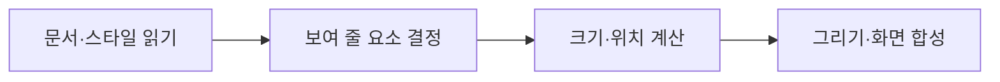

<!-- level:1 -->
# 브라우저 렌더링 — 코드가 화면이 되는 순서

> **한 문장으로:** 브라우저는 문서 구조와 스타일을 읽고 각 요소의 위치를 계산한 뒤 화면에 그립니다.

## 왜 필요한가요?

서버가 글과 스타일 코드를 보냈다고 바로 화면이 완성되는 것은 아닙니다. 브라우저가 읽고 배치하고 그리는 과정이 있어야 사용자가 볼 수 있습니다.

## 일상에서 떠올려 보기

전시회를 준비하며 작품 목록을 정리하고, 배치 규칙을 읽고, 작품 크기와 위치를 정한 뒤 실제로 설치한다고 생각해 보세요. 문서 구조·스타일·배치·그리기는 서로 다른 단계입니다.

## 순서대로 따라가기

1. HTML을 읽어 요소의 구조를 만들고 CSS에서 표시 규칙을 읽습니다.
2. 화면에 필요한 요소의 크기와 위치를 계산합니다. 이 과정이 layout입니다.
3. 색·글자·테두리를 그리고 필요한 층을 합쳐 화면에 표시합니다. 코드가 구조와 스타일을 바꾸면 관련 작업을 다시 할 수 있습니다.



## 작은 예로 확인하기

사진이 내려온 뒤 갑자기 큰 영역을 차지하면 아래 글이 밀릴 수 있습니다. 사진의 공간을 미리 정해 두면 화면 변화가 줄 수 있습니다. layout은 사진의 내용보다 요소의 크기와 위치를 계산하는 단계입니다.

## 처음 만나는 용어

| 용어 | 쉬운 뜻 |
|---|---|
| HTML | 페이지 요소와 문서 구조를 표현하는 언어입니다. |
| CSS | 요소의 모양·배치 규칙을 표현하는 언어입니다. |
| DOM | 브라우저가 다룰 수 있도록 만든 문서 구조입니다. |
| layout·paint | 요소의 크기·위치를 계산하는 일과 실제 모습으로 그리는 일입니다. |

**비유의 한계:** 실제 브라우저는 일부 작업을 재사용하고 단계를 겹쳐 처리하기도 합니다. 모든 변경이 전체 화면의 모든 단계를 다시 실행하는 것은 아닙니다.

## 스스로 확인

요소가 몇 픽셀 크기이고 어디에 놓일지 정하는 단계는 무엇일까요?

**답과 이유:** layout입니다. 그 결과를 이용해 색과 글자 등을 그리는 작업이 이어집니다.
<!-- level:2 -->
# 파싱·실행·렌더링의 순서

<!-- beginner-guide:start -->
## 읽기 전 길잡이

HTML 예제에서는 스타일을 바꾸는 코드와 크기를 읽는 코드를 찾아보세요. 바꾸기와 확인을 반복하면 브라우저가 배치 계산을 다시 해야 할 수 있습니다.

## 이 단계에서 만날 말

| 용어 | 쉬운 뜻 |
|---|---|
| 파싱 | 문서를 읽어 구조와 규칙으로 분석하는 과정입니다. |
| critical path | 첫 화면을 표시하기 전에 거쳐야 하는 중요한 처리 경로입니다. |
| parser-blocking | 문서를 읽는 진행이 특정 스크립트 때문에 기다리는 상태입니다. |
| defer·async | 외부 스크립트의 가져오기·실행 시점을 지정하는 방식입니다. |
| hydration | 서버가 만든 화면에 클라이언트 코드의 동작을 연결하는 과정입니다. |
| compositing | 여러 화면 층을 최종 표시로 합성하는 과정입니다. |

<!-- beginner-guide:end -->

일반적인 parser-blocking script는 HTML 파싱을 중단할 수 있다. defer, async, module script의 실행 시점과 순서 보장은 다르다. 외부 CSS와 JavaScript가 critical path에 있는지 확인한다. DOM 준비, 리소스 완료, React hydration은 서로 다른 사건이다.

아래는 로컬 HTML에서 실행 가능한 layout 관측 예제다.

```html
<div id="box" style="width:100px;height:20px;background:teal"></div>
<script>
const box = document.querySelector('#box');
requestAnimationFrame(() => {
  const width = box.getBoundingClientRect().width;
  box.style.width = `${width + 20}px`;
});
</script>
```

레이아웃 정보를 읽고 스타일을 반복 변경하는 코드는 강제 동기 layout을 유발할 수 있다. 읽기를 묶고 쓰기를 묶는 방식으로 재계산 횟수를 줄인다. requestAnimationFrame은 프레임 시점의 기회를 제공하지만 무거운 계산을 자동으로 빠르게 만들지 않는다.

SSR은 서버에서 초기 HTML을 만들고 hydration은 클라이언트 상호작용을 연결한다. 처음부터 서버와 클라이언트가 다른 텍스트·시간·랜덤 결과를 렌더링하면 불일치가 생길 수 있다.
<!-- level:3 -->
# 가상 장애 — 스크롤과 입력이 버벅인다

<!-- beginner-guide:start -->
## 읽기 전 길잡이

스크롤과 입력이 끊기는 상황을 봅니다. 데이터 내려받기와 JavaScript 실행, 배치 계산 중 어느 부분이 오래 걸리는지 개발자 도구로 나누어 확인하세요.

<!-- beginner-guide:end -->

가상 목록 화면이 각 요소의 높이를 읽고 바로 스타일을 쓰는 루프를 수행한다. Performance 패널에서 scripting·style·layout·paint 시간과 긴 main-thread 작업을 확인한다. 네트워크 지연과 화면 계산 지연을 분리한다.

**수정:** DOM 읽기·쓰기를 배치하고, 필요 이상 요소를 줄이거나 virtualization을 검토한다. layout을 자주 바꾸는 애니메이션 대신 transform·opacity를 비교하되 compositing·레이어 메모리를 측정한다. 입력 핸들러의 계산을 줄이고 적절한 worker 경계를 검토한다.

**재검증:** 실제 목표 기기·CPU 제한·긴 목록·키보드와 스크린리더 사용을 확인한다. FPS 하나만 아니라 입력 반응·layout shift·메모리와 기능 정확성을 비교한다.
<!-- level:4 -->
# 초기 표시와 상호작용의 선택

<!-- beginner-guide:start -->
## 읽기 전 길잡이

서버에서 어느 화면을 준비할지와 브라우저에서 얼마나 계산할지를 비교합니다. 첫 표시 속도뿐 아니라 사용자 입력 반응과 이후 변경 비용도 함께 판단하세요.

<!-- beginner-guide:end -->

| 방식 | 이득 | 부담 |
|---|---|---|
| CSR | 클라이언트 상태 흐름 유연 | JS·데이터 다운로드 후 표시 |
| SSR | 초기 HTML과 요청별 데이터 | 서버 비용·hydration·캐시 |
| 정적 생성 | CDN 전달과 낮은 서버 비용 | 신선도·개인화 경계 |
| streaming | 준비된 부분부터 표시 | 로딩·오류·경계 설계 |

컨텐츠·개인화·상호작용·신선도 요구로 경계를 정한다. 서버 렌더링이 클라이언트 JS 비용을 자동 제거하지 않는다. 대형 그래프나 에디터는 클라이언트가 필요할 수 있지만 핵심 설명과 탐색에는 가벼운 초기 경로를 제공할 수 있다.

**판단 연습:** 로그인별 진도 지도와 공개 안내문을 같은 캐시·렌더링 방식으로 처리할까? 실제 데이터 경계를 잘못 정하면 이 앱의 이전 체험 데이터 고정 문제처럼 사용자가 잘못된 상태를 볼 수 있다.

참고: [MDN Critical Rendering Path](https://developer.mozilla.org/en-US/docs/Web/Performance/Guides/Critical_rendering_path), [web.dev Layout Thrashing](https://web.dev/articles/avoid-large-complex-layouts-and-layout-thrashing).
<!-- quizzes -->
[{"level":1,"question":"layout 단계가 주로 결정하는 것은?","choices":["요소의 크기와 위치","DB 격리 수준","DNS 권한","암호 키 교환"],"answer_index":0,"explanation":"스타일을 바탕으로 기하 정보를 계산합니다. paint와 compositing은 그리기·결합의 다른 책임을 갖습니다."},{"level":2,"question":"DOM 크기 읽기와 스타일 쓰기를 반복하면 생길 수 있는 것은?","choices":["항상 layout 비용 0","강제 동기 layout과 반복 계산","인증 자동 완료","모든 JS가 GPU 실행"],"answer_index":1,"explanation":"쓰기 뒤 최신 layout 정보 읽기가 재계산을 요구할 수 있습니다. 읽기와 쓰기를 묶고 실제 엔진의 비용을 측정합니다."},{"level":3,"question":"화면 버벅임 개선 효과를 확인할 대상은?","choices":["개발자 고성능 기기만","파일 크기만","목표 기기의 입력·layout·paint·메모리와 기능","FPS만 높으면 성공"],"answer_index":2,"explanation":"사용자 환경의 실제 병목과 접근성을 확인해야 합니다. 한 지표 개선이 다른 비용이나 기능 손실을 숨길 수 있습니다."},{"level":4,"question":"SSR에 대한 정확한 설명은?","choices":["항상 클라이언트 JS가 0","모든 데이터를 정적으로 고정","서버 비용이 없음","초기 HTML을 제공하지만 hydration·캐시·JS 비용은 별도"],"answer_index":3,"explanation":"SSR의 효과와 이후 상호작용 비용은 구분합니다. 개인화·신선도에 맞는 캐시와 렌더링 경계를 정해야 합니다."}]
