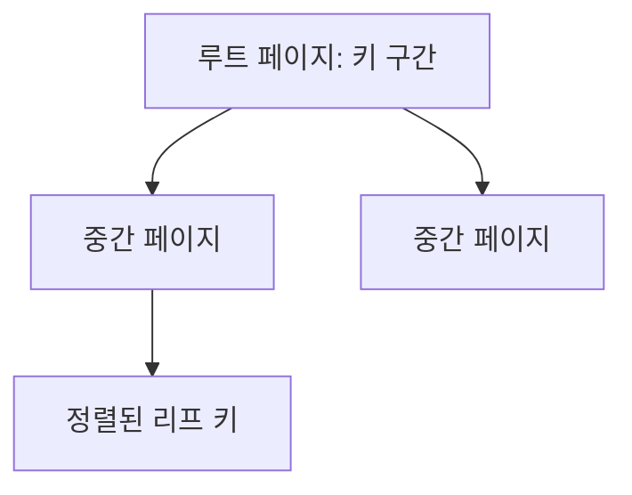

<!-- level:1 -->
# B-Tree 인덱스 — 정렬된 색인으로 페이지를 줄이기

책의 색인에서 항목을 찾아 해당 페이지로 가면 책 전체를 훑지 않아도 된다. DB 인덱스는 키와 행 위치를 찾는 구조를 유지해 일부 조회를 빠르게 한다. B-Tree 계열은 많은 키를 페이지에 담고 정렬된 탐색 경로를 만든다. 단순 이진 탐색 트리처럼 자식이 둘뿐인 구조가 아니다.



인덱스는 읽기를 돕지만 행 삽입·삭제·수정 때 함께 유지해야 한다. 거의 모든 행을 읽는 쿼리는 테이블을 순차 스캔하는 편이 더 나을 수 있다. 인덱스가 있다는 사실과 옵티마이저가 그 인덱스를 선택하는 것은 다르다.

**비유의 한계:** 색인 페이지도 저장장치와 메모리를 쓰며 업데이트 비용이 있다. “인덱스는 많을수록 좋다”는 결론은 쓰기와 운영 비용을 생략한다.
<!-- level:2 -->
# 복합 키 순서와 실제 계획

복합 B-Tree `(tenant_id, created_at)`는 앞 키의 조건과 뒤 키 범위가 조합되는 조회를 지원할 수 있다. 모든 조건에서 같은 효율을 보장하지 않으며 옵티마이저의 선택은 통계·버전·조건에 따른다. 함수·타입 변환·콜레이션이 조건과 인덱스의 관계를 바꿀 수 있다.

PostgreSQL 17 학습용 실행 예제다. `EXPLAIN ANALYZE`는 쿼리를 실제 실행한다.

```sql
CREATE TEMP TABLE events_demo AS
SELECT i AS id, i % 100 AS tenant_id, i AS created_at
FROM generate_series(1,10000) i;
CREATE INDEX ON events_demo(tenant_id,created_at);
ANALYZE events_demo;
EXPLAIN (ANALYZE, BUFFERS)
SELECT * FROM events_demo
WHERE tenant_id=7 AND created_at>=9000;
```

작은 데이터에서는 다른 계획도 합리적일 수 있다. 예상 행 수와 실제 행 수, 읽은 buffer, 실행 시간을 확인한다. index-only scan은 필요한 컬럼이 인덱스에 있고 가시성 조건 등이 맞아야 하며 항상 heap 접근이 0인 것은 아니다.
<!-- level:3 -->
# 가상 장애 — 인덱스를 넣었는데도 조회가 느리다

가상 조회가 대부분 행을 반환하거나 통계가 낡아 인덱스 선택이 기대와 다르다. 계획의 estimated rows와 actual rows를 비교하고 필터·정렬·조인 중 어디가 비용을 쓰는지 본다. 운영의 쓰기 쿼리에 ANALYZE를 붙이면 실제 변경되므로 읽기 또는 격리 환경에서 검증한다.

**수정:** 워크로드에 맞는 키 순서·부분 인덱스·표현식 인덱스를 검토하고 통계·쿼리 조건을 정렬한다. 강제로 인덱스 스캔을 택하게 하는 설정을 영구 해결로 삼지 않는다. 큰 LIMIT 없는 응답과 불필요한 컬럼 전송도 줄인다.

**재검증:** 대표 tenant·핫키·희소 조건·넓은 범위와 동시 쓰기 부하를 비교한다. 읽기 p95뿐 아니라 삽입 지연·인덱스 크기·vacuum 운영도 확인한다.
<!-- level:4 -->
# 인덱스의 이득과 유지 비용

| 선택 | 장점 | 부담 |
|---|---|---|
| B-Tree | 동등·정렬·범위 조회 | 갱신·분할·저장 공간 |
| covering 인덱스 | 조회에 필요한 값 포함 | 크기·쓰기 증폭 |
| 부분 인덱스 | 특정 행 집합에 집중 | 쿼리 조건과 predicate 일치 |
| BRIN | 물리 순서와 연관된 대형 데이터 | 정밀도가 낮아 재검사 |

인덱스 도입은 조회 패턴과 데이터 분포의 계약이다. 사용되지 않는다고 생성 직후 삭제하지 않는다. 반대로 드물게 쓰는 넓은 인덱스가 모든 쓰기의 비용을 늘리는지도 본다. 운영 생성에는 잠금·디스크·복제 지연과 concurrent 생성의 제약을 계획한다.

참고: [PostgreSQL B-Tree](https://www.postgresql.org/docs/17/btree.html), [Multicolumn Indexes](https://www.postgresql.org/docs/17/indexes-multicolumn.html), [Using EXPLAIN](https://www.postgresql.org/docs/17/using-explain.html).
<!-- quizzes -->
[{"level":1,"question":"인덱스에 대한 정확한 설명은?","choices":["모든 읽기가 반드시 빨라짐","쓰기 비용이 없음","특정 읽기를 돕지만 유지·저장 비용이 있음","항상 자식이 둘뿐"],"answer_index":2,"explanation":"인덱스는 키 탐색을 돕지만 행 변경 때 유지됩니다. 넓은 결과에서는 순차 스캔이 합리적일 수 있습니다."},{"level":2,"question":"EXPLAIN ANALYZE 사용 시 중요한 사실은?","choices":["쿼리를 실제 실행한다","계획만 보고 절대 실행하지 않음","항상 index scan 보장","통계는 필요 없음"],"answer_index":0,"explanation":"ANALYZE 옵션은 실제 실행 정보를 수집합니다. 변경 쿼리나 큰 부하의 운영 실행에 특히 주의해야 합니다."},{"level":3,"question":"예상 행 수와 실제 행 수가 크게 다르면 조사할 것은?","choices":["화면 색상","통계·데이터 분포·조건 선택도","항상 인덱스 전부 삭제","HTTP 메서드만"],"answer_index":1,"explanation":"옵티마이저의 추정은 통계와 조건에 의존합니다. 실제 분포를 반영하는지 확인해 계획 차이를 설명합니다."},{"level":4,"question":"covering 인덱스 도입 때 비교할 비용은?","choices":["저장 공간이 사라짐","모든 heap 읽기 자동 제거","쓰기 영향은 없음","인덱스 크기·쓰기 증폭·가시성 조건"],"answer_index":3,"explanation":"필요 컬럼을 포함하면 일부 읽기가 개선되지만 크기와 갱신 비용이 늘어납니다. index-only scan 조건도 확인해야 합니다."}]
