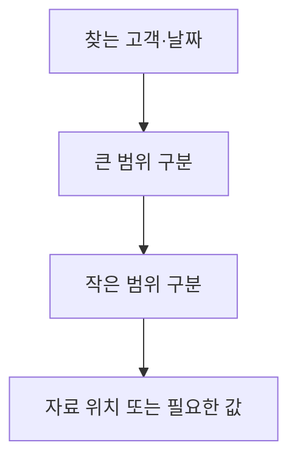

<!-- level:1 -->
# B-Tree 인덱스 — 책의 색인으로 필요한 자료 찾기

> **한 문장으로:** 데이터와 별도로 정렬된 찾기 구조를 만들어 전체 내용을 덜 훑고 필요한 위치에 접근합니다.

## 왜 필요한가요?

주문 수백만 건에서 한 고객의 최근 주문을 찾으려고 모든 행을 읽으면 비용이 큽니다. 자주 찾는 조건에 맞는 안내 구조가 필요합니다.

## 일상에서 떠올려 보기

두꺼운 책 뒤의 색인에서 단어와 페이지를 찾는 상황을 떠올려 보세요. 색인을 만들면 읽을 페이지를 좁힐 수 있습니다. 하지만 책 내용이 바뀌면 색인도 고쳐야 하고 색인을 보관할 공간도 듭니다.

## 순서대로 따라가기

1. 검색할 키를 정렬된 구조에 보관합니다.
2. 찾는 값이나 범위와 비교해 다음에 읽을 구간을 좁힙니다.
3. 필요한 데이터 위치를 읽습니다. 데이터가 추가·수정·삭제되면 인덱스도 관리합니다.



## 작은 예로 확인하기

인덱스가 ‘고객 번호, 주문 날짜’ 순서라면 한 고객의 날짜 범위를 찾는 데 도움이 될 수 있습니다. 하지만 모든 고객을 가로질러 날짜만 찾는 요청도 똑같이 유리하다고 단정할 수는 없습니다. 키 순서와 실제 조회 조건을 함께 봅니다.

## 처음 만나는 용어

| 용어 | 쉬운 뜻 |
|---|---|
| 인덱스 | 특정 조건으로 자료를 찾도록 돕는 별도의 구조입니다. |
| B-Tree | 여러 갈래의 정렬된 구간을 따라 찾는 균형 트리 계열 구조입니다. |
| 복합 인덱스 | 둘 이상의 속성을 순서 있는 키로 묶은 인덱스입니다. |
| 조회 계획 | 데이터베이스가 자료를 어떤 순서와 방법으로 읽을지 정한 계획입니다. |

**비유의 한계:** 색인이 있어도 읽을 자료가 대부분이면 전체를 훑는 편이 나을 수 있습니다. 인덱스를 늘릴수록 저장 공간과 갱신 비용이 늘며 실제 계획을 확인해야 합니다.

## 스스로 확인

인덱스는 검색을 도울 수 있는데 왜 모든 열에 무조건 만들지 않을까요?

**답과 이유:** 유지·저장 비용이 들고 모든 조회에 이득이 있지는 않기 때문입니다. 자주 쓰는 조건과 실제 실행 계획을 기준으로 정합니다.
<!-- level:2 -->
# 복합 키 순서와 실제 계획

<!-- beginner-guide:start -->
## 읽기 전 길잡이

SQL 예제에서 테이블, 복합 키 순서, 조회 조건을 먼저 보세요. EXPLAIN ANALYZE는 실제로 쿼리를 실행하므로 실행 계획 설명과 실제 결과의 관계를 차례로 읽습니다.

## 이 단계에서 만날 말

| 용어 | 쉬운 뜻 |
|---|---|
| 옵티마이저 | 예상 비용을 비교해 실행 방법을 고르는 데이터베이스 부분입니다. |
| 통계 | 값의 분포와 자료량 등을 추정하기 위한 정보입니다. |
| 선택도 | 조건이 전체 자료 중 얼마나 적은 부분을 고르는지와 관련된 성질입니다. |
| EXPLAIN | 데이터베이스의 실행 계획을 보여 주는 명령입니다. |
| EXPLAIN ANALYZE | 쿼리를 실제 실행하며 계획과 측정 결과를 보여 주는 명령입니다. |
| 쓰기 비용 | 자료와 인덱스를 변경·유지하는 데 드는 비용입니다. |

<!-- beginner-guide:end -->

복합 B-Tree `(tenant_id, created_at)`는 앞 키의 조건과 뒤 키 범위가 조합되는 조회를 지원할 수 있다. 모든 조건에서 같은 효율을 보장하지 않으며 옵티마이저의 선택은 통계·버전·조건에 따른다. 함수·타입 변환·콜레이션이 조건과 인덱스의 관계를 바꿀 수 있다.

PostgreSQL 17 학습용 실행 예제다. `EXPLAIN ANALYZE`는 쿼리를 실제 실행한다.

```sql
CREATE TEMP TABLE events_demo AS
SELECT i AS id, i % 100 AS tenant_id, i AS created_at
FROM generate_series(1,10000) i;
CREATE INDEX ON events_demo(tenant_id,created_at);
ANALYZE events_demo;
EXPLAIN (ANALYZE, BUFFERS)
SELECT * FROM events_demo
WHERE tenant_id=7 AND created_at>=9000;
```

작은 데이터에서는 다른 계획도 합리적일 수 있다. 예상 행 수와 실제 행 수, 읽은 buffer, 실행 시간을 확인한다. index-only scan은 필요한 컬럼이 인덱스에 있고 가시성 조건 등이 맞아야 하며 항상 heap 접근이 0인 것은 아니다.
<!-- level:3 -->
# 가상 장애 — 인덱스를 넣었는데도 조회가 느리다

<!-- beginner-guide:start -->
## 읽기 전 길잡이

인덱스가 있어도 느린 상황을 봅니다. 조건의 형태, 자료 분포, 읽은 행 수, 실행 계획이 기대와 같은지 비교하며 가설을 좁히세요.

<!-- beginner-guide:end -->

가상 조회가 대부분 행을 반환하거나 통계가 낡아 인덱스 선택이 기대와 다르다. 계획의 estimated rows와 actual rows를 비교하고 필터·정렬·조인 중 어디가 비용을 쓰는지 본다. 운영의 쓰기 쿼리에 ANALYZE를 붙이면 실제 변경되므로 읽기 또는 격리 환경에서 검증한다.

**수정:** 워크로드에 맞는 키 순서·부분 인덱스·표현식 인덱스를 검토하고 통계·쿼리 조건을 정렬한다. 강제로 인덱스 스캔을 택하게 하는 설정을 영구 해결로 삼지 않는다. 큰 LIMIT 없는 응답과 불필요한 컬럼 전송도 줄인다.

**재검증:** 대표 tenant·핫키·희소 조건·넓은 범위와 동시 쓰기 부하를 비교한다. 읽기 p95뿐 아니라 삽입 지연·인덱스 크기·vacuum 운영도 확인한다.
<!-- level:4 -->
# 인덱스의 이득과 유지 비용

<!-- beginner-guide:start -->
## 읽기 전 길잡이

검색 시간만 줄이려고 많은 인덱스를 추가하면 쓰기와 저장 비용이 늘 수 있습니다. 중요한 조회와 자료 갱신량을 함께 계산해 선택하세요.

<!-- beginner-guide:end -->

| 선택 | 장점 | 부담 |
|---|---|---|
| B-Tree | 동등·정렬·범위 조회 | 갱신·분할·저장 공간 |
| covering 인덱스 | 조회에 필요한 값 포함 | 크기·쓰기 증폭 |
| 부분 인덱스 | 특정 행 집합에 집중 | 쿼리 조건과 predicate 일치 |
| BRIN | 물리 순서와 연관된 대형 데이터 | 정밀도가 낮아 재검사 |

인덱스 도입은 조회 패턴과 데이터 분포의 계약이다. 사용되지 않는다고 생성 직후 삭제하지 않는다. 반대로 드물게 쓰는 넓은 인덱스가 모든 쓰기의 비용을 늘리는지도 본다. 운영 생성에는 잠금·디스크·복제 지연과 concurrent 생성의 제약을 계획한다.

참고: [PostgreSQL B-Tree](https://www.postgresql.org/docs/17/btree.html), [Multicolumn Indexes](https://www.postgresql.org/docs/17/indexes-multicolumn.html), [Using EXPLAIN](https://www.postgresql.org/docs/17/using-explain.html).
<!-- quizzes -->
[{"level":1,"question":"인덱스에 대한 정확한 설명은?","choices":["모든 읽기가 반드시 빨라짐","쓰기 비용이 없음","특정 읽기를 돕지만 유지·저장 비용이 있음","항상 자식이 둘뿐"],"answer_index":2,"explanation":"인덱스는 키 탐색을 돕지만 행 변경 때 유지됩니다. 넓은 결과에서는 순차 스캔이 합리적일 수 있습니다."},{"level":2,"question":"EXPLAIN ANALYZE 사용 시 중요한 사실은?","choices":["쿼리를 실제 실행한다","계획만 보고 절대 실행하지 않음","항상 index scan 보장","통계는 필요 없음"],"answer_index":0,"explanation":"ANALYZE 옵션은 실제 실행 정보를 수집합니다. 변경 쿼리나 큰 부하의 운영 실행에 특히 주의해야 합니다."},{"level":3,"question":"예상 행 수와 실제 행 수가 크게 다르면 조사할 것은?","choices":["화면 색상","통계·데이터 분포·조건 선택도","항상 인덱스 전부 삭제","HTTP 메서드만"],"answer_index":1,"explanation":"옵티마이저의 추정은 통계와 조건에 의존합니다. 실제 분포를 반영하는지 확인해 계획 차이를 설명합니다."},{"level":4,"question":"covering 인덱스 도입 때 비교할 비용은?","choices":["저장 공간이 사라짐","모든 heap 읽기 자동 제거","쓰기 영향은 없음","인덱스 크기·쓰기 증폭·가시성 조건"],"answer_index":3,"explanation":"필요 컬럼을 포함하면 일부 읽기가 개선되지만 크기와 갱신 비용이 늘어납니다. index-only scan 조건도 확인해야 합니다."}]
