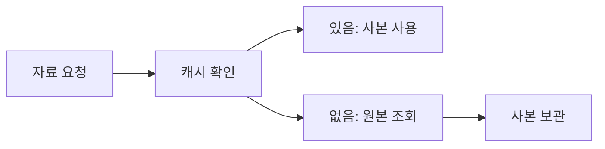

<!-- level:1 -->
# 캐싱 전략 — 자주 찾는 답을 잠시 가까이 보관하기

> **한 문장으로:** 반복해서 읽는 자료의 사본을 빠른 곳에 두고, 원본이 바뀔 때 사본을 어떻게 다룰지 정합니다.

## 왜 필요한가요?

상품 정보를 볼 때마다 느린 저장소를 읽으면 서버와 사용자 모두 기다립니다. 재사용 가능한 결과를 보관해 비용을 줄일 수 있지만 오래된 값의 위험이 생깁니다.

## 일상에서 떠올려 보기

전화로 물은 영업시간을 메모해 두면 다음에는 다시 전화하지 않아도 됩니다. 하지만 휴일 영업시간이 바뀌면 메모가 틀릴 수 있습니다. 얼마 동안 믿고 쓸지와 변경을 어떻게 알지 정해야 합니다.

## 순서대로 따라가기

1. 요청한 값이 캐시에 있는지 먼저 확인합니다.
2. 없으면 원본을 읽고 사본을 보관해 다음 요청에 활용합니다.
3. 원본이 바뀔 때 캐시를 갱신·삭제하거나 만료되도록 하는 규칙을 정합니다.



## 작은 예로 확인하기

TTL을 5분으로 정하면 사본을 최대 그 기간 동안 사용할 수 있지만, 그 사이 원본 가격이 바뀌어도 자동으로 즉시 최신이 되지는 않습니다. 결제에 사용할 가격과 상품 목록의 표시 가격에 같은 오래된 값 허용 정책을 적용할지도 따져야 합니다.

## 처음 만나는 용어

| 용어 | 쉬운 뜻 |
|---|---|
| 캐시 | 재사용하려고 임시 보관한 데이터 사본입니다. |
| 원본 | 기준이 되는 저장소의 데이터입니다. |
| TTL | 사본을 얼마나 오래 사용할 수 있을지 정한 시간입니다. |
| 캐시 무효화 | 더는 사용하면 안 되는 사본을 삭제하거나 갱신하는 것입니다. |

**비유의 한계:** 캐시는 언제나 정확한 답을 가진 지름길이 아닙니다. TTL 전에도 공간 정책으로 없어질 수 있고, 캐시 서버도 실패할 수 있습니다. 원본과 읽기 계약을 정해야 합니다.

## 스스로 확인

TTL을 설정했으면 원본이 바뀐 직후 모든 사용자가 새 값을 읽을까요?

**답과 이유:** 보장하지 않습니다. 아직 유효한 사본이 남을 수 있습니다. 즉시 반영이 필요하면 별도의 갱신·무효화 정책을 설계해야 합니다.
<!-- level:2 -->
# cache-aside와 경계

<!-- beginner-guide:start -->
## 읽기 전 길잡이

TTL 예제에서 사본의 값과 만료 시점을 구분해 보세요. 캐시에 없을 때 원본으로 가는 흐름이 어디인지 찾고, 단일 프로세스 예제의 범위도 확인합니다.

## 이 단계에서 만날 말

| 용어 | 쉬운 뜻 |
|---|---|
| cache-aside | 앱이 캐시를 찾고 없으면 원본을 읽어 채우는 방식입니다. |
| write-through | 쓰기 경로에서 캐시와 원본 반영을 연결하는 방식입니다. |
| write-behind | 캐시 등에 받은 변경을 나중에 원본으로 반영하는 방식입니다. |
| eviction | 공간 관리 정책 때문에 사본을 캐시에서 내보내는 것입니다. |
| stampede | 같은 사본이 사라져 많은 요청이 원본으로 한꺼번에 몰리는 현상입니다. |
| local·distributed cache | 한 프로세스 안의 캐시와 여러 서버가 접근하는 캐시입니다. |

<!-- beginner-guide:end -->

cache-aside는 앱이 캐시를 읽고 미스면 원본을 읽어 채운다. write-through, write-behind 등은 쓰기의 경계를 다르게 만든다. 만료와 eviction은 다르다. TTL 전에도 용량 정책으로 값이 사라질 수 있다.

Python 3의 **단일 프로세스 학습용** TTL 예제다.

```python
import time
cache = {}
def get_value(key, loader, ttl=5):
    now = time.monotonic()
    item = cache.get(key)
    if item and item[1] > now: return item[0]
    value = loader(key)
    cache[key] = (value, now + ttl)
    return value
assert get_value("x", lambda _: 7) == 7
```

운영 구현에는 용량 상한·동시 miss 합치기·오류·취소·통계가 필요하다. 음수 결과 캐시도 수명을 정하고, 오류 응답을 정상 값처럼 오래 저장하지 않는다. 원본 쓰기와 캐시 삭제 사이 경쟁으로 stale 값이 다시 채워질 수 있어 불변 버전 키·검증·재구축 전략을 비교한다.
<!-- level:3 -->
# 가상 장애 — 인기 키 만료 때 DB가 급증한다

<!-- beginner-guide:start -->
## 읽기 전 길잡이

한 값의 만료 시점에 요청이 몰리는 장애를 봅니다. 캐시가 사라진 뒤 얼마나 많은 요청이 원본으로 갔는지 확인하고 중복 조회와 부하를 제한하는 방법을 읽으세요.

<!-- beginner-guide:end -->

가상 이벤트 시작 시간에 수천 요청이 같은 캐시 miss를 만나 DB를 동시에 조회한다. hit ratio의 전체 평균만 보면 짧은 부하 폭발을 놓친다. 키별 miss, loader 동시성, DB 지연과 만료 시각을 연결한다.

**수정:** 요청 합치기(single-flight), TTL 지터, stale-while-revalidate, 제한된 재생성 등을 검토한다. 분산 락을 쓰면 lease·소유자 실패·fencing을 검토한다. 오래된 값을 제공하는 정책은 업무 신선도 요구가 허용할 때만 적용한다.

**재검증:** 캐시 비어 있음·대량 만료·캐시 장애·loader 실패에서 원본 부하와 사용자 오류를 확인한다. 캐시가 없을 때도 전체 시스템의 유입을 제한할 수 있어야 한다.
<!-- level:4 -->
# 로컬·공유 캐시와 정확성

<!-- beginner-guide:start -->
## 읽기 전 길잡이

응답 속도와 최신 값의 필요 사이에서 정책을 고릅니다. 원본 장애, 사본 갱신 비용, 여러 서버 사이의 변경 반영을 함께 비교하세요.

<!-- beginner-guide:end -->

| 선택 | 이득 | 비용 |
|---|---|---|
| 로컬 | 네트워크 비용 낮음 | 서버별 불일치·중복 메모리 |
| 분산 | 공유·중앙 용량 관리 | 네트워크·장애·운영 의존 |
| 다층 | 핫키 빠른 접근 | 무효화와 관측 복잡성 |

가격·권한·잔고와 추천 목록은 허용 stale 비용이 다르다. 키 구성과 보관 기간을 원본의 의미·보안 경계에 맞춘다. 캐시 용량·hit ratio·p95 miss 비용·eviction·재생성 실패율을 함께 관측한다. 캐시를 원본처럼 쓴다면 내구성과 복구 계약이 별도로 필요하다.

참고: [Redis Client-side caching](https://redis.io/docs/latest/develop/reference/client-side-caching/), [Microsoft Cache-aside](https://learn.microsoft.com/en-us/azure/architecture/patterns/cache-aside).
<!-- quizzes -->
[{"level":1,"question":"TTL이 직접 보장하지 않는 것은?","choices":["정해진 만료 조건","캐시 값의 제한된 수명 정책","미스 후 원본 조회 가능성","모든 쓰기 직후 최신 읽기"],"answer_index":3,"explanation":"TTL은 만료 정책이지 강한 최신성 보장이 아닙니다. 쓰기·무효화 경쟁과 업무 신선도 계약을 따로 설계합니다."},{"level":2,"question":"TTL 만료와 eviction의 차이는?","choices":["수명 만료와 용량 정책에 따른 제거를 구분","완전히 같은 원인","eviction은 절대 발생하지 않음","TTL 전이면 항상 존재"],"answer_index":0,"explanation":"메모리 압력과 정책으로 만료 전에도 값이 제거될 수 있습니다. 앱은 언제든 미스를 처리해야 합니다."},{"level":3,"question":"인기 키의 동시 miss 폭주를 줄일 방법은?","choices":["모든 요청이 동시에 재생성","single-flight·지터·제한된 재생성","원본 한도 제거","오류 영구 캐싱"],"answer_index":1,"explanation":"재생성을 합치거나 분산하고 상한을 두어 원본 폭주를 줄입니다. stale 제공은 업무 요구가 허용하는 경우에만 선택합니다."},{"level":4,"question":"사용자별 캐시 키 설계에서 중요한 것은?","choices":["키는 항상 URL만","권한은 캐시에 필요 없음","tenant·사용자·버전·신선도 경계","hit ratio만 최대화"],"answer_index":2,"explanation":"키가 보안·데이터 의미를 잘못 섞으면 다른 사용자 정보가 노출될 수 있습니다. 정확성과 신선도도 함께 관리합니다."}]
