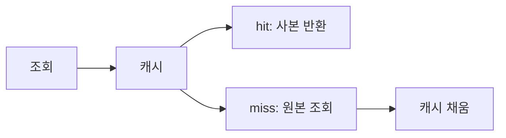

<!-- level:1 -->
# 캐싱 — 빠른 사본과 신선도의 계약

자주 쓰는 안내문을 옆에 복사해 놓으면 원본 보관소에 매번 가지 않아도 된다. 캐시는 반복 계산·조회 비용을 줄이는 사본이다. 로컬 캐시는 프로세스 안에서 빠르게, 분산 캐시는 여러 서버가 공유하는 별도 시스템에서 값을 제공한다.



원본이 바뀌면 캐시를 언제 바꿀지 정해야 한다. TTL은 오래된 사본을 제한할 수 있지만 모든 쓰기 직후 최신 읽기를 보장하지는 않는다. 캐시 미스가 한꺼번에 몰리면 원본으로 부하가 집중되는 stampede가 생길 수 있다.

**비유의 한계:** 캐시는 실패하지 않는 저장소가 아니다. 잘못된 값·권한이 섞이면 더 빠르게 잘못된 결과를 확산시킬 수 있다. 사용자·tenant·버전이 키에 필요한지 검토한다.
<!-- level:2 -->
# cache-aside와 경계

cache-aside는 앱이 캐시를 읽고 미스면 원본을 읽어 채운다. write-through, write-behind 등은 쓰기의 경계를 다르게 만든다. 만료와 eviction은 다르다. TTL 전에도 용량 정책으로 값이 사라질 수 있다.

Python 3의 **단일 프로세스 학습용** TTL 예제다.

```python
import time
cache = {}
def get_value(key, loader, ttl=5):
    now = time.monotonic()
    item = cache.get(key)
    if item and item[1] > now: return item[0]
    value = loader(key)
    cache[key] = (value, now + ttl)
    return value
assert get_value("x", lambda _: 7) == 7
```

운영 구현에는 용량 상한·동시 miss 합치기·오류·취소·통계가 필요하다. 음수 결과 캐시도 수명을 정하고, 오류 응답을 정상 값처럼 오래 저장하지 않는다. 원본 쓰기와 캐시 삭제 사이 경쟁으로 stale 값이 다시 채워질 수 있어 불변 버전 키·검증·재구축 전략을 비교한다.
<!-- level:3 -->
# 가상 장애 — 인기 키 만료 때 DB가 급증한다

가상 이벤트 시작 시간에 수천 요청이 같은 캐시 miss를 만나 DB를 동시에 조회한다. hit ratio의 전체 평균만 보면 짧은 부하 폭발을 놓친다. 키별 miss, loader 동시성, DB 지연과 만료 시각을 연결한다.

**수정:** 요청 합치기(single-flight), TTL 지터, stale-while-revalidate, 제한된 재생성 등을 검토한다. 분산 락을 쓰면 lease·소유자 실패·fencing을 검토한다. 오래된 값을 제공하는 정책은 업무 신선도 요구가 허용할 때만 적용한다.

**재검증:** 캐시 비어 있음·대량 만료·캐시 장애·loader 실패에서 원본 부하와 사용자 오류를 확인한다. 캐시가 없을 때도 전체 시스템의 유입을 제한할 수 있어야 한다.
<!-- level:4 -->
# 로컬·공유 캐시와 정확성

| 선택 | 이득 | 비용 |
|---|---|---|
| 로컬 | 네트워크 비용 낮음 | 서버별 불일치·중복 메모리 |
| 분산 | 공유·중앙 용량 관리 | 네트워크·장애·운영 의존 |
| 다층 | 핫키 빠른 접근 | 무효화와 관측 복잡성 |

가격·권한·잔고와 추천 목록은 허용 stale 비용이 다르다. 키 구성과 보관 기간을 원본의 의미·보안 경계에 맞춘다. 캐시 용량·hit ratio·p95 miss 비용·eviction·재생성 실패율을 함께 관측한다. 캐시를 원본처럼 쓴다면 내구성과 복구 계약이 별도로 필요하다.

참고: [Redis Client-side caching](https://redis.io/docs/latest/develop/reference/client-side-caching/), [Microsoft Cache-aside](https://learn.microsoft.com/en-us/azure/architecture/patterns/cache-aside).
<!-- quizzes -->
[{"level":1,"question":"TTL이 직접 보장하지 않는 것은?","choices":["정해진 만료 조건","캐시 값의 제한된 수명 정책","미스 후 원본 조회 가능성","모든 쓰기 직후 최신 읽기"],"answer_index":3,"explanation":"TTL은 만료 정책이지 강한 최신성 보장이 아닙니다. 쓰기·무효화 경쟁과 업무 신선도 계약을 따로 설계합니다."},{"level":2,"question":"TTL 만료와 eviction의 차이는?","choices":["수명 만료와 용량 정책에 따른 제거를 구분","완전히 같은 원인","eviction은 절대 발생하지 않음","TTL 전이면 항상 존재"],"answer_index":0,"explanation":"메모리 압력과 정책으로 만료 전에도 값이 제거될 수 있습니다. 앱은 언제든 미스를 처리해야 합니다."},{"level":3,"question":"인기 키의 동시 miss 폭주를 줄일 방법은?","choices":["모든 요청이 동시에 재생성","single-flight·지터·제한된 재생성","원본 한도 제거","오류 영구 캐싱"],"answer_index":1,"explanation":"재생성을 합치거나 분산하고 상한을 두어 원본 폭주를 줄입니다. stale 제공은 업무 요구가 허용하는 경우에만 선택합니다."},{"level":4,"question":"사용자별 캐시 키 설계에서 중요한 것은?","choices":["키는 항상 URL만","권한은 캐시에 필요 없음","tenant·사용자·버전·신선도 경계","hit ratio만 최대화"],"answer_index":2,"explanation":"키가 보안·데이터 의미를 잘못 섞으면 다른 사용자 정보가 노출될 수 있습니다. 정확성과 신선도도 함께 관리합니다."}]
