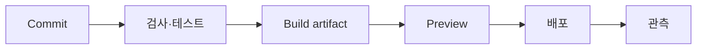

<!-- level:1 -->
# CI/CD — 변경을 검증하고 같은 산출물을 전달하기

제품 생산 라인에서 부품 검사와 출고 절차를 반복 가능하게 만들면 실수를 줄일 수 있다. CI는 변경을 자주 통합하고 자동 검증한다. continuous delivery는 배포 가능한 상태를 유지하고 승인 후 배포할 수 있게 하며 continuous deployment는 조건을 통과한 변경을 자동 운영 반영한다.



빌드가 성공해도 환경변수·DB 스키마·캐시·권한이 잘못되면 서비스는 실패한다. 앱·스키마·설정의 호환 순서를 계획해야 한다. 같은 소스를 여러 환경에서 다시 빌드하는 것과 검증한 산출물을 승격하는 것은 다른 신뢰 경계를 갖는다.

**비유의 한계:** 자동화는 판단을 없애지 않는다. 필요한 승인·비밀 관리·실제 운영 검증과 rollback 계약을 표현하는 도구다.
<!-- level:2 -->
# 재현 가능한 빌드와 최소 권한

GitHub Actions의 검사 예제다. 운영에는 action을 검증한 commit SHA로 고정하고 업데이트 정책을 둔다.

```yaml
name: verify
on: [push, pull_request]
permissions:
  contents: read
jobs:
  check:
    runs-on: ubuntu-latest
    steps:
      - uses: actions/checkout@v4
      - uses: actions/setup-node@v4
        with:
          node-version: 24
          cache: npm
      - run: npm ci
      - run: npm run typecheck
      - run: npm run lint
      - run: npm run build
```

`npm ci`는 lockfile과 의존성을 일치시킨다. 캐시 키는 lockfile·플랫폼·런타임 조건을 반영한다. PR의 신뢰하지 않는 코드를 실행할 때 production secret을 노출하지 않는다. OIDC는 장기 키 대신 짧은 인증을 쓸 수 있지만 trust 조건·권한 범위는 제한해야 한다.
<!-- level:3 -->
# 가상 장애 — 빌드는 성공했지만 운영은 체험 데이터

이 앱에서 발생했던 유형처럼 환경변수 이름 불일치나 정적 빌드의 fallback이 실제 데이터를 숨길 수 있다. commit SHA·deployment ID·환경 이름과 API→DB 응답을 연결해 확인한다. 테스트 통과를 운영 연결 검증으로 대체하지 않는다.

**수정:** 환경별 필수 변수 검증과 연결 검사, 사용자 흐름의 합성 테스트를 둔다. Next.js 공개 변수는 빌드에 반영되는 계약을 확인한다. DB 변경은 expand→앱 이행→contract 순서로 구버전과 호환되게 진행할 수 있다.

**재검증:** 배포 READY, 실제 운영 alias, 데이터·API·브라우저 결과를 확인한다. rollback이 DB 스키마까지 되돌리는지 가정하지 말고 데이터 호환성을 점검한다.
<!-- level:4 -->
# 출시 전략과 복구

| 전략 | 이득 | 비용 |
|---|---|---|
| rolling | 자원 재사용·점진 교체 | 구·신 버전 공존 |
| blue/green | 빠른 트래픽 전환 | 이중 자원·상태 호환 |
| canary | 작은 노출로 지표 검증 | 라우팅·표본·판정 복잡성 |

배포 성공 조건에는 오류율·꼬리 지연·업무 지표·데이터 무결성이 포함된다. schema contract나 외부 효과는 단순 앱 rollback으로 취소되지 않을 수 있다. 복구 가능한 단계와 forward fix를 계획하고 commit·artifact·설정을 추적한다.

참고: [GitHub Actions Workflow Syntax](https://docs.github.com/en/actions/writing-workflows/workflow-syntax-for-github-actions), [GitHub OIDC](https://docs.github.com/en/actions/security-for-github-actions/security-hardening-your-deployments/about-security-hardening-with-openid-connect).
<!-- quizzes -->
[{"level":1,"question":"continuous delivery와 deployment를 구분한 설명은?","choices":["delivery는 배포 가능 상태, deployment는 조건 통과 후 자동 운영 반영","둘 다 테스트 없음","CI는 운영 인증만","deployment는 항상 수동"],"answer_index":0,"explanation":"자동화의 범위와 승인 경계가 다릅니다. 둘 다 재현 가능한 검증·배포 준비와 운영 확인이 중요합니다."},{"level":2,"question":"신뢰하지 않는 PR 코드 실행에서 중요한 보안 원칙은?","choices":["production secret을 모두 제공","최소 권한과 secret 노출 경계 제한","토큰을 로그에 기록","lockfile 무시"],"answer_index":1,"explanation":"PR 코드는 secret을 읽거나 유출할 수 있습니다. 신뢰·권한·OIDC 조건과 의존성 고정을 관리해야 합니다."},{"level":3,"question":"빌드 성공 후 실제 데이터 연결을 검증할 방법은?","choices":["컴파일 메시지만 재확인","배포 이름만 확인","운영 alias에서 브라우저→API→DB 흐름 확인","개발 화면만 확인"],"answer_index":2,"explanation":"운영 환경과 실제 데이터 흐름은 별도입니다. commit과 deployment를 특정하고 사용자 결과까지 확인해야 합니다."},{"level":4,"question":"앱 rollback의 중요한 한계는?","choices":["항상 DB까지 완전 역복구","외부 결제도 자동 취소","schema 호환 필요 없음","스키마·데이터·외부 효과를 자동 되돌리지 못할 수 있음"],"answer_index":3,"explanation":"출시에는 되돌리기 어려운 상태 변경이 있습니다. 호환 단계와 forward fix·복구 절차를 계획해야 합니다."}]
