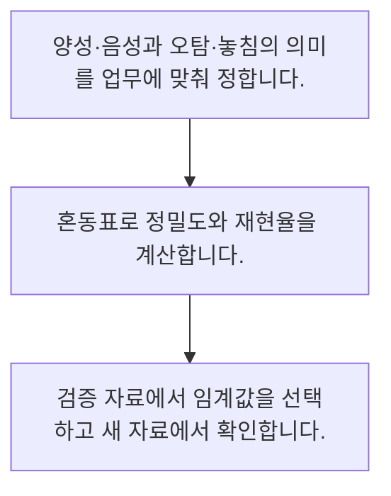

<!-- level:1 -->
# 분류·정밀도·재현율과 임계값

> **한 문장으로:** 분류의 품질은 맞힌 비율뿐 아니라 오탐과 놓침을 나누고 실제 비용에 맞는 임계값으로 판단합니다.

## 왜 필요한가요?

예측 양성 10건 중 8건이 맞아 정밀도는 0.8이고 실제 양성 12건 중 8건을 찾아 재현율은 약 0.67입니다. 분모가 다르므로 서로 바꾸어 쓸 수 없습니다.

## 일상에서 떠올려 보기

수하물 검사에서 위험 물건을 놓치는 것과 안전한 가방을 재검사하는 것은 서로 다른 비용입니다. 둘 다 맞고 틀림이라는 한 숫자로만 볼 수 없습니다.

## 순서대로 따라가기

1. 양성·음성과 오탐·놓침의 의미를 업무에 맞춰 정합니다.
2. 혼동표로 정밀도와 재현율을 계산합니다.
3. 검증 자료에서 임계값을 선택하고 새 자료에서 확인합니다.



## 처음 만나는 용어

| 용어 | 쉬운 뜻 |
|---|---|
| 정밀도 | 양성으로 예측한 것 중 실제 양성인 비율 |
| 재현율 | 실제 양성 중 찾아낸 비율 |
| 임계값 | 점수를 양성·음성 결정으로 바꾸는 경계 |

**비유의 한계:** 모델 점수가 항상 잘 보정된 확률은 아닙니다. 희귀 사건에서는 정확도가 높아도 관심 사건을 놓칠 수 있고, 지표는 선택한 임계값에 따라 달라집니다.

## 스스로 확인

재현율의 분모는 무엇인가요?

**답과 이유:** 실제 양성 수 — 실제 사건 중 찾아낸 비율입니다. 정밀도와 분모가 다릅니다.
<!-- level:2 -->
# 분류·정밀도·재현율과 임계값 — 실제 흐름 따라가기

## 읽기 전 길잡이

분류의 품질은 맞힌 비율뿐 아니라 오탐과 놓침을 나누고 실제 비용에 맞는 임계값으로 판단합니다. 아래 예제는 외부 시스템에 연결하지 않는 작은 학습용 사례입니다. 입력, 처리 조건, 결과를 순서대로 살펴보세요.

1. 양성·음성과 오탐·놓침의 의미를 업무에 맞춰 정합니다.
2. 혼동표로 정밀도와 재현율을 계산합니다.
3. 검증 자료에서 임계값을 선택하고 새 자료에서 확인합니다.

## 예제로 확인하기

```python
tp,fp,fn=8,2,4
precision=tp/(tp+fp); recall=tp/(tp+fn)
assert precision==0.8
print(round(precision,2),round(recall,2))
```

## 결과를 해석하기

예측 양성 10건 중 8건이 맞아 정밀도는 0.8이고 실제 양성 12건 중 8건을 찾아 재현율은 약 0.67입니다. 분모가 다르므로 서로 바꾸어 쓸 수 없습니다.

## 실무에 옮기기 전

모델 점수가 항상 잘 보정된 확률은 아닙니다. 희귀 사건에서는 정확도가 높아도 관심 사건을 놓칠 수 있고, 지표는 선택한 임계값에 따라 달라집니다. 실제 업무에서는 검증 자료로 업무 비용과 처리 용량에 맞는 경계를 고릅니다. 테스트에서 경계를 반복 조정하지 않고 배포 후 발생률 변화도 관측합니다.

## 확인 질문

예제 정밀도는 얼마인가요?

**답과 이유:** 참 양성 8을 예측 양성 10으로 나누면 0.8입니다.
<!-- level:3 -->
# 분류·정밀도·재현율과 임계값 — 가상 사례로 문제 해결하기

실제 고객의 장애 기록이 아닌 학습용 재현 시나리오입니다. 결과만 바꾸기 전에 관측한 증거와 원인 가설을 구분합니다.

## 1. 어떤 문제가 생겼나요?

가상 탐지 모델의 정확도는 높지만 중요한 사건을 대부분 놓칩니다.

## 2. 먼저 확인할 증거

혼동표와 양성 발생률·임계값별 재현율을 확인합니다.

## 3. 원인 가설

희귀 사건을 거의 모두 음성으로 처리한 결과였습니다.

## 4. 수정 방법

조사 용량과 놓침 비용에 맞춰 임계값·평가 지표를 재설계합니다.

## 5. 재검증

다음 기간에서 정밀도·재현율과 오탐 절대 건수를 함께 측정합니다.

## 놓치기 쉬운 조건

모델 점수가 항상 잘 보정된 확률은 아닙니다. 희귀 사건에서는 정확도가 높아도 관심 사건을 놓칠 수 있고, 지표는 선택한 임계값에 따라 달라집니다.

## 확인 질문

희귀 사건을 놓치는 모델의 우선 확인은?

**답과 이유:** 다수 음성만 맞혀도 정확도가 높을 수 있습니다. 놓친 양성을 직접 봐야 합니다.
<!-- level:4 -->
# 분류·정밀도·재현율과 임계값 — 업무와 아키텍처의 선택

## 읽기 전 길잡이

같은 개념도 업무의 규모, 오류 비용, 운영 역량에 따라 적용 방식이 달라집니다. 아래 비교는 특정 제품의 성능 순위가 아닌 선택 기준입니다.

| 선택 | 얻는 점 | 감수할 점 |
|---|---|---|
| 높은 임계값 | 검토 대상 수를 줄일 수 있음 | 놓침이 늘 수 있음 |
| 낮은 임계값 | 더 많은 양성을 찾을 수 있음 | 오탐·처리량 부담 |

## 선택 기준

검증 자료로 업무 비용과 처리 용량에 맞는 경계를 고릅니다. 테스트에서 경계를 반복 조정하지 않고 배포 후 발생률 변화도 관측합니다.

## 도입과 운영에서 확인할 것

조사 용량과 놓침 비용에 맞춰 임계값·평가 지표를 재설계합니다. 다음 기간에서 정밀도·재현율과 오탐 절대 건수를 함께 측정합니다.

## 판단 연습

임계값 선택의 적절한 근거는?

**판단의 근거:** 점수의 보정 상태와 업무 비용에 따라 적절한 경계는 달라집니다.

참고: [Google ML Crash Course](https://developers.google.com/machine-learning/crash-course), [scikit-learn 평가](https://scikit-learn.org/stable/model_selection.html), [scikit-learn 흔한 실수](https://scikit-learn.org/stable/common_pitfalls.html).
<!-- quizzes -->
[{"level":1,"question":"재현율의 분모는 무엇인가요?","choices":["모든 서버 수","실제 양성 수","예측 양성 수","전체 음성 수"],"answer_index":1,"explanation":"실제 사건 중 찾아낸 비율입니다. 정밀도와 분모가 다릅니다."},{"level":2,"question":"예제 정밀도는 얼마인가요?","choices":["0.2","1.0","0.8","0.67"],"answer_index":2,"explanation":"참 양성 8을 예측 양성 10으로 나누면 0.8입니다."},{"level":3,"question":"희귀 사건을 놓치는 모델의 우선 확인은?","choices":["정확도 한 숫자","모델 크기만","정답 삭제","혼동표와 임계값별 재현율"],"answer_index":3,"explanation":"다수 음성만 맞혀도 정확도가 높을 수 있습니다. 놓친 양성을 직접 봐야 합니다."},{"level":4,"question":"임계값 선택의 적절한 근거는?","choices":["오류 비용과 검토 용량","항상 0.5 고정","테스트 최고 점수만","점수 색상"],"answer_index":0,"explanation":"점수의 보정 상태와 업무 비용에 따라 적절한 경계는 달라집니다."}]
