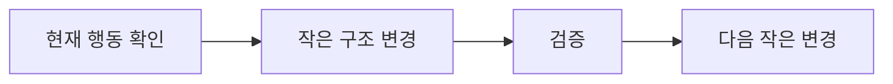

<!-- level:1 -->
# 클린 코드와 리팩터링 — 행동을 보존하며 읽기 쉽게

메모의 내용은 그대로 두고 제목·순서·표현을 정리하면 다음 사람이 이해하기 쉽다. 리팩터링은 관측되는 동작을 보존하면서 내부 구조를 개선하는 작업이다. 기능 추가와 함께 큰 구조를 한 번에 바꾸면 어떤 변경이 오류를 냈는지 찾기 어려워진다.



좋은 이름은 값의 단위·목적·범위를 드러낸다. 함수 길이의 숫자 규칙보다 책임과 제어 흐름이 명확한지가 중요하다. 중복은 모양이 아니라 함께 바뀌는 지식의 중복인지 판단한다. 비슷해 보이는 코드를 무리하게 합치면 독립 변경을 서로 묶을 수 있다.

**비유의 한계:** 프로그램에는 오류·부작용·성능 계약이 있다. 출력 값만 같아도 오류 종류나 부작용 순서가 달라지면 행동을 보존하지 못할 수 있다.
<!-- level:2 -->
# 작은 함수 추출과 계약 테스트

먼저 현재 행동을 테스트로 고정한다. 레거시의 이해되지 않는 동작에는 characterization test가 도움을 줄 수 있지만 알려진 버그를 영원히 계약으로 굳히지는 않는다. 순수 계산을 추출하면 검증하기 쉬워진다.

Python 3 예제는 배송비 계산을 이름과 단위로 드러낸다.

```python
def shipping_fee(subtotal_won, is_remote):
    if subtotal_won < 0: raise ValueError("negative subtotal")
    base_won = 0 if subtotal_won >= 50_000 else 3_000
    remote_won = 2_000 if is_remote else 0
    return base_won + remote_won
assert shipping_fee(49_999, False) == 3_000
assert shipping_fee(50_000, False) == 0
assert shipping_fee(50_000, True) == 2_000
```

함수 추출, 이름 변경, 조건 정리 등 한 종류를 작은 단위로 수행한다. 변경 전에 오류·경계·부작용 순서를 정하고, 바뀐 호출 관계가 성능을 악화시키지 않는지 확인한다. 인위적인 추상화로 호출이 여러 파일에 흩어지면 이해 비용이 증가할 수 있다.
<!-- level:3 -->
# 가상 장애 — 리팩터링 후 경계 금액만 잘못 계산된다

가상 수정에서 `>= 50000`을 `> 50000`으로 바꾸어 무료배송 경계가 틀렸다. 코드 스타일만 검사하면 찾을 수 없다. 변경 전후의 실제 입력과 결과·오류를 비교한다.

**진단:** 정확한 경계, 경계 바로 아래·위, 빈 값과 잘못된 입력을 테스트한다. 계산 함수와 DB·메일 같은 효과를 분리하면 원인 범위를 줄일 수 있다. 테스트가 구현의 조건문을 그대로 복사하면 같은 오류를 놓칠 수 있다.

**수정:** 계약에 맞는 비교를 복원하고 의미가 드러나는 테스트 이름을 붙인다. 버그 수정과 구조 변경을 커밋으로 구분하면 리뷰와 rollback이 쉬워진다.

**재검증:** 정상·오류·경계 동작과 운영에서 중요한 지연·조회 횟수를 확인한다. 관련이 없는 전면 재작성으로 검증 범위를 늘리지 않는다.
<!-- level:4 -->
# 개선의 범위와 위험을 고르기

| 접근 | 장점 | 위험 |
|---|---|---|
| 작은 지속 리팩터링 | 검증·리뷰·복구 쉬움 | 장기 구조 변경에 시간 필요 |
| 경계별 점진 이행 | 구·신 구현 비교 가능 | 임시 호환 계층 |
| 전면 재작성 | 모델 재정비 기회 | 숨은 계약·기능 누락·긴 이행 |

대형 시스템의 클린 코드는 팀이 자주 바꾸는 경로와 운영 실패를 기준으로 평가한다. 가독성·테스트 용이성·성능·API 호환성은 함께 고려한다. 코드가 아름답다는 주관만으로 출시 위험을 정당화하지 않는다.

**판단 연습:** 자주 바뀌는 가격 계산과 안정적인 파일 포맷 파서를 모두 다시 쓸 것인가? 변경 빈도·버그 비용·검증 가능성을 근거로 우선순위를 정하자.

참고: [Martin Fowler Refactoring Catalog](https://refactoring.com/catalog/), [Refactoring 정의](https://martinfowler.com/bliki/DefinitionOfRefactoring.html).
<!-- quizzes -->
[{"level":1,"question":"리팩터링의 핵심 조건은?","choices":["항상 기능 추가","관측되는 행동을 보존하며 내부 구조 개선","모든 테스트 삭제","무조건 줄 수 감소"],"answer_index":1,"explanation":"리팩터링은 행동 보존을 전제로 합니다. 오류와 부작용 순서 같은 계약도 관측 행동에 포함될 수 있습니다."},{"level":2,"question":"비슷한 코드의 추상화 여부를 판단할 기준은?","choices":["모양만 같으면 무조건 합침","함수 길이만 계산","같은 지식·변경 이유를 공유하는지","파일 개수 최대화"],"answer_index":2,"explanation":"겉모양보다 함께 바뀌는 의미가 중요합니다. 독립 정책을 합치면 변경 결합이 커질 수 있습니다."},{"level":3,"question":"무료배송 경계 오류를 찾는 검증은?","choices":["경계·바로 아래·위의 계약 기반 테스트","색상 린트만","정상 입력 하나만","구현 조건문을 그대로 복사"],"answer_index":0,"explanation":"비교 연산의 변경은 경계값에서 드러납니다. 요구된 결과를 독립적으로 명시해야 같은 구현 오류를 복제하지 않습니다."},{"level":4,"question":"대형 시스템의 전면 재작성에서 큰 위험은?","choices":["항상 코드가 짧아짐","모든 배포가 자동 성공","테스트가 필요 없음","숨은 계약·기능 누락·긴 이행 기간"],"answer_index":3,"explanation":"기존 시스템에는 문서화되지 않은 행동이 있을 수 있습니다. 점진 이행과 비교 검증으로 위험을 줄이는 대안을 고려합니다."}]
