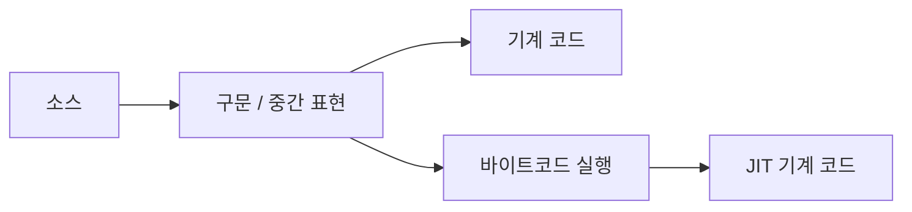

<!-- level:1 -->
# 컴파일러와 인터프리터 — 실행까지의 여러 번역 경로

외국어 안내서를 미리 번역해 놓는 방식과 읽는 순간 해석하는 방식은 비용이 드는 시점이 다르다. 컴파일러는 프로그램을 다른 표현으로 번역하고 인터프리터는 프로그램 표현을 읽어 실행한다. 현실의 언어 구현은 이들을 섞는다. “언어 자체가 컴파일 언어 또는 인터프리터 언어로 영원히 나뉜다”는 설명은 부정확하다.



미리 기계 코드로 만드는 AOT, 실행 중 자주 쓰는 부분을 번역하는 JIT, 바이트코드를 해석하는 VM 등이 있다. Python의 일반적인 CPython도 소스를 바이트코드로 컴파일하는 단계를 갖는다. 프로그램을 실행 전에 검사할 수 있는 범위와 실행 중 최적화 비용을 구분하자.

**비유의 한계:** 번역된 문서와 달리 기계 코드는 CPU·ABI·런타임 계약에 묶인다. “컴파일이면 무조건 빠르다”는 결론은 알고리즘과 구현 차이를 생략한다.
<!-- level:2 -->
# 파싱에서 실행으로

소스를 토큰화·파싱해 구문 구조를 만들고 이름·타입 등 의미를 분석한다. 구현에 따라 중간 표현을 최적화하고 대상 기계 코드나 바이트코드를 만든다. 링커는 심벌과 코드·데이터를 결합하고 로더는 실행 환경에 놓는다. 각 단계의 오류는 책임이 다르다.

Python 3에서 실행 가능한 바이트코드 관찰 예제다.

```python
import dis
def add(a, b):
    return a + b
dis.dis(add)
assert add(2, 3) == 5
```

출력 명령은 Python 버전에 따라 달라진다. 명령 이름을 영구 계약으로 암기하지 말고 소스 연산이 어떤 실행 단계로 바뀌는지 본다. JIT는 실행 중 프로파일에 맞춰 최적화할 수 있지만 가정이 깨지면 deoptimization이 발생할 수 있다. 인터프리터도 캐시·전문화 같은 최적화를 사용한다.

**실습:** 같은 함수를 워밍업 전후로 측정하고, 실행 시간 외에 시작 시간과 메모리도 기록하자. 소스 줄 하나와 기계 명령 하나가 항상 대응하지 않는다.
<!-- level:3 -->
# 가상 장애 — 배포 직후만 느리고 이후 빨라진다

가상 JIT 서비스가 워밍업 동안 컴파일·클래스 로딩·캐시 준비 비용을 낸다. 모든 시작 지연을 JIT 탓으로 돌리지 말고 의존성 로딩, 네트워크, DB 풀 준비를 분해한다. 동일 요청의 처음과 정상 상태를 따로 측정한다.

**진단:** 런타임 프로파일과 컴파일 로그, GC, CPU, 코드 경로 분포를 연결한다. 벤치마크가 결과를 사용하지 않아 최적화로 제거되는지도 확인한다. 단일 마이크로벤치마크를 전체 API 성능으로 일반화하지 않는다.

**수정:** readiness 이전의 제한된 준비 작업, AOT 대안, 워커 교체 속도와 캐시 준비를 비교한다. 대표하지 않는 예열 데이터가 실제 코드 경로를 덜 준비할 수도 있다.

**재검증:** 차가운 시작, 장기 실행, 입력 타입 변화, 배포 중 용량을 확인한다. p95 지연과 시작 메모리·CPU 비용을 함께 본다.
<!-- level:4 -->
# 실행 전략을 고르는 기준

| 방식 | 장점 | 비용 |
|---|---|---|
| AOT | 예측 가능한 시작과 배포 산출물 | 대상별 빌드·동적 최적화 제약 |
| JIT | 실제 실행 정보 활용 | 워밍업·코드 메모리·재최적화 |
| 인터프리터/VM | 이식·도구·동적 동작 | 실행 오버헤드·런타임 의존 |

선택은 CPU 처리량뿐 아니라 시작 지연, 메모리 한도, 플러그인 유연성, 빌드 시간, 디버깅과 보안 패치 운영을 포함한다. 서버리스의 짧은 수명과 장기 실행 서버는 워밍업 비용의 비중이 다르다.

**판단 연습:** 매번 짧게 실행되는 CLI와 하루 종일 반복 연산하는 서버에서 같은 실행 전략이 유리할까? 언어 이름보다 구체적 구현·버전을 비교하자.

참고: [CPython dis](https://docs.python.org/3/library/dis.html), [LLVM Language Reference](https://llvm.org/docs/LangRef.html).
<!-- quizzes -->
[{"level":1,"question":"컴파일러와 인터프리터의 관계로 정확한 설명은?","choices":["한 구현에서 번역·해석·JIT를 함께 사용할 수 있음","모든 Python 구현은 컴파일 단계가 없음","컴파일이면 모든 오류가 사라짐","언어 이름만으로 성능이 결정"],"answer_index":0,"explanation":"실제 실행 구현은 여러 단계를 조합합니다. CPython도 바이트코드 컴파일 단계가 있으며 런타임의 보장은 별도로 확인해야 합니다."},{"level":2,"question":"바이트코드 관찰에서 주의할 점은?","choices":["명령은 버전과 무관하게 영구 동일","구체적 명령은 구현·버전에 따라 달라질 수 있음","소스 한 줄은 항상 한 명령","모든 최적화는 금지"],"answer_index":1,"explanation":"dis 출력은 구현 세부사항입니다. 소스에서 실행으로 변환되는 원리를 관찰하되 버전별 명령을 일반 계약으로 취급하지 않습니다."},{"level":3,"question":"JIT 서버의 첫 요청 지연을 조사할 때 적절한 것은?","choices":["첫 요청만으로 전체 성능 판정","항상 DB 원인 배제","워밍업·로딩·GC·외부 대기를 분리 측정","지연 로그 제거"],"answer_index":2,"explanation":"초기 지연에는 여러 원인이 있습니다. 대표 입력으로 차가운 상태와 정상 상태를 따로 측정해야 합니다."},{"level":4,"question":"AOT와 JIT 선택에서 함께 비교할 것은?","choices":["코드 이름 길이","항상 처리량 하나만","개발자 취향만","시작 지연·메모리·처리량·배포 운영"],"answer_index":3,"explanation":"실행 전략은 여러 자원과 운영 요구의 선택입니다. 짧은 실행과 장기 실행에서 비용 비중이 달라집니다."}]
