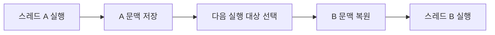

<!-- level:1 -->
# 컨텍스트 스위칭 — 여러 일을 이어서 하는 작업자

한 사람이 여러 과제를 번갈아 처리하려면 어디까지 했는지 적어 두어야 한다. CPU도 실행 중인 스레드를 바꿀 때 다음 명령 위치, 레지스터, 스택 포인터 등 실행 문맥을 보존하고 다음 스레드의 문맥을 복원한다. 이것이 컨텍스트 스위칭이다. 한 코어에서는 이 번갈아 실행이 동시 진행처럼 보이지만 여러 스레드가 그 순간 동시에 명령을 실행하는 것은 아니다.



스레드가 입출력을 기다리며 CPU를 내놓는 전환과, 스케줄러가 실행 시간을 나눠 주기 위해 중단하는 전환이 있다. 전환은 대기 중인 작업 대신 다른 작업을 실행할 수 있게 하지만 공짜가 아니다. 저장·복원뿐 아니라 캐시와 주소 변환 상태의 영향도 받는다.

**비유의 한계:** 커널에 진입하는 모든 시스템 콜이 다른 스레드로의 전환을 뜻하지 않는다. 사용자 모드↔커널 모드 전환과 실행 주체 변경을 구분해야 한다.

**확인:** 디스크를 기다리는 동안 같은 코어가 다른 스레드를 실행하면 어떤 이득이 있을까? 전환 횟수가 많다는 이유만으로 항상 오류인가?
<!-- level:2 -->
# 전환 종류와 관측 단위

스케줄러는 실행 가능한 태스크 중 대상을 고른다. 대기 상태의 태스크는 준비 큐에서 실행을 기다리는 태스크와 다르다. 같은 프로세스의 스레드끼리 주소 공간을 공유할 수 있지만 각자의 실행 문맥은 다르다. 다른 주소 공간으로의 전환에서는 페이지 테이블 관련 상태도 달라질 수 있다. TLB 영향은 아키텍처와 ASID/PCID 같은 기능에 따라 달라지므로 항상 전체 TLB를 비운다고 단정하지 않는다.

Linux에서 자기 프로세스의 전환 횟수를 확인하는 Python 3 예제다.

```python
import resource, time
before = resource.getrusage(resource.RUSAGE_SELF)
for _ in range(10):
    time.sleep(0.001)
after = resource.getrusage(resource.RUSAGE_SELF)
print("voluntary", after.ru_nvcsw - before.ru_nvcsw)
print("involuntary", after.ru_nivcsw - before.ru_nivcsw)
```

정확히 10회의 전환을 보장하지는 않는다. OS 스케줄링과 다른 태스크에 의해 결과가 달라진다. voluntary는 실행 주체가 기다리는 등의 이유로 양보한 전환, involuntary는 선점 등에 따른 전환으로 해석할 수 있다. 서버에서는 전체 시스템 수치뿐 아니라 특정 워커·스레드와 요청 지연을 연결해 보아야 한다.

**실습:** sleep 간격과 CPU 작업을 바꿔 두 종류의 전환이 어떻게 달라지는지 기록하자. 전환 자체의 순수 비용을 측정한 실험이라고 주장하지 않는다.
<!-- level:3 -->
# 가상 장애 — 워커 200개가 코어 4개를 경쟁한다

CPU 중심 작업을 처리하는 워커 수를 크게 늘린 뒤 지연이 악화된 사례를 재현한다. 실행 가능한 스레드 수가 코어 수를 훨씬 넘으면 준비 큐 대기와 캐시 재가열이 커질 수 있다. 다만 I/O 중심 작업에는 다른 적정 동시성이 필요하다.

Linux 학습 서버에서 `pidstat -w -p PID 1`, `vmstat 1` 등으로 전환과 실행 큐를 확인한다. CPU 사용률·스레드 수·p95 지연·처리량을 같은 부하에서 함께 기록한다. 높은 voluntary 전환이 정상적인 입출력 대기를 나타내는지, 락 경합을 나타내는지도 스택 샘플과 연결한다.

**수정:** CPU 워커 풀을 제한하고 유입 큐에 길이 제한·타임아웃·백프레셔를 둔다. 무조건 스레드 수를 코어 수와 똑같이 고정하기보다 실제 작업의 대기 비율을 측정한다. 바쁜 폴링이나 작은 작업을 지나치게 나누는 코드도 점검한다.

**재검증:** 동시성을 단계적으로 바꿔 처리량이 포화되는 지점과 지연 증가 구간을 찾는다. 큐 길이와 거절률까지 비교해야 과부하를 단순히 다른 장소에 옮기는 실수를 피한다.
<!-- level:4 -->
# 동시성 모델과 스케줄링 비용

| 모델 | 장점 | 설계 책임 |
|---|---|---|
| 요청당 OS 스레드 | 동기 코드와 디버깅이 익숙함 | 스택 메모리·전환·풀 제한 |
| 이벤트 루프 | 많은 I/O 연결의 대기를 효율적으로 관리 | CPU 작업 격리·블로킹 방지 |
| 사용자 수준 태스크 | 많은 논리 작업을 적은 스레드에 매핑 | 런타임 스케줄러·취소·관측 |

코어 수보다 많은 작업이 존재해도 적정 동시성은 I/O 대기, 메모리 사용, 런타임과 공정성에 따라 정한다. 컨테이너 CPU 할당량과 실제 호스트 코어 수가 다를 수 있으므로 하드웨어 숫자만 사용하지 않는다. CPU throttling과 스케줄러 대기도 함께 본다.

**판단 연습:** 이미지 변환과 네트워크 호출이 섞인 API를 어떤 풀로 나눌까? 각 풀의 최대 동시성, 큐 상한, 취소 정책, 요청 기한을 제시하고 평균 지연뿐 아니라 꼬리 지연과 실패율을 기준으로 비교하자.

참고: [Linux sched](https://man7.org/linux/man-pages/man7/sched.7.html), [Python resource](https://docs.python.org/3/library/resource.html).
<!-- quizzes -->
[{"level":1,"question":"시스템 콜의 모드 전환과 컨텍스트 스위칭을 구분한 설명은?","choices":["완전히 같은 개념","모든 시스템 콜은 다른 프로세스를 실행","커널 진입만으로 실행 스레드가 반드시 바뀌지는 않음","컨텍스트 스위칭은 메모리를 모두 복사"],"answer_index":2,"explanation":"모드 전환은 권한 실행 모드의 변화이고 컨텍스트 스위칭은 실행 태스크의 변화입니다. 시스템 콜은 현재 태스크에서 처리될 수도 있습니다."},{"level":2,"question":"전환 실험의 횟수를 해석할 때 적절한 태도는?","choices":["sleep 횟수와 항상 정확히 일치","스케줄링·환경에 따라 달라지고 요청 지연과 함께 관측","숫자 하나가 모든 비용을 설명","TLB는 언제나 무조건 전부 삭제"],"answer_index":1,"explanation":"전환 횟수와 비용은 실행 조건에 영향을 받습니다. 주소 변환 캐시의 영향도 CPU 기능에 따라 다르므로 절대 규칙으로 단정하지 않습니다."},{"level":3,"question":"CPU 중심 워커를 크게 늘린 후 지연이 악화되면 무엇을 함께 조사하나요?","choices":["DNS 이름 길이","버튼 색상","HTTP 쿠키 개수만","실행 큐·전환·처리량·꼬리 지연"],"answer_index":3,"explanation":"워커 경쟁은 준비 큐와 전환 비용을 늘릴 수 있습니다. 같은 부하에서 동시성을 바꾸고 처리량과 p95 등 지연을 함께 확인합니다."},{"level":4,"question":"이벤트 루프가 있는 서버의 CPU 중심 작업은 어떻게 다루는 것이 합리적인가요?","choices":["제한된 별도 워커와 큐로 비교 검토","이벤트 루프에서 무제한 실행","취소와 기한을 제거","모든 요청마다 워커 수를 두 배로 증가"],"answer_index":0,"explanation":"긴 CPU 작업은 이벤트 루프를 막을 수 있습니다. 별도 워커·큐 상한·기한을 설계하고 전체 지연과 운영 비용으로 판단합니다."}]
