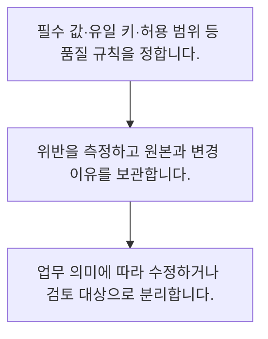

<!-- level:1 -->
# 결측·중복·이상치와 데이터 품질

> **한 문장으로:** 자료를 정리할 때 빠진 값과 반복된 값의 뜻을 먼저 확인하고 수정 규칙을 기록합니다.

## 왜 필요한가요?

같은 고객이 두 번 들어가거나 날짜 단위가 섞이면 분석과 AI의 결과도 틀어집니다. 자료를 쓰기 전에 빈칸·중복·형식을 점검하면 뒤에서 생길 오류를 줄일 수 있습니다.

## 일상에서 떠올려 보기

주소록의 빈 전화번호를 모두 0000으로 채우면 전화번호가 생긴 것이 아닙니다. 왜 비었는지와 어떤 업무에 사용할지를 먼저 따져야 합니다.

## 순서대로 따라가기

1. 필수 값·유일 키·허용 범위 등 품질 규칙을 정합니다.
2. 위반을 측정하고 원본과 변경 이유를 보관합니다.
3. 업무 의미에 따라 수정하거나 검토 대상으로 분리합니다.



## 처음 만나는 용어

| 용어 | 쉬운 뜻 |
|---|---|
| 결측 | 관측되거나 저장되지 않은 값 |
| 중복 | 정의한 키에 대해 같은 대상이 반복된 상태 |
| 품질 규칙 | 데이터가 업무에서 지켜야 하는 조건 |

**비유의 한계:** 이상한 값이 항상 오류는 아닙니다. 삭제·대체 규칙은 실제 중요한 사건을 지울 수 있고, 학습 자료 전체로 계산한 대체값은 평가 자료의 정보 누출을 만들 수 있습니다.

## 스스로 확인

결측과 실제 0은 어떤 관계인가요?

**답과 이유:** 의미가 다를 수 있음 — 모르는 값과 관측한 0은 구별해야 합니다. 업무 의미를 모른 채 대체하면 해석이 바뀝니다.
<!-- level:2 -->
# 결측·중복·이상치와 데이터 품질 — 실제 흐름 따라가기

## 읽기 전 길잡이

자료를 정리할 때 빠진 값과 반복된 값의 뜻을 먼저 확인하고 수정 규칙을 기록합니다. 아래 예제는 외부 시스템에 연결하지 않는 작은 학습용 사례입니다. 입력, 처리 조건, 결과를 순서대로 살펴보세요.

1. 필수 값·유일 키·허용 범위 등 품질 규칙을 정합니다.
2. 위반을 측정하고 원본과 변경 이유를 보관합니다.
3. 업무 의미에 따라 수정하거나 검토 대상으로 분리합니다.

## 예제로 확인하기

```python
rows = [{"id":1,"age":20},{"id":1,"age":20},{"id":2,"age":None}]
unique = {r["id"]:r for r in rows}
missing = sum(r["age"] is None for r in unique.values())
assert len(unique)==2 and missing==1
print("중복 제외:",len(unique),"결측:",missing)
```

## 결과를 해석하기

학습 예제는 동일 키를 한 건으로 만들고 None을 따로 셉니다. 서로 다른 값이 같은 키로 들어오면 임의로 마지막 행을 고르기보다 충돌 규칙과 원본 시각을 확인해야 합니다.

## 실무에 옮기기 전

이상한 값이 항상 오류는 아닙니다. 삭제·대체 규칙은 실제 중요한 사건을 지울 수 있고, 학습 자료 전체로 계산한 대체값은 평가 자료의 정보 누출을 만들 수 있습니다. 실제 업무에서는 핵심 거래와 탐색용 분석에는 다른 품질 수준이 필요합니다. 수정 전후 비율과 규칙 버전을 남기고, 기준 위반 시 자동 중단할 조건을 정합니다.

## 확인 질문

예제에서 유일 ID 수와 결측 수는?

**답과 이유:** ID 1은 반복되고 ID 2의 나이는 None입니다. 중복과 결측을 따로 계산합니다.
<!-- level:3 -->
# 결측·중복·이상치와 데이터 품질 — 가상 사례로 문제 해결하기

실제 고객의 장애 기록이 아닌 학습용 재현 시나리오입니다. 결과만 바꾸기 전에 관측한 증거와 원인 가설을 구분합니다.

## 1. 어떤 문제가 생겼나요?

가상 학습에서 빈 소득을 0으로 채운 뒤 저소득 예측이 급증합니다.

## 2. 먼저 확인할 증거

결측 발생 경로와 실제 0의 비중을 따로 확인합니다.

## 3. 원인 가설

모르는 값과 실제 0을 같은 뜻으로 바꿨습니다.

## 4. 수정 방법

결측 표시와 적절한 대체 전략을 분리하고 학습 구간에서만 대체 규칙을 추정합니다.

## 5. 재검증

결측 집단과 비결측 집단의 품질, 경계값·중복 충돌을 다시 검사합니다.

## 놓치기 쉬운 조건

이상한 값이 항상 오류는 아닙니다. 삭제·대체 규칙은 실제 중요한 사건을 지울 수 있고, 학습 자료 전체로 계산한 대체값은 평가 자료의 정보 누출을 만들 수 있습니다.

## 확인 질문

빈 소득 대체 후 분포가 달라졌다면?

**답과 이유:** 수정 규칙이 의미를 바꿨는지 확인하고 학습·평가 정보 경계를 지켜야 합니다.
<!-- level:4 -->
# 결측·중복·이상치와 데이터 품질 — 업무와 아키텍처의 선택

## 읽기 전 길잡이

같은 개념도 업무의 규모, 오류 비용, 운영 역량에 따라 적용 방식이 달라집니다. 아래 비교는 특정 제품의 성능 순위가 아닌 선택 기준입니다.

| 선택 | 얻는 점 | 감수할 점 |
|---|---|---|
| 일괄 삭제 | 처리 간단 | 표본 손실과 편향 |
| 표시·대체·검토 분리 | 업무 의미 보존 | 규칙과 추적 관리 비용 |

## 선택 기준

핵심 거래와 탐색용 분석에는 다른 품질 수준이 필요합니다. 수정 전후 비율과 규칙 버전을 남기고, 기준 위반 시 자동 중단할 조건을 정합니다.

## 도입과 운영에서 확인할 것

결측 표시와 적절한 대체 전략을 분리하고 학습 구간에서만 대체 규칙을 추정합니다. 결측 집단과 비결측 집단의 품질, 경계값·중복 충돌을 다시 검사합니다.

## 판단 연습

품질 규칙 운영에 필요한 것은?

**판단의 근거:** 변경 이유와 영향을 추적해야 규칙 오류를 발견하고 복원할 수 있습니다.

참고: [NIST 통계 핸드북](https://www.itl.nist.gov/div898/handbook/), [PostgreSQL 쿼리](https://www.postgresql.org/docs/current/queries.html).
<!-- quizzes -->
[{"level":1,"question":"결측과 실제 0은 어떤 관계인가요?","choices":["항상 오류","항상 삭제 대상","의미가 다를 수 있음","언제나 동일"],"answer_index":2,"explanation":"모르는 값과 관측한 0은 구별해야 합니다. 업무 의미를 모른 채 대체하면 해석이 바뀝니다."},{"level":2,"question":"예제에서 유일 ID 수와 결측 수는?","choices":["3과 0","1과 2","3과 3","2와 1"],"answer_index":3,"explanation":"ID 1은 반복되고 ID 2의 나이는 None입니다. 중복과 결측을 따로 계산합니다."},{"level":3,"question":"빈 소득 대체 후 분포가 달라졌다면?","choices":["대체 규칙과 결측 경로 조사","모든 0 삭제","평가 자료로 평균 계산","보고 중단 없이 배포"],"answer_index":0,"explanation":"수정 규칙이 의미를 바꿨는지 확인하고 학습·평가 정보 경계를 지켜야 합니다."},{"level":4,"question":"품질 규칙 운영에 필요한 것은?","choices":["원본 없는 최종 값","버전·위반율·원본 추적","삭제 건수만","도구 이름만"],"answer_index":1,"explanation":"변경 이유와 영향을 추적해야 규칙 오류를 발견하고 복원할 수 있습니다."}]
