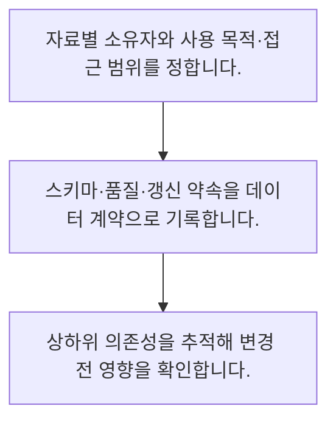

<!-- level:1 -->
# 데이터 소유권·계약·계보

> **한 문장으로:** 누가 데이터를 책임지고 어떤 변환을 거쳐 어디에 쓰이는지 알아야 변경과 사고의 영향을 추적할 수 있습니다.

## 왜 필요한가요?

예제는 갱신 지연 약속 60분을 75분이 넘은 상황입니다. 탐지 기준과 책임자를 연결합니다. 실제 계약에는 스키마 버전과 삭제·민감도 규칙, 변경 통보 방법도 포함합니다.

## 일상에서 떠올려 보기

식재료의 원산지와 유통 경로를 기록하는 일과 같습니다. 문제가 생겼을 때 어느 요리에 쓰였는지 알아야 필요한 범위에 대응할 수 있습니다.

## 순서대로 따라가기

1. 자료별 소유자와 사용 목적·접근 범위를 정합니다.
2. 스키마·품질·갱신 약속을 데이터 계약으로 기록합니다.
3. 상하위 의존성을 추적해 변경 전 영향을 확인합니다.



## 처음 만나는 용어

| 용어 | 쉬운 뜻 |
|---|---|
| 데이터 소유자 | 품질·접근·변경 결정을 책임지는 역할 |
| 데이터 계약 | 제공자와 사용자가 합의한 형식·품질·갱신 조건 |
| 계보 | 자료의 출처와 변환·사용 경로에 관한 기록 |

**비유의 한계:** 계보가 있다고 데이터가 항상 정확한 것은 아닙니다. 자동 수집되지 않는 수작업 변환도 있고, 기록 자체에도 접근 권한과 갱신 책임이 필요합니다.

## 스스로 확인

데이터 계보가 답하는 질문은 무엇인가요?

**답과 이유:** 어디서 와서 어디에 쓰이는가 — 계보는 출처·변환·사용 경로를 기록합니다. 값의 정확성을 자동 보증하지는 않습니다.
<!-- level:2 -->
# 데이터 소유권·계약·계보 — 실제 흐름 따라가기

## 읽기 전 길잡이

누가 데이터를 책임지고 어떤 변환을 거쳐 어디에 쓰이는지 알아야 변경과 사고의 영향을 추적할 수 있습니다. 아래 예제는 외부 시스템에 연결하지 않는 작은 학습용 사례입니다. 입력, 처리 조건, 결과를 순서대로 살펴보세요.

1. 자료별 소유자와 사용 목적·접근 범위를 정합니다.
2. 스키마·품질·갱신 약속을 데이터 계약으로 기록합니다.
3. 상하위 의존성을 추적해 변경 전 영향을 확인합니다.

## 예제로 확인하기

```python
contract={"owner":"orders-team","key":"order_id","freshness_minutes":60}
observed_delay=75
assert observed_delay>contract["freshness_minutes"]
print("계약 위반 알림 대상:",contract["owner"])
```

## 결과를 해석하기

예제는 갱신 지연 약속 60분을 75분이 넘은 상황입니다. 탐지 기준과 책임자를 연결합니다. 실제 계약에는 스키마 버전과 삭제·민감도 규칙, 변경 통보 방법도 포함합니다.

## 실무에 옮기기 전

계보가 있다고 데이터가 항상 정확한 것은 아닙니다. 자동 수집되지 않는 수작업 변환도 있고, 기록 자체에도 접근 권한과 갱신 책임이 필요합니다. 실제 업무에서는 모든 결정을 한 팀에 모으기보다 데이터 민감도와 사용 범위에 맞게 책임을 나눕니다. 계약과 계보를 문서량이 아닌 변경 영향·복구 시간에 연결합니다.

## 확인 질문

예제에서 알림을 받을 역할은?

**답과 이유:** 계약 위반 기준과 소유자를 연결해야 대응 책임이 명확해집니다.
<!-- level:3 -->
# 데이터 소유권·계약·계보 — 가상 사례로 문제 해결하기

실제 고객의 장애 기록이 아닌 학습용 재현 시나리오입니다. 결과만 바꾸기 전에 관측한 증거와 원인 가설을 구분합니다.

## 1. 어떤 문제가 생겼나요?

가상 원본 컬럼 이름 변경 뒤 여러 리포트가 동시에 깨집니다.

## 2. 먼저 확인할 증거

컬럼의 상하위 모델, 사용 팀, 최근 배포와 계약 검증 결과를 확인합니다.

## 3. 원인 가설

사용처를 모른 채 호환성 없는 변경을 했습니다.

## 4. 수정 방법

대체 컬럼과 이전 기간을 두고 계약 검증·변경 통보 절차를 만듭니다.

## 5. 재검증

의존 리포트와 모델을 회귀 검사하고 계보에서 누락된 수작업을 찾습니다.

## 놓치기 쉬운 조건

계보가 있다고 데이터가 항상 정확한 것은 아닙니다. 자동 수집되지 않는 수작업 변환도 있고, 기록 자체에도 접근 권한과 갱신 책임이 필요합니다.

## 확인 질문

컬럼 변경 전 확인해야 할 것은?

**답과 이유:** 하위 사용처에 미치는 영향을 알아야 변경과 이전을 설계할 수 있습니다.
<!-- level:4 -->
# 데이터 소유권·계약·계보 — 업무와 아키텍처의 선택

## 읽기 전 길잡이

같은 개념도 업무의 규모, 오류 비용, 운영 역량에 따라 적용 방식이 달라집니다. 아래 비교는 특정 제품의 성능 순위가 아닌 선택 기준입니다.

| 선택 | 얻는 점 | 감수할 점 |
|---|---|---|
| 중앙 통제 | 공통 규칙을 적용하기 쉬움 | 팀의 대기와 병목 |
| 분산 소유와 공통 계약 | 현장 책임과 자율성 | 규칙 일치·조율 비용 |

## 선택 기준

모든 결정을 한 팀에 모으기보다 데이터 민감도와 사용 범위에 맞게 책임을 나눕니다. 계약과 계보를 문서량이 아닌 변경 영향·복구 시간에 연결합니다.

## 도입과 운영에서 확인할 것

대체 컬럼과 이전 기간을 두고 계약 검증·변경 통보 절차를 만듭니다. 의존 리포트와 모델을 회귀 검사하고 계보에서 누락된 수작업을 찾습니다.

## 판단 연습

분산 소유를 운영하기 위한 조건은?

**판단의 근거:** 현장 책임을 주면서도 공유 인터페이스와 품질 조건은 맞춰야 합니다.

참고: [NIST 통계 핸드북](https://www.itl.nist.gov/div898/handbook/), [PostgreSQL 쿼리](https://www.postgresql.org/docs/current/queries.html).
<!-- quizzes -->
[{"level":1,"question":"데이터 계보가 답하는 질문은 무엇인가요?","choices":["모든 값이 참인가","어디서 와서 어디에 쓰이는가","서버 색상은 무엇인가","파일은 얼마나 예쁜가"],"answer_index":1,"explanation":"계보는 출처·변환·사용 경로를 기록합니다. 값의 정확성을 자동 보증하지는 않습니다."},{"level":2,"question":"예제에서 알림을 받을 역할은?","choices":["모든 외부인","담당자 없음","orders-team","임의의 고객"],"answer_index":2,"explanation":"계약 위반 기준과 소유자를 연결해야 대응 책임이 명확해집니다."},{"level":3,"question":"컬럼 변경 전 확인해야 할 것은?","choices":["이름 길이만","문서 표지","자신의 쿼리 한 개만","의존 모델과 계약 호환성"],"answer_index":3,"explanation":"하위 사용처에 미치는 영향을 알아야 변경과 이전을 설계할 수 있습니다."},{"level":4,"question":"분산 소유를 운영하기 위한 조건은?","choices":["공통 계약과 명확한 책임","규칙 없는 자율","모든 자료 공개","계보 기록 금지"],"answer_index":0,"explanation":"현장 책임을 주면서도 공유 인터페이스와 품질 조건은 맞춰야 합니다."}]
