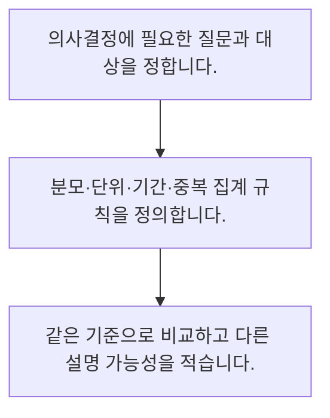

<!-- level:1 -->
# 데이터로 질문하고 지표 읽기

> **한 문장으로:** 숫자를 해석하기 전에 무엇을 누구에 대해 어떤 단위와 기간으로 센 것인지 정합니다.

## 왜 필요한가요?

방문 200건 중 구매가 20건이면 방문 기준 전환율은 10%입니다. 방문 수와 사용자 수를 섞으면 다른 질문에 답하게 됩니다. 기간과 집계 단위를 함께 표기하세요.

## 일상에서 떠올려 보기

가게 매출표를 읽을 때 원과 만 원, 오늘과 한 달을 구별하는 일과 같습니다. 숫자 자체보다 표가 답하려는 질문이 먼저입니다.

## 순서대로 따라가기

1. 의사결정에 필요한 질문과 대상을 정합니다.
2. 분모·단위·기간·중복 집계 규칙을 정의합니다.
3. 같은 기준으로 비교하고 다른 설명 가능성을 적습니다.



## 처음 만나는 용어

| 용어 | 쉬운 뜻 |
|---|---|
| 지표 | 관찰할 현상을 일정한 규칙으로 수치화한 값 |
| 분모 | 비율을 계산할 때 기준으로 삼는 전체 수 |
| 측정 단위 | 사용자·방문·주문처럼 한 건의 기준 |

**비유의 한계:** 측정한 숫자에는 수집되지 않은 사람과 행동이 빠질 수 있습니다. 지표가 좋아졌다는 사실만으로 원인이나 전체 경험의 개선을 단정하지 않습니다.

## 스스로 확인

전환율을 읽기 전에 먼저 확인할 것은 무엇인가요?

**답과 이유:** 분모와 집계 기간 — 같은 비율이라도 분모와 기간이 다르면 의미가 달라집니다. 표시 형식은 측정 기준을 대신하지 못합니다.
<!-- level:2 -->
# 데이터로 질문하고 지표 읽기 — 실제 흐름 따라가기

## 읽기 전 길잡이

숫자를 해석하기 전에 무엇을 누구에 대해 어떤 단위와 기간으로 센 것인지 정합니다. 아래 예제는 외부 시스템에 연결하지 않는 작은 학습용 사례입니다. 입력, 처리 조건, 결과를 순서대로 살펴보세요.

1. 의사결정에 필요한 질문과 대상을 정합니다.
2. 분모·단위·기간·중복 집계 규칙을 정의합니다.
3. 같은 기준으로 비교하고 다른 설명 가능성을 적습니다.

## 예제로 확인하기

```python
visits, buyers = 200, 20
conversion = buyers / visits
assert conversion == 0.1
print(f"구매 전환율: {conversion:.0%}")
```

## 결과를 해석하기

방문 200건 중 구매가 20건이면 방문 기준 전환율은 10%입니다. 방문 수와 사용자 수를 섞으면 다른 질문에 답하게 됩니다. 기간과 집계 단위를 함께 표기하세요.

## 실무에 옮기기 전

측정한 숫자에는 수집되지 않은 사람과 행동이 빠질 수 있습니다. 지표가 좋아졌다는 사실만으로 원인이나 전체 경험의 개선을 단정하지 않습니다. 실제 업무에서는 업무 결정을 바꾸는 숫자부터 고르고 고객 피해·비용 같은 보조 지표를 함께 둡니다. 집계 규칙과 담당자를 정해 팀별 숫자 해석 차이를 줄입니다.

## 확인 질문

방문 200건 중 구매 20건의 전환율은?

**답과 이유:** 20을 200으로 나누면 0.1입니다. 구매 건수 20을 그대로 퍼센트로 쓰면 분모를 놓칩니다.
<!-- level:3 -->
# 데이터로 질문하고 지표 읽기 — 가상 사례로 문제 해결하기

실제 고객의 장애 기록이 아닌 학습용 재현 시나리오입니다. 결과만 바꾸기 전에 관측한 증거와 원인 가설을 구분합니다.

## 1. 어떤 문제가 생겼나요?

가상 보고서에서 구매 전환율이 갑자기 두 배가 됩니다.

## 2. 먼저 확인할 증거

기간별 방문 이벤트 수, 주문 중복, 분모 필터와 시간대 설정을 대조합니다.

## 3. 원인 가설

구매한 사용자만 분모에 남긴 쿼리가 전체 방문과 비교되었습니다.

## 4. 수정 방법

지표 정의를 문서로 고정하고 같은 필터와 단위로 다시 집계합니다.

## 5. 재검증

원본 소수 행을 손으로 세고 새 지표와 맞는지 확인합니다. 수집 누락도 별도로 표시합니다.

## 놓치기 쉬운 조건

측정한 숫자에는 수집되지 않은 사람과 행동이 빠질 수 있습니다. 지표가 좋아졌다는 사실만으로 원인이나 전체 경험의 개선을 단정하지 않습니다.

## 확인 질문

분모 필터 변경으로 지표가 급등했을 때 먼저 할 일은?

**답과 이유:** 측정 방식의 변화와 실제 행동 변화를 분리해야 합니다. 재계산 없이 원인과 성과를 단정할 수 없습니다.
<!-- level:4 -->
# 데이터로 질문하고 지표 읽기 — 업무와 아키텍처의 선택

## 읽기 전 길잡이

같은 개념도 업무의 규모, 오류 비용, 운영 역량에 따라 적용 방식이 달라집니다. 아래 비교는 특정 제품의 성능 순위가 아닌 선택 기준입니다.

| 선택 | 얻는 점 | 감수할 점 |
|---|---|---|
| 단일 대표 지표 | 방향을 빠르게 공유 | 다른 품질 저하를 숨길 수 있음 |
| 대표 지표와 보조 지표 | 효과와 부작용을 함께 관찰 | 정의와 운영 부담 증가 |

## 선택 기준

업무 결정을 바꾸는 숫자부터 고르고 고객 피해·비용 같은 보조 지표를 함께 둡니다. 집계 규칙과 담당자를 정해 팀별 숫자 해석 차이를 줄입니다.

## 도입과 운영에서 확인할 것

지표 정의를 문서로 고정하고 같은 필터와 단위로 다시 집계합니다. 원본 소수 행을 손으로 세고 새 지표와 맞는지 확인합니다. 수집 누락도 별도로 표시합니다.

## 판단 연습

대표 지표를 운영할 때 적절한 설계는?

**판단의 근거:** 대표 지표의 개선과 고객 피해가 동시에 생길 수 있어 보조 지표와 정의 관리가 필요합니다.

참고: [NIST 통계 핸드북](https://www.itl.nist.gov/div898/handbook/), [PostgreSQL 쿼리](https://www.postgresql.org/docs/current/queries.html).
<!-- quizzes -->
[{"level":1,"question":"전환율을 읽기 전에 먼저 확인할 것은 무엇인가요?","choices":["분모와 집계 기간","그래프 색깔","소수점 자릿수만","가장 큰 수만"],"answer_index":0,"explanation":"같은 비율이라도 분모와 기간이 다르면 의미가 달라집니다. 표시 형식은 측정 기준을 대신하지 못합니다."},{"level":2,"question":"방문 200건 중 구매 20건의 전환율은?","choices":["200%","10%","1%","20%"],"answer_index":1,"explanation":"20을 200으로 나누면 0.1입니다. 구매 건수 20을 그대로 퍼센트로 쓰면 분모를 놓칩니다."},{"level":3,"question":"분모 필터 변경으로 지표가 급등했을 때 먼저 할 일은?","choices":["과거 자료 삭제","단위 숨기기","같은 집계 기준으로 재계산","즉시 성공 발표"],"answer_index":2,"explanation":"측정 방식의 변화와 실제 행동 변화를 분리해야 합니다. 재계산 없이 원인과 성과를 단정할 수 없습니다."},{"level":4,"question":"대표 지표를 운영할 때 적절한 설계는?","choices":["한 숫자로 모든 품질 단정","좋은 기간만 선택","수집 누락 무시","부작용을 보는 보조 지표도 관리"],"answer_index":3,"explanation":"대표 지표의 개선과 고객 피해가 동시에 생길 수 있어 보조 지표와 정의 관리가 필요합니다."}]
