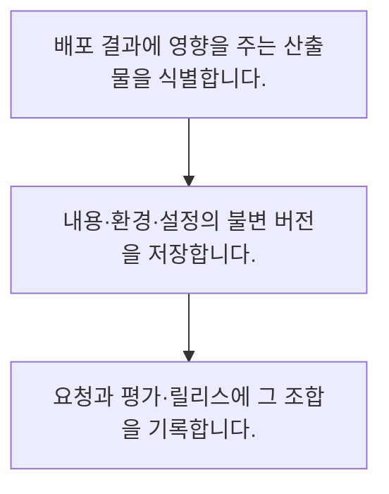

<!-- level:1 -->
# 데이터·모델·프롬프트 버전 관리

> **한 문장으로:** 같은 이름의 파일 대신 변경 불가능한 식별자로 자료·모델·프롬프트·검색 인덱스의 조합을 기록합니다.

## 왜 필요한가요?

프롬프트 문자열의 SHA-256 식별 값을 구합니다. 실제 배포 기록에는 원본 보관 위치·모델·도구 계약·인덱스 버전과 환경 정보도 연결해야 합니다.

## 일상에서 떠올려 보기

요리 이름이 같아도 레시피와 재료가 바뀌면 맛이 달라집니다. 주문에 어떤 판본을 썼는지 알아야 재현과 복구가 가능합니다.

## 순서대로 따라가기

1. 배포 결과에 영향을 주는 산출물을 식별합니다.
2. 내용·환경·설정의 불변 버전을 저장합니다.
3. 요청과 평가·릴리스에 그 조합을 기록합니다.



## 처음 만나는 용어

| 용어 | 쉬운 뜻 |
|---|---|
| 불변 산출물 | 같은 식별자가 같은 내용으로 유지되는 결과물 |
| 내용 해시 | 내용을 정해진 함수로 요약한 식별 값 |
| 매니페스트 | 여러 산출물과 버전의 조합을 기록한 목록 |

**비유의 한계:** 해시는 내용 일치를 확인할 수 있지만 품질·출처·사용 권리를 보증하지 않습니다. 개인 정보와 비밀을 해시로만 가렸다고 익명 자료가 되는 것도 아닙니다.

## 스스로 확인

내용 해시가 보장하지 않는 것은?

**답과 이유:** 품질과 사용 권리 — 해시는 내용의 신뢰나 권리 판단을 대신하지 않습니다.
<!-- level:2 -->
# 데이터·모델·프롬프트 버전 관리 — 실제 흐름 따라가기

## 읽기 전 길잡이

같은 이름의 파일 대신 변경 불가능한 식별자로 자료·모델·프롬프트·검색 인덱스의 조합을 기록합니다. 아래 예제는 외부 시스템에 연결하지 않는 작은 학습용 사례입니다. 입력, 처리 조건, 결과를 순서대로 살펴보세요.

1. 배포 결과에 영향을 주는 산출물을 식별합니다.
2. 내용·환경·설정의 불변 버전을 저장합니다.
3. 요청과 평가·릴리스에 그 조합을 기록합니다.

## 예제로 확인하기

```python
import hashlib
prompt="출처가 없으면 모른다고 답하세요"
digest=hashlib.sha256(prompt.encode()).hexdigest()
assert len(digest)==64
print(digest[:12])
```

## 결과를 해석하기

프롬프트 문자열의 SHA-256 식별 값을 구합니다. 실제 배포 기록에는 원본 보관 위치·모델·도구 계약·인덱스 버전과 환경 정보도 연결해야 합니다.

## 실무에 옮기기 전

해시는 내용 일치를 확인할 수 있지만 품질·출처·사용 권리를 보증하지 않습니다. 개인 정보와 비밀을 해시로만 가렸다고 익명 자료가 되는 것도 아닙니다. 실제 업무에서는 배포를 바꾼 정확한 조합을 비교할 수 있게 합니다. 오래된 버전의 보관·접근·폐기 규칙도 운영 목적과 자료 민감도에 맞춰 정합니다.

## 확인 질문

SHA-256 예제의 16진 문자열 길이는?

**답과 이유:** 전체 해시는 64자리이고 출력은 그 앞 12자리만 보여 줍니다.
<!-- level:3 -->
# 데이터·모델·프롬프트 버전 관리 — 가상 사례로 문제 해결하기

실제 고객의 장애 기록이 아닌 학습용 재현 시나리오입니다. 결과만 바꾸기 전에 관측한 증거와 원인 가설을 구분합니다.

## 1. 어떤 문제가 생겼나요?

가상 서비스의 같은 모델명이 날짜에 따라 다른 답을 냅니다.

## 2. 먼저 확인할 증거

프롬프트·공급자 모델 버전·인덱스·생성 설정을 비교합니다.

## 3. 원인 가설

모델명만 기록하고 주변 문맥과 공급자 변경을 놓쳤습니다.

## 4. 수정 방법

릴리스 매니페스트와 요청별 버전·설정을 저장합니다.

## 5. 재검증

보관한 조건으로 재실행하고 재현 불가능한 외부 변경도 명시합니다.

## 놓치기 쉬운 조건

해시는 내용 일치를 확인할 수 있지만 품질·출처·사용 권리를 보증하지 않습니다. 개인 정보와 비밀을 해시로만 가렸다고 익명 자료가 되는 것도 아닙니다.

## 확인 질문

같은 모델명인데 답이 달라지면?

**답과 이유:** 답변은 모델 외의 문맥과 구성 변화에도 영향을 받습니다.
<!-- level:4 -->
# 데이터·모델·프롬프트 버전 관리 — 업무와 아키텍처의 선택

## 읽기 전 길잡이

같은 개념도 업무의 규모, 오류 비용, 운영 역량에 따라 적용 방식이 달라집니다. 아래 비교는 특정 제품의 성능 순위가 아닌 선택 기준입니다.

| 선택 | 얻는 점 | 감수할 점 |
|---|---|---|
| 가변 latest 참조 | 운영이 간단 | 추적·복구가 어려움 |
| 불변 버전 묶음 | 비교·롤백이 명확 | 저장·수명·호환성 관리 |

## 선택 기준

배포를 바꾼 정확한 조합을 비교할 수 있게 합니다. 오래된 버전의 보관·접근·폐기 규칙도 운영 목적과 자료 민감도에 맞춰 정합니다.

## 도입과 운영에서 확인할 것

릴리스 매니페스트와 요청별 버전·설정을 저장합니다. 보관한 조건으로 재실행하고 재현 불가능한 외부 변경도 명시합니다.

## 판단 연습

불변 버전 묶음의 이득은?

**판단의 근거:** 동일한 산출물 조합을 찾아 다시 사용할 수 있게 합니다.

참고: [Google Cloud MLOps](https://docs.cloud.google.com/architecture/mlops-continuous-delivery-and-automation-pipelines-in-machine-learning), [NIST AI RMF](https://www.nist.gov/itl/ai-risk-management-framework), [OWASP 생성형 AI 보안](https://genai.owasp.org/llm-top-10/), [Google SRE Workbook](https://sre.google/workbook/table-of-contents/).
<!-- quizzes -->
[{"level":1,"question":"내용 해시가 보장하지 않는 것은?","choices":["변경 탐지 활용","품질과 사용 권리","동일 내용 확인 수단","내용 식별"],"answer_index":1,"explanation":"해시는 내용의 신뢰나 권리 판단을 대신하지 않습니다."},{"level":2,"question":"SHA-256 예제의 16진 문자열 길이는?","choices":["256","1","64","12"],"answer_index":2,"explanation":"전체 해시는 64자리이고 출력은 그 앞 12자리만 보여 줍니다."},{"level":3,"question":"같은 모델명인데 답이 달라지면?","choices":["모델 이름만 저장","이전 결과 삭제","테스트 금지","프롬프트·인덱스·설정·버전 비교"],"answer_index":3,"explanation":"답변은 모델 외의 문맥과 구성 변화에도 영향을 받습니다."},{"level":4,"question":"불변 버전 묶음의 이득은?","choices":["변경 비교와 복구","품질 자동 보장","권한 검사 제거","저장 비용 0"],"answer_index":0,"explanation":"동일한 산출물 조합을 찾아 다시 사용할 수 있게 합니다."}]
