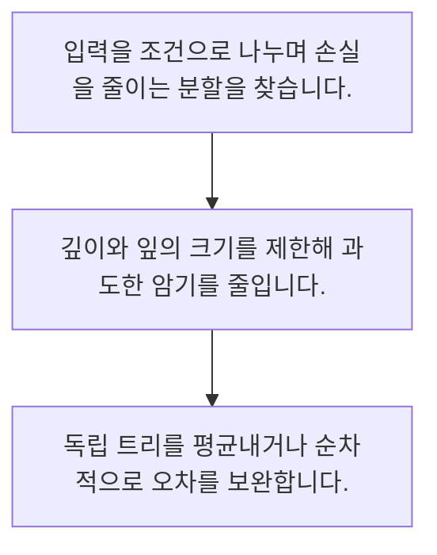

<!-- level:1 -->
# 결정 트리·랜덤 포레스트·부스팅

> **한 문장으로:** 트리는 조건을 따라 자료를 나누고, 앙상블은 여러 모델의 판단을 조합해 예측을 개선하는 방법입니다.

## 왜 필요한가요?

다섯 예측 중 세 표가 양성이므로 다수결 결과는 1입니다. 실제 랜덤 포레스트는 표본·피처 등의 다양성을 이용하고 부스팅은 순차적인 손실 개선을 사용합니다.

## 일상에서 떠올려 보기

상담원이 여러 질문을 따라 상담 유형을 고르는 모습이 트리와 비슷합니다. 서로 다른 상담원의 판단을 합치는 방법도 있지만 모두 같은 실수를 하면 합쳐도 해결되지 않습니다.

## 순서대로 따라가기

1. 입력을 조건으로 나누며 손실을 줄이는 분할을 찾습니다.
2. 깊이와 잎의 크기를 제한해 과도한 암기를 줄입니다.
3. 독립 트리를 평균내거나 순차적으로 오차를 보완합니다.



## 처음 만나는 용어

| 용어 | 쉬운 뜻 |
|---|---|
| 결정 트리 | 조건 분할을 따라 예측하는 구조 |
| 랜덤 포레스트 | 다양성을 주어 학습한 여러 트리의 결과를 합치는 방법 |
| 부스팅 | 앞선 모델이 남긴 오차를 순차적으로 보완하는 계열 |

**비유의 한계:** 질문 순서를 사람이 적은 예제는 학습된 트리와 다릅니다. 여러 모델을 합친다고 항상 좋아지지 않고 누출·편향·분포 변화는 그대로 남을 수 있습니다.

## 스스로 확인

앙상블의 기본 생각은?

**답과 이유:** 여러 모델 판단을 조합 — 여러 판단의 조합이 유용할 수 있지만 같은 편향을 자동 제거하지는 않습니다.
<!-- level:2 -->
# 결정 트리·랜덤 포레스트·부스팅 — 실제 흐름 따라가기

## 읽기 전 길잡이

트리는 조건을 따라 자료를 나누고, 앙상블은 여러 모델의 판단을 조합해 예측을 개선하는 방법입니다. 아래 예제는 외부 시스템에 연결하지 않는 작은 학습용 사례입니다. 입력, 처리 조건, 결과를 순서대로 살펴보세요.

1. 입력을 조건으로 나누며 손실을 줄이는 분할을 찾습니다.
2. 깊이와 잎의 크기를 제한해 과도한 암기를 줄입니다.
3. 독립 트리를 평균내거나 순차적으로 오차를 보완합니다.

## 예제로 확인하기

```python
# 학습 알고리즘이 아닌, 투표 원리를 보여 주는 예제
votes=[1,1,0,1,0]
prediction=int(sum(votes)>len(votes)/2)
assert prediction==1
print(prediction)
```

## 결과를 해석하기

다섯 예측 중 세 표가 양성이므로 다수결 결과는 1입니다. 실제 랜덤 포레스트는 표본·피처 등의 다양성을 이용하고 부스팅은 순차적인 손실 개선을 사용합니다.

## 실무에 옮기기 전

질문 순서를 사람이 적은 예제는 학습된 트리와 다릅니다. 여러 모델을 합친다고 항상 좋아지지 않고 누출·편향·분포 변화는 그대로 남을 수 있습니다. 실제 업무에서는 해석 요구와 지연·자료 규모를 함께 고려합니다. 앙상블을 도입할 때 각 모델의 다양성, 학습 경계와 검증의 독립성을 유지합니다.

## 확인 질문

예제 투표 결과는?

**답과 이유:** 양성 세 표가 음성 두 표보다 많아 1을 선택합니다.
<!-- level:3 -->
# 결정 트리·랜덤 포레스트·부스팅 — 가상 사례로 문제 해결하기

실제 고객의 장애 기록이 아닌 학습용 재현 시나리오입니다. 결과만 바꾸기 전에 관측한 증거와 원인 가설을 구분합니다.

## 1. 어떤 문제가 생겼나요?

가상 트리는 학습 오류가 0인데 검증 성능이 낮습니다.

## 2. 먼저 확인할 증거

트리 깊이·잎 표본 수와 학습·검증 오차 차이를 확인합니다.

## 3. 원인 가설

적은 예제를 지나치게 세분화해 암기했습니다.

## 4. 수정 방법

깊이와 최소 잎 크기를 제한하고 검증으로 복잡도를 선택합니다.

## 5. 재검증

새 분할과 다음 기간에서 성능·추론 비용·중요 피처의 안정성을 검사합니다.

## 놓치기 쉬운 조건

질문 순서를 사람이 적은 예제는 학습된 트리와 다릅니다. 여러 모델을 합친다고 항상 좋아지지 않고 누출·편향·분포 변화는 그대로 남을 수 있습니다.

## 확인 질문

학습 오류 0·검증 오류가 큰 트리의 점검은?

**답과 이유:** 과도한 분할은 학습 예제를 암기해 일반화를 해칠 수 있습니다.
<!-- level:4 -->
# 결정 트리·랜덤 포레스트·부스팅 — 업무와 아키텍처의 선택

## 읽기 전 길잡이

같은 개념도 업무의 규모, 오류 비용, 운영 역량에 따라 적용 방식이 달라집니다. 아래 비교는 특정 제품의 성능 순위가 아닌 선택 기준입니다.

| 선택 | 얻는 점 | 감수할 점 |
|---|---|---|
| 단일 얕은 트리 | 설명과 배포가 간단 | 복잡한 경계 표현 제한 |
| 여러 트리 앙상블 | 표 형식 자료에서 강한 기준선이 될 수 있음 | 모델 크기·해석·튜닝 비용 |

## 선택 기준

해석 요구와 지연·자료 규모를 함께 고려합니다. 앙상블을 도입할 때 각 모델의 다양성, 학습 경계와 검증의 독립성을 유지합니다.

## 도입과 운영에서 확인할 것

깊이와 최소 잎 크기를 제한하고 검증으로 복잡도를 선택합니다. 새 분할과 다음 기간에서 성능·추론 비용·중요 피처의 안정성을 검사합니다.

## 판단 연습

단일 트리와 앙상블의 선택 기준은?

**판단의 근거:** 독립 평가의 이득과 해석·지연·유지 부담을 함께 봅니다.

참고: [Google ML Crash Course](https://developers.google.com/machine-learning/crash-course), [scikit-learn 평가](https://scikit-learn.org/stable/model_selection.html), [scikit-learn 흔한 실수](https://scikit-learn.org/stable/common_pitfalls.html).
<!-- quizzes -->
[{"level":1,"question":"앙상블의 기본 생각은?","choices":["한 트리를 무한 확장","평가 생략","여러 모델 판단을 조합","데이터 없이 정답 보장"],"answer_index":2,"explanation":"여러 판단의 조합이 유용할 수 있지만 같은 편향을 자동 제거하지는 않습니다."},{"level":2,"question":"예제 투표 결과는?","choices":["0","5","확률 1로 보장","1"],"answer_index":3,"explanation":"양성 세 표가 음성 두 표보다 많아 1을 선택합니다."},{"level":3,"question":"학습 오류 0·검증 오류가 큰 트리의 점검은?","choices":["깊이와 잎 크기","색상 테마","파일명","검증 제거"],"answer_index":0,"explanation":"과도한 분할은 학습 예제를 암기해 일반화를 해칠 수 있습니다."},{"level":4,"question":"단일 트리와 앙상블의 선택 기준은?","choices":["학습 오류만","해석·성능·운영 비용","트리 개수만","항상 많은 트리"],"answer_index":1,"explanation":"독립 평가의 이득과 해석·지연·유지 부담을 함께 봅니다."}]
