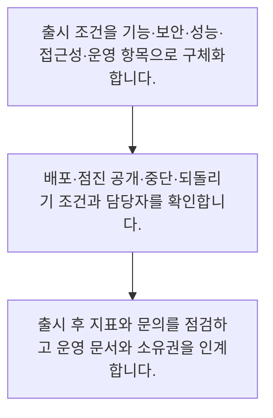

<!-- level:1 -->
# 품질 게이트·출시·인수인계

> **한 문장으로:** 출시는 개발 완료 버튼이 아니라, 품질 증거와 운영 준비·되돌리기 조건을 확인하는 공동 결정입니다.

## 왜 필요한가요?

롤백 버튼이 있어도 이미 보낸 메일이나 외부 결제는 되돌리지 못할 수 있습니다. 데이터 마이그레이션 호환성·외부 부작용·고객 안내까지 검토합니다. AI 시스템은 모델뿐 아니라 프롬프트·검색 문서·권한 정책 버전을 함께 추적해야 합니다.

## 일상에서 떠올려 보기

새 매장을 열 때 인테리어만 끝났다고 영업할 수는 없습니다. 계산대와 비상구, 직원 교육, 문제 발생 시 연락처를 확인해야 합니다. 서비스 출시도 기능과 운영을 함께 준비해야 사용자에게 책임 있게 제공할 수 있습니다.

## 순서대로 따라가기

1. 출시 조건을 기능·보안·성능·접근성·운영 항목으로 구체화합니다.
2. 배포·점진 공개·중단·되돌리기 조건과 담당자를 확인합니다.
3. 출시 후 지표와 문의를 점검하고 운영 문서와 소유권을 인계합니다.



## 처음 만나는 용어

| 용어 | 쉬운 뜻 |
|---|---|
| 품질 게이트 | 다음 단계로 진행할지 판단하는 확인 조건 |
| 점진 출시 | 제한된 사용자부터 범위를 넓혀 위험을 관측하는 방식 |
| 런북 | 반복 운영이나 장애 대응 절차와 연락 경로를 적은 문서 |

**비유의 한계:** 서비스는 매장보다 자주 바뀌며 일부 사용자부터 점진적으로 공개할 수 있습니다. 체크리스트 통과가 모든 장애를 막는 보증은 아니므로 관측과 대응을 계속해야 합니다.

## 스스로 확인

서비스 출시 전에 기능 외에 무엇을 준비하나요?

**답과 이유:** 운영 담당·관측·실패 대응·복구 절차 — 사용자에게 제공한 뒤에도 책임 있게 운영하려면 담당자와 대응 준비가 필요합니다.
<!-- level:2 -->
# 품질 게이트·출시·인수인계 — 실제 흐름 따라가기

## 읽기 전 길잡이

출시는 개발 완료 버튼이 아니라, 품질 증거와 운영 준비·되돌리기 조건을 확인하는 공동 결정입니다. 아래 예제는 외부 시스템에 연결하지 않는 작은 학습용 사례입니다. 입력, 처리 조건, 결과를 순서대로 살펴보세요.

1. 출시 조건을 기능·보안·성능·접근성·운영 항목으로 구체화합니다.
2. 배포·점진 공개·중단·되돌리기 조건과 담당자를 확인합니다.
3. 출시 후 지표와 문의를 점검하고 운영 문서와 소유권을 인계합니다.

## 예제로 확인하기

```markdown
# 출시 준비 기록
- 기능: 인수 조건과 회귀 테스트 결과 링크
- 보안: 역할별 문서 접근 검증 결과
- AI 품질: 대표 평가셋 결과, 금지 동작과 거부 경로
- 운영: 지표 대시보드, 담당·대체 담당, 런북
- 공개: 사내 시범부터 시작, 관측 후 확대
- 중단: 오류율·오처리·민감정보 노출의 합의 기준
- 복구: 이전 버전 전환, 데이터 호환성과 실행 권한 확인
- 인계: 운영 담당자의 모의 대응 완료
```

## 결과를 해석하기

롤백 버튼이 있어도 이미 보낸 메일이나 외부 결제는 되돌리지 못할 수 있습니다. 데이터 마이그레이션 호환성·외부 부작용·고객 안내까지 검토합니다. AI 시스템은 모델뿐 아니라 프롬프트·검색 문서·권한 정책 버전을 함께 추적해야 합니다.

## 실무에 옮기기 전

서비스는 매장보다 자주 바뀌며 일부 사용자부터 점진적으로 공개할 수 있습니다. 체크리스트 통과가 모든 장애를 막는 보증은 아니므로 관측과 대응을 계속해야 합니다. 실제 업무에서는 영향이 큰 서비스는 제한된 공개와 명시적인 중단 기준을 우선합니다. 되돌리기 어려운 데이터 변경과 외부 실행을 별도 검토하고, 운영 인계는 문서 전달뿐 아니라 담당자의 모의 대응으로 확인합니다.

## 확인 질문

AI 출시 버전 기록에 함께 묶을 것은 무엇인가요?

**답과 이유:** 결과에 영향을 준 구성요소를 알아야 문제를 재현하고 이전 상태와 비교할 수 있습니다.
<!-- level:3 -->
# 품질 게이트·출시·인수인계 — 가상 사례로 문제 해결하기

실제 고객의 장애 기록이 아닌 학습용 재현 시나리오입니다. 결과만 바꾸기 전에 관측한 증거와 원인 가설을 구분합니다.

## 1. 어떤 문제가 생겼나요?

새 AI 답변 기능을 되돌렸지만 잘못 전송된 고객 안내 메일은 남아 있습니다.

## 2. 먼저 확인할 증거

배포 기록에는 앱 버전만 있고 외부 전송 작업과 문서 버전은 없습니다.

## 3. 원인 가설

코드 롤백이 모든 부작용을 복구한다고 가정한 것이 원인 가설입니다.

## 4. 수정 방법

외부 전송을 중지하고 영향 범위를 파악한 뒤 정정 안내와 중복 방지를 수행하며 버전을 묶어 기록합니다.

## 5. 재검증

재현 환경에서 중단·복구·외부 부작용 처리를 연습하고 실제 운영자가 절차를 수행할 수 있는지 확인합니다.

## 놓치기 쉬운 조건

서비스는 매장보다 자주 바뀌며 일부 사용자부터 점진적으로 공개할 수 있습니다. 체크리스트 통과가 모든 장애를 막는 보증은 아니므로 관측과 대응을 계속해야 합니다.

## 확인 질문

롤백 뒤에도 잘못 보낸 메일이 남는 이유는 무엇인가요?

**답과 이유:** 배포 복구와 외부 실행의 보상·정정은 별도 절차로 설계해야 합니다.
<!-- level:4 -->
# 품질 게이트·출시·인수인계 — 업무와 아키텍처의 선택

## 읽기 전 길잡이

같은 개념도 업무의 규모, 오류 비용, 운영 역량에 따라 적용 방식이 달라집니다. 아래 비교는 특정 제품의 성능 순위가 아닌 선택 기준입니다.

| 선택 | 얻는 점 | 감수할 점 |
|---|---|---|
| 전체 동시 출시 | 운영 버전과 안내가 단순함 | 문제 발생 시 영향 범위가 큼 |
| 점진 공개와 관측 | 초기 영향 범위를 제한하고 검증 가능 | 대상 분리·버전 호환·지표 운영이 필요 |

## 선택 기준

영향이 큰 서비스는 제한된 공개와 명시적인 중단 기준을 우선합니다. 되돌리기 어려운 데이터 변경과 외부 실행을 별도 검토하고, 운영 인계는 문서 전달뿐 아니라 담당자의 모의 대응으로 확인합니다.

## 도입과 운영에서 확인할 것

외부 전송을 중지하고 영향 범위를 파악한 뒤 정정 안내와 중복 방지를 수행하며 버전을 묶어 기록합니다. 재현 환경에서 중단·복구·외부 부작용 처리를 연습하고 실제 운영자가 절차를 수행할 수 있는지 확인합니다.

## 판단 연습

운영 인수인계를 확인하는 좋은 방법은 무엇인가요?

**판단의 근거:** 실제로 대응할 수 있는지 확인해야 문서와 책임의 공백을 발견할 수 있습니다.

참고: [Scrum Guide](https://scrumguides.org/scrum-guide.html), [The Kanban Guide 2025](https://kanbanguides.org/the-kanban-guide/2025.5/), [GOV.UK Agile delivery](https://www.gov.uk/service-manual/agile-delivery).
<!-- quizzes -->
[{"level":1,"question":"서비스 출시 전에 기능 외에 무엇을 준비하나요?","choices":["운영 담당·관측·실패 대응·복구 절차","로고만","축하 메시지만","티켓 개수만"],"answer_index":0,"explanation":"사용자에게 제공한 뒤에도 책임 있게 운영하려면 담당자와 대응 준비가 필요합니다."},{"level":2,"question":"AI 출시 버전 기록에 함께 묶을 것은 무엇인가요?","choices":["스크린샷 하나","모델·프롬프트·검색 문서·정책 버전","앱 이름만","개발자 닉네임만"],"answer_index":1,"explanation":"결과에 영향을 준 구성요소를 알아야 문제를 재현하고 이전 상태와 비교할 수 있습니다."},{"level":3,"question":"롤백 뒤에도 잘못 보낸 메일이 남는 이유는 무엇인가요?","choices":["메일은 버전이 없어서 모든 추적이 불가능해서","테스트가 많아서","외부 부작용은 코드 롤백으로 자동 취소되지 않아서","롤백은 항상 거짓말이어서"],"answer_index":2,"explanation":"배포 복구와 외부 실행의 보상·정정은 별도 절차로 설계해야 합니다."},{"level":4,"question":"운영 인수인계를 확인하는 좋은 방법은 무엇인가요?","choices":["문서 파일만 보낸다","개발자 연락처를 지운다","지표를 숨긴다","운영자가 모의 장애에서 런북으로 대응해 본다"],"answer_index":3,"explanation":"실제로 대응할 수 있는지 확인해야 문서와 책임의 공백을 발견할 수 있습니다."}]
