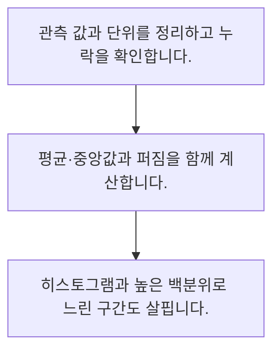

<!-- level:1 -->
# 평균·중앙값·분산과 분포

> **한 문장으로:** 평균 하나와 함께 가운데 값, 퍼짐, 긴 꼬리를 살펴야 데이터의 모습을 이해할 수 있습니다.

## 왜 필요한가요?

매출이나 처리 시간 하나만 보고 업무가 좋아졌다고 판단하기는 어렵습니다. 전체의 중심과 흩어짐을 함께 보면 유난히 오래 걸리는 사례와 보통 사례를 구분할 수 있습니다.

## 일상에서 떠올려 보기

다섯 사람의 통근 시간을 비교한다고 생각해 보세요. 한 명이 아주 먼 곳에 살면 평균은 커지지만 나머지 사람의 보통 경험은 중앙값에 더 가까울 수 있습니다.

## 순서대로 따라가기

1. 관측 값과 단위를 정리하고 누락을 확인합니다.
2. 평균·중앙값과 퍼짐을 함께 계산합니다.
3. 히스토그램과 높은 백분위로 느린 구간도 살핍니다.



## 처음 만나는 용어

| 용어 | 쉬운 뜻 |
|---|---|
| 중앙값 | 값을 정렬했을 때 가운데에 있는 값 |
| 분산 | 평균에서 얼마나 떨어져 있는지 제곱해 평균낸 양 |
| 백분위수 | 작은 값부터 정렬했을 때 특정 비율에 해당하는 경계 |

**비유의 한계:** 중앙값도 모든 사람의 경험을 대표하지는 않습니다. 백분위수는 표본 수와 계산 방식에 영향을 받고, 서로 다른 집단을 섞으면 해석이 달라집니다.

## 스스로 확인

극단적으로 큰 값의 영향을 덜 받는 가운데 값은?

**답과 이유:** 중앙값 — 중앙값은 순서상 가운데 값입니다. 합계와 평균은 극단 값의 크기에 직접 영향을 받습니다.
<!-- level:2 -->
# 평균·중앙값·분산과 분포 — 실제 흐름 따라가기

## 읽기 전 길잡이

평균 하나와 함께 가운데 값, 퍼짐, 긴 꼬리를 살펴야 데이터의 모습을 이해할 수 있습니다. 아래 예제는 외부 시스템에 연결하지 않는 작은 학습용 사례입니다. 입력, 처리 조건, 결과를 순서대로 살펴보세요.

1. 관측 값과 단위를 정리하고 누락을 확인합니다.
2. 평균·중앙값과 퍼짐을 함께 계산합니다.
3. 히스토그램과 높은 백분위로 느린 구간도 살핍니다.

## 예제로 확인하기

```python
import statistics as s
x = [10, 10, 10, 10, 110]
assert s.mean(x) == 30
assert s.median(x) == 10
print(s.mean(x), s.median(x), s.pvariance(x))
```

## 결과를 해석하기

다섯 값의 평균은 30, 중앙값은 10입니다. 드문 110이 평균을 올립니다. 응답 시간에서는 중앙값뿐 아니라 느린 요청의 비중과 p95 같은 꼬리도 함께 봅니다.

## 실무에 옮기기 전

중앙값도 모든 사람의 경험을 대표하지는 않습니다. 백분위수는 표본 수와 계산 방식에 영향을 받고, 서로 다른 집단을 섞으면 해석이 달라집니다. 실제 업무에서는 비용 합계는 평균이 유용하지만 대기 경험은 꼬리를 함께 봅니다. 서로 다른 서버의 p95를 단순 평균해 전체 p95로 간주하지 않고 원본 분포나 병합 가능한 요약을 사용합니다.

## 확인 질문

10·10·10·10·110의 평균과 중앙값은?

**답과 이유:** 합은 150이고 5개로 나누면 30입니다. 정렬한 세 번째 값은 10입니다.
<!-- level:3 -->
# 평균·중앙값·분산과 분포 — 가상 사례로 문제 해결하기

실제 고객의 장애 기록이 아닌 학습용 재현 시나리오입니다. 결과만 바꾸기 전에 관측한 증거와 원인 가설을 구분합니다.

## 1. 어떤 문제가 생겼나요?

가상 서비스의 평균 응답 시간은 그대로인데 고객 불만이 늘어납니다.

## 2. 먼저 확인할 증거

중앙값·p95·오류율과 시간대별 요청 수를 나누어 봅니다.

## 3. 원인 가설

일부 느린 요청이 적은 수의 빠른 요청과 섞여 평균에서 드러나지 않았습니다.

## 4. 수정 방법

엔드포인트와 고객군별 분포를 만들고 느린 구간을 조사합니다.

## 5. 재검증

같은 부하 조건에서 꼬리 지연과 오류율이 개선되는지 확인합니다.

## 놓치기 쉬운 조건

중앙값도 모든 사람의 경험을 대표하지는 않습니다. 백분위수는 표본 수와 계산 방식에 영향을 받고, 서로 다른 집단을 섞으면 해석이 달라집니다.

## 확인 질문

평균이 같아도 불만이 늘면 확인할 것은?

**답과 이유:** 평균은 분포의 차이를 숨길 수 있습니다. 꼬리 지연과 오류를 함께 관찰해야 증거를 얻습니다.
<!-- level:4 -->
# 평균·중앙값·분산과 분포 — 업무와 아키텍처의 선택

## 읽기 전 길잡이

같은 개념도 업무의 규모, 오류 비용, 운영 역량에 따라 적용 방식이 달라집니다. 아래 비교는 특정 제품의 성능 순위가 아닌 선택 기준입니다.

| 선택 | 얻는 점 | 감수할 점 |
|---|---|---|
| 평균만 저장 | 저장·설명 간단 | 꼬리와 다봉 분포를 놓침 |
| 분포·백분위 저장 | 사용자 경험의 차이 관찰 | 집계 방식과 보관 비용 필요 |

## 선택 기준

비용 합계는 평균이 유용하지만 대기 경험은 꼬리를 함께 봅니다. 서로 다른 서버의 p95를 단순 평균해 전체 p95로 간주하지 않고 원본 분포나 병합 가능한 요약을 사용합니다.

## 도입과 운영에서 확인할 것

엔드포인트와 고객군별 분포를 만들고 느린 구간을 조사합니다. 같은 부하 조건에서 꼬리 지연과 오류율이 개선되는지 확인합니다.

## 판단 연습

서버별 p95의 단순 평균은 무엇인가요?

**판단의 근거:** 백분위수는 합산 가능한 평균이 아닙니다. 전체 요청의 분포를 반영한 계산이 필요합니다.

참고: [NIST 통계 핸드북](https://www.itl.nist.gov/div898/handbook/), [PostgreSQL 쿼리](https://www.postgresql.org/docs/current/queries.html).
<!-- quizzes -->
[{"level":1,"question":"극단적으로 큰 값의 영향을 덜 받는 가운데 값은?","choices":["분산의 제곱","중앙값","최댓값","합계"],"answer_index":1,"explanation":"중앙값은 순서상 가운데 값입니다. 합계와 평균은 극단 값의 크기에 직접 영향을 받습니다."},{"level":2,"question":"10·10·10·10·110의 평균과 중앙값은?","choices":["30과 30","110과 10","30과 10","10과 30"],"answer_index":2,"explanation":"합은 150이고 5개로 나누면 30입니다. 정렬한 세 번째 값은 10입니다."},{"level":3,"question":"평균이 같아도 불만이 늘면 확인할 것은?","choices":["평균만 다시 표시","최솟값만 기록","고객군 제거","느린 요청의 분포와 오류율"],"answer_index":3,"explanation":"평균은 분포의 차이를 숨길 수 있습니다. 꼬리 지연과 오류를 함께 관찰해야 증거를 얻습니다."},{"level":4,"question":"서버별 p95의 단순 평균은 무엇인가요?","choices":["전체 p95를 보장하지 않음","항상 전체 p95","항상 중앙값","요청 수와 무관한 정확한 합계"],"answer_index":0,"explanation":"백분위수는 합산 가능한 평균이 아닙니다. 전체 요청의 분포를 반영한 계산이 필요합니다."}]
