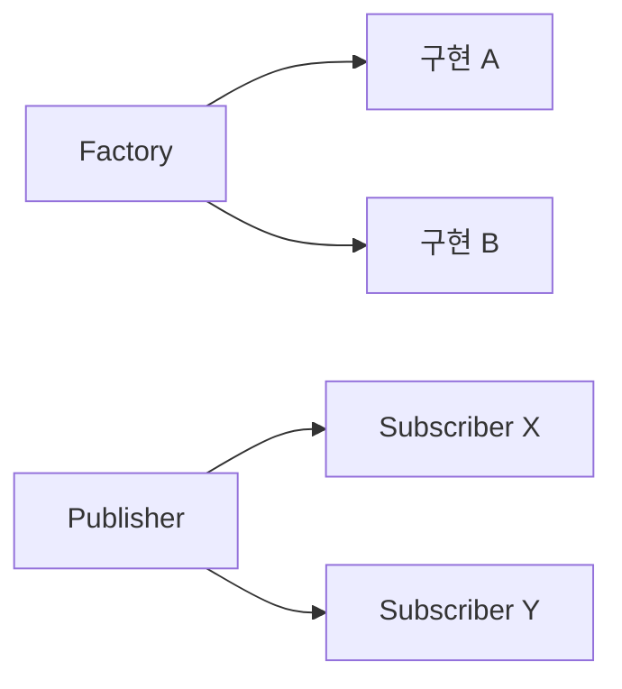

<!-- level:1 -->
# 디자인 패턴 — 반복되는 설계 문제의 이름

공장에서 제품을 만드는 절차를 분리하거나, 게시판 변경을 구독자에게 알리는 것처럼 반복되는 문제에는 익숙한 구조가 있다. Factory는 생성 결정을 모으고, Observer는 변화 통지를 연결하며, Singleton은 특정 범위에서 인스턴스를 하나로 제한하는 구조다. 패턴은 요구와 비용을 이야기하는 어휘이지 반드시 적용해야 하는 목록이 아니다.



Singleton 객체 하나가 분산 서버 전체의 하나를 뜻하지 않는다. 여러 프로세스는 각각 인스턴스를 가질 수 있다. Observer의 알림 순서·실패·구독 해제를 정하지 않으면 호출자가 강하게 얽히거나 참조 누수가 생길 수 있다.

**비유의 한계:** 이름이 같은 패턴도 언어·런타임·동기/비동기 실행에 따라 계약이 달라진다. 문제를 먼저 정하고 패턴을 선택한다.
<!-- level:2 -->
# 생성과 사용을 분리하기

Factory는 설정·환경에 따른 생성 로직을 사용 코드 밖으로 이동시킬 수 있다. 객체 수명을 누가 소유하고 닫는지 함께 정한다. Observer는 상태 변경 이후 어떤 이벤트를 누구에게 어떤 보장으로 전달하는지 정의한다.

Python 3 예제는 Factory의 최소 형태다.

```python
class JsonWriter:
    def write(self, value):
        import json
        return json.dumps(value)
class TextWriter:
    def write(self, value): return str(value)
def writer(kind):
    factories = {"json": JsonWriter, "text": TextWriter}
    if kind not in factories: raise ValueError("unsupported format")
    return factories[kind]()
assert writer("json").write({"ok": True}) == '{"ok": true}'
```

단순한 생성 함수만으로 요구가 해결되면 복잡한 Factory 계층을 만들 필요가 없다. Singleton 초기화의 스레드 안전성과 테스트 격리는 별도 문제다. Observer에서는 콜백 실행 중 구독 목록 변경, 재진입, 예외 전파를 처리해야 한다. 네트워크 이벤트 버스는 메모리 안 콜백과 달리 전달 중복·지연·손실을 다룬다.
<!-- level:3 -->
# 가상 장애 — 화면을 열 때마다 알림이 중복된다

가상 UI가 화면 마운트마다 구독하지만 닫을 때 해제하지 않는다. 발행자는 이전 화면의 콜백과 상태를 붙잡고 있어 중복 알림과 메모리 증가가 발생한다.

**진단:** 화면 열기·닫기를 반복하며 구독자 수와 콜백 호출 수를 확인한다. 힙 스냅샷의 참조 경로와 이벤트 등록 지점을 연결한다. 비동기 콜백이 화면 종료 후 실행되는 경로도 확인한다.

**수정:** subscribe가 해제 함수를 반환하도록 하고 수명주기에 맞춰 실행한다. 콜백 실패 정책·순서·중복 등록을 명시한다. Singleton 공유 상태 때문에 테스트가 서로 영향을 주면 상태를 주입하거나 테스트별 수명을 분리한다.

**재검증:** 반복 마운트·해제, 예외 콜백, 구독 중 등록 변경을 테스트하고 구독자 수가 초기 수준으로 돌아오는지 확인한다.
<!-- level:4 -->
# 패턴 도입보다 계약 선택

| 구조 | 쓰기 좋은 상황 | 비용 |
|---|---|---|
| Factory | 생성 정책이 여러 곳에서 바뀜 | 설정과 수명 소유권 |
| Observer | 변화와 소비자 결합을 줄임 | 순서·예외·해제·재진입 |
| Singleton | 명확한 프로세스 내부 공유 자원 | 전역 상태·테스트·동시성 |

분산 유일성 요구를 Singleton으로 해결하려 하지 않는다. 여러 서버가 하나의 작업을 수행해야 한다면 DB 제약·리더 선출·작업 lease 등 다른 계약이 필요하다. 패턴은 처음부터 일반화하기보다 실제 중복과 변경 압력을 발견했을 때 도입한다.

**판단 연습:** 한 프로세스의 설정 객체와 전 세계 한 번만 실행해야 하는 정산 작업을 같은 “하나”로 설명할 수 있을까? 범위·수명·실패 보장을 명시하자.

참고: [Python logging의 Logger 관리](https://docs.python.org/3/library/logging.html), [MDN EventTarget](https://developer.mozilla.org/en-US/docs/Web/API/EventTarget).
<!-- quizzes -->
[{"level":1,"question":"프로세스 내부 Singleton의 보장 범위는?","choices":["전 세계 서버 모두 하나","분산 DB가 자동 잠김","모든 사용자별 하나","해당 구현이 정의한 프로세스·모듈 수명 범위"],"answer_index":3,"explanation":"Singleton은 분산 유일성을 자동 제공하지 않습니다. 실행 프로세스와 모듈 수명에 따라 인스턴스 범위를 명시해야 합니다."},{"level":2,"question":"Factory가 직접 분리하는 책임은?","choices":["구현 객체를 생성·선택하는 결정","모든 업무 오류","네트워크 전달 보장","모든 상태 동기화"],"answer_index":0,"explanation":"생성 로직을 사용 코드 밖으로 옮길 수 있습니다. 객체의 수명과 실패 계약은 여전히 설계해야 합니다."},{"level":3,"question":"Observer 중복 알림과 참조 누수의 수정 출발점은?","choices":["구독을 무제한 추가","구독 해제와 수명주기 연결","GC 주기를 무조건 증가","모든 이벤트를 전역 공개"],"answer_index":1,"explanation":"발행자가 콜백 참조를 보유할 수 있습니다. 등록과 해제를 맞추고 중복·재진입·예외 정책도 정의합니다."},{"level":4,"question":"패턴 선택의 기준으로 적절한 것은?","choices":["패턴 이름 수 최대화","모든 코드에 동일 패턴","실제 문제·변경 축·수명·실패 계약","라이브러리 이름만 보고 선택"],"answer_index":2,"explanation":"패턴에는 관리 비용이 있습니다. 실제 반복 문제와 계약을 확인해 가장 단순하게 요구를 충족하는 구조를 선택합니다."}]
