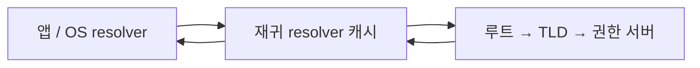

<!-- level:1 -->
# DNS — 이름을 주소로 찾는 분산 안내 체계

사람은 서비스 이름을 기억하기 쉽고 네트워크는 주소를 사용한다. DNS는 이름에 연결된 레코드를 찾는 분산 시스템이다. 앱의 stub resolver, 재귀 resolver, 루트·TLD·권한 서버가 서로 다른 역할을 갖는다. 전화번호부 한 권을 전 세계가 매번 읽는 구조가 아니다.



권한 서버는 특정 이름 영역의 레코드를 제공한다. 재귀 resolver는 클라이언트 대신 필요한 조회를 진행하고 캐시한다. TTL은 캐시에 보관할 수 있는 시간과 관련된다. 이름 하나가 여러 주소를 가질 수 있고 별칭(CNAME)을 따라가야 할 수도 있다.

**비유의 한계:** DNS 변경은 전 세계 캐시를 즉시 지우는 버튼이 아니다. DNS가 주소를 알려줬다는 사실은 서버가 살아 있거나 그 서버의 TLS 인증서가 올바름을 보장하지 않는다.

**확인:** 권한 서버 레코드를 바꿨는데 일부 사용자가 이전 주소를 보는 이유는 무엇일까?
<!-- level:2 -->
# 레코드와 캐시의 경계를 확인하기

A는 IPv4 주소, AAAA는 IPv6 주소, CNAME은 다른 이름으로의 별칭이다. DNS 응답은 레코드뿐 아니라 존재하지 않는 이름이나 데이터에 대한 상태도 포함하며 부정 응답 역시 캐시될 수 있다. 재귀 서버가 이미 유효한 캐시를 갖고 있으면 루트부터 다시 조회하지 않는다.

`dig`가 설치된 학습 환경에서 공개 예제 이름을 읽는 명령이다.

```bash
dig example.com A
dig example.com AAAA
dig example.com NS
dig +trace example.com
```

`+trace`는 위임 경로를 직접 확인하는 진단 방식이며 일반 앱의 resolver 동작과 완전히 같지 않다. 지정 resolver를 비교하려면 `dig @RESOLVER example.com A`처럼 실제 허용된 서버를 사용한다. 응답의 status, ANSWER, TTL, 권한·재귀 관련 플래그를 읽는다.

DNS는 보통 UDP를 쓰지만 큰 응답, 절단 응답 처리 등에는 TCP도 필요하다. DNSSEC은 DNS 데이터의 출처·무결성 검증을 지원하며 TLS처럼 모든 조회를 암호화하는 기술이 아니다. DoH/DoT는 전송 보호와 다른 신뢰 경계를 갖는다.
<!-- level:3 -->
# 가상 장애 — 배포 뒤 특정 지역만 옛 서버로 간다

새 IP로 바꾼 직후 일부 요청이 이전 서버로 연결되는 사례를 재현한다. 먼저 앱·OS·재귀 resolver의 캐시와 권한 서버 응답을 구분해 비교한다. TTL을 낮추는 작업은 변경 전에 기존 TTL이 만료될 여유를 두어야 효과가 있다.

가상 관측: 권한 서버는 새 주소, 재귀 resolver 일부는 남은 TTL과 이전 주소를 반환한다. resolver 응답이 같은데도 연결 대상이 다르면 앱의 연결 풀·주소 캐시를 조사한다. IPv6 AAAA만 옛 주소로 남은 경우도 확인한다.

**수정:** 이전 서버를 이행 기간 동안 유지하고 A/AAAA 및 별칭을 함께 검토한다. 실패 응답의 부정 캐시와 split-horizon 설정, 기업 VPN resolver도 고려한다. 무조건 모든 클라이언트의 캐시를 지우는 운영은 통제하기 어렵다.

**재검증:** 여러 resolver와 지역에서 DNS 응답 및 실제 연결을 따로 관측한다. 요청 성공률·주소별 트래픽·TLS 오류가 안정되는지 확인한다.
<!-- level:4 -->
# TTL과 DNS 기반 전환의 비용

| 전략 | 장점 | 한계 |
|---|---|---|
| 긴 TTL | 조회 부하와 지연 감소 | 변경 반영이 늦을 수 있음 |
| 짧은 TTL | 주소 변경 유연성 | 조회량·resolver 의존도 증가 |
| DNS 기반 분산 | 넓은 지역의 주소 선택 | 캐시·연결 재사용으로 즉시 제어 불가 |
| 프록시 기반 전환 | 요청 단위 제어·관측 | 프록시 비용과 장애 경계 |

DNS만으로 엄밀한 즉시 failover를 보장하지 않는다. 클라이언트 캐시, 기존 연결, resolver 행동과 실패 모드를 함께 고려한다. 복구 목표가 매우 짧다면 DNS와 별개로 여러 끝점·클라이언트 재시도·프록시 헬스체크를 조합할 수 있다.

**판단 연습:** 5분 이내 주소 이전과 낮은 조회 비용이 모두 필요하다면 준비 기간, TTL 변경 시점, 이전 서버 유지 기간을 어떻게 정할까? 수치는 요구 조건이고 실제 캐시 관측으로 검증해야 한다.

참고: [DNS RFC 1034](https://www.rfc-editor.org/rfc/rfc1034), [DNS Negative Caching RFC 2308](https://www.rfc-editor.org/rfc/rfc2308).
<!-- quizzes -->
[{"level":1,"question":"DNS 변경이 모든 사용자에게 즉시 반영되지 않는 주요 이유는?","choices":["이름은 절대 바뀌지 않음","전 세계 서버가 같은 RAM 사용","TCP가 DNS를 제거","여러 resolver와 앱에 캐시가 존재"],"answer_index":3,"explanation":"권한 레코드와 클라이언트가 보는 캐시는 다릅니다. TTL과 앱의 연결 재사용도 반영 시점에 영향을 줍니다."},{"level":2,"question":"DNSSEC과 DoH/DoT를 구분한 설명으로 적절한 것은?","choices":["DNSSEC은 데이터 출처·무결성, DoH/DoT는 전송 보호와 관련","모두 모든 앱 데이터를 암호화","DNSSEC은 서버 생존을 보장","DoH는 캐시를 없앰"],"answer_index":0,"explanation":"각 기술의 보호 범위가 다릅니다. DNS 데이터 검증, 조회 전송 암호화, 서비스 가용성을 구분해야 합니다."},{"level":3,"question":"DNS 응답은 새 주소인데 앱이 옛 주소로 계속 연결될 때 확인할 것은?","choices":["비트 진법만 변경","앱 주소 캐시와 기존 연결 풀","권한 서버를 무조건 삭제","모든 HTTP 본문 수정"],"answer_index":1,"explanation":"resolver 응답 이후에도 앱의 DNS 캐시나 장기 연결이 이전 주소를 사용할 수 있습니다. DNS 조회와 실제 연결을 나눠 관측합니다."},{"level":4,"question":"짧은 TTL을 선택할 때 함께 고려할 비용은?","choices":["메모리 부호 비트","프로그램 파일 이름","조회량 증가와 resolver 의존도","모든 장애의 자동 해결"],"answer_index":2,"explanation":"짧은 TTL은 유연성을 높일 수 있지만 캐시 효과가 줄어 조회 부하가 늘고 외부 resolver에 더 자주 의존합니다."}]
