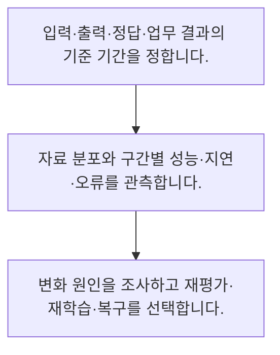

<!-- level:1 -->
# 데이터 드리프트·성능 저하·모니터링

> **한 문장으로:** 입력 분포 변화와 실제 예측 품질 저하를 구분하고 정답이 늦게 오는 상황까지 관측합니다.

## 왜 필요한가요?

평균 차이만 보는 학습용 신호로, 통계 검정이나 성능 하락 판정은 아닙니다. 실제로는 표본 수·계절성·입력 수집 오류와 정답 기반 성능을 함께 확인합니다.

## 일상에서 떠올려 보기

가게 손님 구성이 달라졌다고 매출이 반드시 나빠지는 것은 아닙니다. 변화 신호와 실제 업무 결과를 따로 확인해야 합니다.

## 순서대로 따라가기

1. 입력·출력·정답·업무 결과의 기준 기간을 정합니다.
2. 자료 분포와 구간별 성능·지연·오류를 관측합니다.
3. 변화 원인을 조사하고 재평가·재학습·복구를 선택합니다.



## 처음 만나는 용어

| 용어 | 쉬운 뜻 |
|---|---|
| 데이터 드리프트 | 운영 자료의 분포가 기준과 달라지는 현상 |
| 개념 드리프트 | 입력과 목표 사이의 관계가 변하는 현상 |
| 지연 라벨 | 예측 뒤 시간이 지나야 얻을 수 있는 정답 |

**비유의 한계:** 분포 변화 알림은 성능 저하의 증명이 아닙니다. 반대로 평균이 비슷해도 특정 집단이나 입력·정답 관계가 바뀌면 실패할 수 있습니다.

## 스스로 확인

입력 분포가 달라졌다는 신호가 바로 뜻하지 않는 것은?

**답과 이유:** 성능 하락 확정 — 드리프트와 실제 품질 저하는 관련될 수 있지만 같은 사실은 아닙니다.
<!-- level:2 -->
# 데이터 드리프트·성능 저하·모니터링 — 실제 흐름 따라가기

## 읽기 전 길잡이

입력 분포 변화와 실제 예측 품질 저하를 구분하고 정답이 늦게 오는 상황까지 관측합니다. 아래 예제는 외부 시스템에 연결하지 않는 작은 학습용 사례입니다. 입력, 처리 조건, 결과를 순서대로 살펴보세요.

1. 입력·출력·정답·업무 결과의 기준 기간을 정합니다.
2. 자료 분포와 구간별 성능·지연·오류를 관측합니다.
3. 변화 원인을 조사하고 재평가·재학습·복구를 선택합니다.

## 예제로 확인하기

```python
baseline=[10,11,9]; live=[20,21,19]
mean=lambda x:sum(x)/len(x)
gap=abs(mean(live)-mean(baseline))
assert gap==10
print("평균 차이:",gap)
```

## 결과를 해석하기

평균 차이만 보는 학습용 신호로, 통계 검정이나 성능 하락 판정은 아닙니다. 실제로는 표본 수·계절성·입력 수집 오류와 정답 기반 성능을 함께 확인합니다.

## 실무에 옮기기 전

분포 변화 알림은 성능 저하의 증명이 아닙니다. 반대로 평균이 비슷해도 특정 집단이나 입력·정답 관계가 바뀌면 실패할 수 있습니다. 실제 업무에서는 알림은 재학습의 자동 명령이 아니라 조사의 출발점으로 둡니다. 수집 오류·계절성·실제 관계 변화에 따라 대응을 다르게 선택합니다.

## 확인 질문

예제 평균 차이는?

**답과 이유:** 기준 평균 10과 운영 평균 20의 차이입니다.
<!-- level:3 -->
# 데이터 드리프트·성능 저하·모니터링 — 가상 사례로 문제 해결하기

실제 고객의 장애 기록이 아닌 학습용 재현 시나리오입니다. 결과만 바꾸기 전에 관측한 증거와 원인 가설을 구분합니다.

## 1. 어떤 문제가 생겼나요?

가상 모델에서 분포 알림이 계속 울리지만 업무 성과는 유지됩니다.

## 2. 먼저 확인할 증거

기간·표본·계절성과 실제 정답 도착 후 성능을 대조합니다.

## 3. 원인 가설

정상 계절 변화를 실패로 해석했습니다.

## 4. 수정 방법

상황별 기준과 조사 절차를 만들고 성능 지표를 분리합니다.

## 5. 재검증

실제 실패 사례의 탐지와 불필요 알림 비율을 함께 검사합니다.

## 놓치기 쉬운 조건

분포 변화 알림은 성능 저하의 증명이 아닙니다. 반대로 평균이 비슷해도 특정 집단이나 입력·정답 관계가 바뀌면 실패할 수 있습니다.

## 확인 질문

계절 변화로 알림이 많으면?

**답과 이유:** 정상 변화와 실제 실패를 구분해야 합니다.
<!-- level:4 -->
# 데이터 드리프트·성능 저하·모니터링 — 업무와 아키텍처의 선택

## 읽기 전 길잡이

같은 개념도 업무의 규모, 오류 비용, 운영 역량에 따라 적용 방식이 달라집니다. 아래 비교는 특정 제품의 성능 순위가 아닌 선택 기준입니다.

| 선택 | 얻는 점 | 감수할 점 |
|---|---|---|
| 입력 분포 관측 | 빠른 변화 탐지 | 성능 영향은 간접적 |
| 정답·업무 결과 관측 | 실제 품질과 연결 | 정답 지연·수집 비용 |

## 선택 기준

알림은 재학습의 자동 명령이 아니라 조사의 출발점으로 둡니다. 수집 오류·계절성·실제 관계 변화에 따라 대응을 다르게 선택합니다.

## 도입과 운영에서 확인할 것

상황별 기준과 조사 절차를 만들고 성능 지표를 분리합니다. 실제 실패 사례의 탐지와 불필요 알림 비율을 함께 검사합니다.

## 판단 연습

좋은 드리프트 대응은?

**판단의 근거:** 입력 오류와 실제 관계 변화는 다른 해결이 필요합니다.

참고: [Google Cloud MLOps](https://docs.cloud.google.com/architecture/mlops-continuous-delivery-and-automation-pipelines-in-machine-learning), [NIST AI RMF](https://www.nist.gov/itl/ai-risk-management-framework), [OWASP 생성형 AI 보안](https://genai.owasp.org/llm-top-10/), [Google SRE Workbook](https://sre.google/workbook/table-of-contents/).
<!-- quizzes -->
[{"level":1,"question":"입력 분포가 달라졌다는 신호가 바로 뜻하지 않는 것은?","choices":["추가 조사 필요","성능 하락 확정","자료 변화 가능성","기준과 차이"],"answer_index":1,"explanation":"드리프트와 실제 품질 저하는 관련될 수 있지만 같은 사실은 아닙니다."},{"level":2,"question":"예제 평균 차이는?","choices":["0","3","10","20"],"answer_index":2,"explanation":"기준 평균 10과 운영 평균 20의 차이입니다."},{"level":3,"question":"계절 변화로 알림이 많으면?","choices":["무조건 재학습","모든 알림 끄기","정답 수집 중단","상황별 기준과 실제 결과 비교"],"answer_index":3,"explanation":"정상 변화와 실제 실패를 구분해야 합니다."},{"level":4,"question":"좋은 드리프트 대응은?","choices":["원인별 조사·재평가","항상 자동 재학습","평균만 확인","로그 삭제"],"answer_index":0,"explanation":"입력 오류와 실제 관계 변화는 다른 해결이 필요합니다."}]
