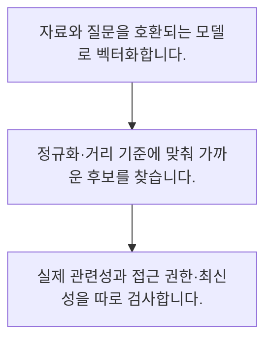

<!-- level:1 -->
# 임베딩·벡터 유사도와 검색

> **한 문장으로:** 임베딩은 자료를 숫자 벡터로 표현해 가까움을 계산하지만 유사도 점수는 사실성이나 권한의 증명이 아닙니다.

## 왜 필요한가요?

2차원 벡터의 코사인 값은 0.8입니다. 정답 확률 80%라는 뜻은 아닙니다. 영벡터 처리와 차원·모델 일치가 필요하며 실제 검색 적합성은 별도 평가합니다.

## 일상에서 떠올려 보기

책을 주제별 지도에 놓고 비슷한 책을 가까이 배치하는 모습과 비슷합니다. 지도의 가까움이 책 내용이 모두 옳거나 읽을 권한이 있다는 뜻은 아닙니다.

## 순서대로 따라가기

1. 자료와 질문을 호환되는 모델로 벡터화합니다.
2. 정규화·거리 기준에 맞춰 가까운 후보를 찾습니다.
3. 실제 관련성과 접근 권한·최신성을 따로 검사합니다.



## 처음 만나는 용어

| 용어 | 쉬운 뜻 |
|---|---|
| 임베딩 | 자료의 특징을 수치 벡터로 나타낸 표현 |
| 코사인 유사도 | 벡터 방향의 가까움을 계산하는 기준 |
| 벡터 검색 | 벡터 거리나 유사도를 이용해 후보를 찾는 작업 |

**비유의 한계:** 벡터 공간은 학습 목표와 모델 버전에 의존합니다. 다른 모델의 벡터를 섞거나 비슷한 문서를 동일 의미로 단정하지 않아야 합니다.

## 스스로 확인

높은 임베딩 유사도가 보장하지 않는 것은?

**답과 이유:** 사실성과 접근 권한 — 유사도는 표현 공간의 관계이며 사실과 권한은 다른 검사입니다.
<!-- level:2 -->
# 임베딩·벡터 유사도와 검색 — 실제 흐름 따라가기

## 읽기 전 길잡이

임베딩은 자료를 숫자 벡터로 표현해 가까움을 계산하지만 유사도 점수는 사실성이나 권한의 증명이 아닙니다. 아래 예제는 외부 시스템에 연결하지 않는 작은 학습용 사례입니다. 입력, 처리 조건, 결과를 순서대로 살펴보세요.

1. 자료와 질문을 호환되는 모델로 벡터화합니다.
2. 정규화·거리 기준에 맞춰 가까운 후보를 찾습니다.
3. 실제 관련성과 접근 권한·최신성을 따로 검사합니다.

## 예제로 확인하기

```python
import math
a=[1.,0.]; b=[0.8,0.6]
cos=sum(x*y for x,y in zip(a,b))/(math.sqrt(sum(x*x for x in a))*math.sqrt(sum(x*x for x in b)))
assert math.isclose(cos,0.8)
print(cos)
```

## 결과를 해석하기

2차원 벡터의 코사인 값은 0.8입니다. 정답 확률 80%라는 뜻은 아닙니다. 영벡터 처리와 차원·모델 일치가 필요하며 실제 검색 적합성은 별도 평가합니다.

## 실무에 옮기기 전

벡터 공간은 학습 목표와 모델 버전에 의존합니다. 다른 모델의 벡터를 섞거나 비슷한 문서를 동일 의미로 단정하지 않아야 합니다. 실제 업무에서는 자료 특성과 질의 유형에 맞춰 키워드·벡터 또는 혼합 방식을 평가합니다. 모델 버전을 인덱스와 연결하고 점수를 확률이나 사실 검증으로 사용하지 않습니다.

## 확인 질문

예제 코사인 값은?

**답과 이유:** 두 벡터의 내적과 길이를 이용한 값이며 확률 해석은 할 수 없습니다.
<!-- level:3 -->
# 임베딩·벡터 유사도와 검색 — 가상 사례로 문제 해결하기

실제 고객의 장애 기록이 아닌 학습용 재현 시나리오입니다. 결과만 바꾸기 전에 관측한 증거와 원인 가설을 구분합니다.

## 1. 어떤 문제가 생겼나요?

가상 검색이 모델 교체 후 엉뚱한 문서를 반환합니다.

## 2. 먼저 확인할 증거

질의·문서 벡터의 모델 ID·차원·정규화 방식을 비교합니다.

## 3. 원인 가설

옛 문서 벡터와 새 질문 벡터를 같은 공간처럼 비교했습니다.

## 4. 수정 방법

호환되는 인덱스를 별도로 만들고 전체 재임베딩·전환을 계획합니다.

## 5. 재검증

보류 질의의 검색 품질과 권한 필터를 전환 전후 비교합니다.

## 놓치기 쉬운 조건

벡터 공간은 학습 목표와 모델 버전에 의존합니다. 다른 모델의 벡터를 섞거나 비슷한 문서를 동일 의미로 단정하지 않아야 합니다.

## 확인 질문

임베딩 모델 변경 후 품질이 깨지면?

**답과 이유:** 서로 다른 벡터 공간은 직접 비교할 수 있다고 가정하면 안 됩니다.
<!-- level:4 -->
# 임베딩·벡터 유사도와 검색 — 업무와 아키텍처의 선택

## 읽기 전 길잡이

같은 개념도 업무의 규모, 오류 비용, 운영 역량에 따라 적용 방식이 달라집니다. 아래 비교는 특정 제품의 성능 순위가 아닌 선택 기준입니다.

| 선택 | 얻는 점 | 감수할 점 |
|---|---|---|
| 키워드 검색 | 정확한 용어·식별자에 강점 | 표현 변화 대응 한계 |
| 임베딩 검색 | 의미 관련 후보 탐색 | 모델·인덱스·평가 비용 |

## 선택 기준

자료 특성과 질의 유형에 맞춰 키워드·벡터 또는 혼합 방식을 평가합니다. 모델 버전을 인덱스와 연결하고 점수를 확률이나 사실 검증으로 사용하지 않습니다.

## 도입과 운영에서 확인할 것

호환되는 인덱스를 별도로 만들고 전체 재임베딩·전환을 계획합니다. 보류 질의의 검색 품질과 권한 필터를 전환 전후 비교합니다.

## 판단 연습

검색 방식 선택의 기준은?

**판단의 근거:** 식별자·표현 변화·권한·비용을 함께 평가해야 합니다.

참고: [Hugging Face LLM 과정](https://huggingface.co/learn/llm-course/chapter1/1), [RAG 원논문](https://arxiv.org/abs/2005.11401), [LoRA 원논문](https://arxiv.org/abs/2106.09685), [JSON Schema 학습](https://json-schema.org/learn/getting-started-step-by-step).
<!-- quizzes -->
[{"level":1,"question":"높은 임베딩 유사도가 보장하지 않는 것은?","choices":["사실성과 접근 권한","선택한 기준의 가까움","벡터 비교 결과","모델 내 유사도 계산"],"answer_index":0,"explanation":"유사도는 표현 공간의 관계이며 사실과 권한은 다른 검사입니다."},{"level":2,"question":"예제 코사인 값은?","choices":["0","0.8","80% 정답 보장","1.4"],"answer_index":1,"explanation":"두 벡터의 내적과 길이를 이용한 값이며 확률 해석은 할 수 없습니다."},{"level":3,"question":"임베딩 모델 변경 후 품질이 깨지면?","choices":["인덱스 이름 변경","점수만 확대","벡터 모델·버전 일치 확인","차원만 무시"],"answer_index":2,"explanation":"서로 다른 벡터 공간은 직접 비교할 수 있다고 가정하면 안 됩니다."},{"level":4,"question":"검색 방식 선택의 기준은?","choices":["항상 벡터만","항상 키워드만","점수 크기만","질의 유형별 실제 품질"],"answer_index":3,"explanation":"식별자·표현 변화·권한·비용을 함께 평가해야 합니다."}]
