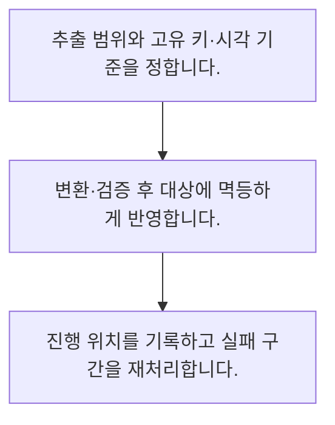

<!-- level:1 -->
# ETL·ELT와 데이터 파이프라인

> **한 문장으로:** 데이터를 옮기는 작업은 한 번의 복사보다 재실행·검증·실패 복구를 포함한 흐름으로 설계합니다.

## 왜 필요한가요?

매번 파일을 내려받고 손으로 붙여 넣으면 누락과 실수가 생깁니다. 자료를 가져와 정리하고 저장하는 흐름을 만들면 반복 업무를 줄이고 실패한 지점도 찾기 쉬워집니다.

## 일상에서 떠올려 보기

매장 영수증을 본사 장부로 옮기는 과정과 같습니다. 같은 봉투를 두 번 받거나 늦게 도착해도 총액이 중복되지 않도록 접수 번호와 처리 기록이 필요합니다.

## 순서대로 따라가기

1. 추출 범위와 고유 키·시각 기준을 정합니다.
2. 변환·검증 후 대상에 멱등하게 반영합니다.
3. 진행 위치를 기록하고 실패 구간을 재처리합니다.



## 처음 만나는 용어

| 용어 | 쉬운 뜻 |
|---|---|
| ETL | 추출·변환 후 적재하는 흐름 |
| ELT | 먼저 적재한 뒤 대상 환경에서 변환하는 흐름 |
| 멱등성 | 같은 작업을 다시 적용해도 최종 효과가 같도록 하는 성질 |

**비유의 한계:** 작은 배치 예제로 분산 환경의 정확히 한 번 처리를 보장할 수는 없습니다. 저장 경계와 이벤트의 중복·지연·순서 변경을 별도로 설계해야 합니다.

## 스스로 확인

파이프라인의 재실행에서 중요한 성질은?

**답과 이유:** 멱등성 — 중복 입력이 중복 효과로 이어지지 않게 저장 키와 경계를 설계합니다.
<!-- level:2 -->
# ETL·ELT와 데이터 파이프라인 — 실제 흐름 따라가기

## 읽기 전 길잡이

데이터를 옮기는 작업은 한 번의 복사보다 재실행·검증·실패 복구를 포함한 흐름으로 설계합니다. 아래 예제는 외부 시스템에 연결하지 않는 작은 학습용 사례입니다. 입력, 처리 조건, 결과를 순서대로 살펴보세요.

1. 추출 범위와 고유 키·시각 기준을 정합니다.
2. 변환·검증 후 대상에 멱등하게 반영합니다.
3. 진행 위치를 기록하고 실패 구간을 재처리합니다.

## 예제로 확인하기

```python
events=[{"id":"e1","amount":10},{"id":"e2","amount":20}]
store={}
for batch in [events,events]:
    for e in batch: store[e["id"]]=e["amount"]
assert sum(store.values())==30
print(sum(store.values()))
```

## 결과를 해석하기

고유 이벤트 ID로 덮어쓰기 때문에 같은 배치를 두 번 넣어도 합계는 30입니다. 실제 파이프라인은 대상 반영과 진행 위치 기록 사이의 실패도 다뤄야 합니다.

## 실무에 옮기기 전

작은 배치 예제로 분산 환경의 정확히 한 번 처리를 보장할 수는 없습니다. 저장 경계와 이벤트의 중복·지연·순서 변경을 별도로 설계해야 합니다. 실제 업무에서는 필요한 최신성과 재처리 비용을 기준으로 배치 또는 스트리밍을 정합니다. 처리량만 높이기 전에 데이터 계약과 실패 경계를 고정합니다.

## 확인 질문

예제 배치를 두 번 반영한 합계는?

**답과 이유:** 같은 이벤트 ID를 덮어쓰므로 합산 대상은 두 건입니다. 단순 누적과 다릅니다.
<!-- level:3 -->
# ETL·ELT와 데이터 파이프라인 — 가상 사례로 문제 해결하기

실제 고객의 장애 기록이 아닌 학습용 재현 시나리오입니다. 결과만 바꾸기 전에 관측한 증거와 원인 가설을 구분합니다.

## 1. 어떤 문제가 생겼나요?

가상 야간 배치 재시도 후 매출이 중복 적재됩니다.

## 2. 먼저 확인할 증거

배치 ID·이벤트 ID·대상 쓰기와 체크포인트 기록 시각을 봅니다.

## 3. 원인 가설

쓰기 성공 뒤 진행 위치 저장이 실패해 같은 범위를 다시 더했습니다.

## 4. 수정 방법

유일 키 기반 upsert나 원자적 적재·체크포인트 경계를 구성합니다.

## 5. 재검증

쓰기 직후 실패를 주입하고 재시도 후 합계와 누락이 없는지 확인합니다.

## 놓치기 쉬운 조건

작은 배치 예제로 분산 환경의 정확히 한 번 처리를 보장할 수는 없습니다. 저장 경계와 이벤트의 중복·지연·순서 변경을 별도로 설계해야 합니다.

## 확인 질문

쓰기 뒤 체크포인트 실패를 재현하는 이유는?

**답과 이유:** 일부 단계만 성공한 상태가 복구 과정의 주요 위험이기 때문입니다.
<!-- level:4 -->
# ETL·ELT와 데이터 파이프라인 — 업무와 아키텍처의 선택

## 읽기 전 길잡이

같은 개념도 업무의 규모, 오류 비용, 운영 역량에 따라 적용 방식이 달라집니다. 아래 비교는 특정 제품의 성능 순위가 아닌 선택 기준입니다.

| 선택 | 얻는 점 | 감수할 점 |
|---|---|---|
| 주기적 배치 | 단순하고 비용 예측 쉬움 | 정보 갱신 지연 |
| 스트리밍 처리 | 짧은 갱신 지연 | 상태·중복·지연 이벤트 운영 복잡성 |

## 선택 기준

필요한 최신성과 재처리 비용을 기준으로 배치 또는 스트리밍을 정합니다. 처리량만 높이기 전에 데이터 계약과 실패 경계를 고정합니다.

## 도입과 운영에서 확인할 것

유일 키 기반 upsert나 원자적 적재·체크포인트 경계를 구성합니다. 쓰기 직후 실패를 주입하고 재시도 후 합계와 누락이 없는지 확인합니다.

## 판단 연습

배치와 스트리밍의 선택 기준은?

**판단의 근거:** 짧은 지연이 필요한지와 상태·복구 운영을 감당할 수 있는지를 함께 봅니다.

참고: [NIST 통계 핸드북](https://www.itl.nist.gov/div898/handbook/), [PostgreSQL 쿼리](https://www.postgresql.org/docs/current/queries.html).
<!-- quizzes -->
[{"level":1,"question":"파이프라인의 재실행에서 중요한 성질은?","choices":["화면 해상도","무한 재시도","원본 삭제","멱등성"],"answer_index":3,"explanation":"중복 입력이 중복 효과로 이어지지 않게 저장 키와 경계를 설계합니다."},{"level":2,"question":"예제 배치를 두 번 반영한 합계는?","choices":["30","60","20","0"],"answer_index":0,"explanation":"같은 이벤트 ID를 덮어쓰므로 합산 대상은 두 건입니다. 단순 누적과 다릅니다."},{"level":3,"question":"쓰기 뒤 체크포인트 실패를 재현하는 이유는?","choices":["정렬 규칙 제거","재시도 중복 효과 검사","그래프 색 비교","모델 정확도 향상"],"answer_index":1,"explanation":"일부 단계만 성공한 상태가 복구 과정의 주요 위험이기 때문입니다."},{"level":4,"question":"배치와 스트리밍의 선택 기준은?","choices":["레코드 이름","도구 인지도만","필요한 최신성과 운영 비용","언제나 스트리밍"],"answer_index":2,"explanation":"짧은 지연이 필요한지와 상태·복구 운영을 감당할 수 있는지를 함께 봅니다."}]
