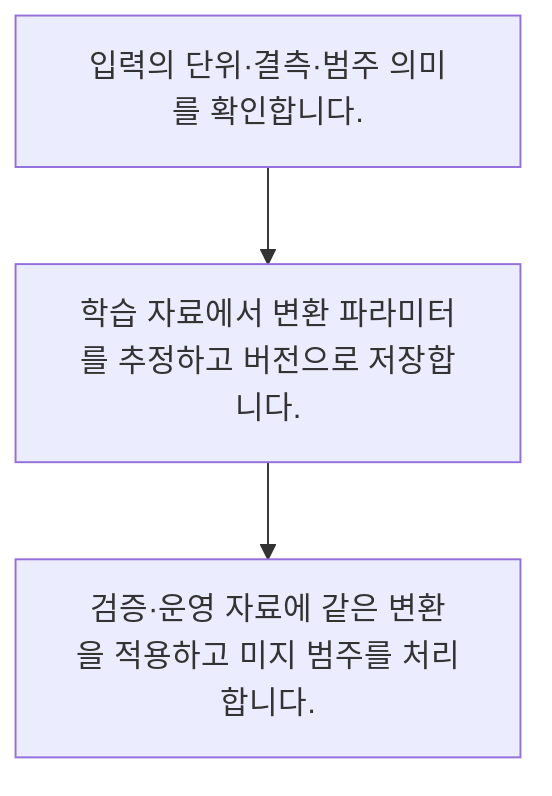

<!-- level:1 -->
# 피처·인코딩·전처리

> **한 문장으로:** 업무 자료를 모델이 사용할 수 있는 값으로 바꾸되 학습과 운영에서 같은 의미와 변환을 유지합니다.

## 왜 필요한가요?

사람이 읽는 날짜·금액·문장을 그대로 넣는다고 모델이 필요한 뜻을 알아내지는 않습니다. 입력을 정리하는 방법을 알면 단위 차이와 빠진 값 때문에 생기는 오류를 줄일 수 있습니다.

## 일상에서 떠올려 보기

같은 레시피에서도 컵과 밀리리터를 섞으면 맛이 달라집니다. 모델 입력도 단위와 범주 표현이 일치해야 합니다.

## 순서대로 따라가기

1. 입력의 단위·결측·범주 의미를 확인합니다.
2. 학습 자료에서 변환 파라미터를 추정하고 버전으로 저장합니다.
3. 검증·운영 자료에 같은 변환을 적용하고 미지 범주를 처리합니다.



## 처음 만나는 용어

| 용어 | 쉬운 뜻 |
|---|---|
| 피처 | 모델 입력으로 사용하는 관측 값이나 그 변환 |
| 인코딩 | 범주 등을 모델이 다룰 표현으로 바꾸는 과정 |
| 표준화 | 학습에서 추정한 중심과 척도로 값을 변환하는 방법 |

**비유의 한계:** 전처리가 정보의 의미를 바꿀 수 있습니다. 표준화는 모든 모델에 필수인 만능 절차가 아니며 범주를 정수로 바꾼다고 순서가 생기는 것은 아닙니다.

## 스스로 확인

피처란 무엇인가요?

**답과 이유:** 모델에 주는 입력 표현 — 원본 값이나 가공된 값이 모델 입력 역할을 합니다.
<!-- level:2 -->
# 피처·인코딩·전처리 — 실제 흐름 따라가기

## 읽기 전 길잡이

업무 자료를 모델이 사용할 수 있는 값으로 바꾸되 학습과 운영에서 같은 의미와 변환을 유지합니다. 아래 예제는 외부 시스템에 연결하지 않는 작은 학습용 사례입니다. 입력, 처리 조건, 결과를 순서대로 살펴보세요.

1. 입력의 단위·결측·범주 의미를 확인합니다.
2. 학습 자료에서 변환 파라미터를 추정하고 버전으로 저장합니다.
3. 검증·운영 자료에 같은 변환을 적용하고 미지 범주를 처리합니다.

## 예제로 확인하기

```python
import statistics as s
train=[10,20,30]
mean,scale=s.mean(train),s.pstdev(train)
transform=lambda x:(x-mean)/scale
assert transform(20)==0
print(round(transform(40),3))
```

## 결과를 해석하기

평균과 표준편차는 학습 값 10·20·30에서만 계산합니다. 새 값 40을 변환할 때 평균을 다시 계산하지 않습니다. 척도가 0인 상수 피처는 별도 처리해야 합니다.

## 실무에 옮기기 전

전처리가 정보의 의미를 바꿀 수 있습니다. 표준화는 모든 모델에 필수인 만능 절차가 아니며 범주를 정수로 바꾼다고 순서가 생기는 것은 아닙니다. 실제 업무에서는 모델 유형과 입력 의미에 맞게 변환을 선택하고 변환 버전을 모델과 연결합니다. 피처를 늘릴 때 정보 누출·운영 가용성·계산 비용을 함께 검토합니다.

## 확인 질문

새 값을 표준화할 때 사용할 평균은?

**답과 이유:** 학습과 운영의 같은 변환을 유지하고 평가 정보 누출을 막습니다.
<!-- level:3 -->
# 피처·인코딩·전처리 — 가상 사례로 문제 해결하기

실제 고객의 장애 기록이 아닌 학습용 재현 시나리오입니다. 결과만 바꾸기 전에 관측한 증거와 원인 가설을 구분합니다.

## 1. 어떤 문제가 생겼나요?

가상 운영 모델의 입력 분포가 학습 때와 달라집니다.

## 2. 먼저 확인할 증거

학습·서빙 변환 버전과 단위, 미지 범주 비율을 비교합니다.

## 3. 원인 가설

운영 코드가 각 요청마다 평균을 새로 계산했습니다.

## 4. 수정 방법

학습된 변환을 모델과 함께 배포하고 공통 변환 테스트를 둡니다.

## 5. 재검증

같은 원본 입력의 학습·운영 피처를 비교하고 상수·결측 경계값을 검사합니다.

## 놓치기 쉬운 조건

전처리가 정보의 의미를 바꿀 수 있습니다. 표준화는 모든 모델에 필수인 만능 절차가 아니며 범주를 정수로 바꾼다고 순서가 생기는 것은 아닙니다.

## 확인 질문

운영 피처가 학습과 다르면 우선 확인할 것은?

**답과 이유:** 표현의 일관성이 깨졌는지 실제 입력으로 대조해야 합니다.
<!-- level:4 -->
# 피처·인코딩·전처리 — 업무와 아키텍처의 선택

## 읽기 전 길잡이

같은 개념도 업무의 규모, 오류 비용, 운영 역량에 따라 적용 방식이 달라집니다. 아래 비교는 특정 제품의 성능 순위가 아닌 선택 기준입니다.

| 선택 | 얻는 점 | 감수할 점 |
|---|---|---|
| 간단한 수작업 피처 | 해석과 디버깅 용이 | 업무 지식·유지 필요 |
| 학습된 표현 | 복잡한 패턴 활용 | 자료·계산·관측 비용 |

## 선택 기준

모델 유형과 입력 의미에 맞게 변환을 선택하고 변환 버전을 모델과 연결합니다. 피처를 늘릴 때 정보 누출·운영 가용성·계산 비용을 함께 검토합니다.

## 도입과 운영에서 확인할 것

학습된 변환을 모델과 함께 배포하고 공통 변환 테스트를 둡니다. 같은 원본 입력의 학습·운영 피처를 비교하고 상수·결측 경계값을 검사합니다.

## 판단 연습

피처 추가 결정에 필요한 것은?

**판단의 근거:** 좋은 입력은 예측 시점에 실제로 사용 가능해야 합니다.

참고: [Google ML Crash Course](https://developers.google.com/machine-learning/crash-course), [scikit-learn 평가](https://scikit-learn.org/stable/model_selection.html), [scikit-learn 흔한 실수](https://scikit-learn.org/stable/common_pitfalls.html).
<!-- quizzes -->
[{"level":1,"question":"피처란 무엇인가요?","choices":["정답 파일만","GPU 이름","운영 화면 색","모델에 주는 입력 표현"],"answer_index":3,"explanation":"원본 값이나 가공된 값이 모델 입력 역할을 합니다."},{"level":2,"question":"새 값을 표준화할 때 사용할 평균은?","choices":["학습 자료에서 추정한 평균","매 요청의 새 평균","테스트 정답 평균","임의의 0"],"answer_index":0,"explanation":"학습과 운영의 같은 변환을 유지하고 평가 정보 누출을 막습니다."},{"level":3,"question":"운영 피처가 학습과 다르면 우선 확인할 것은?","choices":["정답 순서","변환 버전·단위","모델 로고","서버 이름"],"answer_index":1,"explanation":"표현의 일관성이 깨졌는지 실제 입력으로 대조해야 합니다."},{"level":4,"question":"피처 추가 결정에 필요한 것은?","choices":["테스트 정답 활용","미래 값 우선","가용성·누출·비용 검토","개수가 많을수록 무조건 좋음"],"answer_index":2,"explanation":"좋은 입력은 예측 시점에 실제로 사용 가능해야 합니다."}]
