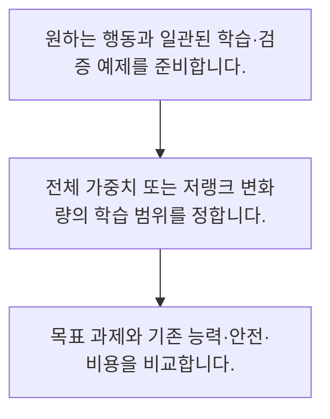

<!-- level:1 -->
# 미세조정·LoRA·데이터셋 설계

> **한 문장으로:** 미세조정은 원하는 입력·출력 패턴으로 모델을 적응시키며 LoRA는 일부 가중치 변화량을 작은 행렬로 표현합니다.

## 왜 필요한가요?

2×1과 1×2 행렬의 곱으로 2×2 변화량을 만듭니다. 실제 LoRA의 스케일·적용 층·학습 루프는 생략했습니다. 랭크가 낮으면 학습 대상은 줄지만 표현 가능한 변화도 제한됩니다.

## 일상에서 떠올려 보기

새 업무를 가르칠 때 조직 전체 매뉴얼을 모두 다시 쓰는 대신 특정 업무의 보충 지침을 만드는 모습과 비슷합니다. 작은 수정도 기존 업무에 영향을 줄 수 있습니다.

## 순서대로 따라가기

1. 원하는 행동과 일관된 학습·검증 예제를 준비합니다.
2. 전체 가중치 또는 저랭크 변화량의 학습 범위를 정합니다.
3. 목표 과제와 기존 능력·안전·비용을 비교합니다.



## 처음 만나는 용어

| 용어 | 쉬운 뜻 |
|---|---|
| LoRA | 저랭크 행렬 곱으로 가중치 변화량을 학습하는 방식 |
| 랭크 | 행렬이 표현할 수 있는 독립 방향의 수와 관련된 값 |
| 어댑터 | 기반 모델에 결합하는 추가 학습 파라미터 구성 |

**비유의 한계:** LoRA가 모든 학습·서빙 메모리를 없애지는 않습니다. 좋은 데이터와 평가가 필요하며 최신 지식 저장이나 사실성 문제를 자동 해결하지 않습니다.

## 스스로 확인

LoRA가 표현하는 것은?

**답과 이유:** 가중치의 저랭크 변화량 — 기반 가중치 전체를 직접 바꾸는 것과 다른 파라미터화 방식입니다.
<!-- level:2 -->
# 미세조정·LoRA·데이터셋 설계 — 실제 흐름 따라가기

## 읽기 전 길잡이

미세조정은 원하는 입력·출력 패턴으로 모델을 적응시키며 LoRA는 일부 가중치 변화량을 작은 행렬로 표현합니다. 아래 예제는 외부 시스템에 연결하지 않는 작은 학습용 사례입니다. 입력, 처리 조건, 결과를 순서대로 살펴보세요.

1. 원하는 행동과 일관된 학습·검증 예제를 준비합니다.
2. 전체 가중치 또는 저랭크 변화량의 학습 범위를 정합니다.
3. 목표 과제와 기존 능력·안전·비용을 비교합니다.

## 예제로 확인하기

```python
b=[[1],[2]]; a=[[3,4]]
delta=[[b[i][0]*a[0][j] for j in range(2)] for i in range(2)]
assert delta==[[3,4],[6,8]]
print(delta)
```

## 결과를 해석하기

2×1과 1×2 행렬의 곱으로 2×2 변화량을 만듭니다. 실제 LoRA의 스케일·적용 층·학습 루프는 생략했습니다. 랭크가 낮으면 학습 대상은 줄지만 표현 가능한 변화도 제한됩니다.

## 실무에 옮기기 전

LoRA가 모든 학습·서빙 메모리를 없애지는 않습니다. 좋은 데이터와 평가가 필요하며 최신 지식 저장이나 사실성 문제를 자동 해결하지 않습니다. 실제 업무에서는 먼저 프롬프트·검색으로 해결 가능한지 평가합니다. 반복적인 행동·형식 오류가 남고 좋은 학습 예제가 확보될 때 미세조정을 검토합니다.

## 확인 질문

예제 행렬 곱의 두 번째 행은?

**답과 이유:** B의 값 2와 A의 3·4를 곱합니다.
<!-- level:3 -->
# 미세조정·LoRA·데이터셋 설계 — 가상 사례로 문제 해결하기

실제 고객의 장애 기록이 아닌 학습용 재현 시나리오입니다. 결과만 바꾸기 전에 관측한 증거와 원인 가설을 구분합니다.

## 1. 어떤 문제가 생겼나요?

가상 어댑터를 붙인 뒤 엉뚱한 형식과 성능 저하가 생깁니다.

## 2. 먼저 확인할 증거

기반 모델·토크나이저 버전, 대화 템플릿과 적용 층을 확인합니다.

## 3. 원인 가설

다른 기반 버전이나 잘못된 형식으로 학습·서빙했습니다.

## 4. 수정 방법

호환되는 기반·템플릿·어댑터를 함께 버전 관리합니다.

## 5. 재검증

목표 평가와 기존 능력 회귀, 어댑터 적용·해제 비교를 수행합니다.

## 놓치기 쉬운 조건

LoRA가 모든 학습·서빙 메모리를 없애지는 않습니다. 좋은 데이터와 평가가 필요하며 최신 지식 저장이나 사실성 문제를 자동 해결하지 않습니다.

## 확인 질문

어댑터 적용 후 이상하면 먼저 볼 것은?

**답과 이유:** 학습과 서빙의 기반 계약이 맞아야 결과를 비교할 수 있습니다.
<!-- level:4 -->
# 미세조정·LoRA·데이터셋 설계 — 업무와 아키텍처의 선택

## 읽기 전 길잡이

같은 개념도 업무의 규모, 오류 비용, 운영 역량에 따라 적용 방식이 달라집니다. 아래 비교는 특정 제품의 성능 순위가 아닌 선택 기준입니다.

| 선택 | 얻는 점 | 감수할 점 |
|---|---|---|
| 프롬프트·예시 | 빠르고 되돌리기 쉬움 | 문맥 길이와 패턴 일관성 한계 |
| LoRA·미세조정 | 반복 행동을 모델에 적응 | 자료·학습·버전 운영 비용 |

## 선택 기준

먼저 프롬프트·검색으로 해결 가능한지 평가합니다. 반복적인 행동·형식 오류가 남고 좋은 학습 예제가 확보될 때 미세조정을 검토합니다.

## 도입과 운영에서 확인할 것

호환되는 기반·템플릿·어댑터를 함께 버전 관리합니다. 목표 평가와 기존 능력 회귀, 어댑터 적용·해제 비교를 수행합니다.

## 판단 연습

미세조정을 검토할 조건은?

**판단의 근거:** 문제 원인과 자료·평가 준비가 도입 근거가 되어야 합니다.

참고: [Hugging Face LLM 과정](https://huggingface.co/learn/llm-course/chapter1/1), [RAG 원논문](https://arxiv.org/abs/2005.11401), [LoRA 원논문](https://arxiv.org/abs/2106.09685), [JSON Schema 학습](https://json-schema.org/learn/getting-started-step-by-step).
<!-- quizzes -->
[{"level":1,"question":"LoRA가 표현하는 것은?","choices":["모든 메모리 제거","사실 보증서","가중치의 저랭크 변화량","문서 검색 결과"],"answer_index":2,"explanation":"기반 가중치 전체를 직접 바꾸는 것과 다른 파라미터화 방식입니다."},{"level":2,"question":"예제 행렬 곱의 두 번째 행은?","choices":["3과 4","1과 2","0과 0","6과 8"],"answer_index":3,"explanation":"B의 값 2와 A의 3·4를 곱합니다."},{"level":3,"question":"어댑터 적용 후 이상하면 먼저 볼 것은?","choices":["기반·토크나이저·템플릿 호환성","이름 길이","문서 색상","운영 로그 삭제"],"answer_index":0,"explanation":"학습과 서빙의 기반 계약이 맞아야 결과를 비교할 수 있습니다."},{"level":4,"question":"미세조정을 검토할 조건은?","choices":["무조건 큰 랭크","좋은 예제와 반복 행동 적응 필요","최신 문서 한 건 추가만","검증 불가능한 목표"],"answer_index":1,"explanation":"문제 원인과 자료·평가 준비가 도입 근거가 되어야 합니다."}]
