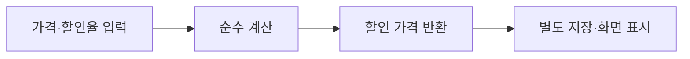

<!-- level:1 -->
# 함수형과 순수 함수 — 입력에서 결과를 예측하기

> **한 문장으로:** 같은 입력에 같은 결과를 내고 주변 상태를 바꾸지 않는 계산은 이해하고 시험하기 쉽습니다.

## 왜 필요한가요?

어떤 함수를 실행했더니 다른 곳의 값까지 바뀌면 원인을 추적하기 어렵습니다. 계산과 외부 효과를 구분하면 결과를 예측하기 쉬워집니다.

## 일상에서 떠올려 보기

자판기에 같은 금액과 같은 상품 선택을 넣으면 같은 계산 결과를 얻는 가격표를 떠올려 보세요. 순수 계산은 입력만 보고 결과를 정합니다. 바깥 장부를 몰래 고치거나 현재 시각에 따라 달라진다면 이 조건을 만족하지 않습니다.

## 순서대로 따라가기

1. 계산에 필요한 값을 입력으로 받습니다.
2. 입력값으로 결과를 만들고 바깥의 데이터는 바꾸지 않습니다.
3. 파일 저장·결제·화면 변경 같은 효과는 별도의 경계에서 수행할 수 있게 나눕니다.



## 작은 예로 확인하기

가격 10,000원과 할인율 10%를 입력받아 9,000원을 반환하는 계산을 생각해 보세요. 같은 입력에서 결과가 같고 공용 가격표를 바꾸지 않으면 순수 함수로 다루기 좋습니다. 가격을 전역 변수에서 몰래 읽으면 그 변수 변화가 결과에 영향을 줄 수 있습니다.

## 처음 만나는 용어

| 용어 | 쉬운 뜻 |
|---|---|
| 함수 | 입력을 받아 정해진 작업을 하고 결과를 돌려주는 코드 단위입니다. |
| 순수 함수 | 같은 입력에 같은 결과를 내며 외부 상태를 바꾸지 않는 함수입니다. |
| 부작용 | 결과 반환 외에 파일·화면·공유 데이터 등을 바꾸는 효과입니다. |
| 불변 데이터 | 만든 뒤 그 값 자체를 바꾸지 않고 사용하는 데이터입니다. |

**비유의 한계:** 실제 앱에는 저장과 전송 같은 효과가 필요합니다. 모든 일을 순수 함수로 만들 수 있다는 뜻은 아닙니다. map 같은 이름을 썼어도 그 안의 함수가 외부 상태를 바꾸면 순수하지 않습니다.

## 스스로 확인

같은 입력을 넣었는데 전역 할인율이 바뀌어 결과도 달라집니다. 순수 함수의 조건에 맞을까요?

**답과 이유:** 맞지 않습니다. 필요한 할인율을 입력으로 받고 외부 상태에 의존하지 않아야 입력만으로 결과를 예측할 수 있습니다.
<!-- level:2 -->
# 함수 합성과 데이터의 소유권

<!-- beginner-guide:start -->
## 읽기 전 길잡이

할인 예제에서 계산에 필요한 값이 어디서 들어오는지 보세요. 원래 자료를 수정하는지 새 결과를 만드는지도 비교합니다. 함수 이름보다 실제 읽기·쓰기 경계가 중요합니다.

## 이 단계에서 만날 말

| 용어 | 쉬운 뜻 |
|---|---|
| 고차 함수 | 다른 함수를 입력으로 받거나 결과로 주는 함수입니다. |
| map | 각 항목을 다른 값으로 바꾸는 연산입니다. |
| filter | 조건에 맞는 항목만 남기는 연산입니다. |
| reduce | 여러 항목을 차례로 누적해 하나의 결과를 만드는 연산입니다. |
| 함수 합성 | 한 함수의 결과를 다음 함수의 입력으로 연결하는 것입니다. |
| 참조 투명성 | 계산을 그 결과값으로 바꿔도 같은 의미를 유지하는 성질입니다. |

<!-- beginner-guide:end -->

고차 함수는 함수를 입력 또는 결과로 다룬다. map은 변환, filter는 선택, reduce는 누적 계산을 표현한다. 그러나 이 이름을 쓴다는 사실만으로 콜백의 부작용이 없어지는 것은 아니다.

Python 3의 순수 할인 계산 예제다.

```python
def price_after_discount(price, percent):
    if price < 0 or not 0 <= percent <= 100:
        raise ValueError("invalid input")
    return price * (100 - percent) // 100

prices = (1000, 2000, 3000)
discounted = tuple(price_after_discount(p, 10) for p in prices)
assert discounted == (900, 1800, 2700)
assert prices == (1000, 2000, 3000)
```

정수 나눗셈의 반올림 정책은 업무 계약에 포함한다. 계산 결과를 저장하는 함수와 계산 자체를 분리하면 네트워크 없이 계산 테스트를 실행할 수 있다. 불변 컨테이너 안에 가변 객체가 있으면 전체가 깊게 불변인 것은 아니다. 공유 상태와 데이터 소유권을 계속 확인해야 한다.

**실습:** 현재 시간을 함수 내부에서 읽는 대신 인수로 전달하고 결과를 재현 가능하게 만들어 보자.
<!-- level:3 -->
# 가상 장애 — map 콜백이 공유 리스트를 바꾼다

<!-- beginner-guide:start -->
## 읽기 전 길잡이

테스트 순서를 바꾸니 결과가 달라지는 상황을 봅니다. 이전 테스트가 공유 상태를 바꿨는지, 현재 시각이나 임의값을 숨겨서 읽는지 조사하세요.

<!-- beginner-guide:end -->

가상 코드가 병렬 변환 콜백에서 전역 리스트에 결과를 append한다. 호출 순서와 공유 변경에 결과가 의존해 테스트가 흔들린다. 함수형 이름을 썼지만 순수 계산은 아니다.

**진단:** 함수가 읽고 쓰는 외부 상태, 랜덤·시간·I/O를 목록으로 만든다. 동일 입력을 여러 번 실행해 값이 같은지, 입력 객체가 변경됐는지 검사한다. 병렬 실행의 순서를 보장하지 않는 도구에 순서 보장을 기대하지 않는다.

**수정:** 콜백이 값만 반환하도록 하고 결과 결합을 명시적으로 수행한다. 시간·랜덤 생성기·외부 서비스를 주입한다. 필요한 효과는 경계에 모으되 실패·재시도와 관측을 숨기지 않는다.

**재검증:** 동일 입력·순서 변경·병렬 실행·실패 입력을 비교하고 원본 상태 보존을 확인한다. 복사 증가로 메모리 병목이 생겼는지도 측정한다.
<!-- level:4 -->
# 순수 코어와 효과 경계의 설계

<!-- beginner-guide:start -->
## 읽기 전 길잡이

계산을 순수하게 만들면 검증과 조합이 쉬워질 수 있지만 자료 복사와 연결 비용도 생깁니다. 외부 효과를 어디에 모을지와 데이터 크기를 함께 비교하세요.

<!-- beginner-guide:end -->

| 선택 | 이득 | 비용 |
|---|---|---|
| 순수 함수와 불변 값 | 재현·테스트·동시성 이해 | 할당·복사·모델링 비용 |
| 제한된 지역 가변 상태 | 반복 연산 최적화 | 외부 노출 방지 필요 |
| 지속 자료구조 | 구조 공유로 새 버전 생성 | 구현·접근 비용 이해 |

모든 코드를 고차 함수로 바꾸기보다 업무 계산을 순수하게 만들고 I/O를 명확히 제어한다. 병렬화는 데이터 독립성과 실행 비용에 달려 있으며 순수 함수라는 사실만으로 성능 향상이 자동으로 생기지 않는다. 메모이제이션은 입력 크기·캐시 수명·동등성도 설계해야 한다.

**판단 연습:** 가격 계산, DB 저장, 이메일 발송을 한 함수에 넣은 코드를 어떻게 분리할까? 실패 순서와 중복 발송·관측까지 포함해 답하자.

참고: [Python Functional Programming HOWTO](https://docs.python.org/3/howto/functional.html), [Haskell Language Report](https://www.haskell.org/onlinereport/haskell2010/).
<!-- quizzes -->
[{"level":1,"question":"순수 함수의 조건으로 적절한 것은?","choices":["같은 입력에 같은 결과이며 외부 상태를 바꾸지 않음","파일 읽기를 항상 포함","반환값만 있으면 순수","전역 상태를 자유롭게 변경"],"answer_index":0,"explanation":"입력 외 상태 의존과 외부 부작용이 없어야 합니다. 반환문이 있다는 사실이나 map 사용만으로 순수성이 보장되지 않습니다."},{"level":2,"question":"시간에 의존한 계산을 재현 가능하게 만드는 방법은?","choices":["시간을 무조건 숨김","현재 시각을 명시적인 입력으로 전달","테스트 제거","날짜를 전역 변수로만 저장"],"answer_index":1,"explanation":"시간을 입력으로 주면 같은 입력의 결과를 재현하고 경계값을 검사할 수 있습니다. 실제 시간 읽기는 효과 경계에서 수행합니다."},{"level":3,"question":"병렬 map에서 공유 리스트를 갱신하는 코드의 개선은?","choices":["전역 변수를 더 늘림","항상 완료 순서를 가정","각 작업이 값을 반환하고 결합을 명시","예외를 모두 숨김"],"answer_index":2,"explanation":"공유 변경을 줄이면 순서와 경쟁 의존을 줄일 수 있습니다. 결과 순서 계약과 결합 정책은 별도로 명시합니다."},{"level":4,"question":"불변 자료구조 선택에서 고려할 것은?","choices":["항상 모든 데이터를 깊게 복사","메모리 비용은 없음","순수하면 자동으로 병렬 성능 향상","구조 공유·할당 비용·접근 패턴"],"answer_index":3,"explanation":"불변성에는 여러 구현 방식이 있습니다. 구조 공유와 할당·복사 비용을 실제 작업에 맞춰 비교해야 합니다."}]
