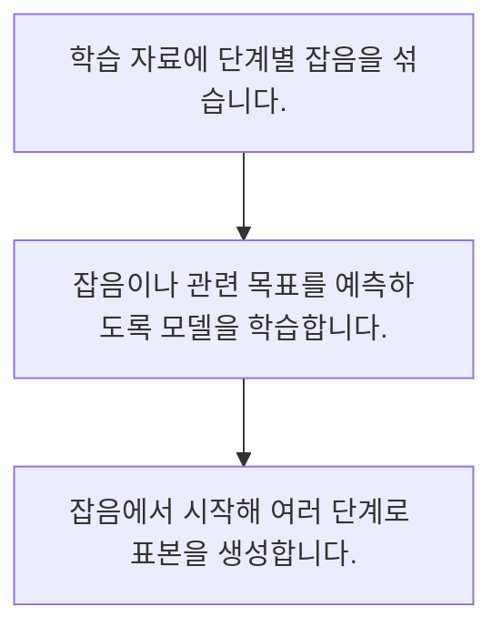

<!-- level:1 -->
# 생성 모델·확산 모델의 직관

> **한 문장으로:** 확산 모델은 자료에 잡음을 더하는 과정과 그 잡음을 줄이는 방향을 학습해 새로운 표본을 만드는 방법입니다.

## 왜 필요한가요?

한 번의 순방향 잡음 혼합만 계산합니다. 원본의 계수 0.8과 잡음의 계수 0.6을 적용하면 1이 됩니다. 학습된 잡음 제거기나 실제 이미지 생성기를 구현한 코드는 아닙니다.

## 일상에서 떠올려 보기

선명한 그림에 점점 안개를 더한 사례를 보고 안개를 줄이는 요령을 배우는 모습과 비슷합니다. 단순히 원본 파일을 압축했다 푸는 과정은 아닙니다.

## 순서대로 따라가기

1. 학습 자료에 단계별 잡음을 섞습니다.
2. 잡음이나 관련 목표를 예측하도록 모델을 학습합니다.
3. 잡음에서 시작해 여러 단계로 표본을 생성합니다.



## 처음 만나는 용어

| 용어 | 쉬운 뜻 |
|---|---|
| 생성 모델 | 자료의 분포를 배워 새 표본을 만드는 모델 |
| 잡음 스케줄 | 단계별 잡음의 크기를 정하는 규칙 |
| 샘플링 | 학습한 분포와 생성 절차로 표본을 얻는 과정 |

**비유의 한계:** 안개 비유가 모든 생성 모델을 설명하지는 않습니다. 학습된 분포에서 표본을 만드는 것이며 진실성·독창성·권리 문제를 자동 해결하지 않습니다.

## 스스로 확인

확산 모델 학습의 핵심 직관은?

**답과 이유:** 잡음 혼합과 제거 방향 학습 — 잡음이 섞인 자료에서 복원 관련 목표를 학습해 생성에 활용합니다.
<!-- level:2 -->
# 생성 모델·확산 모델의 직관 — 실제 흐름 따라가기

## 읽기 전 길잡이

확산 모델은 자료에 잡음을 더하는 과정과 그 잡음을 줄이는 방향을 학습해 새로운 표본을 만드는 방법입니다. 아래 예제는 외부 시스템에 연결하지 않는 작은 학습용 사례입니다. 입력, 처리 조건, 결과를 순서대로 살펴보세요.

1. 학습 자료에 단계별 잡음을 섞습니다.
2. 잡음이나 관련 목표를 예측하도록 모델을 학습합니다.
3. 잡음에서 시작해 여러 단계로 표본을 생성합니다.

## 예제로 확인하기

```python
import math
x,noise,alpha=2.,-1.,0.64
noisy=math.sqrt(alpha)*x+math.sqrt(1-alpha)*noise
assert math.isclose(noisy,1.)
print(noisy)
```

## 결과를 해석하기

한 번의 순방향 잡음 혼합만 계산합니다. 원본의 계수 0.8과 잡음의 계수 0.6을 적용하면 1이 됩니다. 학습된 잡음 제거기나 실제 이미지 생성기를 구현한 코드는 아닙니다.

## 실무에 옮기기 전

안개 비유가 모든 생성 모델을 설명하지는 않습니다. 학습된 분포에서 표본을 만드는 것이며 진실성·독창성·권리 문제를 자동 해결하지 않습니다. 실제 업무에서는 사용 목적에 맞는 품질·지연·다양성과 부적절한 생성 위험을 함께 평가합니다. 단계 수와 조건 강도는 실제 평가 없이 최적이라고 정하지 않습니다.

## 확인 질문

예제의 잡음 혼합 결과는?

**답과 이유:** 0.8 곱하기 2와 0.6 곱하기 -1의 합입니다.
<!-- level:3 -->
# 생성 모델·확산 모델의 직관 — 가상 사례로 문제 해결하기

실제 고객의 장애 기록이 아닌 학습용 재현 시나리오입니다. 결과만 바꾸기 전에 관측한 증거와 원인 가설을 구분합니다.

## 1. 어떤 문제가 생겼나요?

가상 생성 결과가 조건과 무관하거나 형태가 무너집니다.

## 2. 먼저 확인할 증거

학습·샘플링의 스케줄, 입력 정규화와 조건 표현을 대조합니다.

## 3. 원인 가설

학습과 다른 스케줄 또는 잘못된 조건 입력을 사용했습니다.

## 4. 수정 방법

호환되는 샘플러·스케줄·전처리를 맞춥니다.

## 5. 재검증

동일 시드와 다양한 조건에서 품질·실패율·생성 시간을 평가합니다.

## 놓치기 쉬운 조건

안개 비유가 모든 생성 모델을 설명하지는 않습니다. 학습된 분포에서 표본을 만드는 것이며 진실성·독창성·권리 문제를 자동 해결하지 않습니다.

## 확인 질문

조건과 무관한 생성의 점검 대상은?

**답과 이유:** 학습과 샘플링의 호환성이 맞는지 먼저 확인합니다.
<!-- level:4 -->
# 생성 모델·확산 모델의 직관 — 업무와 아키텍처의 선택

## 읽기 전 길잡이

같은 개념도 업무의 규모, 오류 비용, 운영 역량에 따라 적용 방식이 달라집니다. 아래 비교는 특정 제품의 성능 순위가 아닌 선택 기준입니다.

| 선택 | 얻는 점 | 감수할 점 |
|---|---|---|
| 많은 생성 단계 | 품질 조절의 여지 | 지연·계산 비용 |
| 적은 단계·증류 | 빠른 생성 가능 | 세부 품질·다양성 절충 |

## 선택 기준

사용 목적에 맞는 품질·지연·다양성과 부적절한 생성 위험을 함께 평가합니다. 단계 수와 조건 강도는 실제 평가 없이 최적이라고 정하지 않습니다.

## 도입과 운영에서 확인할 것

호환되는 샘플러·스케줄·전처리를 맞춥니다. 동일 시드와 다양한 조건에서 품질·실패율·생성 시간을 평가합니다.

## 판단 연습

생성 단계 수를 줄일 때 볼 것은?

**판단의 근거:** 적은 단계가 계산을 줄여도 품질과 실패 양상이 달라질 수 있습니다.

참고: [PyTorch 기초](https://docs.pytorch.org/tutorials/beginner/basics/intro.html), [Attention Is All You Need](https://arxiv.org/abs/1706.03762), [DDPM 논문](https://arxiv.org/abs/2006.11239).
<!-- quizzes -->
[{"level":1,"question":"확산 모델 학습의 핵심 직관은?","choices":["잡음 혼합과 제거 방향 학습","모든 원본 그대로 복사","색상 규칙만 저장","항상 진실한 그림"],"answer_index":0,"explanation":"잡음이 섞인 자료에서 복원 관련 목표를 학습해 생성에 활용합니다."},{"level":2,"question":"예제의 잡음 혼합 결과는?","choices":["0.64","1","2","-1"],"answer_index":1,"explanation":"0.8 곱하기 2와 0.6 곱하기 -1의 합입니다."},{"level":3,"question":"조건과 무관한 생성의 점검 대상은?","choices":["화면 밝기","모든 조건 삭제","스케줄·전처리·조건 입력","파일명 길이"],"answer_index":2,"explanation":"학습과 샘플링의 호환성이 맞는지 먼저 확인합니다."},{"level":4,"question":"생성 단계 수를 줄일 때 볼 것은?","choices":["속도만","항상 동일 품질","권리 자동 해결","지연과 품질·다양성"],"answer_index":3,"explanation":"적은 단계가 계산을 줄여도 품질과 실패 양상이 달라질 수 있습니다."}]
