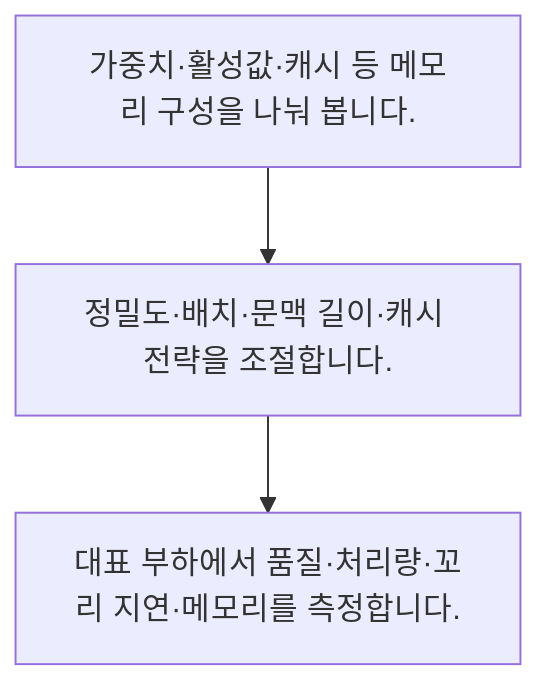

<!-- level:1 -->
# GPU·정밀도·양자화·KV 캐시

> **한 문장으로:** AI 추론의 메모리와 속도는 가중치뿐 아니라 활성값·KV 캐시·배치·입출력과 정밀도의 영향을 받습니다.

## 왜 필요한가요?

학습용 크기에서 파라미터당 2바이트인 가중치와 가상 캐시만 더합니다. 실제 GPU 필요량은 메타데이터·활성값·임시 공간·런타임 여유까지 포함하므로 이 합만으로 장치를 선정하지 않습니다.

## 일상에서 떠올려 보기

공장의 기계 크기뿐 아니라 대기 중인 부품과 작업 중간 재료가 공간을 차지하는 것과 같습니다. 동시에 처리할 주문이 늘면 중간 저장 공간도 커집니다.

## 순서대로 따라가기

1. 가중치·활성값·캐시 등 메모리 구성을 나눠 봅니다.
2. 정밀도·배치·문맥 길이·캐시 전략을 조절합니다.
3. 대표 부하에서 품질·처리량·꼬리 지연·메모리를 측정합니다.



## 처음 만나는 용어

| 용어 | 쉬운 뜻 |
|---|---|
| 양자화 | 값을 더 적은 비트의 표현으로 근사하는 방법 |
| KV 캐시 | 생성 중 이전 위치의 key·value를 재사용하는 저장 |
| 배칭 | 여러 요청을 묶어 장치 연산을 수행하는 방식 |

**비유의 한계:** 낮은 비트 수가 메모리와 지연을 같은 비율로 줄이지는 않습니다. 커널 지원·메모리 대역폭·역양자화·품질 영향을 실제 장치에서 측정해야 합니다.

## 스스로 확인

가중치 외에 추론 메모리를 차지하는 것은?

**답과 이유:** KV 캐시와 임시 공간 — 생성 상태와 활성값 등 여러 구성 요소가 메모리를 사용합니다.
<!-- level:2 -->
# GPU·정밀도·양자화·KV 캐시 — 실제 흐름 따라가기

## 읽기 전 길잡이

AI 추론의 메모리와 속도는 가중치뿐 아니라 활성값·KV 캐시·배치·입출력과 정밀도의 영향을 받습니다. 아래 예제는 외부 시스템에 연결하지 않는 작은 학습용 사례입니다. 입력, 처리 조건, 결과를 순서대로 살펴보세요.

1. 가중치·활성값·캐시 등 메모리 구성을 나눠 봅니다.
2. 정밀도·배치·문맥 길이·캐시 전략을 조절합니다.
3. 대표 부하에서 품질·처리량·꼬리 지연·메모리를 측정합니다.

## 예제로 확인하기

```python
params=1_000_000
weight_bytes=params*2
cache_bytes=500_000
assert weight_bytes+cache_bytes==2_500_000
print("가중치+가상 캐시 바이트:",weight_bytes+cache_bytes)
```

## 결과를 해석하기

학습용 크기에서 파라미터당 2바이트인 가중치와 가상 캐시만 더합니다. 실제 GPU 필요량은 메타데이터·활성값·임시 공간·런타임 여유까지 포함하므로 이 합만으로 장치를 선정하지 않습니다.

## 실무에 옮기기 전

낮은 비트 수가 메모리와 지연을 같은 비율로 줄이지는 않습니다. 커널 지원·메모리 대역폭·역양자화·품질 영향을 실제 장치에서 측정해야 합니다. 실제 업무에서는 모델 파일 크기 대신 실제 워크로드의 최악 구간을 측정합니다. 최적화 후에도 업무 평가를 통과하는지와 대기·취소·실패 복구의 영향을 함께 확인합니다.

## 확인 질문

예제의 가중치와 가상 캐시 합은?

**답과 이유:** 가중치 2백만 바이트와 캐시 50만 바이트를 더합니다.
<!-- level:3 -->
# GPU·정밀도·양자화·KV 캐시 — 가상 사례로 문제 해결하기

실제 고객의 장애 기록이 아닌 학습용 재현 시나리오입니다. 결과만 바꾸기 전에 관측한 증거와 원인 가설을 구분합니다.

## 1. 어떤 문제가 생겼나요?

가상 LLM 서버가 긴 요청이 겹칠 때 메모리 부족으로 종료됩니다.

## 2. 먼저 확인할 증거

동시 요청·문맥 길이·캐시·임시 메모리의 최고 사용량을 확인합니다.

## 3. 원인 가설

가중치만 기준으로 용량을 계획했습니다.

## 4. 수정 방법

입력·동시성 제한과 캐시·배치·정밀도 구성을 조정합니다.

## 5. 재검증

긴 문맥·혼합 길이·피크 부하에서 품질과 메모리 여유를 검사합니다.

## 놓치기 쉬운 조건

낮은 비트 수가 메모리와 지연을 같은 비율로 줄이지는 않습니다. 커널 지원·메모리 대역폭·역양자화·품질 영향을 실제 장치에서 측정해야 합니다.

## 확인 질문

긴 요청 동시 실행에서 메모리 부족이면?

**답과 이유:** 입력과 동시 요청에 따라 상태 메모리가 커질 수 있습니다.
<!-- level:4 -->
# GPU·정밀도·양자화·KV 캐시 — 업무와 아키텍처의 선택

## 읽기 전 길잡이

같은 개념도 업무의 규모, 오류 비용, 운영 역량에 따라 적용 방식이 달라집니다. 아래 비교는 특정 제품의 성능 순위가 아닌 선택 기준입니다.

| 선택 | 얻는 점 | 감수할 점 |
|---|---|---|
| 높은 정밀도 | 수치 근사 영향이 작음 | 메모리·대역폭 부담 |
| 양자화·최적 커널 | 용량·처리 효율 향상 가능 | 장치 지원·품질·변환 비용 |

## 선택 기준

모델 파일 크기 대신 실제 워크로드의 최악 구간을 측정합니다. 최적화 후에도 업무 평가를 통과하는지와 대기·취소·실패 복구의 영향을 함께 확인합니다.

## 도입과 운영에서 확인할 것

입력·동시성 제한과 캐시·배치·정밀도 구성을 조정합니다. 긴 문맥·혼합 길이·피크 부하에서 품질과 메모리 여유를 검사합니다.

## 판단 연습

양자화 도입의 검증 기준은?

**판단의 근거:** 수치 근사와 커널·장치 성능을 함께 측정해야 합니다.

참고: [Google Cloud MLOps](https://docs.cloud.google.com/architecture/mlops-continuous-delivery-and-automation-pipelines-in-machine-learning), [NIST AI RMF](https://www.nist.gov/itl/ai-risk-management-framework), [OWASP 생성형 AI 보안](https://genai.owasp.org/llm-top-10/), [Google SRE Workbook](https://sre.google/workbook/table-of-contents/).
<!-- quizzes -->
[{"level":1,"question":"가중치 외에 추론 메모리를 차지하는 것은?","choices":["모델 이름","출처 링크만","화면 색상","KV 캐시와 임시 공간"],"answer_index":3,"explanation":"생성 상태와 활성값 등 여러 구성 요소가 메모리를 사용합니다."},{"level":2,"question":"예제의 가중치와 가상 캐시 합은?","choices":["2500000바이트","2000000바이트","500000바이트","항상 0"],"answer_index":0,"explanation":"가중치 2백만 바이트와 캐시 50만 바이트를 더합니다."},{"level":3,"question":"긴 요청 동시 실행에서 메모리 부족이면?","choices":["오류 로그 삭제","캐시·문맥·동시성 최고값 확인","가중치 파일만 확인","무한 배치"],"answer_index":1,"explanation":"입력과 동시 요청에 따라 상태 메모리가 커질 수 있습니다."},{"level":4,"question":"양자화 도입의 검증 기준은?","choices":["항상 선형 속도 향상","평가 제거","실제 장치의 품질·속도·메모리","비트 수만"],"answer_index":2,"explanation":"수치 근사와 커널·장치 성능을 함께 측정해야 합니다."}]
