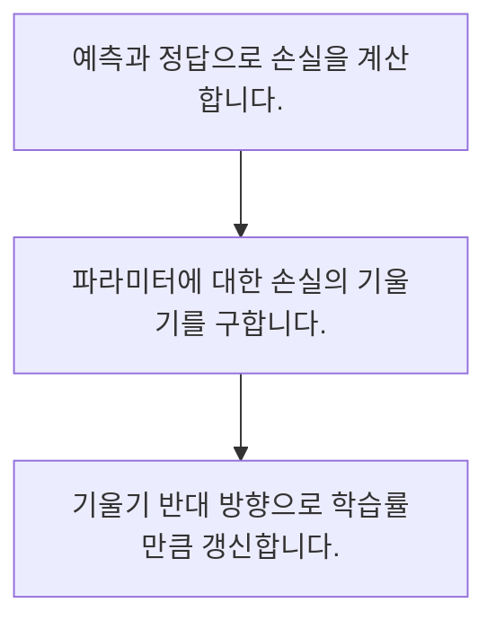

<!-- level:1 -->
# 미분·경사하강법·학습률

> **한 문장으로:** 손실이 줄어드는 방향을 미분으로 계산하고 학습률만큼 파라미터를 움직여 모델을 조정합니다.

## 왜 필요한가요?

모델의 결과가 틀렸을 때 내부의 수치를 어느 방향으로 조금 바꿀지 정해야 합니다. 기울기는 그 조정 방향을 이해하는 출발점이며 학습이 흔들리는 이유를 살피는 데도 도움이 됩니다.

## 일상에서 떠올려 보기

안개 낀 언덕에서 주변 경사를 살피며 아래로 이동하는 모습과 비슷합니다. 보폭이 너무 크면 골짜기를 지나쳐 반대쪽으로 튈 수 있습니다.

## 순서대로 따라가기

1. 예측과 정답으로 손실을 계산합니다.
2. 파라미터에 대한 손실의 기울기를 구합니다.
3. 기울기 반대 방향으로 학습률만큼 갱신합니다.



## 처음 만나는 용어

| 용어 | 쉬운 뜻 |
|---|---|
| 기울기 | 파라미터 변화에 따른 손실 변화율 |
| 학습률 | 파라미터 갱신의 보폭을 조절하는 값 |
| 옵티마이저 | 기울기와 상태로 갱신을 수행하는 알고리즘 |

**비유의 한계:** 신경망 손실 지형은 단순한 언덕과 다릅니다. 경사하강법이 전역 최적점에 도달한다는 보장은 없고 미니배치의 기울기에는 변동도 있습니다.

## 스스로 확인

경사하강법의 갱신 방향은?

**답과 이유:** 손실 기울기의 반대 — 손실을 줄이기 위해 기울기의 반대 방향으로 이동합니다.
<!-- level:2 -->
# 미분·경사하강법·학습률 — 실제 흐름 따라가기

## 읽기 전 길잡이

손실이 줄어드는 방향을 미분으로 계산하고 학습률만큼 파라미터를 움직여 모델을 조정합니다. 아래 예제는 외부 시스템에 연결하지 않는 작은 학습용 사례입니다. 입력, 처리 조건, 결과를 순서대로 살펴보세요.

1. 예측과 정답으로 손실을 계산합니다.
2. 파라미터에 대한 손실의 기울기를 구합니다.
3. 기울기 반대 방향으로 학습률만큼 갱신합니다.

## 예제로 확인하기

```python
w=0.; lr=0.1
for _ in range(30):
    gradient=2*(w-3)
    w-=lr*gradient
assert abs(w-3)<0.01
print(round(w,3))
```

## 결과를 해석하기

손실 (w-3)의 제곱을 줄이는 예제입니다. 기울기는 2(w-3)이며 w는 3에 가까워집니다. 실제 모델의 학습률은 손실 곡선과 검증 성능으로 점검해야 합니다.

## 실무에 옮기기 전

신경망 손실 지형은 단순한 언덕과 다릅니다. 경사하강법이 전역 최적점에 도달한다는 보장은 없고 미니배치의 기울기에는 변동도 있습니다. 실제 업무에서는 최종 점수뿐 아니라 수렴 속도·안정성·재현 조건을 비교합니다. 기울기 폭주와 입력 오류를 학습률 하나로 덮지 않습니다.

## 확인 질문

예제 파라미터가 가까워지는 값은?

**답과 이유:** 손실이 최소가 되는 지점이 w=3입니다.
<!-- level:3 -->
# 미분·경사하강법·학습률 — 가상 사례로 문제 해결하기

실제 고객의 장애 기록이 아닌 학습용 재현 시나리오입니다. 결과만 바꾸기 전에 관측한 증거와 원인 가설을 구분합니다.

## 1. 어떤 문제가 생겼나요?

가상 학습에서 손실이 심하게 흔들리거나 커집니다.

## 2. 먼저 확인할 증거

학습률·기울기 크기·입력 척도와 유한값 여부를 확인합니다.

## 3. 원인 가설

보폭이 크거나 비정상 입력이 큰 갱신을 만들었습니다.

## 4. 수정 방법

학습률과 입력을 점검하고 필요한 경우 기울기 제한을 적용합니다.

## 5. 재검증

작은 배치 재현과 여러 구간에서 손실·기울기의 안정성을 확인합니다.

## 놓치기 쉬운 조건

신경망 손실 지형은 단순한 언덕과 다릅니다. 경사하강법이 전역 최적점에 도달한다는 보장은 없고 미니배치의 기울기에는 변동도 있습니다.

## 확인 질문

손실이 발산하면 먼저 볼 것은?

**답과 이유:** 큰 보폭과 비정상 입력 등 원인을 구분해 점검합니다.
<!-- level:4 -->
# 미분·경사하강법·학습률 — 업무와 아키텍처의 선택

## 읽기 전 길잡이

같은 개념도 업무의 규모, 오류 비용, 운영 역량에 따라 적용 방식이 달라집니다. 아래 비교는 특정 제품의 성능 순위가 아닌 선택 기준입니다.

| 선택 | 얻는 점 | 감수할 점 |
|---|---|---|
| 고정 학습률 | 비교와 구현 간단 | 학습 단계별 적응 제한 |
| 스케줄·적응형 갱신 | 진행에 따라 조절 | 상태 메모리·설정 복잡성 |

## 선택 기준

최종 점수뿐 아니라 수렴 속도·안정성·재현 조건을 비교합니다. 기울기 폭주와 입력 오류를 학습률 하나로 덮지 않습니다.

## 도입과 운영에서 확인할 것

학습률과 입력을 점검하고 필요한 경우 기울기 제한을 적용합니다. 작은 배치 재현과 여러 구간에서 손실·기울기의 안정성을 확인합니다.

## 판단 연습

적응형 갱신의 비용은?

**판단의 근거:** 적응형 옵티마이저도 상태와 설정 비용이 있고 최적 결과를 보장하지 않습니다.

참고: [PyTorch 기초](https://docs.pytorch.org/tutorials/beginner/basics/intro.html), [Attention Is All You Need](https://arxiv.org/abs/1706.03762), [DDPM 논문](https://arxiv.org/abs/2006.11239).
<!-- quizzes -->
[{"level":1,"question":"경사하강법의 갱신 방향은?","choices":["파일 크기 방향","손실 기울기의 반대","항상 양수 방향","정답 순서"],"answer_index":1,"explanation":"손실을 줄이기 위해 기울기의 반대 방향으로 이동합니다."},{"level":2,"question":"예제 파라미터가 가까워지는 값은?","choices":["30","0.1","3","0"],"answer_index":2,"explanation":"손실이 최소가 되는 지점이 w=3입니다."},{"level":3,"question":"손실이 발산하면 먼저 볼 것은?","choices":["모델 이름","보고서 크기","검증 제거","학습률·기울기·입력"],"answer_index":3,"explanation":"큰 보폭과 비정상 입력 등 원인을 구분해 점검합니다."},{"level":4,"question":"적응형 갱신의 비용은?","choices":["추가 상태와 설정","메모리 0","검증 불필요","전역 최적 보장"],"answer_index":0,"explanation":"적응형 옵티마이저도 상태와 설정 비용이 있고 최적 결과를 보장하지 않습니다."}]
