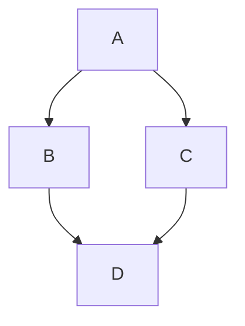

<!-- level:1 -->
# DFS와 BFS — 길을 찾는 두 순서

역과 연결 노선은 그래프로 표현할 수 있다. 정점은 대상, 간선은 관계다. BFS는 가까운 층부터 넓게, DFS는 한 경로를 깊게 탐색한다. 둘은 탐색 순서와 필요한 상태가 다르며 목적에 따라 선택한다.



BFS는 가중치 없는 그래프에서 간선 수 기준 최단 경로를 찾는 데 적합하다. DFS는 도달성·구조 탐색·순환 검사 같은 작업에 유용하다. 방문 기록이 없으면 순환 그래프에서 같은 정점을 계속 돌 수 있다.

**비유의 한계:** 실제 지도는 간선마다 이동 시간이 다를 수 있다. 가중치가 다른데 BFS를 실행해도 최소 시간 경로를 일반적으로 보장하지 않는다. 방문 순서와 최단 거리 보장은 구분하자.

**확인:** 간선의 비용이 모두 같지 않다면 BFS 결과를 곧바로 최소 비용 경로라고 불러도 될까?
<!-- level:2 -->
# 큐, 방문 시점, 경로 복원

인접 리스트는 각 정점의 이웃을 저장한다. V개 정점 E개 간선의 BFS/DFS는 일반적인 인접 리스트 구현에서 O(V+E) 탐색 비용을 갖는다. BFS는 발견해 큐에 넣는 시점에 방문을 표시해야 같은 정점이 과도하게 중복 삽입되는 것을 막는다.

Python 3 예제는 BFS로 가중치 없는 최단 경로를 복원한다.

```python
from collections import deque
graph = {"A": ["B", "C"], "B": ["D"], "C": ["D"], "D": []}
parent, queue = {"A": None}, deque(["A"])
while queue:
    node = queue.popleft()
    for neighbor in graph[node]:
        if neighbor not in parent:
            parent[neighbor] = node
            queue.append(neighbor)
path, current = [], "D"
while current is not None:
    path.append(current); current = parent[current]
print(path[::-1])  # A, B, D (이웃 순서에 따른 한 경로)
```

같은 길이 경로가 여러 개면 이웃 순서에 따라 반환 경로가 달라질 수 있다. DFS의 재귀 스택도 메모리를 쓴다. 매우 깊은 그래프에서는 명시적 스택을 검토한다. 방향 그래프의 순환 탐지는 단순 visited만이 아니라 현재 탐색 경로 상태 등을 구분해야 한다.
<!-- level:3 -->
# 가상 장애 — 추천 관계 탐색이 폭발한다

가상 추천 그래프에서 방문 처리를 dequeue 시점에만 해 다수 이웃이 같은 노드를 큐에 반복 넣는다. 큐 길이가 커지고 메모리를 소모한다. 노드·간선 수, 실제 enqueue 수, 중복률을 비교한다.

**수정:** 발견 시점에 방문을 기록하고 탐색 깊이·전체 방문 수·시간 예산을 둔다. 깊이 제한을 두면 완전한 최단 경로/도달성 보장이 제한될 수 있음을 API에 명시한다. DB에서 이웃을 매 노드마다 조회하면 N+1 I/O가 비용을 지배할 수 있어 묶음 조회나 그래프 저장 모델을 검토한다.

**재검증:** 자기 루프·순환·다중 경로·고립 정점·허브 노드·끊긴 목적지를 포함한다. 결과 정확성과 큐 최대 크기, 조회 횟수, 제한 초과 응답을 확인한다.
<!-- level:4 -->
# 그래프 목적과 자원 제한

| 목적 | 알고리즘 출발점 | 전제 |
|---|---|---|
| 가중치 없는 최단 경로 | BFS | 간선 비용이 동일 |
| 깊은 구조·도달성 탐색 | DFS | 방문·스택 관리 |
| 비음수 가중 최단 경로 | Dijkstra | 우선순위 큐·가중 조건 |
| 선수 지식 순서 | 위상 정렬 | 방향 비순환 그래프 |

이 앱의 선수 관계는 DAG여야 하므로 새 간선이 순환을 만드는지 검증한다. UI 배치가 예쁘다고 그래프 무결성이 보장되는 것은 아니다. 대형 그래프는 전체를 클라이언트로 전송하기보다 부분 그래프·캐시·서버 탐색과 권한을 설계한다.

**판단 연습:** “이 토픽의 모든 선수”와 “친구 사이 최단 연결”은 같은 질의인가? 결과 크기·권한·탐색 깊이·정확성 계약을 정하고 알고리즘을 선택하자.

참고: [Princeton Undirected Graphs](https://algs4.cs.princeton.edu/41graph/), [Princeton Directed Graphs](https://algs4.cs.princeton.edu/42digraph/).
<!-- quizzes -->
[{"level":1,"question":"BFS가 간선 수 기준 최단 경로를 보장하는 전제는?","choices":["간선 비용이 모두 동일한 가중치 없는 문제","모든 그래프에 무조건 성립","음수 비용이 많음","방문 기록이 없음"],"answer_index":0,"explanation":"BFS는 층별 탐색이라 같은 비용 간선의 최소 개수를 찾습니다. 다른 가중치의 최소 비용에는 별도 알고리즘이 필요합니다."},{"level":2,"question":"BFS의 중복 enqueue를 줄이는 방문 표시 시점은?","choices":["끝까지 표시하지 않음","목적지 도착 뒤 전체 표시","발견해 큐에 넣을 때","모든 노드를 무조건 먼저 표시"],"answer_index":2,"explanation":"발견 시 방문을 기록하면 다른 경로에서 같은 노드를 다시 큐에 넣지 않습니다. 경로 parent도 그 시점에 정할 수 있습니다."},{"level":3,"question":"대형 그래프 API에서 자원 폭주 방지와 함께 명시할 계약은?","choices":["제한은 정확성에 영향이 없음","깊이·방문·시간 제한과 결과 완전성의 범위","무제한 DB 조회","관측 제거"],"answer_index":1,"explanation":"자원 제한은 필요하지만 완전한 탐색 결과가 제한될 수 있습니다. 제한 초과나 부분 결과의 의미를 API에 명시해야 합니다."},{"level":4,"question":"선수 지식 순서를 만드는 알고리즘의 중요한 전제는?","choices":["모든 간선이 무방향","각 정점이 하나의 자식만 보유","모든 토픽이 같은 난이도","방향 비순환 그래프 DAG"],"answer_index":3,"explanation":"위상 정렬은 DAG에서 선후수 순서를 만들 수 있습니다. 순환은 만족 가능한 학습 순서를 깨므로 저장 시 검증해야 합니다."}]
