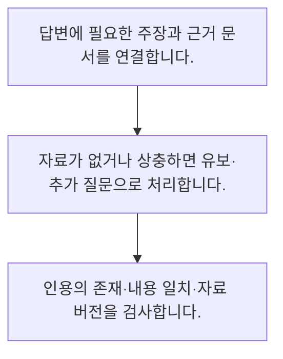

<!-- level:1 -->
# 환각·출처·모르는 답 처리

> **한 문장으로:** 자연스러운 문장과 근거 있는 답은 다르므로 주장별 출처와 모를 때의 행동을 검증해야 합니다.

## 왜 필요한가요?

문자열이 그대로 들어 있는 직접 인용의 형식과 일치만 검사합니다. 일반적인 문장의 함의·예외·상충 근거 검증은 이 코드보다 어렵고 별도 평가와 사람 검토가 필요할 수 있습니다.

## 일상에서 떠올려 보기

확신 있게 발표하는 사람이 정확한 자료를 봤는지는 별개입니다. 발표에 붙은 참고문헌도 실제 주장을 뒷받침하는지 확인해야 합니다.

## 순서대로 따라가기

1. 답변에 필요한 주장과 근거 문서를 연결합니다.
2. 자료가 없거나 상충하면 유보·추가 질문으로 처리합니다.
3. 인용의 존재·내용 일치·자료 버전을 검사합니다.



## 처음 만나는 용어

| 용어 | 쉬운 뜻 |
|---|---|
| 환각 | 근거가 부족하거나 사실과 다른 내용을 그럴듯하게 생성하는 현상 |
| 근거 연결 | 주장과 이를 뒷받침하는 자료를 연결하는 과정 |
| 답 유보 | 충분한 근거가 없을 때 단정적 답변을 피하는 처리 |

**비유의 한계:** 출처 ID가 존재하거나 인용 형식이 맞아도 주장을 지지한다는 보장은 없습니다. 모델의 자신감 표현도 보정된 확률로 볼 수 없습니다.

## 스스로 확인

출처 링크가 있다는 사실만으로 알 수 없는 것은?

**답과 이유:** 주장이 실제로 지지되는지 — 존재 검사와 내용 지지 검사는 서로 다릅니다.
<!-- level:2 -->
# 환각·출처·모르는 답 처리 — 실제 흐름 따라가기

## 읽기 전 길잡이

자연스러운 문장과 근거 있는 답은 다르므로 주장별 출처와 모를 때의 행동을 검증해야 합니다. 아래 예제는 외부 시스템에 연결하지 않는 작은 학습용 사례입니다. 입력, 처리 조건, 결과를 순서대로 살펴보세요.

1. 답변에 필요한 주장과 근거 문서를 연결합니다.
2. 자료가 없거나 상충하면 유보·추가 질문으로 처리합니다.
3. 인용의 존재·내용 일치·자료 버전을 검사합니다.

## 예제로 확인하기

```python
sources={"p2":"환불 가능 기간 7일"}
claim={"text":"환불 가능 기간 7일","source":"p2"}
assert claim["source"] in sources
assert claim["text"] in sources[claim["source"]]
print("이 작은 예제의 직접 인용 일치 확인")
```

## 결과를 해석하기

문자열이 그대로 들어 있는 직접 인용의 형식과 일치만 검사합니다. 일반적인 문장의 함의·예외·상충 근거 검증은 이 코드보다 어렵고 별도 평가와 사람 검토가 필요할 수 있습니다.

## 실무에 옮기기 전

출처 ID가 존재하거나 인용 형식이 맞아도 주장을 지지한다는 보장은 없습니다. 모델의 자신감 표현도 보정된 확률로 볼 수 없습니다. 실제 업무에서는 업무 오류 비용에 맞춰 근거 검토와 사람 연결 수준을 정합니다. 모든 질문에 답하는 비율만 높이지 않고 오답과 과도한 유보를 함께 측정합니다.

## 확인 질문

예제 문자열 검사의 범위는?

**답과 이유:** 정확한 문자열 포함만 검사하며 조건·함의 전체를 이해하는 것은 아닙니다.
<!-- level:3 -->
# 환각·출처·모르는 답 처리 — 가상 사례로 문제 해결하기

실제 고객의 장애 기록이 아닌 학습용 재현 시나리오입니다. 결과만 바꾸기 전에 관측한 증거와 원인 가설을 구분합니다.

## 1. 어떤 문제가 생겼나요?

가상 챗봇이 실제 문서 링크를 붙여 틀린 환불 기간을 말합니다.

## 2. 먼저 확인할 증거

인용한 조각과 답변의 수치·조건을 직접 비교합니다.

## 3. 원인 가설

출처 존재만 확인하고 내용 지지를 검사하지 않았습니다.

## 4. 수정 방법

주장별 근거와 조건을 확인하고 불충분한 답을 유보합니다.

## 5. 재검증

없는 사실·상충 정책·예외 조건 질문에서 유보와 인용 정확도를 평가합니다.

## 놓치기 쉬운 조건

출처 ID가 존재하거나 인용 형식이 맞아도 주장을 지지한다는 보장은 없습니다. 모델의 자신감 표현도 보정된 확률로 볼 수 없습니다.

## 확인 질문

맞는 링크와 틀린 수치가 함께 오면?

**답과 이유:** 실제 근거가 해당 수치와 조건을 뒷받침하는지 확인해야 합니다.
<!-- level:4 -->
# 환각·출처·모르는 답 처리 — 업무와 아키텍처의 선택

## 읽기 전 길잡이

같은 개념도 업무의 규모, 오류 비용, 운영 역량에 따라 적용 방식이 달라집니다. 아래 비교는 특정 제품의 성능 순위가 아닌 선택 기준입니다.

| 선택 | 얻는 점 | 감수할 점 |
|---|---|---|
| 자유로운 답변 | 다양한 표현·종합 | 근거 없는 확장 위험 |
| 근거 제한 답변 | 추적과 검토가 쉬움 | 답 유보·검색 누락 관리 |

## 선택 기준

업무 오류 비용에 맞춰 근거 검토와 사람 연결 수준을 정합니다. 모든 질문에 답하는 비율만 높이지 않고 오답과 과도한 유보를 함께 측정합니다.

## 도입과 운영에서 확인할 것

주장별 근거와 조건을 확인하고 불충분한 답을 유보합니다. 없는 사실·상충 정책·예외 조건 질문에서 유보와 인용 정확도를 평가합니다.

## 판단 연습

답 유보 설계에서 볼 두 축은?

**판단의 근거:** 답변 가능 범위와 잘못된 확신을 함께 평가해야 유용성을 판단합니다.

참고: [Hugging Face LLM 과정](https://huggingface.co/learn/llm-course/chapter1/1), [RAG 원논문](https://arxiv.org/abs/2005.11401), [LoRA 원논문](https://arxiv.org/abs/2106.09685), [JSON Schema 학습](https://json-schema.org/learn/getting-started-step-by-step).
<!-- quizzes -->
[{"level":1,"question":"출처 링크가 있다는 사실만으로 알 수 없는 것은?","choices":["링크 형식","자료 식별자","참조의 존재","주장이 실제로 지지되는지"],"answer_index":3,"explanation":"존재 검사와 내용 지지 검사는 서로 다릅니다."},{"level":2,"question":"예제 문자열 검사의 범위는?","choices":["직접 인용 일치","일반 추론의 완전 검증","모든 사실 보증","자료 최신성 보증"],"answer_index":0,"explanation":"정확한 문자열 포함만 검사하며 조건·함의 전체를 이해하는 것은 아닙니다."},{"level":3,"question":"맞는 링크와 틀린 수치가 함께 오면?","choices":["평가 질문 제거","인용 내용과 주장 대조","링크가 있으니 승인","글을 길게 생성"],"answer_index":1,"explanation":"실제 근거가 해당 수치와 조건을 뒷받침하는지 확인해야 합니다."},{"level":4,"question":"답 유보 설계에서 볼 두 축은?","choices":["모델 이름과 크기","호출 수만","오답과 과도한 유보","응답 길이와 색"],"answer_index":2,"explanation":"답변 가능 범위와 잘못된 확신을 함께 평가해야 유용성을 판단합니다."}]
